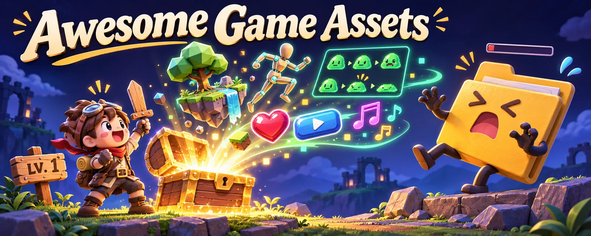

# Awesome Game Assets（ゲーム素材ガイド）

[English](README.md) · [简体中文](README.zh-CN.md) · [繁體中文](README.zh-TW.md) · **日本語** · [한국어](README.ko.md)

オリジナルイラスト：最初の剣を装備。素材のお宝をアンロック。

ゲーム素材とツールを、利用条件の制限も含めたライセンス情報とともに厳選。3D モデル、スプライト、テクスチャ、効果音、VFX、アビリティ・詠唱デモ、アニメーション、エディターを収録しています。各項目に URL、公開元で確認したライセンス、用途を掲載しています。

> ⚠️ 海賊版、クラック、有料素材の無断再配布、スターの不正獲得、マルウェアが疑われるリポジトリは、回避のため [警告一覧（英語）](WARNING.md) に分けて掲載しています。利用しないでください。

## 目次

**[素材の表を見る](#3d-モデル2d-スプライト)** · [貢献する](CONTRIBUTING.md)

各分類は最初の 15 件を表示し、残りは展開できます。GitHub リポジトリは累計スター数順（2026-11-12 時点）で、比較可能なデータのないサイトはその後に表示します。最近の伸び率ではありません。[並び順の説明](docs/discovery.md)。

スマートフォンでは表を左右にスワイプして、プロジェクト・利用条件・用途を比較できます。

- [3D モデル・2D スプライト](#3d-モデル2d-スプライト)
- [UI・アイコン・HUD](#uiアイコンhud)
- [テクスチャ・マテリアル](#テクスチャマテリアル)
- [効果音・オーディオ](#効果音オーディオ)
- [フォント](#フォント)
- [VFX・パーティクル・シェーダー](#vfxパーティクルシェーダー)
- [アビリティ・詠唱・戦闘デモ](#アビリティ詠唱戦闘デモ)
- [アニメーション・モーションキャプチャー](#アニメーションモーションキャプチャー)
- [物理](#物理)
- [ゲーム AI・経路探索](#ゲーム-ai経路探索)
- [プロシージャル生成](#プロシージャル生成)
- [エンジン・フレームワーク](#エンジンフレームワーク)
- [ツール・制作パイプライン](#ツール制作パイプライン)
- [AI 素材生成・Agent Skill](#ai-素材生成agent-skill)
- [厳選リスト・設計資料](#厳選リスト設計資料)

## 掲載基準

- プロジェクトまたは公式サイトにライセンスが明記された公開元のみ掲載します。素材ごとのライセンスはその旨を表示しているため、使用前に個別に確認してください。
- 海賊版、クラック、スターの不正獲得が見られるリポジトリは掲載しません。スター、フォーク、活動状況を確認し、アーカイブ済みまたは利用不能なものも除外します。
- 自動チェックではリンク切れ、ボット対策による遮断、タイムアウトを報告します。警告があることは、アクセスできると確認済みであることを意味しません。
- ライセンスの確認日：2026-11-12。GitHub API の `license` フィールド、または各行からリンクした公式ライセンスページを確認しました。
- プレビューは元のプロジェクトの画像を出典付きで参照しています。ここでの表示は再利用の許諾ではありません。リンク先の素材利用条件を確認してください。ヘッダー・分類用イラストは生成画像です。原画像が見つからない場合は明記し、架空の成果画像で代用しません。

## 3D モデル・2D スプライト

| プロジェクト / プレビュー | 利用条件 | 用途 |
| --- | --- | --- |
| [dicebear/dicebear](https://github.com/dicebear/dicebear)  画像の出典： [dicebear/dicebear](https://www.dicebear.com) GitHub ★ 10,068 | 素材・部品ごとに利用条件を確認 ([MIT (code; avatar styles have their own licenses)](https://github.com/dicebear/dicebear)) | シードから多様なスタイルの SVG アバターを生成するライブラリ。スタイルごとのライセンスを要確認。 |
| [vrm-c/UniVRM](https://github.com/vrm-c/UniVRM)  画像の出典： [vrm-c/UniVRM](https://vrm.dev/en) GitHub ★ 3,421 | 商用利用・改変可。必要な著作権・ライセンス表示を残す ([MIT](https://github.com/vrm-c/UniVRM)) | glTF ベースの VRM 人型アバターを Unity で読み書き。揺れ物ボーンと表情に対応。 |
| [LiberatedPixelCup/Universal-LPC-Spritesheet-Character-Generator](https://github.com/LiberatedPixelCup/Universal-LPC-Spritesheet-Character-Generator)  画像の出典： [LiberatedPixelCup/Universal-LPC-Spritesheet-Character-Generator](https://github.com/LiberatedPixelCup/Universal-LPC-Spritesheet-Character-Generator) 参考一覧： [Calinou/awesome-gamedev](https://github.com/Calinou/awesome-gamedev) GitHub ★ 2,003 | 素材・部品ごとに利用条件を確認 ([GPL-3.0 (code); art per asset (CC0 / CC-BY / CC-BY-SA / OGA-BY / GPL)](https://github.com/LiberatedPixelCup/Universal-LPC-Spritesheet-Character-Generator#licensing-and-attribution-credits)) | 歩行・斬撃・詠唱アニメーションを備えた RPG キャラクターのレイヤー式スプライトシートをブラウザーで生成。クレジットファイルも出力。 |
| [makehumancommunity/makehuman](https://github.com/makehumancommunity/makehuman) [利用できる原プレビューなし · プロジェクトを開く](https://github.com/makehumancommunity/makehuman) GitHub ★ 1,646 | 素材は商用可・クレジット不要。コードは AGPL の義務あり ([AGPL-3.0 (code) / CC0-1.0 (bundled assets)](https://github.com/makehumancommunity/makehuman)) | パラメーターで調整できる 3D 人物作成ツール。書き出したキャラクターと同梱素材は CC0。 |
| [sparklinlabs/superpowers-asset-packs](https://github.com/sparklinlabs/superpowers-asset-packs)  画像の出典： [sparklinlabs/superpowers-asset-packs](https://github.com/sparklinlabs/superpowers-asset-packs) GitHub ★ 1,280 | 商用利用・改変可。クレジット不要 ([CC0-1.0](https://github.com/sparklinlabs/superpowers-asset-packs)) | Superpowers エンジンの CC0 素材集。キャラクター、乗り物、背景、シューティング、プラットフォーマー向けの 2D・3D 素材を収録。 |
| [KhronosGroup/glTF-Sample-Assets](https://github.com/KhronosGroup/glTF-Sample-Assets)  画像の出典： [KhronosGroup/glTF-Sample-Assets](https://github.com/KhronosGroup/glTF-Sample-Assets) GitHub ★ 1,154 | 素材・部品ごとに利用条件を確認 ([Per model (mostly CC0 / CC-BY-4.0; a few under custom terms, see REUSE.toml)](https://github.com/KhronosGroup/glTF-Sample-Assets/tree/main/LICENSES)) | ローダー、PBR マテリアル、エンジンへのインポート処理を検証するための glTF 参照モデル。 |
| [umasteeringgroup/UMA](https://github.com/umasteeringgroup/UMA)  画像の出典： [umasteeringgroup/UMA](https://github.com/umasteeringgroup/UMA) プロジェクトのロゴ等であり、素材の完成例ではありません GitHub ★ 876 | 商用利用・改変可。必要な著作権・ライセンス表示を残す ([MIT](https://github.com/umasteeringgroup/UMA)) | Unity Multipurpose Avatar。衣装交換、DNA パラメーターによる体型調整、テクスチャアトラスを備えたカスタマイズ可能なキャラクター。 |
| [PolygonalMind/initiative-opensource-release](https://github.com/PolygonalMind/initiative-opensource-release)  画像の出典： [PolygonalMind/initiative-opensource-release](https://raw.githubusercontent.com/PolygonalMind/initiative-opensource-release/master/README.md) GitHub ★ 41 | 商用利用・改変可。クレジット不要 ([CC0-1.0](https://github.com/PolygonalMind/initiative-opensource-release)) | Polygonal Mind が CC0 で公開する素材。100 Avatars のキャラクターパックや 3D 環境を収録。 |
| [Kenney Game Assets](https://kenney.nl/assets)  画像の出典： [Kenney Game Assets](https://kenney.nl/assets) 比較可能な人気指標なし | 商用利用・改変可。クレジット不要 ([CC0-1.0](https://kenney.nl/support)) | 統一感のある 2D スプライト、UI、3D モデル、音素材が数千点。試作やゲームジャムに最適。 |
| [Quaternius](https://quaternius.com/)  画像の出典： [Quaternius](https://quaternius.com/) 比較可能な人気指標なし | 商用利用・改変可。クレジット不要 ([CC0-1.0](https://quaternius.com/faq.html)) | キャラクター、自然、建物、武器などのローポリ 3D 素材を FBX/OBJ/glTF で提供。無料パックは CC0。 |
| [OpenGameArt.org](https://opengameart.org/)  画像の出典： [OpenGameArt.org](https://opengameart.org/content/tilesets-base-rpg-2d) 比較可能な人気指標なし | 素材・部品ごとに利用条件を確認 ([Per asset (CC0 / CC-BY / CC-BY-SA / GPL / OGA-BY)](https://opengameart.org/content/faq)) | 2D・3D 素材、音楽、効果音を集めたコミュニティライブラリ。各素材ページのライセンスを使用前に確認。 |
| [Polyfork](https://polyfork.dev/assets)  画像の出典： [Polyfork](https://polyfork.dev/assets) 比較可能な人気指標なし | ローポリはクレジット表記または Polyfork 条項を選択。HD・モジュールは別条件 ([Free low-poly meshes: CC-BY-4.0 or Polyfork licence (your choice); ES modules and HD editions: Polyfork licence only](https://polyfork.dev/licensing)) | 3,000 点以上の無料ローポリ 3D モデルを GLB と three.js の ES モジュールで提供。CC BY に従い Polyfork をクレジットするか、ファイル再配布不可のクレジット不要ライセンスを選択。有料プランでは HD 版も利用可能。 |
| [The Base Mesh](https://www.thebasemesh.com/)  画像の出典： [The Base Mesh](https://www.thebasemesh.com/) 参考一覧： [madjin/awesome-cc0](https://github.com/madjin/awesome-cc0) 比較可能な人気指標なし | 商用利用・改変可。クレジット不要 ([CC0-1.0](https://www.thebasemesh.com/)) | 実寸スケールのベースメッシュを 1,250 点以上収録。グレーボックス、スカルプト、試作に。 |
| [Kenney Modular Characters](https://kenney.nl/assets/modular-characters)  画像の出典： [Kenney Modular Characters](https://kenney.nl/assets/modular-characters) 比較可能な人気指標なし | 商用利用・改変可。クレジット不要 ([CC0-1.0](https://kenney.nl/assets/modular-characters)) | 組み合わせて多彩な見下ろし・横視点キャラクターを作れるモジュール式 2D パーツ。 |
| [Kenney Roguelike Characters](https://kenney.nl/assets/roguelike-characters)  画像の出典： [Kenney Roguelike Characters](https://kenney.nl/assets/roguelike-characters) 比較可能な人気指標なし | 商用利用・改変可。クレジット不要 ([CC0-1.0](https://kenney.nl/assets/roguelike-characters)) | 装備や衣装を含む、16x16 ピクセルのローグライク用キャラクタースプライト。 |

残り 12 件を表示

| プロジェクト / プレビュー | 利用条件 | 用途 |
| --- | --- | --- |
| [Kenney Platformer Characters](https://kenney.nl/assets/platformer-characters)  画像の出典： [Kenney Platformer Characters](https://kenney.nl/assets/platformer-characters) 比較可能な人気指標なし | 商用利用・改変可。クレジット不要 ([CC0-1.0](https://kenney.nl/assets/platformer-characters)) | 歩行、ジャンプなどのポーズを備えた横視点プラットフォーマー用キャラクター。 |
| [Kenney Toon Characters](https://kenney.nl/assets/toon-characters)  画像の出典： [Kenney Toon Characters](https://kenney.nl/assets/toon-characters) 比較可能な人気指標なし | 商用利用・改変可。クレジット不要 ([CC0-1.0](https://kenney.nl/assets/toon-characters)) | カジュアルゲーム向けの、複数ポーズを持つカートゥーン調 2D キャラクター。 |
| [Quaternius Universal Base Characters](https://quaternius.com/packs/universalbasecharacters.html)  画像の出典： [Quaternius Universal Base Characters](https://quaternius.com/packs/universalbasecharacters.html) 比較可能な人気指標なし | 商用利用・改変可。クレジット不要 ([CC0-1.0](https://quaternius.com/packs/universalbasecharacters.html)) | Quaternius の共通アニメーションライブラリに対応する、リグ付きローポリベースキャラクター。 |
| [Quaternius Modular Character Outfits - Fantasy](https://quaternius.com/packs/modularcharacteroutfitsfantasy.html)  画像の出典： [Quaternius Modular Character Outfits - Fantasy](https://quaternius.com/packs/modularcharacteroutfitsfantasy.html) 比較可能な人気指標なし | 商用利用・改変可。クレジット不要 ([CC0-1.0](https://quaternius.com/packs/modularcharacteroutfitsfantasy.html)) | Quaternius のベースキャラクター用に組み合わせられる鎧、ローブ、帽子などのファンタジー衣装。 |
| [Liberated Pixel Cup (LPC) Base Assets](https://opengameart.org/content/liberated-pixel-cup-lpc-base-assets-sprites-map-tiles)  画像の出典： [Liberated Pixel Cup (LPC) Base Assets](https://opengameart.org/content/liberated-pixel-cup-lpc-base-assets-sprites-map-tiles) 比較可能な人気指標なし | 商用利用可。クレジット必須、改変物も同じ条件で公開 ([CC-BY-SA-3.0 / GPL-3.0](https://opengameart.org/content/liberated-pixel-cup-lpc-base-assets-sprites-map-tiles)) | Liberated Pixel Cup の基本スプライトとマップタイル。大規模な LPC キャラクター素材群の基盤。 |
| [Kenney Pixel Platformer](https://kenney.nl/assets/pixel-platformer)  画像の出典： [Kenney Pixel Platformer](https://kenney.nl/assets/pixel-platformer) 比較可能な人気指標なし | 商用利用・改変可。クレジット不要 ([CC0-1.0](https://kenney.nl/assets/pixel-platformer)) | 18x18 ピクセルのプラットフォーマー用タイル、キャラクター、アイテム。 |
| [Kenney 1-Bit Pack](https://kenney.nl/assets/1-bit-pack)  画像の出典： [Kenney 1-Bit Pack](https://kenney.nl/assets/1-bit-pack) 比較可能な人気指標なし | 商用利用・改変可。クレジット不要 ([CC0-1.0](https://kenney.nl/assets/1-bit-pack)) | ダンジョン、街、SF などに使える 16x16 の 1 ビットタイルを 1,000 点以上収録。 |
| [Kenney Tiny Dungeon](https://kenney.nl/assets/tiny-dungeon)  画像の出典： [Kenney Tiny Dungeon](https://kenney.nl/assets/tiny-dungeon) 比較可能な人気指標なし | 商用利用・改変可。クレジット不要 ([CC0-1.0](https://kenney.nl/assets/tiny-dungeon)) | 16x16 の小さなダンジョンタイル、ヒーロー、モンスター。 |
| [Kenney Tiny Town](https://kenney.nl/assets/tiny-town)  画像の出典： [Kenney Tiny Town](https://kenney.nl/assets/tiny-town) 比較可能な人気指標なし | 商用利用・改変可。クレジット不要 ([CC0-1.0](https://kenney.nl/assets/tiny-town)) | 家、柵、自然を収録した 16x16 の小さな街タイル。 |
| [16x16 DungeonTileset II](https://0x72.itch.io/dungeontileset-ii)  画像の出典： [16x16 DungeonTileset II](https://0x72.itch.io/dungeontileset-ii) 比較可能な人気指標なし | 素材は商用可・クレジット不要。コードは MIT の表示を保持 ([CC0-1.0 (assets) / MIT (code)](https://0x72.itch.io/dungeontileset-ii)) | アニメーション付きキャラクター、モンスター、武器を含む 16x16 ダンジョンタイルセット。 |
| [16x16 Fantasy tileset](https://opengameart.org/content/16x16-fantasy-tileset)  画像の出典： [16x16 Fantasy tileset](https://opengameart.org/content/16x16-fantasy-tileset) 比較可能な人気指標なし | 商用利用可。クレジット必須、改変物も同じ条件で公開 ([CC-BY-SA-3.0](https://opengameart.org/content/16x16-fantasy-tileset)) | ゲームボーイ・ファミコン風のローグライクや RPG 向けの小型キャラクターとファンタジーアイテム。 |
| [A Blocky Dungeon](https://opengameart.org/content/a-blocky-dungeon)  画像の出典： [A Blocky Dungeon](https://opengameart.org/content/a-blocky-dungeon) 比較可能な人気指標なし | 商用利用・改変可。クレジット不要 ([CC0-1.0](https://opengameart.org/content/a-blocky-dungeon)) | 扉、スイッチ、動く小物を含むブロック調 16x16 ダンジョンタイル。キャラクターは含まない。 |

## UI・アイコン・HUD

| プロジェクト / プレビュー | 利用条件 | 用途 |
| --- | --- | --- |
| [ocornut/imgui](https://github.com/ocornut/imgui)  画像の出典： [ocornut/imgui](https://github.com/ocornut/imgui) GitHub ★ 77,076 | 商用利用・改変可。必要な著作権・ライセンス表示を残す ([MIT](https://github.com/ocornut/imgui)) | デバッグメニュー、ゲーム内ツール、エディター向けの即時モード GUI ライブラリ Dear ImGui。 |
| [emilk/egui](https://github.com/emilk/egui)  画像の出典： [emilk/egui](https://github.com/emilk/egui) プロジェクトのロゴ等であり、素材の完成例ではありません GitHub ★ 32,236 | 商用利用・改変可。必要な著作権・ライセンス表示を残す ([MIT OR Apache-2.0](https://github.com/emilk/egui)) | ネイティブと Web で動く扱いやすい Rust 即時モード GUI。Rust のゲーム開発ツールでもよく使われる。 |
| [facebook/yoga](https://github.com/facebook/yoga)  画像の出典： [facebook/yoga](https://yogalayout.dev/) プロジェクトのロゴ等であり、素材の完成例ではありません GitHub ★ 18,951 | 商用利用・改変可。必要な著作権・ライセンス表示を残す ([MIT](https://github.com/facebook/yoga)) | 組み込み可能な Flexbox レイアウトエンジン。C++、C#、JavaScript のゲーム UI に活用可能。 |
| [nicbarker/clay](https://github.com/nicbarker/clay)  画像の出典： [nicbarker/clay](https://github.com/nicbarker/clay) GitHub ★ 18,405 | 商用利用・改変可。必要な著作権・ライセンス表示を残す ([Zlib](https://github.com/nicbarker/clay)) | Flexbox 風レイアウトとレンダラー非依存の出力を備えた、高性能な C 製 UI レイアウトライブラリ。 |
| [Immediate-Mode-UI/Nuklear](https://github.com/Immediate-Mode-UI/Nuklear)  画像の出典： [Immediate-Mode-UI/Nuklear](https://github.com/Immediate-Mode-UI/Nuklear) GitHub ★ 11,506 | 商用利用・改変可。必要な著作権・ライセンス表示を残す ([MIT or Unlicense](https://github.com/Immediate-Mode-UI/Nuklear)) | ツールやゲーム内メニュー向けの、単一ヘッダー ANSI C 即時モード GUI。 |
| [epezent/implot](https://github.com/epezent/implot)  画像の出典： [epezent/implot](https://github.com/epezent/implot) GitHub ★ 6,275 | 商用利用・改変可。必要な著作権・ライセンス表示を残す ([MIT](https://github.com/epezent/implot)) | Dear ImGui 用の即時モードグラフ描画。プロファイラーやデバッググラフに。 |
| [memononen/nanovg](https://github.com/memononen/nanovg)  画像の出典： [memononen/nanovg](https://github.com/memononen/nanovg) GitHub ★ 5,738 | 商用利用・改変可。必要な著作権・ライセンス表示を残す ([Zlib](https://github.com/memononen/nanovg)) | OpenGL 上でアンチエイリアス付き 2D ベクター描画を行うライブラリ。UI や可視化に。 |
| [wjakob/nanogui](https://github.com/wjakob/nanogui)  画像の出典： [wjakob/nanogui](https://github.com/wjakob/nanogui/blob/master/README.rst) GitHub ★ 4,865 | 商用利用・改変可。必要な著作権・ライセンス表示を残す ([BSD-3-Clause](https://github.com/wjakob/nanogui)) | OpenGL 向けのミニマルな C++/Python GUI ライブラリ。手早いツールパネル作成に便利。 |
| [mikke89/RmlUi](https://github.com/mikke89/RmlUi)  画像の出典： [mikke89/RmlUi](https://github.com/mikke89/RmlUi) プロジェクトのロゴ等であり、素材の完成例ではありません GitHub ★ 4,620 | 商用利用・改変可。必要な著作権・ライセンス表示を残す ([MIT](https://github.com/mikke89/RmlUi)) | HTML/CSS に似た文書から UI を構築する C++ ゲーム UI ライブラリ。データバインディングとアニメーションに対応。 |
| [CedricGuillemet/ImGuizmo](https://github.com/CedricGuillemet/ImGuizmo)  画像の出典： [CedricGuillemet/ImGuizmo](https://github.com/CedricGuillemet/ImGuizmo) 参考一覧： [Calinou/awesome-gamedev](https://github.com/Calinou/awesome-gamedev) GitHub ★ 4,061 | 商用利用・改変可。必要な著作権・ライセンス表示を残す ([MIT](https://github.com/CedricGuillemet/ImGuizmo)) | Dear ImGui 用の即時モード 3D ギズモ。移動・回転・拡縮や各種エディター操作を提供。 |
| [vladbat00/bevy_egui](https://github.com/vladbat00/bevy_egui)  画像の出典： [vladbat00/bevy_egui](https://github.com/vladbat00/bevy_egui) GitHub ★ 1,440 | 商用利用・改変可。必要な著作権・ライセンス表示を残す ([MIT](https://github.com/vladbat00/bevy_egui)) | egui を Bevy に統合し、デバッグパネルやゲーム内エディターを作成。 |
| [ebitenui/ebitenui](https://github.com/ebitenui/ebitenui)  画像の出典： [ebitenui/ebitenui](https://github.com/ebitenui/ebitenui) GitHub ★ 947 | 商用利用・改変可。必要な著作権・ライセンス表示を残す ([MIT](https://github.com/ebitenui/ebitenui)) | Go の Ebitengine ゲーム向け UI エンジンとウィジェットライブラリ。 |
| [Game-icons.net](https://game-icons.net/)  画像の出典： [Game-icons.net](https://game-icons.net/) 参考一覧： [Calinou/awesome-gamedev](https://github.com/Calinou/awesome-gamedev) 比較可能な人気指標なし | 商用利用可。クレジット表記が必要 ([CC-BY-3.0](https://game-icons.net/about.html)) | スキル、アイテム、状態異常などの無料 SVG/PNG ゲームアイコンを 4,000 点以上収録。各作者のクレジットが必要。 |
| [Those Awesome Guys: Controller & Keyboard Prompts](https://thoseawesomeguys.com/prompts/) [利用できる原プレビューなし · プロジェクトを開く](https://thoseawesomeguys.com/prompts/) 参考一覧： [Calinou/awesome-gamedev](https://github.com/Calinou/awesome-gamedev) 比較可能な人気指標なし | 商用利用・改変可。クレジット不要 ([CC0-1.0](https://thoseawesomeguys.com/prompts/)) | キーボード、マウス、一般的なコントローラーの操作ボタンアイコン。チュートリアルや操作ガイドに。 |
| [Kenney UI Pack](https://kenney.nl/assets/ui-pack)  画像の出典： [Kenney UI Pack](https://kenney.nl/assets/ui-pack) 比較可能な人気指標なし | 商用利用・改変可。クレジット不要 ([CC0-1.0](https://kenney.nl/assets/ui-pack)) | ボタン、スライダー、パネルなど 430 点の UI 素材を複数色で収録。メニューや HUD に。 |

残り 5 件を表示

| プロジェクト / プレビュー | 利用条件 | 用途 |
| --- | --- | --- |
| [Kenney Crosshair Pack](https://kenney.nl/assets/crosshair-pack)  画像の出典： [Kenney Crosshair Pack](https://kenney.nl/assets/crosshair-pack) 比較可能な人気指標なし | 商用利用・改変可。クレジット不要 ([CC0-1.0](https://kenney.nl/assets/crosshair-pack)) | シューティングゲームや照準 UI 向けのクロスヘア・照準スプライト集。 |
| [Kenney Cursor Pack](https://kenney.nl/assets/cursor-pack)  画像の出典： [Kenney Cursor Pack](https://kenney.nl/assets/cursor-pack) 比較可能な人気指標なし | 商用利用・改変可。クレジット不要 ([CC0-1.0](https://kenney.nl/assets/cursor-pack)) | ゲームメニューやストラテジーゲーム向けのマウスカーソル・ポインターアイコン。 |
| [Kenney UI Pack (RPG Expansion)](https://kenney.nl/assets/ui-pack-rpg-expansion)  画像の出典： [Kenney UI Pack (RPG Expansion)](https://kenney.nl/assets/ui-pack-rpg-expansion) 比較可能な人気指標なし | 商用利用・改変可。クレジット不要 ([CC0-1.0](https://kenney.nl/assets/ui-pack-rpg-expansion)) | パネル、バー、ボタン、フレームなどの RPG 風 UI 素材。 |
| [RPG GUI construction kit v1.0](https://opengameart.org/content/rpg-gui-construction-kit-v10)  画像の出典： [RPG GUI construction kit v1.0](https://opengameart.org/content/rpg-gui-construction-kit-v10) 比較可能な人気指標なし | 商用利用可。クレジット表記が必要 ([CC-BY-3.0](https://opengameart.org/content/rpg-gui-construction-kit-v10)) | フレーム、バー、ボタンを組み合わせてファンタジー風メニューを作る RPG GUI キット。 |
| [Sci-fi User Interface](https://opengameart.org/content/sci-fi-user-interface)  画像の出典： [Sci-fi User Interface](https://opengameart.org/content/sci-fi-user-interface) 比較可能な人気指標なし | 商用利用・改変可。クレジット不要 ([CC0-1.0](https://opengameart.org/content/sci-fi-user-interface)) | 未来的な HUD やメニュー向けの SF 調 UI パーツ。 |

## テクスチャ・マテリアル

| プロジェクト / プレビュー | 利用条件 | 用途 |
| --- | --- | --- |
| [armory3d/armorpaint](https://github.com/armory3d/armorpaint)  画像の出典： [armory3d/armorpaint](https://github.com/armory3d/armorpaint) GitHub ★ 5,485 | 商用利用・改変可。必要な著作権・ライセンス表示を残す ([Zlib](https://github.com/armory3d/armorpaint)) | モデルに PBR テクスチャを描く 3D ペイントツール。ソースコードを公開し、ビルド済みバイナリは別売り。 |
| [kmkolasinski/AwesomeBump](https://github.com/kmkolasinski/AwesomeBump)  画像の出典： [kmkolasinski/AwesomeBump](https://github.com/kmkolasinski/AwesomeBump) 参考一覧： [Calinou/awesome-gamedev](https://github.com/Calinou/awesome-gamedev) 参考一覧： [madjin/awesome-cc0](https://github.com/madjin/awesome-cc0) GitHub ★ 1,785 | 商用利用可。対象コードの配布時は条件に従いソースを公開 ([GPL-3.0](https://github.com/kmkolasinski/AwesomeBump)) | 1 枚の画像から法線、高さ、スペキュラー、AO、粗さ、メタリックの各マップを生成。最終更新は 2023 年。 |
| [azagaya/laigter](https://github.com/azagaya/laigter)  画像の出典： [azagaya/laigter](https://raw.githubusercontent.com/azagaya/laigter/master/README.md) GitHub ★ 1,402 | 商用利用可。対象コードの配布時は条件に従いソースを公開 ([GPL-3.0](https://github.com/azagaya/laigter)) | 2D スプライトから法線、スペキュラー、オクルージョンマップを生成し、動的ライティングに活用。 |
| [Poly Haven](https://polyhaven.com/)  画像の出典： [Poly Haven](https://polyhaven.com/) 比較可能な人気指標なし | 商用利用・改変可。クレジット不要 ([CC0-1.0](https://polyhaven.com/license)) | 高品質な PBR テクスチャ、HDRI、写真測量モデル。写実的なシーンやライティングに最適。 |
| [ambientCG](https://ambientcg.com/) [利用できる原プレビューなし · プロジェクトを開く](https://ambientcg.com/) 比較可能な人気指標なし | 商用利用・改変可。クレジット不要 ([CC0-1.0](https://docs.ambientcg.com/license/)) | PBR マテリアル、HDRI、モデルを複数解像度で提供する大規模な CC0 ライブラリ。 |

## 効果音・オーディオ

| プロジェクト / プレビュー | 利用条件 | 用途 |
| --- | --- | --- |
| [goldfire/howler.js](https://github.com/goldfire/howler.js)  画像の出典： [goldfire/howler.js](https://github.com/goldfire/howler.js) プロジェクトのロゴ等であり、素材の完成例ではありません GitHub ★ 25,443 | 商用利用・改変可。必要な著作権・ライセンス表示を残す ([MIT](https://github.com/goldfire/howler.js)) | Web ゲーム向け JavaScript 音声ライブラリ。オーディオスプライト、空間音響、ブラウザー間互換再生に対応。 |
| [Tonejs/Tone.js](https://github.com/Tonejs/Tone.js) [利用できる原プレビューなし · プロジェクトを開く](https://github.com/Tonejs/Tone.js) GitHub ★ 14,897 | 商用利用・改変可。必要な著作権・ライセンス表示を残す ([MIT](https://github.com/Tonejs/Tone.js)) | ブラウザーでシンセサイザー、エフェクト、再生スケジュールを扱う、インタラクティブ音楽向け Web Audio フレームワーク。 |
| [mackron/miniaudio](https://github.com/mackron/miniaudio)  画像の出典： [mackron/miniaudio](https://github.com/mackron/miniaudio) プロジェクトのロゴ等であり、素材の完成例ではありません GitHub ★ 7,615 | 商用利用・改変可。必要な著作権・ライセンス表示を残す ([Unlicense or MIT-0 (your choice)](https://github.com/mackron/miniaudio)) | ミキシングとエフェクトを備えた単一ファイルの C 音声再生・録音ライブラリ。エンジンに組み込みやすい。 |
| [surge-synthesizer/surge](https://github.com/surge-synthesizer/surge)  画像の出典： [surge-synthesizer/surge](https://surge-synthesizer.github.io/) GitHub ★ 4,116 | 商用利用可。対象コードの配布時は条件に従いソースを公開 ([GPL-3.0](https://github.com/surge-synthesizer/surge)) | ゲーム音楽や効果音の制作に使える高機能なオープンソースシンセサイザー Surge XT。 |
| [tildearrow/furnace](https://github.com/tildearrow/furnace)  画像の出典： [tildearrow/furnace](https://github.com/tildearrow/furnace) GitHub ★ 3,912 | 商用利用可。対象コードの配布時は条件に従いソースを公開 ([GPL-2.0-or-later](https://github.com/tildearrow/furnace)) | 数十種の往年の音源チップをエミュレートする、複数システム対応のチップチューントラッカー。 |
| [ValveSoftware/steam-audio](https://github.com/ValveSoftware/steam-audio) [利用できる原プレビューなし · プロジェクトを開く](https://github.com/ValveSoftware/steam-audio) GitHub ★ 3,006 | 商用利用・改変可。必要な著作権・ライセンス表示を残す ([Apache-2.0](https://github.com/ValveSoftware/steam-audio)) | HRTF、遮蔽、物理ベースの残響を備えた空間音響 SDK。Unity、Unreal、FMOD 用プラグインを提供。 |
| [kcat/openal-soft](https://github.com/kcat/openal-soft) [利用できる原プレビューなし · プロジェクトを開く](https://github.com/kcat/openal-soft) GitHub ★ 2,775 | 商用利用可。配布時はライブラリの変更・ソース提供等の条件を守る ([LGPL-2.0-or-later](https://github.com/kcat/openal-soft)) | OpenAL 3D オーディオ API のソフトウェア実装。HRTF とサラウンド出力に対応。 |
| [jarikomppa/soloud](https://github.com/jarikomppa/soloud)  画像の出典： [jarikomppa/soloud](https://github.com/jarikomppa/soloud) プロジェクトのロゴ等であり、素材の完成例ではありません GitHub ★ 2,195 | 商用利用・改変可。必要な著作権・ライセンス表示を残す ([Zlib](https://github.com/jarikomppa/soloud)) | 3D 音響、フィルター、音声合成を備えた、扱いやすく移植性の高い C++ ゲーム用音声エンジン。 |
| [milkytracker/MilkyTracker](https://github.com/milkytracker/MilkyTracker)  画像の出典： [milkytracker/MilkyTracker](https://github.com/milkytracker/MilkyTracker) GitHub ★ 2,132 | 商用利用可。対象コードの配布時は条件に従いソースを公開 ([GPL-3.0 (MilkyPlay library: BSD-3-Clause)](https://github.com/milkytracker/MilkyTracker)) | MOD/XM のチップチューンやゲーム音楽を作る、FastTracker II 互換の音楽トラッカー。 |
| [tesselode/kira](https://github.com/tesselode/kira) [利用できる原プレビューなし · プロジェクトを開く](https://github.com/tesselode/kira) GitHub ★ 1,078 | 商用利用・改変可。必要な著作権・ライセンス表示を残す ([MIT OR Apache-2.0](https://github.com/tesselode/kira)) | 補間可能なパラメーター、ミキサートラック、クロック、エフェクトを備えた Rust ゲーム音声ライブラリ。 |
| [increpare/bfxr](https://github.com/increpare/bfxr) [利用できる原プレビューなし · プロジェクトを開く](https://github.com/increpare/bfxr) GitHub ★ 1,028 | 商用利用・改変可。必要な著作権・ライセンス表示を残す ([Apache-2.0 (stated in README)](https://github.com/increpare/bfxr#readme)) | ジャンプ、アイテム取得、爆発などのレトロな効果音を生成。sfxr の拡張版。 |
| [YuriSizov/boscaceoil-blue](https://github.com/YuriSizov/boscaceoil-blue)  画像の出典： [YuriSizov/boscaceoil-blue](https://yurisizov.itch.io/boscaceoil-blue) 参考一覧： [Calinou/awesome-gamedev](https://github.com/Calinou/awesome-gamedev) GitHub ★ 841 | 商用利用・改変可。必要な著作権・ライセンス表示を残す ([MIT](https://github.com/YuriSizov/boscaceoil-blue/blob/main/LICENSE)) | 初心者向けのステップシーケンサー式作曲ツール。Terry Cavanagh の Bosca Ceoil を現代化した移植版で、ゲーム用ループ曲やジングルに。 |
| [LabSound/LabSound](https://github.com/LabSound/LabSound)  画像の出典： [LabSound/LabSound](https://github.com/LabSound/LabSound) プロジェクトのロゴ等であり、素材の完成例ではありません GitHub ★ 795 | 商用利用・改変可。必要な著作権・ライセンス表示を残す ([BSD-2-Clause / BSD-3-Clause](https://github.com/LabSound/LabSound)) | WebKit の WebAudio から派生したグラフベース C++ 音声エンジン。ゲームやインタラクティブアプリ向け。 |
| [raysan5/rfxgen](https://github.com/raysan5/rfxgen)  画像の出典： [raysan5/rfxgen](https://github.com/raysan5/rfxgen) 参考一覧： [Calinou/awesome-gamedev](https://github.com/Calinou/awesome-gamedev) GitHub ★ 520 | 商用利用・改変可。必要な著作権・ライセンス表示を残す ([Zlib](https://github.com/raysan5/rfxgen)) | raylib 作者による小型の sfxr 風効果音生成ツール。デスクトップと Web に対応。 |
| [chr15m/jsfxr](https://github.com/chr15m/jsfxr)  画像の出典： [chr15m/jsfxr](https://github.com/chr15m/jsfxr) GitHub ★ 464 | 商用利用・改変可。クレジット不要 ([Unlicense](https://github.com/chr15m/jsfxr)) | ジャンプ、コイン、ヒット、レーザーなどのレトロな効果音をブラウザーで生成。sfxr の移植版。 |

残り 3 件を表示

| プロジェクト / プレビュー | 利用条件 | 用途 |
| --- | --- | --- |
| [Freesound](https://freesound.org/) [利用できる原プレビューなし · プロジェクトを開く](https://freesound.org/) 比較可能な人気指標なし | 素材・部品ごとに利用条件を確認 ([Per sound (CC0 / CC-BY-4.0 / CC-BY-NC-4.0)](https://freesound.org/help/faq/)) | 大規模なコミュニティ音素材ライブラリ。商用ゲームでは CC0 や CC-BY で絞り込み、必要に応じてクレジットを記載。 |
| [Sonniss #GameAudioGDC Bundles](https://sonniss.com/gameaudiogdc)  画像の出典： [Sonniss #GameAudioGDC Bundles](https://sonniss.com/gameaudiogdc) 比較可能な人気指標なし | 商用利用可・クレジット不要。素材単体の再配布不可 ([Royalty-free (Sonniss license: commercial use, no attribution required)](https://sonniss.com/gameaudiogdc)) | プロ仕様の効果音を毎年無料配布。商用ゲームでもロイヤリティフリーで利用可能。 |
| [Pixabay Sound Effects](https://pixabay.com/sound-effects/) [利用できる原プレビューなし · プロジェクトを開く](https://pixabay.com/sound-effects/) ⚠ 自動チェックではサイトが 403 を返します。ライセンスは手動で確認済み 比較可能な人気指標なし | 商用利用可。素材単体の転売不可 ([Pixabay Content License (free, no attribution; no standalone resale)](https://pixabay.com/service/license-summary/)) | Pixabay Content License で利用できる、ロイヤリティフリーの効果音・音楽ライブラリ。 |

## フォント

| プロジェクト / プレビュー | 利用条件 | 用途 |
| --- | --- | --- |
| [google/fonts](https://github.com/google/fonts) [利用できる原プレビューなし · プロジェクトを開く](https://github.com/google/fonts) GitHub ★ 20,754 | 素材・部品ごとに利用条件を確認 ([Per family (OFL-1.1 / Apache-2.0 / UFL)](https://github.com/google/fonts#license)) | Google Fonts の全フォントファミリーのソース。ライセンス名ごとのフォルダーに整理され、多くが日中韓文字に対応。 |
| [IdreesInc/Monocraft](https://github.com/IdreesInc/Monocraft)  画像の出典： [IdreesInc/Monocraft](https://github.com/IdreesInc/Monocraft) GitHub ★ 11,483 | 商用利用・埋め込み可。フォントのライセンスを保持し、単体販売は不可 ([OFL-1.1](https://github.com/IdreesInc/Monocraft)) | Minecraft の書体に着想を得た角ばった等幅フォント。プログラミング用合字に対応。 |
| [TakWolf/ark-pixel-font](https://github.com/TakWolf/ark-pixel-font)  画像の出典： [TakWolf/ark-pixel-font](https://github.com/TakWolf/ark-pixel-font) GitHub ★ 4,961 | 商用利用・埋め込み可。フォントのライセンスを保持し、単体販売は不可 ([OFL-1.1 (font) / MIT (build code)](https://github.com/TakWolf/ark-pixel-font)) | ピクセルアートゲーム向けのオープンフォント。日中韓文字とラテン文字に対応。 |
| [the-moonwitch/Cozette](https://github.com/the-moonwitch/Cozette)  画像の出典： [the-moonwitch/Cozette](https://github.com/the-moonwitch/Cozette) GitHub ★ 3,880 | 商用利用・改変可。必要な著作権・ライセンス表示を残す ([MIT](https://github.com/the-moonwitch/Cozette)) | 多数の文字を収録する小型ビットマップフォント。レトロな UI やターミナルに。 |
| [rektdeckard/departure-mono](https://github.com/rektdeckard/departure-mono)  画像の出典： [rektdeckard/departure-mono](https://github.com/rektdeckard/departure-mono) GitHub ★ 3,642 | 商用利用・埋め込み可。フォントのライセンスを保持し、単体販売は不可 ([OFL-1.1 (font) / MIT (site)](https://github.com/rektdeckard/departure-mono)) | HUD やターミナルに合う、レトロフューチャー調の等幅ピクセルフォント。 |
| [TakWolf/fusion-pixel-font](https://github.com/TakWolf/fusion-pixel-font)  画像の出典： [TakWolf/fusion-pixel-font](https://github.com/TakWolf/fusion-pixel-font) GitHub ★ 3,481 | 商用利用・埋め込み可。フォントのライセンスを保持し、単体販売は不可 ([OFL-1.1 (font) / MIT (build code)](https://github.com/TakWolf/fusion-pixel-font)) | 中国語、日本語、韓国語、ラテン文字に対応するオープンなピクセルフォント。8/10/12 px を用意。 |
| [fcambus/spleen](https://github.com/fcambus/spleen)  画像の出典： [fcambus/spleen](https://github.com/fcambus/spleen) GitHub ★ 1,421 | 商用利用・改変可。必要な著作権・ライセンス表示を残す ([BSD-2-Clause](https://github.com/fcambus/spleen)) | 5x8 から 32x64 までのサイズを揃えた等幅ビットマップフォント。くっきりしたピクセル UI に。 |
| [scott0107000/BoutiqueBitmap7x7](https://github.com/scott0107000/BoutiqueBitmap7x7)  画像の出典： [scott0107000/BoutiqueBitmap7x7](https://github.com/scott0107000/BoutiqueBitmap7x7) GitHub ★ 165 | 商用利用・埋め込み可。フォントのライセンスを保持し、単体販売は不可 ([OFL-1.1](https://github.com/scott0107000/BoutiqueBitmap7x7)) | 中国語、日本語、ラテン文字を収録するオープンソースの 7x7 ビットマップフォント。 |
| [sgigou/NF-Pixels](https://github.com/sgigou/NF-Pixels)  画像の出典： [sgigou/NF-Pixels](https://github.com/sgigou/NF-Pixels) GitHub ★ 32 | 商用利用・埋め込み可。フォントのライセンスを保持し、単体販売は不可 ([OFL-1.1](https://github.com/sgigou/NF-Pixels)) | レトロゲームの文字表示向けの無料ピクセルフォント。標準と太字を用意。 |
| [Kenney Fonts](https://kenney.nl/assets/kenney-fonts)  画像の出典： [Kenney Fonts](https://kenney.nl/assets/kenney-fonts) 比較可能な人気指標なし | 商用利用・改変可。クレジット不要 ([CC0-1.0](https://kenney.nl/assets/kenney-fonts)) | Kenney による遊び心のあるゲーム用フォント 11 種。どのプロジェクトでも無料で利用可能。 |
| [monogram](https://datagoblin.itch.io/monogram)  画像の出典： [monogram](https://datagoblin.itch.io/monogram) 比較可能な人気指標なし | 商用利用・改変可。クレジット不要 ([CC0-1.0](https://datagoblin.itch.io/monogram)) | 多様な文字に対応する無料の等幅ピクセルフォント monogram。 |
| [m5x7](https://managore.itch.io/m5x7)  画像の出典： [m5x7](https://managore.itch.io/m5x7) 比較可能な人気指標なし | 商用利用・改変可。クレジット不要 ([CC0-1.0](https://managore.itch.io/m5x7)) | Daniel Linssen による、小さくても読みやすいピクセルフォント m5x7。 |
| [Pixeloid](https://ggbot.itch.io/pixeloid-font)  画像の出典： [Pixeloid](https://ggbot.itch.io/pixeloid-font) 比較可能な人気指標なし | 商用利用・埋め込み可。フォントのライセンスを保持し、単体販売は不可 ([OFL-1.1](https://ggbot.itch.io/pixeloid-font)) | サンセリフ、等幅、太字を揃えたピクセルフォントファミリー Pixeloid。 |
| [The League of Moveable Type](https://www.theleagueofmoveabletype.com/)  画像の出典： [The League of Moveable Type](https://www.theleagueofmoveabletype.com/) 比較可能な人気指標なし | 商用利用・埋め込み可。フォントのライセンスを保持し、単体販売は不可 ([OFL-1.1](https://www.theleagueofmoveabletype.com/)) | すべて SIL Open Font License で公開するオープンソースの見出し用フォント制作集団。 |

## VFX・パーティクル・シェーダー

| プロジェクト / プレビュー | 利用条件 | 用途 |
| --- | --- | --- |
| [gdquest-demos/godot-shaders](https://github.com/gdquest-demos/godot-shaders)  画像の出典： [gdquest-demos/godot-shaders](https://github.com/gdquest-demos/godot-shaders) GitHub ★ 4,202 | 対象コンテンツ・重みは非商用限定。クレジット必須、改変物も同条件 ([MIT (code) / CC-BY-NC-SA-4.0 (art)](https://github.com/gdquest-demos/godot-shaders)) | ディゾルブ、輪郭線、水、トゥーンなどの Godot シェーダーデモ。読みやすいコードをオープンソースで公開。 |
| [pmndrs/postprocessing](https://github.com/pmndrs/postprocessing) [利用できる原プレビューなし · プロジェクトを開く](https://github.com/pmndrs/postprocessing) GitHub ★ 2,973 | 商用利用・改変可。必要な著作権・ライセンス表示を残す ([Zlib](https://github.com/pmndrs/postprocessing)) | ブルーム、被写界深度、SMAA、トーンマッピングなどを備えた three.js 用ポストプロセスライブラリ。 |
| [effekseer/Effekseer](https://github.com/effekseer/Effekseer)  画像の出典： [effekseer/Effekseer](https://github.com/effekseer/Effekseer) GitHub ★ 2,065 | 商用利用・改変可。必要な著作権・ライセンス表示を残す ([MIT](https://github.com/effekseer/Effekseer)) | パーティクルエフェクトのエディターとランタイム。Unity、Unreal、Godot、Web 用プラグインを提供。 |
| [CyberAgentGameEntertainment/NovaShader](https://github.com/CyberAgentGameEntertainment/NovaShader) [公開元で見る](https://github.com/CyberAgentGameEntertainment/NovaShader) GitHub ★ 1,672 | 商用利用・改変可。必要な著作権・ライセンス表示を残す ([MIT](https://github.com/CyberAgentGameEntertainment/NovaShader)) | 歪み、ディゾルブ、フローマップなどに対応する Unity URP 用の多目的パーティクルシェーダー。 |
| [djeedai/bevy_hanabi](https://github.com/djeedai/bevy_hanabi) [利用できる原プレビューなし · プロジェクトを開く](https://github.com/djeedai/bevy_hanabi) GitHub ★ 1,448 | 商用利用・改変可。必要な著作権・ライセンス表示を残す ([MIT OR Apache-2.0](https://github.com/djeedai/bevy_hanabi)) | 大量のパーティクルを扱う Bevy 用 GPU パーティクルシステムプラグイン。 |
| [Arnklit/Waterways](https://github.com/Arnklit/Waterways)  画像の出典： [Arnklit/Waterways](https://github.com/Arnklit/Waterways) GitHub ★ 1,351 | 商用利用・改変可。必要な著作権・ライセンス表示を残す ([MIT](https://github.com/Arnklit/Waterways)) | ベジェ曲線から川のメッシュを作り、フローと泡のマップをベイクする Godot アドオン。 |
| [gdquest-demos/godot-visual-effects](https://github.com/gdquest-demos/godot-visual-effects)  画像の出典： [gdquest-demos/godot-visual-effects](https://github.com/gdquest-demos/godot-visual-effects) GitHub ★ 1,348 | 対象コンテンツ・重みは非商用限定。クレジット必須、改変物も同条件 ([MIT (code) / CC-BY-NC-SA-4.0 (art)](https://github.com/gdquest-demos/godot-visual-effects)) | パーティクル、爆発、衝撃、魔法を学べる Godot のビジュアルエフェクトデモ集。 |
| [creativelifeform/three-nebula](https://github.com/creativelifeform/three-nebula)  画像の出典： [creativelifeform/three-nebula](https://three-nebula.org/) GitHub ★ 1,249 | 商用利用・改変可。必要な著作権・ライセンス表示を残す ([MIT](https://github.com/creativelifeform/three-nebula)) | three.js 向け WebGL パーティクルエンジン。炎、煙、魔法などのエミッターを JSON で定義。 |
| [Alchemist0823/three.quarks](https://github.com/Alchemist0823/three.quarks)  画像の出典： [Alchemist0823/three.quarks](https://github.com/Alchemist0823/three.quarks) GitHub ★ 1,199 | 商用利用・改変可。必要な著作権・ライセンス表示を残す ([MIT](https://github.com/Alchemist0823/three.quarks)) | ビジュアルエディターを備えた three.js 向け汎用パーティクルシステム・VFX エンジン。 |
| [pixijs-userland/particle-emitter](https://github.com/pixijs-userland/particle-emitter) [利用できる原プレビューなし · プロジェクトを開く](https://github.com/pixijs-userland/particle-emitter) GitHub ★ 853 | 商用利用・改変可。必要な著作権・ライセンス表示を残す ([MIT](https://github.com/pixijs-userland/particle-emitter)) | 炎、煙、火花などの 2D エフェクトを作る PixiJS パーティクルシステム。ビジュアルエディター付き。 |
| [Cyanilux/URP_ShaderGraphCustomLighting](https://github.com/Cyanilux/URP_ShaderGraphCustomLighting) [利用できる原プレビューなし · プロジェクトを開く](https://github.com/Cyanilux/URP_ShaderGraphCustomLighting) GitHub ★ 789 | 商用利用・改変可。必要な著作権・ライセンス表示を残す ([MIT](https://github.com/Cyanilux/URP_ShaderGraphCustomLighting)) | Unity URP Shader Graph 用のカスタムライティングサブグラフ。トゥーンやスタイライズド表現に便利。 |
| [wwwtyro/glsl-atmosphere](https://github.com/wwwtyro/glsl-atmosphere)  画像の出典： [wwwtyro/glsl-atmosphere](https://github.com/wwwtyro/glsl-atmosphere) GitHub ★ 634 | 商用利用・改変可。クレジット不要 ([Unlicense](https://github.com/wwwtyro/glsl-atmosphere)) | レイリー散乱とミー散乱で写実的な空を描く GLSL レンダラー。 |
| [stegu/webgl-noise](https://github.com/stegu/webgl-noise) [利用できる原プレビューなし · プロジェクトを開く](https://github.com/stegu/webgl-noise) GitHub ★ 599 | 商用利用・改変可。必要な著作権・ライセンス表示を残す ([MIT](https://github.com/stegu/webgl-noise)) | プロシージャルシェーダー向けの GLSL Simplex、Perlin、Cellular ノイズ関数。 |
| [haowg/GODOT-VFX-LIBRARY](https://github.com/haowg/GODOT-VFX-LIBRARY)  画像の出典： [haowg/GODOT-VFX-LIBRARY](https://github.com/haowg/GODOT-VFX-LIBRARY) GitHub ★ 358 | 商用利用・改変可。必要な著作権・ライセンス表示を残す ([MIT](https://github.com/haowg/GODOT-VFX-LIBRARY)) | Godot 4 のアクションゲーム向けパーティクル・シェーダー集。ヒット、斬撃、爆発、オーラなどを収録。 |
| [gdquest-demos/godot-4-stylized-sky](https://github.com/gdquest-demos/godot-4-stylized-sky)  画像の出典： [gdquest-demos/godot-4-stylized-sky](https://github.com/gdquest-demos/godot-4-stylized-sky) プロジェクトのロゴ等であり、素材の完成例ではありません GitHub ★ 311 | 対象コンテンツ・重みは非商用限定。クレジット必須、改変物も同条件 ([MIT (code) / CC-BY-NC-SA-4.0 (art)](https://github.com/gdquest-demos/godot-4-stylized-sky)) | 太陽、月、雲、星を備えた Godot 4 用のオープンソースなスタイライズド空シェーダー。 |

残り 4 件を表示

| プロジェクト / プレビュー | 利用条件 | 用途 |
| --- | --- | --- |
| [Chrisknyfe/boujie_water_shader](https://github.com/Chrisknyfe/boujie_water_shader)  画像の出典： [Chrisknyfe/boujie_water_shader](https://github.com/Chrisknyfe/boujie_water_shader) GitHub ★ 189 | 商用利用・改変可。必要な著作権・ライセンス表示を残す ([MIT](https://github.com/Chrisknyfe/boujie_water_shader)) | 波、泡、屈折を備えた Godot 4 用のスタイライズド水面シェーダー。 |
| [Kenney Particle Pack](https://kenney.nl/assets/particle-pack)  画像の出典： [Kenney Particle Pack](https://kenney.nl/assets/particle-pack) 比較可能な人気指標なし | 商用利用・改変可。クレジット不要 ([CC0-1.0](https://kenney.nl/assets/particle-pack)) | 煙、炎、火花、魔法など 80 点のパーティクル用スプライト。各種パーティクルシステムに組み込める。 |
| [JangaFX Free VDB Animations](https://jangafx.com/software/embergen/download/free-vdb-animations/)  画像の出典： [JangaFX Free VDB Animations](https://jangafx.com/) 参考一覧： [madjin/awesome-cc0](https://github.com/madjin/awesome-cc0) 比較可能な人気指標なし | 商用利用・改変可。クレジット不要 ([CC0-1.0](https://jangafx.com/software/embergen/download/free-vdb-animations/)) | 炎、煙、爆発の無料ボリュームシミュレーション素材（OpenVDB）。Blender、Houdini、オフラインレンダリングに。 |
| [Godot Shaders](https://godotshaders.com/)  画像の出典： [Godot Shaders](https://godotshaders.com/) 比較可能な人気指標なし | 素材・部品ごとに利用条件を確認 ([Per shader (CC0 / MIT / GPL-3.0); images not covered](https://godotshaders.com/license/)) | Godot シェーダーのコミュニティライブラリ。各投稿にライセンスを表示し、適用範囲はコードのみ。 |

## アビリティ・詠唱・戦闘デモ

| プロジェクト / プレビュー | 利用条件 | 用途 |
| --- | --- | --- |
| [tranek/GASDocumentation](https://github.com/tranek/GASDocumentation)  画像の出典： [tranek/GASDocumentation](https://github.com/tranek/GASDocumentation) GitHub ★ 5,995 | 商用利用・改変可。必要な著作権・ライセンス表示を残す ([MIT](https://github.com/tranek/GASDocumentation)) | Unreal Engine 5 の Gameplay Ability System を詳しく解説する非公式ガイド。UE 5.3 のマルチプレイヤーサンプル付き。 |
| [gdquest-demos/godot-open-rpg](https://github.com/gdquest-demos/godot-open-rpg)  画像の出典： [gdquest-demos/godot-open-rpg](https://github.com/gdquest-demos/godot-open-rpg) GitHub ★ 3,085 | 商用利用・改変可。必要な著作権・ライセンス表示を残す ([MIT](https://github.com/gdquest-demos/godot-open-rpg)) | ターン制戦闘、インベントリー、会話を学べるオープンソースの Godot RPG デモ。 |
| [achrefelouafi/LinearAbiltyCastingThreeJS](https://github.com/achrefelouafi/LinearAbiltyCastingThreeJS)  画像の出典： [achrefelouafi/LinearAbiltyCastingThreeJS](https://github.com/achrefelouafi/LinearAbiltyCastingThreeJS) GitHub ★ 1,201 | 商用利用・改変可。必要な著作権・ライセンス表示を残す ([MIT](https://github.com/achrefelouafi/LinearAbiltyCastingThreeJS)) | 照準矢印、ターゲット円、ビーム、ランス、隕石など、直線・遠距離スキルを HUD 付きで示す three.js デモ。 |
| [tranek/GASShooter](https://github.com/tranek/GASShooter) [利用できる原プレビューなし · プロジェクトを開く](https://github.com/tranek/GASShooter) GitHub ★ 1,174 | 商用利用・改変可。必要な著作権・ライセンス表示を残す ([MIT](https://github.com/tranek/GASShooter)) | 武器、アビリティ、予測処理を備えたマルチプレイヤー FPS/TPS。Unreal GAS の高度なサンプル。 |
| [No78Vino/gameplay-ability-system-for-unity](https://github.com/No78Vino/gameplay-ability-system-for-unity)  画像の出典： [No78Vino/gameplay-ability-system-for-unity](https://github.com/No78Vino/gameplay-ability-system-for-unity) GitHub ★ 857 | 商用利用・改変可。必要な著作権・ライセンス表示を残す ([MIT](https://github.com/No78Vino/gameplay-ability-system-for-unity)) | Unreal の Gameplay Ability System を Unity で実装。タグ、属性、効果、アビリティに対応するが、実装は一部で開発中。文書は中国語。 |
| [Narxim/Narxim-GAS-Example](https://github.com/Narxim/Narxim-GAS-Example)  画像の出典： [Narxim/Narxim-GAS-Example](https://github.com/Narxim/Narxim-GAS-Example) GitHub ★ 456 | 商用利用・改変可。必要な著作権・ライセンス表示を残す ([MIT](https://github.com/Narxim/Narxim-GAS-Example)) | 属性とアビリティを設定済みの、すっきりした Unreal Gameplay Ability System テンプレート。 |
| [gdquest-demos/godot-2d-jrpg-combat](https://github.com/gdquest-demos/godot-2d-jrpg-combat)  画像の出典： [gdquest-demos/godot-2d-jrpg-combat](https://github.com/gdquest-demos/godot-2d-jrpg-combat) GitHub ★ 319 | 商用利用可。クレジット表記が必要 ([MIT (code) / CC-BY-4.0 (art)](https://github.com/gdquest-demos/godot-2d-jrpg-combat)) | 行動順、スキル、UI を示す Godot の 2D JRPG アクティブタイムバトルデモ。 |
| [Pyxus/fray](https://github.com/Pyxus/fray)  画像の出典： [Pyxus/fray](https://github.com/Pyxus/fray) GitHub ★ 313 | 商用利用・改変可。必要な著作権・ライセンス表示を残す ([MIT](https://github.com/Pyxus/fray)) | 階層型状態機械、入力バッファー、ヒットボックス管理を備えた Godot 戦闘フレームワーク。 |
| [PhysaliaStudio/Flexi](https://github.com/PhysaliaStudio/Flexi)  画像の出典： [PhysaliaStudio/Flexi](https://github.com/PhysaliaStudio/Flexi) GitHub ★ 245 | 商用利用・改変可。必要な著作権・ライセンス表示を残す ([MIT](https://github.com/PhysaliaStudio/Flexi)) | スキルと効果のノードグラフエディターを備えた Unity ゲームプレイアビリティフレームワーク。 |
| [Relintai/entity_spell_system](https://github.com/Relintai/entity_spell_system) [利用できる原プレビューなし · プロジェクトを開く](https://github.com/Relintai/entity_spell_system) 参考一覧： [Calinou/awesome-godot](https://github.com/Calinou/awesome-godot) GitHub ★ 202 | 商用利用・改変可。必要な著作権・ライセンス表示を残す ([MIT](https://github.com/Relintai/entity_spell_system)) | 複雑な RPG のエンティティ、呪文、オーラ、能力値を扱う C++ Godot モジュール。マルチプレイヤーにも対応可能。 |
| [panthavma/castagne](https://github.com/panthavma/castagne)  画像の出典： [panthavma/castagne](https://castagneengine.com/) GitHub ★ 156 | 商用利用可。配布時は対象ファイルの変更箇所をソースとして公開 ([MPL-2.0](https://github.com/panthavma/castagne)) | 独自のキャラクタースクリプトとフレームデータツールを備えた Godot 用格闘ゲームエンジン・ツールキット。 |
| [Leafwing-Studios/leafwing_abilities](https://github.com/Leafwing-Studios/leafwing_abilities) [利用できる原プレビューなし · プロジェクトを開く](https://github.com/Leafwing-Studios/leafwing_abilities) GitHub ★ 86 | 商用利用・改変可。必要な著作権・ライセンス表示を残す ([MIT OR Apache-2.0](https://github.com/Leafwing-Studios/leafwing_abilities)) | 入力アクションと連携する Bevy 用アビリティ管理。クールダウン、使用回数、リソースプールに対応。 |
| [OctoD/godot-gameplay-abilities](https://github.com/OctoD/godot-gameplay-abilities) [利用できる原プレビューなし · プロジェクトを開く](https://github.com/OctoD/godot-gameplay-abilities) GitHub ★ 79 | 商用利用・改変可。必要な著作権・ライセンス表示を残す ([MIT](https://github.com/OctoD/godot-gameplay-abilities)) | アビリティ、属性、効果、クールダウンを扱う Godot 用ゲームプレイアビリティシステム。 |
| [homemech/unity-pattern-combo](https://github.com/homemech/unity-pattern-combo) [利用できる原プレビューなし · プロジェクトを開く](https://github.com/homemech/unity-pattern-combo) GitHub ★ 68 | 商用利用・改変可。必要な著作権・ライセンス表示を残す ([MIT](https://github.com/homemech/unity-pattern-combo)) | コマンドパターンで構築した、Unity のアクション・格闘ゲーム向けコンボシステム例。 |
| [jammyfu/open-game-skills](https://github.com/jammyfu/open-game-skills)  画像の出典： [jammyfu/open-game-skills](https://github.com/jammyfu/open-game-skills) GitHub ★ 13 | 商用利用・改変可。必要な著作権・ライセンス表示を残す ([MIT](https://github.com/jammyfu/open-game-skills)) | コーディングエージェントでゲームを作るための Agent Skill。操作感、戦闘、カメラ、エンジンアダプターを実行可能な例とともに提供。 |

## アニメーション・モーションキャプチャー

| プロジェクト / プレビュー | 利用条件 | 用途 |
| --- | --- | --- |
| [google-ai-edge/mediapipe](https://github.com/google-ai-edge/mediapipe)  画像の出典： [google-ai-edge/mediapipe](https://github.com/google-ai-edge/mediapipe) GitHub ★ 37,651 | 商用利用・改変可。必要な著作権・ライセンス表示を残す ([Apache-2.0](https://github.com/google-ai-edge/mediapipe)) | ポーズ、手、顔を追跡するクロスプラットフォーム ML ソリューション。キャラクター制御やモーションキャプチャーの試作に。 |
| [piskelapp/piskel](https://github.com/piskelapp/piskel)  画像の出典： [piskelapp/piskel](https://www.piskelapp.com/) 参考一覧： [Calinou/awesome-gamedev](https://github.com/Calinou/awesome-gamedev) GitHub ★ 12,980 | 商用利用・改変可。必要な著作権・ライセンス表示を残す ([Apache-2.0](https://github.com/piskelapp/piskel)) | コマ送りのピクセルアニメーションを作る Web スプライトエディター。GIF とスプライトシートを書き出せる。 |
| [freemocap/freemocap](https://github.com/freemocap/freemocap)  画像の出典： [freemocap/freemocap](https://github.com/freemocap/freemocap) GitHub ★ 10,782 | 商用利用可。配布・ネットワーク提供時はソース公開義務あり ([AGPL-3.0](https://github.com/freemocap/freemocap)) | 一般的な Web カメラでマーカーレスのモーションキャプチャーを行い、Blender などへ出力。 |
| [BandaiNamcoResearchInc/Bandai-Namco-Research-Motiondataset](https://github.com/BandaiNamcoResearchInc/Bandai-Namco-Research-Motiondataset)  画像の出典： [BandaiNamcoResearchInc/Bandai-Namco-Research-Motiondataset](https://github.com/BandaiNamcoResearchInc/Bandai-Namco-Research-Motiondataset) GitHub ★ 3,387 | 対象コンテンツ・重みは非商用限定。クレジット表記が必要 ([CC-BY-NC-4.0 (datasets) / MIT (scripts)](https://github.com/BandaiNamcoResearchInc/Bandai-Namco-Research-Motiondataset#license)) | 多様な歩行、戦闘、ジェスチャーを収録したモーションキャプチャーデータセット。非商用限定。 |
| [guillaumeblanc/ozz-animation](https://github.com/guillaumeblanc/ozz-animation)  画像の出典： [guillaumeblanc/ozz-animation](https://github.com/guillaumeblanc/ozz-animation) プロジェクトのロゴ等であり、素材の完成例ではありません GitHub ★ 3,142 | 商用利用・改変可。必要な著作権・ライセンス表示を残す ([MIT](https://github.com/guillaumeblanc/ozz-animation)) | サンプリング、ブレンド、IK、FBX/glTF インポートを備えた C++ スケルタルアニメーションライブラリとツール群。 |
| [xbpeng/DeepMimic](https://github.com/xbpeng/DeepMimic)  画像の出典： [xbpeng/DeepMimic](https://github.com/xbpeng/DeepMimic) GitHub ★ 3,133 | 商用利用・改変可。必要な著作権・ライセンス表示を残す ([MIT](https://github.com/xbpeng/DeepMimic)) | 深層強化学習でモーションキャプチャーを模倣し、動作を習得する物理ベースキャラクターの研究コード。 |
| [synfig/synfig](https://github.com/synfig/synfig)  画像の出典： [synfig/synfig](https://www.synfig.org/) 参考一覧： [Calinou/awesome-gamedev](https://github.com/Calinou/awesome-gamedev) GitHub ★ 2,407 | 商用利用可。対象コードの配布時は条件に従いソースを公開 ([GPL-3.0](https://github.com/synfig/synfig)) | カットシーンやキャラクター向けの 2D ベクター・ボーンアニメーションソフト。 |
| [emilianavt/OpenSeeFace](https://github.com/emilianavt/OpenSeeFace)  画像の出典： [emilianavt/OpenSeeFace](https://github.com/emilianavt/OpenSeeFace) プロジェクトのロゴ等であり、素材の完成例ではありません GitHub ★ 2,114 | 商用利用・改変可。必要な著作権・ライセンス表示を残す ([BSD-2-Clause](https://github.com/emilianavt/OpenSeeFace)) | CPU で動作するリアルタイム顔・顔ランドマーク追跡。アバター操作用の Unity 連携を提供。 |
| [Inochi2D/inochi2d](https://github.com/Inochi2D/inochi2d)  画像の出典： [Inochi2D/inochi2d](https://github.com/Inochi2D/inochi2d) GitHub ★ 1,855 | 商用利用・改変可。必要な著作権・ライセンス表示を残す ([BSD-2-Clause](https://github.com/Inochi2D/inochi2d)) | VTuber 風のリグ付き 2D キャラクターをリアルタイムに動かすオープンなパペットアニメーション SDK。専用エディター付き。 |
| [ubisoft/ubisoft-laforge-animation-dataset](https://github.com/ubisoft/ubisoft-laforge-animation-dataset)  画像の出典： [ubisoft/ubisoft-laforge-animation-dataset](https://github.com/ubisoft/ubisoft-laforge-animation-dataset) GitHub ★ 1,650 | 非商用限定。クレジット必須、改変不可 ([CC-BY-NC-ND-4.0](https://github.com/ubisoft/ubisoft-laforge-animation-dataset)) | アニメーション研究向けの Ubisoft La Forge LAFAN1 モーションキャプチャーデータセット（BVH）。非商用・改変不可。 |
| [nfrechette/acl](https://github.com/nfrechette/acl) [利用できる原プレビューなし · プロジェクトを開く](https://github.com/nfrechette/acl) GitHub ★ 1,604 | 商用利用・改変可。必要な著作権・ライセンス表示を残す ([MIT](https://github.com/nfrechette/acl)) | スケルタルアニメーションクリップを高速・高精度に圧縮・展開する Animation Compression Library。 |
| [Samsung/rlottie](https://github.com/Samsung/rlottie)  画像の出典： [Samsung/rlottie](https://github.com/Samsung/rlottie) プロジェクトのロゴ等であり、素材の完成例ではありません GitHub ★ 1,448 | 素材・部品ごとに利用条件を確認 ([MIT (some bundled parts under other licenses)](https://github.com/Samsung/rlottie)) | Lottie のベクターアニメーションを再生する独立型 C++ ライブラリ。ゲーム UI の演出に。 |
| [rive-app/rive-runtime](https://github.com/rive-app/rive-runtime)  画像の出典： [rive-app/rive-runtime](https://github.com/rive-app/rive-runtime) プロジェクトのロゴ等であり、素材の完成例ではありません GitHub ★ 1,254 | 商用利用・改変可。必要な著作権・ライセンス表示を残す ([MIT](https://github.com/rive-app/rive-runtime)) | Rive のインタラクティブアニメーションと状態機械向けの低レベル C++ ランタイム・レンダラー。 |
| [orangeduck/Motion-Matching](https://github.com/orangeduck/Motion-Matching) [利用できる原プレビューなし · プロジェクトを開く](https://github.com/orangeduck/Motion-Matching) GitHub ★ 941 | 商用利用・改変可。必要な著作権・ライセンス表示を残す ([MIT](https://github.com/orangeduck/Motion-Matching)) | 応答性の高いキャラクター移動向けのモーションマッチングと学習型モーションマッチングの実装例。 |
| [DragonBones/DragonBonesJS](https://github.com/DragonBones/DragonBonesJS)  画像の出典： [DragonBones/DragonBonesJS](https://github.com/DragonBones/DragonBonesJS) GitHub ★ 862 | 商用利用・改変可。必要な著作権・ライセンス表示を残す ([MIT](https://github.com/DragonBones/DragonBonesJS)) | DragonBones の 2D スケルタルアニメーション向け JavaScript ランタイム。Pixi、Phaser、Egret などに対応。 |

残り 11 件を表示

| プロジェクト / プレビュー | 利用条件 | 用途 |
| --- | --- | --- |
| [mobius3/tweeny](https://github.com/mobius3/tweeny) [利用できる原プレビューなし · プロジェクトを開く](https://github.com/mobius3/tweeny) GitHub ★ 858 | 商用利用・改変可。必要な著作権・ライセンス表示を残す ([MIT](https://github.com/mobius3/tweeny)) | イージングと複数地点の補間に対応した、モダンなヘッダーオンリー C++ トゥイーンライブラリ。 |
| [enziop/mixamo_converter](https://github.com/enziop/mixamo_converter) [利用できる原プレビューなし · プロジェクトを開く](https://github.com/enziop/mixamo_converter) GitHub ★ 823 | 商用利用可。対象コードの配布時は条件に従いソースを公開 ([GPL-3.0](https://github.com/enziop/mixamo_converter)) | Mixamo アニメーションを Unreal 系の制作工程向けルートモーションに変換する Blender アドオン。 |
| [eth-ait/aitviewer](https://github.com/eth-ait/aitviewer)  画像の出典： [eth-ait/aitviewer](https://github.com/eth-ait/aitviewer) GitHub ★ 761 | 商用利用・改変可。必要な著作権・ライセンス表示を残す ([MIT](https://github.com/eth-ait/aitviewer)) | SMPL 人体やモーションキャプチャーなどの時系列 3D データを、対話的に可視化する Python ビューアー。 |
| [Rokoko/rokoko-studio-live-blender](https://github.com/Rokoko/rokoko-studio-live-blender)  画像の出典： [Rokoko/rokoko-studio-live-blender](https://github.com/Rokoko/rokoko-studio-live-blender) GitHub ★ 516 | 商用利用可。配布時はライブラリの変更・ソース提供等の条件を守る ([LGPL-3.0](https://github.com/Rokoko/rokoko-studio-live-blender)) | Rokoko Studio のライブモーションキャプチャーを受信し、自分のリグへリターゲットする Blender アドオン。 |
| [Wasserwecken/bvhio](https://github.com/Wasserwecken/bvhio) [利用できる原プレビューなし · プロジェクトを開く](https://github.com/Wasserwecken/bvhio) GitHub ★ 70 | 商用利用・改変可。必要な著作権・ライセンス表示を残す ([MIT](https://github.com/Wasserwecken/bvhio)) | 階層変換を扱いながら BVH モーションファイルを読み書き・編集・作成する Python ライブラリ。 |
| [Quaternius Universal Animation Library](https://quaternius.com/packs/universalanimationlibrary.html)  画像の出典： [Quaternius Universal Animation Library](https://quaternius.com/packs/universalanimationlibrary.html) 比較可能な人気指標なし | 商用利用・改変可。クレジット不要 ([CC0-1.0](https://quaternius.com/packs/universalanimationlibrary.html)) | 共通リグ用の人型アニメーションを 120 種以上収録。移動、戦闘、エモートを Unity、Unreal、Godot でリターゲット可能。 |
| [Kenney Animated Characters](https://kenney.nl/assets/animated-characters-1)  画像の出典： [Kenney Animated Characters](https://kenney.nl/assets/animated-characters-1) 比較可能な人気指標なし | 商用利用・改変可。クレジット不要 ([CC0-1.0](https://kenney.nl/assets/animated-characters-1)) | リグとアニメーションを備えたローポリキャラクター。3D ゲームの素早い試作に。 |
| [KayKit Character Animations (legacy)](https://kaylousberg.itch.io/kaykit-animations)  画像の出典： [KayKit Character Animations (legacy)](https://kaylousberg.itch.io/kaykit-animations) 比較可能な人気指標なし | 商用利用・改変可。クレジット不要 ([CC0-1.0](https://kaylousberg.itch.io/kaykit-animations)) | 旧 KayKit ローポリキャラクター向けの旧版アニメーション集。待機、歩行、走行、ジャンプ、登攀、攻撃などを収録。更新終了。 |
| [Blender Studio — Rain rig](https://studio.blender.org/characters/rain/v3/)  画像の出典： [Blender Studio — Rain rig](https://studio.blender.org/characters/rain/v3/) 比較可能な人気指標なし | 商用利用可。クレジット表記が必要 ([CC-BY (credit required)](https://studio.blender.org/characters/rain/v3/)) | アニメーションの学習・練習用に Blender Studio が無料提供するキャラクターリグ Rain。 |
| [Blender Studio — Snow rig](https://studio.blender.org/characters/snow/v4/)  画像の出典： [Blender Studio — Snow rig](https://studio.blender.org/characters/snow/v4/) 比較可能な人気指標なし | 商用利用可。クレジット表記が必要 ([CC-BY (credit required)](https://studio.blender.org/characters/snow/v4/)) | アニメーションの学習・練習用に Blender Studio が無料提供するキャラクターリグ Snow。 |
| [Blender Studio — Vincent rig](https://studio.blender.org/characters/vincent/v2/)  画像の出典： [Blender Studio — Vincent rig](https://studio.blender.org/characters/vincent/v2/) 比較可能な人気指標なし | 商用利用可。クレジット表記が必要 ([CC-BY (credit required)](https://studio.blender.org/characters/vincent/v2/)) | Blender Studio のアニメーション練習用カートゥーンキャラクターリグ Vincent。 |

## 物理

| プロジェクト / プレビュー | 利用条件 | 用途 |
| --- | --- | --- |
| [liabru/matter-js](https://github.com/liabru/matter-js) [利用できる原プレビューなし · プロジェクトを開く](https://github.com/liabru/matter-js) GitHub ★ 18,619 | 商用利用・改変可。必要な著作権・ライセンス表示を残す ([MIT](https://github.com/liabru/matter-js)) | シンプルな API を備えた Web 向け 2D 剛体物理エンジン。 |
| [google-deepmind/mujoco](https://github.com/google-deepmind/mujoco)  画像の出典： [google-deepmind/mujoco](https://github.com/google-deepmind/mujoco) プロジェクトのロゴ等であり、素材の完成例ではありません GitHub ★ 17,698 | 商用利用・改変可。必要な著作権・ライセンス表示を残す ([Apache-2.0](https://github.com/google-deepmind/mujoco)) | 接触を伴う関節付き物体を扱う汎用物理シミュレーター。ロボティクスやキャラクター制御に広く利用。 |
| [bulletphysics/bullet3](https://github.com/bulletphysics/bullet3)  画像の出典： [bulletphysics/bullet3](https://github.com/bulletphysics/bullet3) GitHub ★ 14,855 | 素材・部品ごとに利用条件を確認 ([Zlib (except Extras and third-party libs)](https://github.com/bulletphysics/bullet3)) | 衝突検出、剛体、ソフトボディに対応する実績豊富な 3D 物理 SDK。 |
| [jrouwe/JoltPhysics](https://github.com/jrouwe/JoltPhysics)  画像の出典： [jrouwe/JoltPhysics](https://github.com/jrouwe/JoltPhysics) GitHub ★ 12,274 | 商用利用・改変可。必要な著作権・ライセンス表示を残す ([MIT](https://github.com/jrouwe/JoltPhysics)) | ゲームと VR 向けの高速なマルチスレッド 3D 剛体物理エンジン。 |
| [erincatto/box2d](https://github.com/erincatto/box2d) [利用できる原プレビューなし · プロジェクトを開く](https://github.com/erincatto/box2d) GitHub ★ 10,489 | 商用利用・改変可。必要な著作権・ライセンス表示を残す ([MIT](https://github.com/erincatto/box2d)) | 広く使われている C 製の 2D 剛体物理エンジン。 |
| [dimforge/rapier](https://github.com/dimforge/rapier)  画像の出典： [dimforge/rapier](https://github.com/dimforge/rapier) プロジェクトのロゴ等であり、素材の完成例ではありません GitHub ★ 6,060 | 商用利用・改変可。必要な著作権・ライセンス表示を残す ([Apache-2.0](https://github.com/dimforge/rapier)) | Rust 製の 2D・3D 物理エンジン。WASM 経由で JavaScript からも利用可能。 |
| [piqnt/planck.js](https://github.com/piqnt/planck.js) [利用できる原プレビューなし · プロジェクトを開く](https://github.com/piqnt/planck.js) GitHub ★ 5,318 | 商用利用・改変可。必要な著作権・ライセンス表示を残す ([MIT](https://github.com/piqnt/planck.js)) | ブラウザーゲームの 2D 物理向けに Box2D を JavaScript/TypeScript で書き直した実装。 |
| [NVIDIA-Omniverse/PhysX](https://github.com/NVIDIA-Omniverse/PhysX) [利用できる原プレビューなし · プロジェクトを開く](https://github.com/NVIDIA-Omniverse/PhysX) GitHub ★ 4,844 | 商用利用・改変可。必要な著作権・ライセンス表示を残す ([BSD-3-Clause](https://github.com/NVIDIA-Omniverse/PhysX)) | 多くの商用エンジンで使われる 3D 物理エンジン NVIDIA PhysX SDK。 |
| [projectchrono/chrono](https://github.com/projectchrono/chrono) [利用できる原プレビューなし · プロジェクトを開く](https://github.com/projectchrono/chrono) GitHub ★ 3,151 | 商用利用・改変可。必要な著作権・ライセンス表示を残す ([BSD-3-Clause](https://github.com/projectchrono/chrono)) | 乗り物、粒状地形、ロボティクス向けの C++ 連成物理・マルチボディ動力学ライブラリ。 |
| [bepu/bepuphysics2](https://github.com/bepu/bepuphysics2)  画像の出典： [bepu/bepuphysics2](https://github.com/bepu/bepuphysics2) GitHub ★ 2,980 | 商用利用・改変可。必要な著作権・ライセンス表示を残す ([Apache-2.0](https://github.com/bepu/bepuphysics2)) | 速度を重視した、純 C# のリアルタイム 3D 物理ライブラリ。 |
| [schteppe/p2.js](https://github.com/schteppe/p2.js) [利用できる原プレビューなし · プロジェクトを開く](https://github.com/schteppe/p2.js) GitHub ★ 2,694 | 商用利用・改変可。必要な著作権・ライセンス表示を残す ([MIT](https://github.com/schteppe/p2.js)) | バネ、拘束、デモ環境を備えた JavaScript 2D 物理ライブラリ。 |
| [slembcke/Chipmunk2D](https://github.com/slembcke/Chipmunk2D) [利用できる原プレビューなし · プロジェクトを開く](https://github.com/slembcke/Chipmunk2D) 参考一覧： [ellisonleao/magictools](https://github.com/ellisonleao/magictools) GitHub ★ 2,411 | 商用利用・改変可。必要な著作権・ライセンス表示を残す ([MIT](https://github.com/slembcke/Chipmunk2D)) | 高速・軽量な C 製 2D 剛体物理ライブラリ。 |
| [InteractiveComputerGraphics/PositionBasedDynamics](https://github.com/InteractiveComputerGraphics/PositionBasedDynamics)  画像の出典： [InteractiveComputerGraphics/PositionBasedDynamics](https://github.com/InteractiveComputerGraphics/PositionBasedDynamics) GitHub ★ 2,293 | 商用利用・改変可。必要な著作権・ライセンス表示を残す ([MIT](https://github.com/InteractiveComputerGraphics/PositionBasedDynamics)) | 剛体、布、ソフトボディ、流体を位置ベースでシミュレーションする C++ ライブラリ。 |
| [pmndrs/cannon-es](https://github.com/pmndrs/cannon-es)  画像の出典： [pmndrs/cannon-es](https://github.com/pmndrs/cannon-es) GitHub ★ 2,090 | 商用利用・改変可。必要な著作権・ライセンス表示を残す ([MIT](https://github.com/pmndrs/cannon-es)) | three.js とよく組み合わせて使われる、Web 向けの軽量 3D 物理エンジン。 |
| [InteractiveComputerGraphics/SPlisHSPlasH](https://github.com/InteractiveComputerGraphics/SPlisHSPlasH)  画像の出典： [InteractiveComputerGraphics/SPlisHSPlasH](https://github.com/InteractiveComputerGraphics/SPlisHSPlasH) プロジェクトのロゴ等であり、素材の完成例ではありません GitHub ★ 1,960 | 商用利用・改変可。必要な著作権・ライセンス表示を残す ([MIT](https://github.com/InteractiveComputerGraphics/SPlisHSPlasH)) | 水や液体のエフェクトのベイクに向く、オープンソースの SPH 流体シミュレーションライブラリ。 |

残り 6 件を表示

| プロジェクト / プレビュー | 利用条件 | 用途 |
| --- | --- | --- |
| [DanielChappuis/reactphysics3d](https://github.com/DanielChappuis/reactphysics3d)  画像の出典： [DanielChappuis/reactphysics3d](https://github.com/DanielChappuis/reactphysics3d) プロジェクトのロゴ等であり、素材の完成例ではありません GitHub ★ 1,774 | 商用利用・改変可。必要な著作権・ライセンス表示を残す ([Zlib](https://github.com/DanielChappuis/reactphysics3d)) | 剛体、ジョイント、衝突検出を備えた、ゲーム用 C++ 3D 物理エンジン。 |
| [saharan/OimoPhysics](https://github.com/saharan/OimoPhysics)  画像の出典： [saharan/OimoPhysics](https://github.com/saharan/OimoPhysics) GitHub ★ 960 | 商用利用・改変可。必要な著作権・ライセンス表示を残す ([MIT](https://github.com/saharan/OimoPhysics)) | Haxe 製の軽量なクロスプラットフォーム 3D 物理エンジン。JavaScript ビルドも提供。 |
| [lo-th/phy](https://github.com/lo-th/phy)  画像の出典： [lo-th/phy](https://github.com/lo-th/phy) プロジェクトのロゴ等であり、素材の完成例ではありません GitHub ★ 744 | 商用利用・改変可。必要な著作権・ライセンス表示を残す ([MIT](https://github.com/lo-th/phy)) | Oimo、Ammo、Rapier、Jolt、Havok、PhysX などを共通 API で扱う three.js 向け物理レイヤー。 |
| [anuraghazra/Verly.js](https://github.com/anuraghazra/Verly.js) [利用できる原プレビューなし · プロジェクトを開く](https://github.com/anuraghazra/Verly.js) GitHub ★ 711 | 商用利用・改変可。必要な著作権・ライセンス表示を残す ([MIT](https://github.com/anuraghazra/Verly.js)) | ロープ、布、ラグドールを簡単に組み込める JavaScript の Verlet 物理ライブラリ。 |
| [dyn4j/dyn4j](https://github.com/dyn4j/dyn4j)  画像の出典： [dyn4j/dyn4j](https://github.com/dyn4j/dyn4j) プロジェクトのロゴ等であり、素材の完成例ではありません GitHub ★ 542 | 商用利用・改変可。必要な著作権・ライセンス表示を残す ([BSD-3-Clause](https://github.com/dyn4j/dyn4j)) | Java 製の 2D 衝突検出・物理エンジン。 |
| [notgiven688/jitterphysics2](https://github.com/notgiven688/jitterphysics2)  画像の出典： [notgiven688/jitterphysics2](https://github.com/notgiven688/jitterphysics2) プロジェクトのロゴ等であり、素材の完成例ではありません GitHub ★ 456 | 商用利用・改変可。必要な著作権・ライセンス表示を残す ([MIT](https://github.com/notgiven688/jitterphysics2)) | 外部依存のない高速な C# 3D 物理エンジン。 |

## ゲーム AI・経路探索

| プロジェクト / プレビュー | 利用条件 | 用途 |
| --- | --- | --- |
| [Unity-Technologies/ml-agents](https://github.com/Unity-Technologies/ml-agents)  画像の出典： [Unity-Technologies/ml-agents](https://unity.com/products/machine-learning-agents) プロジェクトのロゴ等であり、素材の完成例ではありません GitHub ★ 19,866 | 商用利用・改変可。必要な著作権・ライセンス表示を残す ([Apache-2.0](https://github.com/Unity-Technologies/ml-agents)) | Unity のゲームやシミュレーションを環境として、強化学習・模倣学習でエージェントを訓練するツールキット。 |
| [qiao/PathFinding.js](https://github.com/qiao/PathFinding.js) [利用できる原プレビューなし · プロジェクトを開く](https://github.com/qiao/PathFinding.js) GitHub ★ 8,728 | 商用利用・改変可。必要な著作権・ライセンス表示を残す ([MIT (stated in README)](https://github.com/qiao/PathFinding.js#license)) | オンライン可視化ツール付きの JavaScript グリッド経路探索ライブラリ。A*、Dijkstra、JPS に対応。 |
| [recastnavigation/recastnavigation](https://github.com/recastnavigation/recastnavigation)  画像の出典： [recastnavigation/recastnavigation](https://github.com/recastnavigation/recastnavigation) GitHub ★ 8,185 | 商用利用・改変可。必要な著作権・ライセンス表示を残す ([Zlib](https://github.com/recastnavigation/recastnavigation)) | 3D ゲーム向けのナビメッシュ生成（Recast）と経路探索・群衆シミュレーション（Detour）。 |
| [MineDojo/Voyager](https://github.com/MineDojo/Voyager)  画像の出典： [MineDojo/Voyager](https://github.com/MineDojo/Voyager) GitHub ★ 7,322 | 商用利用・改変可。必要な著作権・ライセンス表示を残す ([MIT](https://github.com/MineDojo/Voyager)) | LLM を使ってオープンワールドのサンドボックスゲームを探索し、スキルを書きながら学び続ける研究用エージェント。 |
| [BehaviorTree/BehaviorTree.CPP](https://github.com/BehaviorTree/BehaviorTree.CPP)  画像の出典： [BehaviorTree/BehaviorTree.CPP](https://github.com/BehaviorTree/BehaviorTree.CPP) GitHub ★ 4,294 | 商用利用・改変可。必要な著作権・ライセンス表示を残す ([MIT](https://github.com/BehaviorTree/BehaviorTree.CPP)) | XML 形式のツリーとビジュアルエディター Groot を備えた C++ ビヘイビアツリーライブラリ。 |
| [bitbrain/beehave](https://github.com/bitbrain/beehave)  画像の出典： [bitbrain/beehave](https://github.com/bitbrain/beehave) GitHub ★ 3,326 | 商用利用・改変可。必要な著作権・ライセンス表示を残す ([MIT](https://github.com/bitbrain/beehave)) | NPC ロジックのデバッグ表示を備えた Godot 用ビヘイビアツリーアドオン。 |
| [limbonaut/limboai](https://github.com/limbonaut/limboai)  画像の出典： [limbonaut/limboai](https://github.com/limbonaut/limboai) GitHub ★ 3,119 | 商用利用・改変可。必要な著作権・ライセンス表示を残す ([MIT](https://github.com/limbonaut/limboai)) | ビジュアルエディターとデバッガーを備えた Godot 4 用ビヘイビアツリー・状態機械。 |
| [Mugen87/yuka](https://github.com/Mugen87/yuka) [利用できる原プレビューなし · プロジェクトを開く](https://github.com/Mugen87/yuka) GitHub ★ 1,466 | 商用利用・改変可。必要な著作権・ライセンス表示を残す ([MIT](https://github.com/Mugen87/yuka)) | 操舵行動、状態機械、目標、ナビメッシュ、知覚を扱う JavaScript ゲーム AI ライブラリ。 |
| [donmccurdy/three-pathfinding](https://github.com/donmccurdy/three-pathfinding)  画像の出典： [donmccurdy/three-pathfinding](https://github.com/donmccurdy/three-pathfinding) GitHub ★ 1,378 | 商用利用・改変可。必要な著作権・ライセンス表示を残す ([MIT](https://github.com/donmccurdy/three-pathfinding)) | three.js のシーン向けナビメッシュ経路探索。 |
| [libgdx/gdx-ai](https://github.com/libgdx/gdx-ai)  画像の出典： [libgdx/gdx-ai](https://github.com/libgdx/gdx-ai) プロジェクトのロゴ等であり、素材の完成例ではありません GitHub ★ 1,305 | 商用利用・改変可。必要な著作権・ライセンス表示を残す ([Apache-2.0](https://github.com/libgdx/gdx-ai)) | 操舵行動、状態機械、ビヘイビアツリー、経路探索、メッセージングを備えた libGDX ゲーム AI フレームワーク。 |
| [Sollimann/bonsai](https://github.com/Sollimann/bonsai)  画像の出典： [Sollimann/bonsai](https://github.com/Sollimann/bonsai) GitHub ★ 1,109 | 商用利用・改変可。必要な著作権・ライセンス表示を残す ([MIT](https://github.com/Sollimann/bonsai)) | 可視化ツールを備えた Rust ビヘイビアツリーライブラリ。ゲームやロボティクスに利用可能。 |
| [Yonaba/Jumper](https://github.com/Yonaba/Jumper) [利用できる原プレビューなし · プロジェクトを開く](https://github.com/Yonaba/Jumper) GitHub ★ 652 | 商用利用・改変可。必要な著作権・ライセンス表示を残す ([MIT](https://github.com/Yonaba/Jumper)) | LÖVE などの Lua 環境向け高速グリッド経路探索ライブラリ。A*、Jump Point Search などに対応。 |
| [igiagkiozis/CrystalAI](https://github.com/igiagkiozis/CrystalAI) [利用できる原プレビューなし · プロジェクトを開く](https://github.com/igiagkiozis/CrystalAI) GitHub ★ 476 | 商用利用・改変可。必要な著作権・ライセンス表示を残す ([MIT](https://github.com/igiagkiozis/CrystalAI)) | 選択肢を採点してエージェントの行動を決める、C# の効用ベース AI フレームワーク。 |

## プロシージャル生成

| プロジェクト / プレビュー | 利用条件 | 用途 |
| --- | --- | --- |
| [mxgmn/WaveFunctionCollapse](https://github.com/mxgmn/WaveFunctionCollapse)  画像の出典： [mxgmn/WaveFunctionCollapse](https://github.com/mxgmn/WaveFunctionCollapse) GitHub ★ 25,516 | 商用利用・改変可。必要な著作権・ライセンス表示を残す ([MIT](https://github.com/mxgmn/WaveFunctionCollapse)) | 例からタイルマップやテクスチャを生成する Wave Function Collapse アルゴリズムの原実装。 |
| [mxgmn/MarkovJunior](https://github.com/mxgmn/MarkovJunior)  画像の出典： [mxgmn/MarkovJunior](https://github.com/mxgmn/MarkovJunior) GitHub ★ 8,522 | 商用利用・改変可。必要な著作権・ライセンス表示を残す ([MIT](https://github.com/mxgmn/MarkovJunior)) | レベル、迷路、3D 構造を生成する確率的書き換え規則言語。150 以上の例を収録。 |
| [a1studmuffin/SpaceshipGenerator](https://github.com/a1studmuffin/SpaceshipGenerator)  画像の出典： [a1studmuffin/SpaceshipGenerator](https://github.com/a1studmuffin/SpaceshipGenerator) GitHub ★ 7,861 | 商用利用・改変可。必要な著作権・ライセンス表示を残す ([MIT](https://github.com/a1studmuffin/SpaceshipGenerator)) | 乱数シードからテクスチャ付き 3D 宇宙船を生成する Blender スクリプト。旧世代のツールで最終更新は 2024 年。 |
| [Azgaar/Fantasy-Map-Generator](https://github.com/Azgaar/Fantasy-Map-Generator)  画像の出典： [Azgaar/Fantasy-Map-Generator](https://github.com/Azgaar/Fantasy-Map-Generator) GitHub ★ 6,208 | 商用利用・改変可。必要な著作権・ライセンス表示を残す ([MIT](https://github.com/Azgaar/Fantasy-Map-Generator)) | 国、川、文化を含む詳細で編集可能なファンタジー世界地図を生成する Web アプリ。 |
| [marian42/wavefunctioncollapse](https://github.com/marian42/wavefunctioncollapse)  画像の出典： [marian42/wavefunctioncollapse](https://github.com/marian42/wavefunctioncollapse) GitHub ★ 4,875 | 商用利用・改変可。必要な著作権・ライセンス表示を残す ([MIT](https://github.com/marian42/wavefunctioncollapse)) | Wave Function Collapse で歩行可能な無限の街を生成する Unity プロジェクト。 |
| [Zylann/godot_voxel](https://github.com/Zylann/godot_voxel)  画像の出典： [Zylann/godot_voxel](https://github.com/Zylann/godot_voxel) GitHub ★ 4,131 | 商用利用・改変可。必要な著作権・ライセンス表示を残す ([MIT](https://github.com/Zylann/godot_voxel)) | ブロック状・滑らかな地形、LOD、自動生成に対応する Godot 用ボクセル地形モジュール。 |
| [Auburn/FastNoiseLite](https://github.com/Auburn/FastNoiseLite)  画像の出典： [Auburn/FastNoiseLite](https://github.com/Auburn/FastNoiseLite) GitHub ★ 3,554 | 商用利用・改変可。必要な著作権・ライセンス表示を残す ([MIT](https://github.com/Auburn/FastNoiseLite)) | 地形やテクスチャ向けの移植性の高いノイズライブラリ。Perlin、Simplex、Cellular を多言語で提供。 |
| [Syomus/ProceduralToolkit](https://github.com/Syomus/ProceduralToolkit) [利用できる原プレビューなし · プロジェクトを開く](https://github.com/Syomus/ProceduralToolkit) GitHub ★ 2,915 | 商用利用・改変可。必要な著作権・ライセンス表示を残す ([MIT](https://github.com/Syomus/ProceduralToolkit)) | メッシュ構築、ノイズ、生成サンプルを備えた Unity 用プロシージャル生成ライブラリ。 |
| [ondras/rot.js](https://github.com/ondras/rot.js)  画像の出典： [ondras/rot.js](https://github.com/ondras/rot.js) GitHub ★ 2,729 | 商用利用・改変可。必要な著作権・ライセンス表示を残す ([BSD-3-Clause](https://github.com/ondras/rot.js)) | マップ生成、視野計算、経路探索、ターミナル表示を備えた JavaScript ローグライク用ツールキット。 |
| [Zylann/godot_heightmap_plugin](https://github.com/Zylann/godot_heightmap_plugin)  画像の出典： [Zylann/godot_heightmap_plugin](https://github.com/Zylann/godot_heightmap_plugin) GitHub ★ 2,291 | 商用利用・改変可。必要な著作権・ライセンス表示を残す ([MIT](https://github.com/Zylann/godot_heightmap_plugin)) | スカルプト、テクスチャペイント、生成機能を備えた Godot 用ハイトマップ地形プラグイン。 |
| [Auburn/FastNoise2](https://github.com/Auburn/FastNoise2)  画像の出典： [Auburn/FastNoise2](https://github.com/Auburn/FastNoise2) GitHub ★ 1,582 | 商用利用・改変可。必要な著作権・ライセンス表示を残す ([MIT](https://github.com/Auburn/FastNoise2)) | 複雑なノイズを構築するノードグラフエディターを備えた SIMD ノイズ生成ライブラリ。 |
| [SebLague/Procedural-Landmass-Generation](https://github.com/SebLague/Procedural-Landmass-Generation) [利用できる原プレビューなし · プロジェクトを開く](https://github.com/SebLague/Procedural-Landmass-Generation) GitHub ★ 1,250 | 商用利用・改変可。必要な著作権・ライセンス表示を残す ([MIT](https://github.com/SebLague/Procedural-Landmass-Generation)) | 有名なチュートリアルシリーズに基づく Unity プロジェクト。ノイズと LOD を使って無限地形を生成。 |
| [libtcod/libtcod](https://github.com/libtcod/libtcod) [利用できる原プレビューなし · プロジェクトを開く](https://github.com/libtcod/libtcod) GitHub ★ 1,243 | 商用利用・改変可。必要な著作権・ライセンス表示を残す ([BSD-3-Clause](https://github.com/libtcod/libtcod)) | 視野計算、経路探索、マップ生成、タイル端末を備えた C/C++ ローグライク用ツールキット。 |
| [Mindwerks/worldengine](https://github.com/Mindwerks/worldengine)  画像の出典： [Mindwerks/worldengine](https://github.com/Mindwerks/worldengine) GitHub ★ 1,078 | 商用利用・改変可。必要な著作権・ライセンス表示を残す ([MIT](https://github.com/Mindwerks/worldengine)) | プレートテクトニクス、雨陰、侵食をシミュレーションする世界生成ツール。 |
| [SebLague/Hydraulic-Erosion](https://github.com/SebLague/Hydraulic-Erosion)  画像の出典： [SebLague/Hydraulic-Erosion](https://github.com/SebLague/Hydraulic-Erosion) GitHub ★ 1,047 | 商用利用・改変可。必要な著作権・ライセンス表示を残す ([MIT](https://github.com/SebLague/Hydraulic-Erosion)) | プロシージャル地形で水による侵食をシミュレーションする Unity サンプル。 |

残り 6 件を表示

| プロジェクト / プレビュー | 利用条件 | 用途 |
| --- | --- | --- |
| [redblobgames/mapgen4](https://github.com/redblobgames/mapgen4)  画像の出典： [redblobgames/mapgen4](https://www.redblobgames.com/maps/mapgen4/) GitHub ★ 951 | 商用利用・改変可。必要な著作権・ライセンス表示を残す ([Apache-2.0](https://github.com/redblobgames/mapgen4)) | Red Blob Games による、対話的な自然地形マップの自動生成ツール。 |
| [vazgriz/DungeonGenerator](https://github.com/vazgriz/DungeonGenerator)  画像の出典： [vazgriz/DungeonGenerator](https://github.com/vazgriz/DungeonGenerator) GitHub ★ 836 | 商用利用・改変可。必要な著作権・ライセンス表示を残す ([MIT](https://github.com/vazgriz/DungeonGenerator)) | ドロネー三角形分割と A* による通路を使い、2D・3D ダンジョンを生成する Unity ツール。 |
| [BorisTheBrave/DeBroglie](https://github.com/BorisTheBrave/DeBroglie)  画像の出典： [BorisTheBrave/DeBroglie](https://boristhebrave.github.io/DeBroglie/) GitHub ★ 532 | 商用利用・改変可。必要な著作権・ライセンス表示を残す ([MIT](https://github.com/BorisTheBrave/DeBroglie)) | 多数のタイル制約を扱える C# の制約ベース自動生成ライブラリ。WFC などを実装。 |
| [AlexeyBond/godot-constraint-solving](https://github.com/AlexeyBond/godot-constraint-solving)  画像の出典： [AlexeyBond/godot-constraint-solving](https://github.com/AlexeyBond/godot-constraint-solving) GitHub ★ 466 | 商用利用・改変可。必要な著作権・ライセンス表示を残す ([MIT](https://github.com/AlexeyBond/godot-constraint-solving)) | Godot 4 のタイルマップとグリッドマップ向け Wave Function Collapse アドオン。 |
| [math-fehr/fast-wfc](https://github.com/math-fehr/fast-wfc) [利用できる原プレビューなし · プロジェクトを開く](https://github.com/math-fehr/fast-wfc) GitHub ★ 442 | 商用利用・改変可。必要な著作権・ライセンス表示を残す ([MIT](https://github.com/math-fehr/fast-wfc)) | 性能を重視した C++ の Wave Function Collapse 実装。 |
| [OndrejNepozitek/Edgar-DotNet](https://github.com/OndrejNepozitek/Edgar-DotNet)  画像の出典： [OndrejNepozitek/Edgar-DotNet](https://github.com/OndrejNepozitek/Edgar-DotNet) GitHub ★ 362 | 商用利用・改変可。必要な著作権・ライセンス表示を残す ([MIT](https://github.com/OndrejNepozitek/Edgar-DotNet)) | 手作りの部屋テンプレートを組み合わせる、グラフベースのダンジョン配置自動生成ツール。 |

## エンジン・フレームワーク

| プロジェクト / プレビュー | 利用条件 | 用途 |
| --- | --- | --- |
| [godotengine/godot](https://github.com/godotengine/godot)  画像の出典： [godotengine/godot](https://github.com/godotengine/godot) GitHub ★ 120,011 | 商用利用・改変可。必要な著作権・ライセンス表示を残す ([MIT](https://github.com/godotengine/godot)) | 独自エディターと GDScript/C# を備えた、無料・オープンソースの 2D・3D ゲームエンジン。 |
| [mrdoob/three.js](https://github.com/mrdoob/three.js)  画像の出典： [mrdoob/three.js](https://threejs.org/) GitHub ★ 118,215 | 商用利用・改変可。必要な著作権・ライセンス表示を残す ([MIT](https://github.com/mrdoob/three.js)) | 多くの 3D Web ゲームやデモを支える JavaScript 3D ライブラリ。WebGL/WebGPU に対応。 |
| [bevyengine/bevy](https://github.com/bevyengine/bevy)  画像の出典： [bevyengine/bevy](https://bevy.org/) GitHub ★ 49,701 | 商用利用・改変可。必要な著作権・ライセンス表示を残す ([Apache-2.0 or MIT](https://github.com/bevyengine/bevy)) | ECS を基盤とする Rust 製のデータ駆動ゲームエンジン。 |
| [pixijs/pixijs](https://github.com/pixijs/pixijs)  画像の出典： [pixijs/pixijs](https://github.com/pixijs/pixijs) GitHub ★ 48,675 | 商用利用・改変可。必要な著作権・ライセンス表示を残す ([MIT](https://github.com/pixijs/pixijs)) | Web ゲームやインタラクティブな描画に使う高速 2D WebGL/WebGPU レンダラー。 |
| [phaserjs/phaser](https://github.com/phaserjs/phaser)  画像の出典： [phaserjs/phaser](https://raw.githubusercontent.com/phaserjs/phaser/master/README.md) GitHub ★ 40,699 | 商用利用・改変可。必要な著作権・ライセンス表示を残す ([MIT](https://github.com/phaserjs/phaser)) | デスクトップ・モバイルブラウザー向けの HTML5 2D ゲームフレームワーク。 |
| [raysan5/raylib](https://github.com/raysan5/raylib)  画像の出典： [raysan5/raylib](https://github.com/raysan5/raylib) プロジェクトのロゴ等であり、素材の完成例ではありません GitHub ★ 35,640 | 商用利用・改変可。必要な著作権・ライセンス表示を残す ([Zlib](https://github.com/raysan5/raylib)) | ゲーム制作の学習と開発に使えるシンプルな C ライブラリ。60 以上の言語向けバインディングを提供。 |
| [BabylonJS/Babylon.js](https://github.com/BabylonJS/Babylon.js)  画像の出典： [BabylonJS/Babylon.js](https://www.babylonjs.com/) GitHub ★ 26,330 | 商用利用・改変可。必要な著作権・ライセンス表示を残す ([Apache-2.0](https://github.com/BabylonJS/Babylon.js)) | プレイグラウンドとエディターを備えた高機能な Web 向け 3D ゲーム・レンダリングエンジン。 |
| [libgdx/libgdx](https://github.com/libgdx/libgdx)  画像の出典： [libgdx/libgdx](https://raw.githubusercontent.com/libgdx/libgdx/master/README.md) GitHub ★ 25,521 | 商用利用・改変可。必要な著作権・ライセンス表示を残す ([Apache-2.0](https://github.com/libgdx/libgdx)) | デスクトップ、Android、iOS、Web に対応する Java ゲームフレームワーク。 |
| [kitao/pyxel](https://github.com/kitao/pyxel)  画像の出典： [kitao/pyxel](https://github.com/kitao/pyxel) プロジェクトのロゴ等であり、素材の完成例ではありません 参考一覧： [ellisonleao/magictools](https://github.com/ellisonleao/magictools) GitHub ★ 18,605 | 商用利用・改変可。必要な著作権・ライセンス表示を残す ([MIT](https://github.com/kitao/pyxel)) | 固定パレットとスプライト・タイルマップ・音声エディターを内蔵する Python レトロゲームエンジン。 |
| [playcanvas/engine](https://github.com/playcanvas/engine)  画像の出典： [playcanvas/engine](https://github.com/playcanvas/engine) GitHub ★ 17,275 | 商用利用・改変可。必要な著作権・ライセンス表示を残す ([MIT](https://github.com/playcanvas/engine)) | Web 向けの WebGL/WebGPU 3D ゲームエンジンのランタイム。 |
| [MonoGame/MonoGame](https://github.com/MonoGame/MonoGame)  画像の出典： [MonoGame/MonoGame](https://github.com/MonoGame/MonoGame) GitHub ★ 14,629 | 商用利用可。必要な表示を残し、ソース配布条件を守る ([Ms-PL](https://github.com/MonoGame/MonoGame)) | クロスプラットフォームの 2D・3D ゲーム向け C# フレームワーク。XNA の後継。 |
| [hajimehoshi/ebiten](https://github.com/hajimehoshi/ebiten)  画像の出典： [hajimehoshi/ebiten](https://github.com/hajimehoshi/ebiten) GitHub ★ 13,626 | 商用利用・改変可。必要な著作権・ライセンス表示を残す ([Apache-2.0](https://github.com/hajimehoshi/ebiten)) | Go 用のシンプルな 2D ゲームエンジン Ebitengine。 |
| [flame-engine/flame](https://github.com/flame-engine/flame) [利用できる原プレビューなし · プロジェクトを開く](https://github.com/flame-engine/flame) GitHub ★ 10,817 | 商用利用・改変可。必要な著作権・ライセンス表示を残す ([MIT](https://github.com/flame-engine/flame)) | Flutter ベースの 2D ゲームエンジン。Dart でモバイル、デスクトップ、Web ゲームを制作。 |
| [o3de/o3de](https://github.com/o3de/o3de)  画像の出典： [o3de/o3de](https://o3de.org) プロジェクトのロゴ等であり、素材の完成例ではありません GitHub ★ 9,873 | 商用利用・改変可。必要な著作権・ライセンス表示を残す ([Apache-2.0 or MIT](https://github.com/o3de/o3de)) | Linux Foundation のモジュール型 AAA 級 3D エンジン Open 3D Engine。 |
| [FyroxEngine/Fyrox](https://github.com/FyroxEngine/Fyrox)  画像の出典： [FyroxEngine/Fyrox](https://github.com/FyroxEngine/Fyrox) プロジェクトのロゴ等であり、素材の完成例ではありません GitHub ★ 9,671 | 商用利用・改変可。必要な著作権・ライセンス表示を残す ([MIT](https://github.com/FyroxEngine/Fyrox)) | シーンエディターを備えた Rust 製の 3D・2D ゲームエンジン。 |

残り 14 件を表示

| プロジェクト / プレビュー | 利用条件 | 用途 |
| --- | --- | --- |
| [love2d/love](https://github.com/love2d/love) [利用できる原プレビューなし · プロジェクトを開く](https://github.com/love2d/love) GitHub ★ 8,953 | 商用利用・改変可。必要な著作権・ライセンス表示を残す ([Zlib](https://github.com/love2d/love)) | Lua で使える 2D ゲームフレームワーク LÖVE。 |
| [stride3d/stride](https://github.com/stride3d/stride)  画像の出典： [stride3d/stride](https://github.com/stride3d/stride) GitHub ★ 7,949 | 商用利用・改変可。必要な著作権・ライセンス表示を残す ([MIT](https://github.com/stride3d/stride)) | エディターを備えた C# の 3D ゲームエンジン。旧称 Xenko。 |
| [turanszkij/WickedEngine](https://github.com/turanszkij/WickedEngine)  画像の出典： [turanszkij/WickedEngine](https://github.com/turanszkij/WickedEngine) プロジェクトのロゴ等であり、素材の完成例ではありません GitHub ★ 7,346 | 商用利用・改変可。必要な著作権・ライセンス表示を残す ([MIT](https://github.com/turanszkij/WickedEngine)) | 最新のグラフィックス機能とエディターを備えた C++ 3D エンジン。 |
| [defold/defold](https://github.com/defold/defold)  画像の出典： [defold/defold](https://defold.com/) GitHub ★ 6,461 | 商用ゲームに利用可。エンジンの再配布には追加制限あり ([Defold License 1.0 (Apache-2.0 based)](https://github.com/defold/defold)) | Lua スクリプトとワンクリックのマルチプラットフォームビルドを備えた軽量 2D・3D エンジン。 |
| [panda3d/panda3d](https://github.com/panda3d/panda3d)  画像の出典： [panda3d/panda3d](https://github.com/panda3d/panda3d) プロジェクトのロゴ等であり、素材の完成例ではありません GitHub ★ 5,273 | 商用利用・改変可。必要な著作権・ライセンス表示を残す ([BSD-3-Clause](https://github.com/panda3d/panda3d)) | Disney と CMU が開発を始めた、Python・C++ 対応の実績豊富なオープンソース 3D エンジン。 |
| [not-fl3/macroquad](https://github.com/not-fl3/macroquad) [利用できる原プレビューなし · プロジェクトを開く](https://github.com/not-fl3/macroquad) GitHub ★ 4,722 | 商用利用・改変可。必要な著作権・ライセンス表示を残す ([MIT OR Apache-2.0](https://github.com/not-fl3/macroquad)) | デスクトップ、モバイル、Web で動くシンプルなクロスプラットフォーム Rust ゲームライブラリ。 |
| [jMonkeyEngine/jmonkeyengine](https://github.com/jMonkeyEngine/jmonkeyengine)  画像の出典： [jMonkeyEngine/jmonkeyengine](https://github.com/jMonkeyEngine/jmonkeyengine) GitHub ★ 4,358 | 商用利用・改変可。必要な著作権・ライセンス表示を残す ([BSD-3-Clause](https://github.com/jMonkeyEngine/jmonkeyengine)) | Java で書かれた総合的な 3D ゲーム開発環境。 |
| [HeapsIO/heaps](https://github.com/HeapsIO/heaps)  画像の出典： [HeapsIO/heaps](https://heaps.io/) GitHub ★ 3,518 | 商用利用・改変可。必要な著作権・ライセンス表示を残す ([MIT](https://github.com/HeapsIO/heaps)) | Haxe 用のクロスプラットフォーム 2D・3D ゲームエンジン。 |
| [coronalabs/corona](https://github.com/coronalabs/corona)  画像の出典： [coronalabs/corona](https://github.com/coronalabs/corona) プロジェクトのロゴ等であり、素材の完成例ではありません GitHub ★ 2,902 | 商用利用・改変可。必要な著作権・ライセンス表示を残す ([MIT](https://github.com/coronalabs/corona)) | モバイル・デスクトップゲーム向けの Lua ベース 2D エンジン Solar2D。旧称 Corona SDK。 |
| [excaliburjs/Excalibur](https://github.com/excaliburjs/Excalibur)  画像の出典： [excaliburjs/Excalibur](https://raw.githubusercontent.com/excaliburjs/Excalibur/master/README.md) GitHub ★ 2,366 | 商用利用・改変可。必要な著作権・ライセンス表示を残す ([BSD-2-Clause](https://github.com/excaliburjs/Excalibur)) | Web 向けの TypeScript 2D ゲームエンジン。 |
| [HaxeFlixel/flixel](https://github.com/HaxeFlixel/flixel)  画像の出典： [HaxeFlixel/flixel](https://github.com/HaxeFlixel/flixel) プロジェクトのロゴ等であり、素材の完成例ではありません GitHub ★ 2,244 | 商用利用・改変可。必要な著作権・ライセンス表示を残す ([MIT](https://github.com/HaxeFlixel/flixel)) | Haxe と OpenFL を基盤とするクロスプラットフォーム 2D ゲームエンジン。 |
| [liballeg/allegro5](https://github.com/liballeg/allegro5) [利用できる原プレビューなし · プロジェクトを開く](https://github.com/liballeg/allegro5) GitHub ★ 2,133 | 商用利用・改変可。必要な著作権・ライセンス表示を残す ([Zlib](https://github.com/liballeg/allegro5)) | 2D ゲームやマルチメディア向けに長く開発されているクロスプラットフォーム C ライブラリ。 |
| [kaplayjs/kaplay](https://github.com/kaplayjs/kaplay)  画像の出典： [kaplayjs/kaplay](https://github.com/kaplayjs/kaplay) プロジェクトのロゴ等であり、素材の完成例ではありません GitHub ★ 1,827 | 商用利用・改変可。必要な著作権・ライセンス表示を残す ([MIT](https://github.com/kaplayjs/kaplay)) | 初心者向けの JavaScript ゲームライブラリ。Kaboom.js の後継。 |
| [pygame-community/pygame-ce](https://github.com/pygame-community/pygame-ce) [利用できる原プレビューなし · プロジェクトを開く](https://github.com/pygame-community/pygame-ce) GitHub ★ 1,720 | 商用利用可。配布時はライブラリの変更・ソース提供等の条件を守る ([LGPL-2.1-or-later](https://github.com/pygame-community/pygame-ce#license)) | SDL ベースの Python 2D ゲーム・マルチメディアライブラリ pygame のコミュニティ版。 |

## ツール・制作パイプライン

| プロジェクト / プレビュー | 利用条件 | 用途 |
| --- | --- | --- |
| [audacity/audacity](https://github.com/audacity/audacity)  画像の出典： [audacity/audacity](https://www.audacityteam.org/) GitHub ★ 19,034 | 商用利用可。対象コードの配布時は条件に従いソースを公開 ([GPL-3.0](https://github.com/audacity/audacity/blob/master/LICENSE.txt)) | ゲーム効果音の切り出し、重ね合わせ、ノイズ除去に使える音声エディター。 |
| [assimp/assimp](https://github.com/assimp/assimp)  画像の出典： [assimp/assimp](https://www.assimp.org) GitHub ★ 13,320 | 商用利用・改変可。必要な著作権・ライセンス表示を残す ([BSD-3-Clause (modified)](https://github.com/assimp/assimp)) | 40 以上の 3D 形式を共通データ構造に読み込む Open Asset Import Library。 |
| [mapeditor/tiled](https://github.com/mapeditor/tiled)  画像の出典： [mapeditor/tiled](https://www.mapeditor.org/) GitHub ★ 13,051 | 商用利用可。対象コードの配布時は条件に従いソースを公開 ([GPL-2.0 (editor) / BSD-2-Clause (libtiled)](https://github.com/mapeditor/tiled/blob/master/COPYING)) | 柔軟なタイルマップ・レベルエディター。多くの 2D エンジンで利用できる TMX/JSON を出力。 |
| [Orama-Interactive/Pixelorama](https://github.com/Orama-Interactive/Pixelorama)  画像の出典： [Orama-Interactive/Pixelorama](https://github.com/Orama-Interactive/Pixelorama) GitHub ★ 11,081 | 商用利用・改変可。必要な著作権・ライセンス表示を残す ([MIT](https://github.com/Orama-Interactive/Pixelorama)) | スプライト、タイル、コマアニメーション向けピクセルアートエディター。デスクトップと Web で動作。 |
| [KDE/krita](https://github.com/KDE/krita)  画像の出典： [KDE/krita](https://krita.org/en/) 参考一覧： [Calinou/awesome-gamedev](https://github.com/Calinou/awesome-gamedev) GitHub ★ 10,727 | 商用利用可。対象コードの配布時は条件に従いソースを公開 ([GPL-3.0](https://github.com/KDE/krita)) | コンセプトアート、テクスチャ、手描きアニメーション向けのデジタルペイントアプリ。 |
| [LMMS/lmms](https://github.com/LMMS/lmms)  画像の出典： [LMMS/lmms](https://lmms.io/) GitHub ★ 10,644 | 商用利用可。対象コードの配布時は条件に従いソースを公開 ([GPL-2.0](https://github.com/LMMS/lmms)) | ゲームのサウンドトラックや短い演出音を作る無料の音楽制作ソフト。シーケンサー、シンセサイザー、サンプラーを搭載。 |
| [godotengine/godot-demo-projects](https://github.com/godotengine/godot-demo-projects)  画像の出典： [godotengine/godot-demo-projects](https://github.com/godotengine/godot-demo-projects) GitHub ★ 9,786 | 商用利用・改変可。必要な著作権・ライセンス表示を残す ([MIT](https://github.com/godotengine/godot-demo-projects)) | 学習や制作の出発点になる Godot 公式のデモ・テンプレート。2D、3D、物理、UI を収録。 |
| [zeux/meshoptimizer](https://github.com/zeux/meshoptimizer) [利用できる原プレビューなし · プロジェクトを開く](https://github.com/zeux/meshoptimizer) GitHub ★ 8,834 | 商用利用・改変可。必要な著作権・ライセンス表示を残す ([MIT](https://github.com/zeux/meshoptimizer)) | 3D 素材を小さく高速にするメッシュ最適化ライブラリと gltfpack ツール。 |
| [LibreSprite/LibreSprite](https://github.com/LibreSprite/LibreSprite) [公開元で見る](https://github.com/LibreSprite/LibreSprite) GitHub ★ 8,783 | 商用利用可。対象コードの配布時は条件に従いソースを公開 ([GPL-2.0](https://github.com/LibreSprite/LibreSprite)) | 無料のピクセルアート・スプライトアニメーションエディター。GPL で公開された最後の Aseprite から派生。 |
| [google/draco](https://github.com/google/draco) [利用できる原プレビューなし · プロジェクトを開く](https://github.com/google/draco) GitHub ★ 7,549 | 商用利用・改変可。必要な著作権・ライセンス表示を残す ([Apache-2.0](https://github.com/google/draco)) | 3D メッシュと点群を圧縮・展開し、ダウンロード容量を減らすライブラリ。 |
| [RodZill4/material-maker](https://github.com/RodZill4/material-maker)  画像の出典： [RodZill4/material-maker](https://github.com/RodZill4/material-maker) GitHub ★ 6,253 | 商用利用・改変可。必要な著作権・ライセンス表示を残す ([MIT](https://github.com/RodZill4/material-maker)) | Godot 製のノードベースのテクスチャ・マテリアル自動生成ツール。 |
| [JannisX11/blockbench](https://github.com/JannisX11/blockbench)  画像の出典： [JannisX11/blockbench](https://github.com/JannisX11/blockbench) GitHub ★ 6,192 | 商用利用可。対象コードの配布時は条件に従いソースを公開 ([GPL-3.0](https://github.com/JannisX11/blockbench)) | テクスチャ編集とアニメーションに対応するローポリ・ボクセル風 3D モデルエディター。 |
| [inkle/ink](https://github.com/inkle/ink) [利用できる原プレビューなし · プロジェクトを開く](https://github.com/inkle/ink) GitHub ★ 5,014 | 商用利用・改変可。必要な著作権・ライセンス表示を残す ([MIT](https://github.com/inkle/ink)) | 分岐するインタラクティブな物語を記述するスクリプト言語とエンジン。Unity 連携に対応。 |
| [deepnight/ldtk](https://github.com/deepnight/ldtk)  画像の出典： [deepnight/ldtk](https://ldtk.io/) GitHub ★ 4,906 | 商用利用・改変可。必要な著作権・ライセンス表示を残す ([MIT](https://github.com/deepnight/ldtk)) | 自動タイルレイヤーと型付きエンティティフィールドを備えた、モダンで軽量な 2D レベルエディター。 |
| [guillaumechereau/goxel](https://github.com/guillaumechereau/goxel)  画像の出典： [guillaumechereau/goxel](https://github.com/guillaumechereau/goxel) GitHub ★ 3,237 | 商用利用可。対象コードの配布時は条件に従いソースを公開 ([GPL-3.0](https://github.com/guillaumechereau/goxel)) | 3D モデルやシーンを作るオープンソースのボクセルエディター。 |

残り 14 件を表示

| プロジェクト / プレビュー | 利用条件 | 用途 |
| --- | --- | --- |
| [BinomialLLC/basis_universal](https://github.com/BinomialLLC/basis_universal)  画像の出典： [BinomialLLC/basis_universal](https://github.com/BinomialLLC/basis_universal) GitHub ★ 3,142 | 商用利用・改変可。必要な著作権・ライセンス表示を残す ([Apache-2.0](https://github.com/BinomialLLC/basis_universal)) | 1 つのファイルを BC、ASTC、ETC など多様な GPU 形式に変換できる GPU テクスチャコーデック。 |
| [TrenchBroom/TrenchBroom](https://github.com/TrenchBroom/TrenchBroom)  画像の出典： [TrenchBroom/TrenchBroom](https://github.com/TrenchBroom/TrenchBroom) プロジェクトのロゴ等であり、素材の完成例ではありません GitHub ★ 2,904 | 商用利用可。対象コードの配布時は条件に従いソースを公開 ([GPL-3.0](https://github.com/TrenchBroom/TrenchBroom)) | Quake 風マップ用のブラシベース 3D レベルエディター。プラグイン経由で Godot にも利用可能。 |
| [YarnSpinnerTool/YarnSpinner](https://github.com/YarnSpinnerTool/YarnSpinner)  画像の出典： [YarnSpinnerTool/YarnSpinner](https://github.com/YarnSpinnerTool/YarnSpinner) プロジェクトのロゴ等であり、素材の完成例ではありません GitHub ★ 2,875 | 商用利用・改変可。必要な著作権・ライセンス表示を残す ([MIT](https://github.com/YarnSpinnerTool/YarnSpinner)) | ゲームの分岐会話を記述する言語と、エンジンに依存しないランタイム。 |
| [glslify/glslify](https://github.com/glslify/glslify) [利用できる原プレビューなし · プロジェクトを開く](https://github.com/glslify/glslify) GitHub ★ 2,286 | 商用利用・改変可。必要な著作権・ライセンス表示を残す ([MIT](https://github.com/glslify/glslify)) | npm からシェーダー関数をインポートできる、Node.js 風の GLSL モジュールシステム。 |
| [microsoft/DirectXTex](https://github.com/microsoft/DirectXTex)  画像の出典： [microsoft/DirectXTex](https://github.com/microsoft/DirectXTex) プロジェクトのロゴ等であり、素材の完成例ではありません GitHub ★ 2,179 | 商用利用・改変可。必要な著作権・ライセンス表示を残す ([MIT](https://github.com/microsoft/DirectXTex)) | DDS、ミップマップ、ブロック圧縮を扱うテクスチャ処理ライブラリと texconv ツール。 |
| [CesiumGS/gltf-pipeline](https://github.com/CesiumGS/gltf-pipeline) [利用できる原プレビューなし · プロジェクトを開く](https://github.com/CesiumGS/gltf-pipeline) GitHub ★ 2,138 | 商用利用・改変可。必要な著作権・ライセンス表示を残す ([Apache-2.0](https://github.com/CesiumGS/gltf-pipeline)) | glTF 素材を最適化するコマンドラインツール。Draco 圧縮、埋め込み、形式変換に対応。 |
| [donmccurdy/glTF-Transform](https://github.com/donmccurdy/glTF-Transform)  画像の出典： [donmccurdy/glTF-Transform](https://github.com/donmccurdy/glTF-Transform) GitHub ★ 2,073 | 商用利用・改変可。必要な著作権・ライセンス表示を残す ([MIT](https://github.com/donmccurdy/glTF-Transform)) | glTF/GLB を最適化する CLI と SDK。圧縮、テクスチャのリサイズ、重複除去に対応。 |
| [ufbx/ufbx](https://github.com/ufbx/ufbx) [利用できる原プレビューなし · プロジェクトを開く](https://github.com/ufbx/ufbx) GitHub ★ 1,436 | 商用利用・改変可。必要な著作権・ライセンス表示を残す ([MIT or Unlicense](https://github.com/ufbx/ufbx)) | メッシュ、スキニング、アニメーション、マテリアルに対応する単一ソースファイルの C FBX ローダー。 |
| [KhronosGroup/KTX-Software](https://github.com/KhronosGroup/KTX-Software) [利用できる原プレビューなし · プロジェクトを開く](https://github.com/KhronosGroup/KTX-Software) GitHub ★ 1,398 | 素材・部品ごとに利用条件を確認 ([Apache-2.0 (bundled parts under other open licenses)](https://github.com/KhronosGroup/KTX-Software)) | KTX2 ファイルの作成・検証に使う Khronos KTX テクスチャライブラリとツール群。 |
| [odrick/free-tex-packer](https://github.com/odrick/free-tex-packer)  画像の出典： [odrick/free-tex-packer](https://github.com/odrick/free-tex-packer) プロジェクトのロゴ等であり、素材の完成例ではありません GitHub ★ 1,291 | 商用利用・改変可。必要な著作権・ライセンス表示を残す ([MIT](https://github.com/odrick/free-tex-packer)) | Phaser、Pixi、Unity、Godot などへの出力に対応した無料テクスチャアトラスパッカー。 |
| [crashinvaders/gdx-texture-packer-gui](https://github.com/crashinvaders/gdx-texture-packer-gui)  画像の出典： [crashinvaders/gdx-texture-packer-gui](https://github.com/crashinvaders/gdx-texture-packer-gui) GitHub ★ 710 | 商用利用・改変可。必要な著作権・ライセンス表示を残す ([Apache-2.0](https://github.com/crashinvaders/gdx-texture-packer-gui)) | libGDX 形式のテクスチャアトラスを作成・管理する GUI。 |
| [Ogmo-Editor-3/OgmoEditor3-CE](https://github.com/Ogmo-Editor-3/OgmoEditor3-CE)  画像の出典： [Ogmo-Editor-3/OgmoEditor3-CE](https://ogmo-editor-3.github.io/) GitHub ★ 596 | 商用利用・改変可。必要な著作権・ライセンス表示を残す ([MIT](https://github.com/Ogmo-Editor-3/OgmoEditor3-CE)) | タイル、エンティティ、デカールを扱える、エンジンに依存しない無料 2D レベルエディター。最終更新は 2024 年。 |
| [UltimateDoomBuilder/UltimateDoomBuilder](https://github.com/UltimateDoomBuilder/UltimateDoomBuilder) [利用できる原プレビューなし · プロジェクトを開く](https://github.com/UltimateDoomBuilder/UltimateDoomBuilder) GitHub ★ 562 | 商用利用可。対象コードの配布時は条件に従いソースを公開 ([GPL-3.0](https://github.com/UltimateDoomBuilder/UltimateDoomBuilder)) | 2D・3D 編集モードを備えた Doom エンジン向けマップエディター。 |
| [Blender](https://www.blender.org/)  画像の出典： [Blender](https://github.com/blender/blender) ⚠ 自動チェックでは公式サイトが 403 を返します。ライセンスは手動で確認済み 比較可能な人気指標なし | 商用利用可。対象コードの配布時は条件に従いソースを公開 ([GPL-3.0-or-later (binaries)](https://www.blender.org/about/license/)) | モデリング、リギング、アニメーション、ゲーム素材のベイクに使える無料の 3D 制作ソフト。制作物の権利は制作者に帰属。 |

## AI 素材生成・Agent Skill

| プロジェクト / プレビュー | 利用条件 | 用途 |
| --- | --- | --- |
| [Comfy-Org/ComfyUI](https://github.com/Comfy-Org/ComfyUI)  画像の出典： [Comfy-Org/ComfyUI](https://github.com/Comfy-Org/ComfyUI) GitHub ★ 146,429 | 商用利用可。対象コードの配布時は条件に従いソースを公開 ([GPL-3.0](https://github.com/Comfy-Org/ComfyUI)) | テクスチャ、スプライト、コンセプトアートを生成する拡散モデル用ノードベース UI。 |
| [suno-ai/bark](https://github.com/suno-ai/bark)  画像の出典： [suno-ai/bark](https://github.com/suno-ai/bark) 参考一覧： [simoninithomas/awesome-ai-tools-for-game-dev](https://github.com/simoninithomas/awesome-ai-tools-for-game-dev) GitHub ★ 39,354 | 商用利用・改変可。必要な著作権・ライセンス表示を残す ([MIT](https://github.com/suno-ai/bark)) | テキスト指示から音声、非言語音、簡単な音楽を生成するモデル。 |
| [facebookresearch/audiocraft](https://github.com/facebookresearch/audiocraft) [利用できる原プレビューなし · プロジェクトを開く](https://github.com/facebookresearch/audiocraft) GitHub ★ 23,853 | 対象コンテンツ・重みは非商用限定。クレジット表記が必要 ([MIT (code); model weights CC-BY-NC-4.0](https://github.com/facebookresearch/audiocraft)) | 音楽と効果音を生成する Meta のライブラリ。MusicGen、AudioGen を含み、モデル重みは非商用限定。 |
| [Tencent-Hunyuan/Hunyuan3D-2](https://github.com/Tencent-Hunyuan/Hunyuan3D-2)  画像の出典： [Tencent-Hunyuan/Hunyuan3D-2](https://github.com/Tencent-Hunyuan/Hunyuan3D-2) GitHub ★ 15,391 | 商用利用は地域・規模の制限あり。条項を確認 ([Tencent Hunyuan 3D 2.0 Community License (not valid in EU, UK, South Korea)](https://github.com/Tencent-Hunyuan/Hunyuan3D-2)) | テキスト・画像からテクスチャ付き 3D メッシュを生成。ライセンスの対象地域と利用制限を要確認。 |
| [microsoft/TRELLIS](https://github.com/microsoft/TRELLIS)  画像の出典： [microsoft/TRELLIS](https://raw.githubusercontent.com/microsoft/TRELLIS/master/README.md) GitHub ★ 14,246 | 商用利用・改変可。必要な著作権・ライセンス表示を残す ([MIT](https://github.com/microsoft/TRELLIS)) | Microsoft の画像・テキストからの 3D 生成モデル。メッシュ、放射輝度場、ガウシアン表現を生成。 |
| [openai/shap-e](https://github.com/openai/shap-e)  画像の出典： [openai/shap-e](https://github.com/openai/shap-e) GitHub ★ 12,267 | 商用利用・改変可。必要な著作権・ライセンス表示を残す ([MIT](https://github.com/openai/shap-e)) | テキストや画像を条件として、メッシュや陰関数場を出力する 3D オブジェクト生成モデル。 |
| [open-mmlab/Amphion](https://github.com/open-mmlab/Amphion) [利用できる原プレビューなし · プロジェクトを開く](https://github.com/open-mmlab/Amphion) GitHub ★ 10,338 | 商用利用・改変可。必要な著作権・ライセンス表示を残す ([MIT](https://github.com/open-mmlab/Amphion)) | TTS、声質変換、歌声など、音声・音楽・スピーチ生成のツールキット。 |
| [gamedev-skills/awesome-gamedev-agent-skills](https://github.com/gamedev-skills/awesome-gamedev-agent-skills) [公開元で見る](https://github.com/gamedev-skills/awesome-gamedev-agent-skills) GitHub ★ 8,450 | 商用利用・改変可。必要な著作権・ライセンス表示を残す ([Apache-2.0](https://github.com/gamedev-skills/awesome-gamedev-agent-skills)) | AI コーディングエージェント向けのゲーム開発スキル集とルーター。 |
| [carson-katri/dream-textures](https://github.com/carson-katri/dream-textures)  画像の出典： [carson-katri/dream-textures](https://github.com/carson-katri/dream-textures) 参考一覧： [simoninithomas/awesome-ai-tools-for-game-dev](https://github.com/simoninithomas/awesome-ai-tools-for-game-dev) GitHub ★ 8,243 | 商用利用可。対象コードの配布時は条件に従いソースを公開 ([GPL-3.0](https://github.com/carson-katri/dream-textures)) | Blender 内で Stable Diffusion を実行し、シームレステクスチャの生成とモデルへの投影を行うアドオン。 |
| [VAST-AI-Research/TripoSR](https://github.com/VAST-AI-Research/TripoSR)  画像の出典： [VAST-AI-Research/TripoSR](https://github.com/VAST-AI-Research/TripoSR) GitHub ★ 7,368 | 商用利用・改変可。必要な著作権・ライセンス表示を残す ([MIT](https://github.com/VAST-AI-Research/TripoSR)) | 1 枚の画像から 3D メッシュを高速に復元するモデル。 |
| [openai/point-e](https://github.com/openai/point-e)  画像の出典： [openai/point-e](https://github.com/openai/point-e) GitHub ★ 6,905 | 商用利用・改変可。必要な著作権・ライセンス表示を残す ([MIT](https://github.com/openai/point-e)) | テキストから 3D のラフを素早く作る点群拡散モデル。点群からメッシュへの変換も可能。 |
| [xxlong0/Wonder3D](https://github.com/xxlong0/Wonder3D)  画像の出典： [xxlong0/Wonder3D](https://github.com/xxlong0/Wonder3D) GitHub ★ 5,453 | 商用利用・改変可。必要な著作権・ライセンス表示を残す ([MIT](https://github.com/xxlong0/Wonder3D)) | クロスドメイン拡散で複数視点の法線と色を予測し、1 枚の画像から 3D を生成。 |
| [TencentARC/InstantMesh](https://github.com/TencentARC/InstantMesh) [利用できる原プレビューなし · プロジェクトを開く](https://github.com/TencentARC/InstantMesh) GitHub ★ 4,599 | 商用利用・改変可。必要な著作権・ライセンス表示を残す ([Apache-2.0](https://github.com/TencentARC/InstantMesh)) | 複数視点の拡散モデルを使い、1 枚の画像から 3D メッシュを生成。 |
| [dreamgaussian/dreamgaussian](https://github.com/dreamgaussian/dreamgaussian)  画像の出典： [dreamgaussian/dreamgaussian](https://dreamgaussian.github.io/) GitHub ★ 4,363 | 商用利用・改変可。必要な著作権・ライセンス表示を残す ([MIT](https://github.com/dreamgaussian/dreamgaussian)) | 生成的 Gaussian Splatting により、画像やテキストから数分でテクスチャ付き 3D メッシュを作成。 |
| [aldegad/sprite-gen](https://github.com/aldegad/sprite-gen)  画像の出典： [aldegad/sprite-gen](https://github.com/aldegad/sprite-gen) GitHub ★ 4,021 | 商用利用・改変可。必要な著作権・ライセンス表示を残す ([Apache-2.0](https://github.com/aldegad/sprite-gen)) | 1 枚の基準画像からゲーム用スプライトアトラスや透過ループアニメーションを作る Agent Skill と Python CLI。 |

残り 8 件を表示

| プロジェクト / プレビュー | 利用条件 | 用途 |
| --- | --- | --- |
| [Stability-AI/stable-audio-tools](https://github.com/Stability-AI/stable-audio-tools) [利用できる原プレビューなし · プロジェクトを開く](https://github.com/Stability-AI/stable-audio-tools) GitHub ★ 3,906 | 商用利用・改変可。必要な著作権・ライセンス表示を残す ([MIT](https://github.com/Stability-AI/stable-audio-tools)) | Stable Audio Open などの条件付き音声生成モデルの学習・推論コード。 |
| [AiuniAI/Unique3D](https://github.com/AiuniAI/Unique3D)  画像の出典： [AiuniAI/Unique3D](https://github.com/AiuniAI/Unique3D) GitHub ★ 3,599 | 商用利用・改変可。必要な著作権・ライセンス表示を残す ([MIT](https://github.com/AiuniAI/Unique3D)) | 1 枚の画像から精細なテクスチャを持つ高品質なメッシュを生成。 |
| [3DTopia/LGM](https://github.com/3DTopia/LGM)  画像の出典： [3DTopia/LGM](https://me.kiui.moe/lgm/) GitHub ★ 2,125 | 商用利用・改変可。必要な著作権・ライセンス表示を残す ([MIT](https://github.com/3DTopia/LGM)) | テキストまたは 1 枚の画像から、数秒で高解像度 3D ガウシアン素材を生成する大規模マルチビューガウシアンモデル。 |
| [OpenTexture/Paint3D](https://github.com/OpenTexture/Paint3D)  画像の出典： [OpenTexture/Paint3D](https://github.com/OpenTexture/Paint3D) GitHub ★ 811 | 商用利用・改変可。必要な著作権・ライセンス表示を残す ([Apache-2.0](https://github.com/OpenTexture/Paint3D)) | テキストや画像を基に、未テクスチャの 3D メッシュ用に照明の影響を含まない UV テクスチャを生成。 |
| [Stable-X/StableNormal](https://github.com/Stable-X/StableNormal)  画像の出典： [Stable-X/StableNormal](https://github.com/Stable-X/StableNormal/blob/main/README.md) GitHub ★ 790 | 商用利用・改変可。必要な著作権・ライセンス表示を残す ([Apache-2.0](https://github.com/Stable-X/StableNormal)) | 1 枚の画像から鮮明で安定した法線マップを推定。写真やコンセプトアートの法線マップ化に便利。 |
| [thu-ml/CRM](https://github.com/thu-ml/CRM)  画像の出典： [thu-ml/CRM](https://github.com/thu-ml/CRM) GitHub ★ 704 | 商用利用・改変可。必要な著作権・ライセンス表示を残す ([MIT](https://github.com/thu-ml/CRM)) | 畳み込み型復元モデルにより、1 枚の画像から約 10 秒でテクスチャ付き 3D メッシュを生成。 |
| [KohakuBlueleaf/PixelOE](https://github.com/KohakuBlueleaf/PixelOE)  画像の出典： [KohakuBlueleaf/PixelOE](https://github.com/KohakuBlueleaf/PixelOE) GitHub ★ 583 | 商用利用・改変可。必要な著作権・ライセンス表示を残す ([Apache-2.0](https://github.com/KohakuBlueleaf/PixelOE)) | コントラストを考慮した輪郭拡張により、高解像度画像を整ったピクセルアートに変換。AI モデルは不要。 |
| [Retro-Diffusion/pixel-art-fixer](https://github.com/Retro-Diffusion/pixel-art-fixer)  画像の出典： [Retro-Diffusion/pixel-art-fixer](https://github.com/Retro-Diffusion/pixel-art-fixer) GitHub ★ 516 | 商用利用・改変可。必要な著作権・ライセンス表示を残す ([MIT](https://github.com/Retro-Diffusion/pixel-art-fixer)) | 画像生成 AI などによるグリッドのずれた「ピクセルアート」を、正しいグリッドに揃えて修正。 |

## 厳選リスト・設計資料

| プロジェクト / プレビュー | 利用条件 | 用途 |
| --- | --- | --- |
| [bobeff/open-source-games](https://github.com/bobeff/open-source-games) [利用できる原プレビューなし · プロジェクトを開く](https://github.com/bobeff/open-source-games) GitHub ★ 18,206 | 一覧の文章：商用利用・改変可。クレジット不要 ([CC0-1.0](https://github.com/bobeff/open-source-games)) | オープンソースゲームやリメイク作品の大規模な一覧。実際のゲームコードを読むのに便利。 |
| [ellisonleao/magictools](https://github.com/ellisonleao/magictools)  画像の出典： [ellisonleao/magictools](https://github.com/ellisonleao/magictools) プロジェクトのロゴ等であり、素材の完成例ではありません GitHub ★ 17,755 | 一覧の文章：商用利用・改変可。必要な著作権・ライセンス表示を残す ([MIT](https://github.com/ellisonleao/magictools)) | エンジン、アート、音声、ツールを集めた、長く続くゲーム開発リソース一覧。 |
| [Calinou/awesome-godot](https://github.com/Calinou/awesome-godot) [利用できる原プレビューなし · プロジェクトを開く](https://github.com/Calinou/awesome-godot) GitHub ★ 10,980 | 一覧の文章：商用利用可。クレジット表記が必要 ([CC-BY-4.0](https://github.com/Calinou/awesome-godot)) | Godot のプラグイン、スクリプト、テンプレート、プロジェクトを厳選した一覧。 |
| [munificent/game-programming-patterns](https://github.com/munificent/game-programming-patterns) [利用できる原プレビューなし · プロジェクトを開く](https://github.com/munificent/game-programming-patterns) GitHub ★ 4,578 | 一覧の文章：対象コンテンツ・重みは非商用限定。クレジット必須、改変不可 ([MIT (code) / CC-BY-NC-ND-4.0 (book text)](https://github.com/munificent/game-programming-patterns)) | 無料オンライン書籍 Game Programming Patterns のソース。ゲームコードの設計パターンを解説。 |
| [love2d-community/awesome-love2d](https://github.com/love2d-community/awesome-love2d)  画像の出典： [love2d-community/awesome-love2d](https://github.com/love2d-community/awesome-love2d) プロジェクトのロゴ等であり、素材の完成例ではありません GitHub ★ 4,558 | 一覧の文章：商用利用・改変可。クレジット不要 ([CC0-1.0](https://github.com/love2d-community/awesome-love2d)) | LÖVE のライブラリ、ツール、リソースを厳選した一覧。 |
| [dawdle-deer/awesome-learn-gamedev](https://github.com/dawdle-deer/awesome-learn-gamedev)  画像の出典： [dawdle-deer/awesome-learn-gamedev](https://github.com/dawdle-deer/awesome-learn-gamedev) プロジェクトのロゴ等であり、素材の完成例ではありません GitHub ★ 3,608 | 一覧の文章：商用利用・改変可。クレジット不要 ([CC0-1.0](https://github.com/dawdle-deer/awesome-learn-gamedev)) | ゲーム開発の学習リソースを厳選した一覧。 |
| [Calinou/awesome-gamedev](https://github.com/Calinou/awesome-gamedev) [利用できる原プレビューなし · プロジェクトを開く](https://github.com/Calinou/awesome-gamedev) GitHub ★ 3,218 | 一覧の文章：商用利用可。クレジット必須、改変物も同じ条件で公開 ([CC-BY-SA-4.0](https://github.com/Calinou/awesome-gamedev)) | ゲーム制作向けの自由ソフトウェアと自由文化リソースの一覧。 |
| [pico-8/awesome-PICO-8](https://github.com/pico-8/awesome-PICO-8)  画像の出典： [pico-8/awesome-PICO-8](https://github.com/pico-8/awesome-PICO-8) GitHub ★ 3,089 | 一覧の文章：商用利用・改変可。クレジット不要 ([CC0-1.0](https://github.com/pico-8/awesome-PICO-8)) | PICO-8 のリソース、ツール、カートリッジ、チュートリアルを厳選した一覧。 |
| [ncase/loopy](https://github.com/ncase/loopy)  画像の出典： [ncase/loopy](https://github.com/ncase/loopy) プロジェクトのロゴ等であり、素材の完成例ではありません GitHub ★ 1,755 | 一覧の文章：商用利用・改変可。クレジット不要 ([CC0-1.0](https://github.com/ncase/loopy)) | インタラクティブなシステムやフィードバックループを描くブラウザーツール。ゲーム内経済の構想に便利。 |
| [radek-sprta/awesome-game-remakes](https://github.com/radek-sprta/awesome-game-remakes) [利用できる原プレビューなし · プロジェクトを開く](https://github.com/radek-sprta/awesome-game-remakes) GitHub ★ 1,601 | 一覧の文章：商用利用可。クレジット必須、改変物も同じ条件で公開 ([CC-BY-SA-4.0](https://github.com/radek-sprta/awesome-game-remakes)) | 活発に保守されているオープンソースのゲームリメイクやエンジン再実装の一覧。 |
| [flame-engine/awesome-flame](https://github.com/flame-engine/awesome-flame)  画像の出典： [flame-engine/awesome-flame](https://github.com/flame-engine/awesome-flame) プロジェクトのロゴ等であり、素材の完成例ではありません GitHub ★ 1,400 | 一覧の文章：商用利用・改変可。クレジット不要 ([CC0-1.0](https://github.com/flame-engine/awesome-flame)) | Flame エンジンのゲーム、ライブラリ、ツール、チュートリアルを厳選した一覧。 |
| [rafaskb/awesome-libgdx](https://github.com/rafaskb/awesome-libgdx)  画像の出典： [rafaskb/awesome-libgdx](https://github.com/rafaskb/awesome-libgdx) プロジェクトのロゴ等であり、素材の完成例ではありません GitHub ★ 1,279 | 一覧の文章：商用利用・改変可。クレジット不要 ([CC0-1.0](https://github.com/rafaskb/awesome-libgdx)) | libGDX のライブラリ、ツール、チュートリアルを厳選した一覧。 |
| [Siilwyn/awesome-pixel-art](https://github.com/Siilwyn/awesome-pixel-art)  画像の出典： [Siilwyn/awesome-pixel-art](https://github.com/Siilwyn/awesome-pixel-art) GitHub ★ 1,279 | 一覧の文章：商用利用・改変可。クレジット不要 ([CC0-1.0](https://github.com/Siilwyn/awesome-pixel-art)) | ピクセルアートのツール、チュートリアル、パレット、コミュニティを厳選した一覧。 |
| [hzoo/awesome-gametalks](https://github.com/hzoo/awesome-gametalks) [利用できる原プレビューなし · プロジェクトを開く](https://github.com/hzoo/awesome-gametalks) GitHub ★ 1,190 | 一覧の文章：商用利用・改変可。必要な著作権・ライセンス表示を残す ([MIT](https://github.com/hzoo/awesome-gametalks)) | ゲーム開発、設計、開発振り返りの講演を厳選した一覧。 |
| [Roobyx/awesome-game-design](https://github.com/Roobyx/awesome-game-design) [利用できる原プレビューなし · プロジェクトを開く](https://github.com/Roobyx/awesome-game-design) GitHub ★ 714 | 一覧の文章：商用利用可。クレジット表記が必要 ([CC-BY-4.0](https://github.com/Roobyx/awesome-game-design)) | ゲームデザインの教材、実例、ツールを集めた一覧。 |

残り 2 件を表示

| プロジェクト / プレビュー | 利用条件 | 用途 |
| --- | --- | --- |
| [FronkonGames/Awesome-Gamedev](https://github.com/FronkonGames/Awesome-Gamedev)  画像の出典： [FronkonGames/Awesome-Gamedev](https://github.com/FronkonGames/Awesome-Gamedev) GitHub ★ 699 | 一覧の文章：商用利用・改変可。必要な著作権・ライセンス表示を残す ([MIT](https://github.com/FronkonGames/Awesome-Gamedev)) | ツール、チュートリアル、ライブラリなどのゲーム開発リソースを厳選した一覧。 |
| [madjin/awesome-cc0](https://github.com/madjin/awesome-cc0) [利用できる原プレビューなし · プロジェクトを開く](https://github.com/madjin/awesome-cc0) GitHub ★ 555 | 一覧の文章：商用利用・改変可。クレジット不要 ([CC0-1.0](https://github.com/madjin/awesome-cc0)) | Web 上の CC0 モデル、テクスチャ、音素材を集めた一覧。 |

## クレジット・参考一覧

一部の項目は以下の一覧を手がかりに見つけました。リンクを参考にしたうえで、各公開元のライセンスとアクセス可否を再確認し、説明はこの一覧用に書き直しています。一覧を丸ごと転載したものではありません。該当項目には「参考一覧」とリンクを表示しています。

- [Calinou/awesome-gamedev](https://github.com/Calinou/awesome-gamedev) · CC-BY-SA-4.0
- [madjin/awesome-cc0](https://github.com/madjin/awesome-cc0) · CC0-1.0
- [ellisonleao/magictools](https://github.com/ellisonleao/magictools) · MIT
- [simoninithomas/awesome-ai-tools-for-game-dev](https://github.com/simoninithomas/awesome-ai-tools-for-game-dev) · CC0-1.0
- [Calinou/awesome-godot](https://github.com/Calinou/awesome-godot) · CC-BY-4.0

## 貢献するには

[CONTRIBUTING.md](CONTRIBUTING.md) を参照してください。`data/entries.json` を編集し、`python3 tools/render_readme.py` と `python3 tools/verify.py` を実行します。

## ライセンス

この一覧の文章は [CC0 1.0](LICENSE) です。リンク先の素材・ツールにはそれぞれのライセンスが適用されます。プレビュー画像は各プロジェクトに帰属し、複製せずリンクで参照しています。
