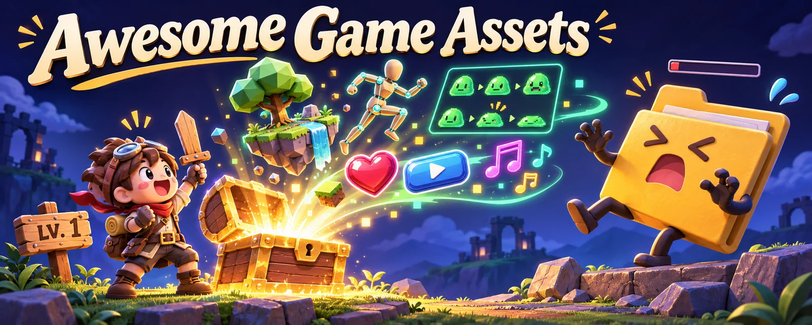

# Awesome Game Assets · 게임 에셋 모음

[English](README.md) · [简体中文](README.zh-CN.md) · [繁體中文](README.zh-TW.md) · [日本語](README.ja.md) · **한국어**

자체 제작 일러스트: 시작은 나무 검 한 자루, 에셋은 전리품으로!

**리소스 297개 · 분류 15개 · 5개 언어.** 인디 게임 개발에 필요한 원본 프로젝트 미리보기, 실제 이용 조건, 출처를 비교하세요. 에셋 팩, 도구, 코드 예제가 포함되며 모든 항목이 바로 다운로드 가능하거나 무료 상업 이용 가능한 것은 아닙니다.

## 개발 목적에 맞는 에셋 찾기

[2D 스프라이트·픽셀 아트·3D 모델](#3d-모델과-2d-스프라이트) · [게임 UI·아이콘·HUD](#ui아이콘hud) · [PBR 텍스처·머티리얼](#텍스처와-머티리얼) · [효과음·게임 오디오](#효과음과-오디오) · [VFX·파티클·셰이더](#vfx파티클셰이더) · [리깅·애니메이션·모션 캡처](#애니메이션과-모션-캡처)

> ⚠️ 불법 복제, 크랙, 유료 에셋 재배포, 스타 조작, 악성 코드가 의심되는 저장소는 피해를 피할 수 있도록 [주의 목록](WARNING.md)에 따로 정리했습니다. 사용하지 마세요.

## 목차

**[에셋 표 둘러보기](#3d-모델과-2d-스프라이트)** · [기여하기](CONTRIBUTING.md)

분류별 처음 15개를 표시하며 나머지는 펼쳐 볼 수 있습니다. GitHub 저장소는 누적 스타 수순(2026-11-12 기준)이며 비교 가능한 데이터가 없는 사이트는 뒤에 표시합니다. 최근 상승세 순위는 아닙니다. [정렬 기준](docs/discovery.md).

휴대폰에서는 표를 좌우로 밀어 프로젝트, 사용 조건, 용도를 비교하세요.

- [3D 모델과 2D 스프라이트](#3d-모델과-2d-스프라이트)
- [UI·아이콘·HUD](#ui아이콘hud)
- [텍스처와 머티리얼](#텍스처와-머티리얼)
- [효과음과 오디오](#효과음과-오디오)
- [글꼴](#글꼴)
- [VFX·파티클·셰이더](#vfx파티클셰이더)
- [스킬·시전·전투 예제](#스킬시전전투-예제)
- [애니메이션과 모션 캡처](#애니메이션과-모션-캡처)
- [물리](#물리)
- [게임 AI와 경로 탐색](#게임-ai와-경로-탐색)
- [절차적 생성](#절차적-생성)
- [엔진과 프레임워크](#엔진과-프레임워크)
- [도구와 파이프라인](#도구와-파이프라인)
- [AI 에셋 생성과 에이전트 스킬](#ai-에셋-생성과-에이전트-스킬)
- [엄선 자료와 디자인 참고](#엄선-자료와-디자인-참고)

## 수록 기준

- 프로젝트나 공식 사이트에 라이선스가 명확히 기재된 자료만 수록합니다. 에셋별 라이선스는 따로 표시하므로 사용 전에 개별 조건을 확인하세요.
- 불법 복제, 크랙, 스타 조작 저장소는 제외합니다. 스타, 포크, 활동 내역을 확인하며 보관 처리되었거나 사용할 수 없는 저장소도 제외합니다.
- 자동 검사는 끊어진 링크, 봇 차단, 시간 초과를 보고합니다. 경고가 있다고 해서 해당 자료에 정상적으로 접속할 수 있음이 확인된 것은 아닙니다.
- 라이선스는 2026-11-12에 GitHub API의 `license` 필드 또는 각 행에 연결된 공식 라이선스 페이지에서 확인했습니다.
- 미리보기는 원본 프로젝트의 이미지를 링크하고 출처를 표기합니다. 여기서의 전시는 재사용 권한을 부여하지 않으므로 원본 에셋의 조건을 확인하세요. 대표·분류 이미지는 생성 이미지이며, 원본 미리보기가 없는 경우 이를 명시하고 가상의 결과물로 대체하지 않습니다.

## 3D 모델과 2D 스프라이트

| 프로젝트 / 미리보기 | 사용 조건 | 활용 용도 |
| --- | --- | --- |
| [dicebear/dicebear](https://github.com/dicebear/dicebear)  이미지 출처: 프로젝트 [dicebear/dicebear](https://www.dicebear.com) GitHub ★ 10,068 | 사용할 에셋·구성 요소의 조건을 개별 확인 ([MIT (code; avatar styles have their own licenses)](https://github.com/dicebear/dicebear)) | 시드로 다양한 스타일의 SVG 프로필 이미지를 생성하는 아바타 라이브러리입니다. 스타일별 라이선스를 확인하세요. |
| [vrm-c/UniVRM](https://github.com/vrm-c/UniVRM)  이미지 출처: 프로젝트 [vrm-c/UniVRM](https://vrm.dev/en) GitHub ★ 3,421 | 상업적 이용·수정 가능; 필요한 저작권·라이선스 고지 유지 ([MIT](https://github.com/vrm-c/UniVRM)) | 스프링 본과 표정을 지원하는 Unity용 VRM 휴머노이드 아바타 임포터/익스포터입니다. VRM은 glTF 기반입니다. |
| [LiberatedPixelCup/Universal-LPC-Spritesheet-Character-Generator](https://github.com/LiberatedPixelCup/Universal-LPC-Spritesheet-Character-Generator)  이미지 출처: 프로젝트 [LiberatedPixelCup/Universal-LPC-Spritesheet-Character-Generator](https://github.com/LiberatedPixelCup/Universal-LPC-Spritesheet-Character-Generator) 참고 목록 [Calinou/awesome-gamedev](https://github.com/Calinou/awesome-gamedev) GitHub ★ 2,003 | 사용할 에셋·구성 요소의 조건을 개별 확인 ([GPL-3.0 (code); art per asset (CC0 / CC-BY / CC-BY-SA / OGA-BY / GPL)](https://github.com/LiberatedPixelCup/Universal-LPC-Spritesheet-Character-Generator#licensing-and-attribution-credits)) | 걷기, 베기, 주문 시전 애니메이션이 있는 레이어형 RPG 캐릭터 스프라이트 시트를 브라우저에서 만들고 크레딧 파일도 내보냅니다. |
| [makehumancommunity/makehuman](https://github.com/makehumancommunity/makehuman) [사용 가능한 원본 미리보기 없음 · 프로젝트 열기](https://github.com/makehumancommunity/makehuman) GitHub ★ 1,646 | 에셋은 상용 가능·표기 불필요; 코드는 AGPL 의무 준수 ([AGPL-3.0 (code) / CC0-1.0 (bundled assets)](https://github.com/makehumancommunity/makehuman)) | 매개변수로 3D 인간 캐릭터를 만드는 도구입니다. 내보낸 캐릭터와 기본 제공 에셋은 CC0입니다. |
| [sparklinlabs/superpowers-asset-packs](https://github.com/sparklinlabs/superpowers-asset-packs)  이미지 출처: 프로젝트 [sparklinlabs/superpowers-asset-packs](https://github.com/sparklinlabs/superpowers-asset-packs) GitHub ★ 1,280 | 상업적 이용·수정 가능, 출처 표기 불필요 ([CC0-1.0](https://github.com/sparklinlabs/superpowers-asset-packs)) | Superpowers 엔진의 CC0 에셋 팩으로 캐릭터, 차량, 배경, 슈터, 플랫포머용 2D·3D 세트를 포함합니다. |
| [KhronosGroup/glTF-Sample-Assets](https://github.com/KhronosGroup/glTF-Sample-Assets)  이미지 출처: 프로젝트 [KhronosGroup/glTF-Sample-Assets](https://github.com/KhronosGroup/glTF-Sample-Assets) GitHub ★ 1,154 | 사용할 에셋·구성 요소의 조건을 개별 확인 ([Per model (mostly CC0 / CC-BY-4.0; a few under custom terms, see REUSE.toml)](https://github.com/KhronosGroup/glTF-Sample-Assets/tree/main/LICENSES)) | 로더, PBR 머티리얼, 엔진 임포트 파이프라인을 테스트하는 glTF 참조 모델입니다. |
| [umasteeringgroup/UMA](https://github.com/umasteeringgroup/UMA)  이미지 출처: 프로젝트 [umasteeringgroup/UMA](https://github.com/umasteeringgroup/UMA) 프로젝트 식별 이미지이며 에셋 결과 미리보기가 아닙니다 GitHub ★ 876 | 상업적 이용·수정 가능; 필요한 저작권·라이선스 고지 유지 ([MIT](https://github.com/umasteeringgroup/UMA)) | Unity Multipurpose Avatar로 의상 교체, DNA 기반 체형 조정, 텍스처 아틀라스를 지원하는 맞춤형 캐릭터 시스템입니다. |
| [PolygonalMind/initiative-opensource-release](https://github.com/PolygonalMind/initiative-opensource-release)  이미지 출처: 프로젝트 [PolygonalMind/initiative-opensource-release](https://raw.githubusercontent.com/PolygonalMind/initiative-opensource-release/master/README.md) GitHub ★ 41 | 상업적 이용·수정 가능, 출처 표기 불필요 ([CC0-1.0](https://github.com/PolygonalMind/initiative-opensource-release)) | 100 Avatars 캐릭터 팩과 3D 환경 등을 포함한 Polygonal Mind의 CC0 공개 에셋입니다. |
| [Kenney Game Assets](https://kenney.nl/assets)  이미지 출처: 프로젝트 [Kenney Game Assets](https://kenney.nl/assets) 비교 가능한 인기 데이터 없음 | 상업적 이용·수정 가능, 출처 표기 불필요 ([CC0-1.0](https://kenney.nl/support)) | 일관된 스타일의 2D 스프라이트, UI, 3D 모델, 사운드 팩 수천 종으로 프로토타입과 게임 잼에 적합합니다. |
| [Quaternius](https://quaternius.com/)  이미지 출처: 프로젝트 [Quaternius](https://quaternius.com/) 비교 가능한 인기 데이터 없음 | 상업적 이용·수정 가능, 출처 표기 불필요 ([CC0-1.0](https://quaternius.com/faq.html)) | 캐릭터, 자연, 건물, 무기 등 로우 폴리 3D 팩을 FBX/OBJ/glTF로 제공합니다. 무료 팩은 CC0입니다. |
| [OpenGameArt.org](https://opengameart.org/)  이미지 출처: 프로젝트 [OpenGameArt.org](https://opengameart.org/content/tilesets-base-rpg-2d) 비교 가능한 인기 데이터 없음 | 사용할 에셋·구성 요소의 조건을 개별 확인 ([Per asset (CC0 / CC-BY / CC-BY-SA / GPL / OGA-BY)](https://opengameart.org/content/faq)) | 2D, 3D, 음악, 효과음을 모은 커뮤니티 라이브러리입니다. 에셋마다 라이선스가 다르므로 사용 전에 확인하세요. |
| [Polyfork](https://polyfork.dev/assets)  이미지 출처: 프로젝트 [Polyfork](https://polyfork.dev/assets) 비교 가능한 인기 데이터 없음 | 로우 폴리는 출처 표기 또는 Polyfork 조건 선택; HD·모듈은 별도 조건 확인 ([Free low-poly meshes: CC-BY-4.0 or Polyfork licence (your choice); ES modules and HD editions: Polyfork licence only](https://polyfork.dev/licensing)) | 무료 로우 폴리 3D 모델 3,000개 이상을 GLB와 three.js ES 모듈로 제공합니다. CC BY에 따라 Polyfork를 표기하거나, 파일 재배포를 금지하는 표기 불필요 라이선스를 선택할 수 있습니다. 유료 요금제에는 HD 버전이 추가됩니다. |
| [The Base Mesh](https://www.thebasemesh.com/)  이미지 출처: 프로젝트 [The Base Mesh](https://www.thebasemesh.com/) 참고 목록 [madjin/awesome-cc0](https://github.com/madjin/awesome-cc0) 비교 가능한 인기 데이터 없음 | 상업적 이용·수정 가능, 출처 표기 불필요 ([CC0-1.0](https://www.thebasemesh.com/)) | 실제 크기를 반영한 베이스 메시 1,250개 이상으로 그레이박싱, 스컬프팅, 프로토타입에 적합합니다. |
| [Kenney Modular Characters](https://kenney.nl/assets/modular-characters)  이미지 출처: 프로젝트 [Kenney Modular Characters](https://kenney.nl/assets/modular-characters) 비교 가능한 인기 데이터 없음 | 상업적 이용·수정 가능, 출처 표기 불필요 ([CC0-1.0](https://kenney.nl/assets/modular-characters)) | 조합하여 다양한 탑다운·사이드뷰 캐릭터를 만드는 모듈형 2D 캐릭터 부품입니다. |
| [Kenney Roguelike Characters](https://kenney.nl/assets/roguelike-characters)  이미지 출처: 프로젝트 [Kenney Roguelike Characters](https://kenney.nl/assets/roguelike-characters) 비교 가능한 인기 데이터 없음 | 상업적 이용·수정 가능, 출처 표기 불필요 ([CC0-1.0](https://kenney.nl/assets/roguelike-characters)) | 장비와 의상을 갖춘 16x16 픽셀 로그라이크 캐릭터 스프라이트입니다. |

나머지 12개 펼치기

| 프로젝트 / 미리보기 | 사용 조건 | 활용 용도 |
| --- | --- | --- |
| [Kenney Platformer Characters](https://kenney.nl/assets/platformer-characters)  이미지 출처: 프로젝트 [Kenney Platformer Characters](https://kenney.nl/assets/platformer-characters) 비교 가능한 인기 데이터 없음 | 상업적 이용·수정 가능, 출처 표기 불필요 ([CC0-1.0](https://kenney.nl/assets/platformer-characters)) | 걷기, 점프 등 다양한 자세를 제공하는 사이드뷰 플랫포머 캐릭터입니다. |
| [Kenney Toon Characters](https://kenney.nl/assets/toon-characters)  이미지 출처: 프로젝트 [Kenney Toon Characters](https://kenney.nl/assets/toon-characters) 비교 가능한 인기 데이터 없음 | 상업적 이용·수정 가능, 출처 표기 불필요 ([CC0-1.0](https://kenney.nl/assets/toon-characters)) | 캐주얼 게임용으로 여러 자세를 제공하는 만화풍 2D 캐릭터입니다. |
| [Quaternius Universal Base Characters](https://quaternius.com/packs/universalbasecharacters.html)  이미지 출처: 프로젝트 [Quaternius Universal Base Characters](https://quaternius.com/packs/universalbasecharacters.html) 비교 가능한 인기 데이터 없음 | 상업적 이용·수정 가능, 출처 표기 불필요 ([CC0-1.0](https://quaternius.com/packs/universalbasecharacters.html)) | Quaternius 범용 애니메이션 라이브러리와 함께 쓰도록 리깅된 로우 폴리 베이스 캐릭터입니다. |
| [Quaternius Modular Character Outfits - Fantasy](https://quaternius.com/packs/modularcharacteroutfitsfantasy.html)  이미지 출처: 프로젝트 [Quaternius Modular Character Outfits - Fantasy](https://quaternius.com/packs/modularcharacteroutfitsfantasy.html) 비교 가능한 인기 데이터 없음 | 상업적 이용·수정 가능, 출처 표기 불필요 ([CC0-1.0](https://quaternius.com/packs/modularcharacteroutfitsfantasy.html)) | Quaternius 베이스 캐릭터용 갑옷, 로브, 모자 등 모듈형 판타지 의상입니다. |
| [Liberated Pixel Cup (LPC) Base Assets](https://opengameart.org/content/liberated-pixel-cup-lpc-base-assets-sprites-map-tiles)  이미지 출처: 프로젝트 [Liberated Pixel Cup (LPC) Base Assets](https://opengameart.org/content/liberated-pixel-cup-lpc-base-assets-sprites-map-tiles) 비교 가능한 인기 데이터 없음 | 상업적 이용 가능; 출처 표기, 변경물은 동일 조건 적용 ([CC-BY-SA-3.0 / GPL-3.0](https://opengameart.org/content/liberated-pixel-cup-lpc-base-assets-sprites-map-tiles)) | 방대한 LPC 캐릭터 아트 생태계의 기반이 된 Liberated Pixel Cup 기본 스프라이트와 맵 타일입니다. |
| [Kenney Pixel Platformer](https://kenney.nl/assets/pixel-platformer)  이미지 출처: 프로젝트 [Kenney Pixel Platformer](https://kenney.nl/assets/pixel-platformer) 비교 가능한 인기 데이터 없음 | 상업적 이용·수정 가능, 출처 표기 불필요 ([CC0-1.0](https://kenney.nl/assets/pixel-platformer)) | 18x18 픽셀 플랫포머 타일, 캐릭터, 아이템입니다. |
| [Kenney 1-Bit Pack](https://kenney.nl/assets/1-bit-pack)  이미지 출처: 프로젝트 [Kenney 1-Bit Pack](https://kenney.nl/assets/1-bit-pack) 비교 가능한 인기 데이터 없음 | 상업적 이용·수정 가능, 출처 표기 불필요 ([CC0-1.0](https://kenney.nl/assets/1-bit-pack)) | 던전, 마을, SF 등에 쓰는 1비트 16x16 타일 1,000개 이상입니다. |
| [Kenney Tiny Dungeon](https://kenney.nl/assets/tiny-dungeon)  이미지 출처: 프로젝트 [Kenney Tiny Dungeon](https://kenney.nl/assets/tiny-dungeon) 비교 가능한 인기 데이터 없음 | 상업적 이용·수정 가능, 출처 표기 불필요 ([CC0-1.0](https://kenney.nl/assets/tiny-dungeon)) | 작은 16x16 던전 타일, 영웅, 몬스터입니다. |
| [Kenney Tiny Town](https://kenney.nl/assets/tiny-town)  이미지 출처: 프로젝트 [Kenney Tiny Town](https://kenney.nl/assets/tiny-town) 비교 가능한 인기 데이터 없음 | 상업적 이용·수정 가능, 출처 표기 불필요 ([CC0-1.0](https://kenney.nl/assets/tiny-town)) | 집, 울타리, 자연물을 포함한 작은 16x16 마을 타일입니다. |
| [16x16 DungeonTileset II](https://0x72.itch.io/dungeontileset-ii)  이미지 출처: 프로젝트 [16x16 DungeonTileset II](https://0x72.itch.io/dungeontileset-ii) 비교 가능한 인기 데이터 없음 | 에셋은 상용 가능·표기 불필요; 코드는 MIT 고지 유지 ([CC0-1.0 (assets) / MIT (code)](https://0x72.itch.io/dungeontileset-ii)) | 애니메이션 캐릭터, 몬스터, 무기가 포함된 16x16 던전 타일셋입니다. |
| [16x16 Fantasy tileset](https://opengameart.org/content/16x16-fantasy-tileset)  이미지 출처: 프로젝트 [16x16 Fantasy tileset](https://opengameart.org/content/16x16-fantasy-tileset) 비교 가능한 인기 데이터 없음 | 상업적 이용 가능; 출처 표기, 변경물은 동일 조건 적용 ([CC-BY-SA-3.0](https://opengameart.org/content/16x16-fantasy-tileset)) | Game Boy/Famicom 스타일 로그라이크·RPG용 작은 캐릭터와 판타지 아이템입니다. |
| [A Blocky Dungeon](https://opengameart.org/content/a-blocky-dungeon)  이미지 출처: 프로젝트 [A Blocky Dungeon](https://opengameart.org/content/a-blocky-dungeon) 비교 가능한 인기 데이터 없음 | 상업적 이용·수정 가능, 출처 표기 불필요 ([CC0-1.0](https://opengameart.org/content/a-blocky-dungeon)) | 문, 스위치, 움직이는 소품이 있는 블록형 16x16 던전 타일입니다. 캐릭터는 포함하지 않습니다. |

## UI·아이콘·HUD

| 프로젝트 / 미리보기 | 사용 조건 | 활용 용도 |
| --- | --- | --- |
| [ocornut/imgui](https://github.com/ocornut/imgui)  이미지 출처: 프로젝트 [ocornut/imgui](https://github.com/ocornut/imgui) GitHub ★ 77,076 | 상업적 이용·수정 가능; 필요한 저작권·라이선스 고지 유지 ([MIT](https://github.com/ocornut/imgui)) | 디버그 메뉴, 게임 내 도구, 에디터용 즉시 모드 GUI 라이브러리 Dear ImGui입니다. |
| [emilk/egui](https://github.com/emilk/egui)  이미지 출처: 프로젝트 [emilk/egui](https://github.com/emilk/egui) 프로젝트 식별 이미지이며 에셋 결과 미리보기가 아닙니다 GitHub ★ 32,236 | 상업적 이용·수정 가능; 필요한 저작권·라이선스 고지 유지 ([MIT OR Apache-2.0](https://github.com/emilk/egui)) | 네이티브와 웹에서 실행되는 사용하기 쉬운 Rust 즉시 모드 GUI로 Rust 게임 도구에 자주 쓰입니다. |
| [facebook/yoga](https://github.com/facebook/yoga)  이미지 출처: 프로젝트 [facebook/yoga](https://yogalayout.dev/) 프로젝트 식별 이미지이며 에셋 결과 미리보기가 아닙니다 GitHub ★ 18,951 | 상업적 이용·수정 가능; 필요한 저작권·라이선스 고지 유지 ([MIT](https://github.com/facebook/yoga)) | C++, C#, JavaScript 게임 UI 레이아웃에 내장할 수 있는 Flexbox 레이아웃 엔진입니다. |
| [nicbarker/clay](https://github.com/nicbarker/clay)  이미지 출처: 프로젝트 [nicbarker/clay](https://github.com/nicbarker/clay) GitHub ★ 18,405 | 상업적 이용·수정 가능; 필요한 저작권·라이선스 고지 유지 ([Zlib](https://github.com/nicbarker/clay)) | Flexbox와 유사한 레이아웃과 렌더러 독립적 출력을 제공하는 고성능 C UI 레이아웃 라이브러리입니다. |
| [Immediate-Mode-UI/Nuklear](https://github.com/Immediate-Mode-UI/Nuklear)  이미지 출처: 프로젝트 [Immediate-Mode-UI/Nuklear](https://github.com/Immediate-Mode-UI/Nuklear) GitHub ★ 11,506 | 상업적 이용·수정 가능; 필요한 저작권·라이선스 고지 유지 ([MIT or Unlicense](https://github.com/Immediate-Mode-UI/Nuklear)) | 도구와 게임 내 메뉴용 단일 헤더 ANSI C 즉시 모드 GUI입니다. |
| [epezent/implot](https://github.com/epezent/implot)  이미지 출처: 프로젝트 [epezent/implot](https://github.com/epezent/implot) GitHub ★ 6,275 | 상업적 이용·수정 가능; 필요한 저작권·라이선스 고지 유지 ([MIT](https://github.com/epezent/implot)) | Dear ImGui용 즉시 모드 그래프 라이브러리로 프로파일러와 디버그 그래프에 적합합니다. |
| [memononen/nanovg](https://github.com/memononen/nanovg)  이미지 출처: 프로젝트 [memononen/nanovg](https://github.com/memononen/nanovg) GitHub ★ 5,738 | 상업적 이용·수정 가능; 필요한 저작권·라이선스 고지 유지 ([Zlib](https://github.com/memononen/nanovg)) | UI와 시각화용으로 OpenGL에서 안티앨리어싱된 2D 벡터를 그립니다. |
| [wjakob/nanogui](https://github.com/wjakob/nanogui)  이미지 출처: 프로젝트 [wjakob/nanogui](https://github.com/wjakob/nanogui/blob/master/README.rst) GitHub ★ 4,865 | 상업적 이용·수정 가능; 필요한 저작권·라이선스 고지 유지 ([BSD-3-Clause](https://github.com/wjakob/nanogui)) | 간단한 도구 패널 제작에 유용한 OpenGL용 미니멀 C++/Python GUI 라이브러리입니다. |
| [mikke89/RmlUi](https://github.com/mikke89/RmlUi)  이미지 출처: 프로젝트 [mikke89/RmlUi](https://github.com/mikke89/RmlUi) 프로젝트 식별 이미지이며 에셋 결과 미리보기가 아닙니다 GitHub ★ 4,620 | 상업적 이용·수정 가능; 필요한 저작권·라이선스 고지 유지 ([MIT](https://github.com/mikke89/RmlUi)) | HTML/CSS와 유사한 문서로 인터페이스를 구성하며 데이터 바인딩과 애니메이션을 지원하는 C++ 게임 UI 라이브러리입니다. |
| [CedricGuillemet/ImGuizmo](https://github.com/CedricGuillemet/ImGuizmo)  이미지 출처: 프로젝트 [CedricGuillemet/ImGuizmo](https://github.com/CedricGuillemet/ImGuizmo) 참고 목록 [Calinou/awesome-gamedev](https://github.com/Calinou/awesome-gamedev) GitHub ★ 4,061 | 상업적 이용·수정 가능; 필요한 저작권·라이선스 고지 유지 ([MIT](https://github.com/CedricGuillemet/ImGuizmo)) | Dear ImGui용 즉시 모드 3D 기즈모(이동·회전·크기 조정)와 에디터 컨트롤입니다. |
| [vladbat00/bevy_egui](https://github.com/vladbat00/bevy_egui)  이미지 출처: 프로젝트 [vladbat00/bevy_egui](https://github.com/vladbat00/bevy_egui) GitHub ★ 1,440 | 상업적 이용·수정 가능; 필요한 저작권·라이선스 고지 유지 ([MIT](https://github.com/vladbat00/bevy_egui)) | Bevy 엔진에 egui를 통합하여 디버그 패널과 게임 내 에디터를 만듭니다. |
| [ebitenui/ebitenui](https://github.com/ebitenui/ebitenui)  이미지 출처: 프로젝트 [ebitenui/ebitenui](https://github.com/ebitenui/ebitenui) GitHub ★ 947 | 상업적 이용·수정 가능; 필요한 저작권·라이선스 고지 유지 ([MIT](https://github.com/ebitenui/ebitenui)) | Go Ebitengine 게임용 UI 엔진과 위젯 라이브러리입니다. |
| [Game-icons.net](https://game-icons.net/)  이미지 출처: 프로젝트 [Game-icons.net](https://game-icons.net/) 참고 목록 [Calinou/awesome-gamedev](https://github.com/Calinou/awesome-gamedev) 비교 가능한 인기 데이터 없음 | 상업적 이용 가능, 출처 표기 필요 ([CC-BY-3.0](https://game-icons.net/about.html)) | 스킬, 아이템, 상태 효과 등에 쓰는 무료 SVG/PNG 게임 아이콘 4,000개 이상입니다. 각 아이콘의 제작자를 표기하세요. |
| [Those Awesome Guys: Controller & Keyboard Prompts](https://thoseawesomeguys.com/prompts/) [사용 가능한 원본 미리보기 없음 · 프로젝트 열기](https://thoseawesomeguys.com/prompts/) 참고 목록 [Calinou/awesome-gamedev](https://github.com/Calinou/awesome-gamedev) 비교 가능한 인기 데이터 없음 | 상업적 이용·수정 가능, 출처 표기 불필요 ([CC0-1.0](https://thoseawesomeguys.com/prompts/)) | 튜토리얼과 입력 안내에 쓰는 키보드, 마우스, 주요 컨트롤러의 버튼 아이콘입니다. |
| [Kenney UI Pack](https://kenney.nl/assets/ui-pack)  이미지 출처: 프로젝트 [Kenney UI Pack](https://kenney.nl/assets/ui-pack) 비교 가능한 인기 데이터 없음 | 상업적 이용·수정 가능, 출처 표기 불필요 ([CC0-1.0](https://kenney.nl/assets/ui-pack)) | 메뉴와 HUD에 쓰는 버튼, 슬라이더, 패널 등 UI 요소 430개를 여러 색상으로 제공합니다. |

나머지 5개 펼치기

| 프로젝트 / 미리보기 | 사용 조건 | 활용 용도 |
| --- | --- | --- |
| [Kenney Crosshair Pack](https://kenney.nl/assets/crosshair-pack)  이미지 출처: 프로젝트 [Kenney Crosshair Pack](https://kenney.nl/assets/crosshair-pack) 비교 가능한 인기 데이터 없음 | 상업적 이용·수정 가능, 출처 표기 불필요 ([CC0-1.0](https://kenney.nl/assets/crosshair-pack)) | 슈팅 게임과 조준 UI용 십자선·조준점 스프라이트 모음입니다. |
| [Kenney Cursor Pack](https://kenney.nl/assets/cursor-pack)  이미지 출처: 프로젝트 [Kenney Cursor Pack](https://kenney.nl/assets/cursor-pack) 비교 가능한 인기 데이터 없음 | 상업적 이용·수정 가능, 출처 표기 불필요 ([CC0-1.0](https://kenney.nl/assets/cursor-pack)) | 게임 메뉴와 전략 게임용 마우스 커서·포인터 아이콘입니다. |
| [Kenney UI Pack (RPG Expansion)](https://kenney.nl/assets/ui-pack-rpg-expansion)  이미지 출처: 프로젝트 [Kenney UI Pack (RPG Expansion)](https://kenney.nl/assets/ui-pack-rpg-expansion) 비교 가능한 인기 데이터 없음 | 상업적 이용·수정 가능, 출처 표기 불필요 ([CC0-1.0](https://kenney.nl/assets/ui-pack-rpg-expansion)) | 패널, 게이지, 버튼, 프레임 등 RPG 스타일 UI 요소입니다. |
| [RPG GUI construction kit v1.0](https://opengameart.org/content/rpg-gui-construction-kit-v10)  이미지 출처: 프로젝트 [RPG GUI construction kit v1.0](https://opengameart.org/content/rpg-gui-construction-kit-v10) 비교 가능한 인기 데이터 없음 | 상업적 이용 가능, 출처 표기 필요 ([CC-BY-3.0](https://opengameart.org/content/rpg-gui-construction-kit-v10)) | 프레임, 게이지, 버튼을 조합해 판타지 메뉴를 만드는 RPG GUI 구성 키트입니다. |
| [Sci-fi User Interface](https://opengameart.org/content/sci-fi-user-interface)  이미지 출처: 프로젝트 [Sci-fi User Interface](https://opengameart.org/content/sci-fi-user-interface) 비교 가능한 인기 데이터 없음 | 상업적 이용·수정 가능, 출처 표기 불필요 ([CC0-1.0](https://opengameart.org/content/sci-fi-user-interface)) | 미래풍 HUD와 메뉴를 위한 SF UI 요소입니다. |

## 텍스처와 머티리얼

| 프로젝트 / 미리보기 | 사용 조건 | 활용 용도 |
| --- | --- | --- |
| [armory3d/armorpaint](https://github.com/armory3d/armorpaint)  이미지 출처: 프로젝트 [armory3d/armorpaint](https://github.com/armory3d/armorpaint) GitHub ★ 5,485 | 상업적 이용·수정 가능; 필요한 저작권·라이선스 고지 유지 ([Zlib](https://github.com/armory3d/armorpaint)) | 모델에 PBR 텍스처를 그리는 3D 페인팅 도구입니다. 소스 코드가 공개되어 있으며 빌드된 실행 파일은 별도 판매합니다. |
| [kmkolasinski/AwesomeBump](https://github.com/kmkolasinski/AwesomeBump)  이미지 출처: 프로젝트 [kmkolasinski/AwesomeBump](https://github.com/kmkolasinski/AwesomeBump) 참고 목록 [Calinou/awesome-gamedev](https://github.com/Calinou/awesome-gamedev) 참고 목록 [madjin/awesome-cc0](https://github.com/madjin/awesome-cc0) GitHub ★ 1,785 | 상업적 이용 가능; 배포하는 해당 코드는 조건에 따라 공개 ([GPL-3.0](https://github.com/kmkolasinski/AwesomeBump)) | 이미지 한 장에서 노멀, 높이, 스페큘러, AO, 거칠기, 메탈릭 맵을 생성합니다. 마지막 업데이트는 2023년입니다. |
| [azagaya/laigter](https://github.com/azagaya/laigter)  이미지 출처: 프로젝트 [azagaya/laigter](https://raw.githubusercontent.com/azagaya/laigter/master/README.md) GitHub ★ 1,402 | 상업적 이용 가능; 배포하는 해당 코드는 조건에 따라 공개 ([GPL-3.0](https://github.com/azagaya/laigter)) | 2D 스프라이트에 동적 조명을 적용할 수 있도록 노멀, 스페큘러, 오클루전 맵을 생성합니다. |
| [Poly Haven](https://polyhaven.com/)  이미지 출처: 프로젝트 [Poly Haven](https://polyhaven.com/) 비교 가능한 인기 데이터 없음 | 상업적 이용·수정 가능, 출처 표기 불필요 ([CC0-1.0](https://polyhaven.com/license)) | 고품질 PBR 텍스처, HDRI, 사진 스캔 모델로 사실적인 장면과 조명에 적합합니다. |
| [ambientCG](https://ambientcg.com/) [사용 가능한 원본 미리보기 없음 · 프로젝트 열기](https://ambientcg.com/) 비교 가능한 인기 데이터 없음 | 상업적 이용·수정 가능, 출처 표기 불필요 ([CC0-1.0](https://docs.ambientcg.com/license/)) | 여러 해상도의 PBR 머티리얼, HDRI, 모델을 제공하는 대규모 CC0 라이브러리입니다. |

## 효과음과 오디오

| 프로젝트 / 미리보기 | 사용 조건 | 활용 용도 |
| --- | --- | --- |
| [goldfire/howler.js](https://github.com/goldfire/howler.js)  이미지 출처: 프로젝트 [goldfire/howler.js](https://github.com/goldfire/howler.js) 프로젝트 식별 이미지이며 에셋 결과 미리보기가 아닙니다 GitHub ★ 25,443 | 상업적 이용·수정 가능; 필요한 저작권·라이선스 고지 유지 ([MIT](https://github.com/goldfire/howler.js)) | 오디오 스프라이트, 공간 음향, 여러 브라우저에서의 재생을 지원하는 웹 게임용 JavaScript 오디오 라이브러리입니다. |
| [Tonejs/Tone.js](https://github.com/Tonejs/Tone.js) [사용 가능한 원본 미리보기 없음 · 프로젝트 열기](https://github.com/Tonejs/Tone.js) GitHub ★ 14,897 | 상업적 이용·수정 가능; 필요한 저작권·라이선스 고지 유지 ([MIT](https://github.com/Tonejs/Tone.js)) | 브라우저에서 신시사이저, 효과, 재생 일정 제어로 인터랙티브 음악을 만드는 Web Audio 프레임워크입니다. |
| [mackron/miniaudio](https://github.com/mackron/miniaudio)  이미지 출처: 프로젝트 [mackron/miniaudio](https://github.com/mackron/miniaudio) 프로젝트 식별 이미지이며 에셋 결과 미리보기가 아닙니다 GitHub ★ 7,615 | 상업적 이용·수정 가능; 필요한 저작권·라이선스 고지 유지 ([Unlicense or MIT-0 (your choice)](https://github.com/mackron/miniaudio)) | 믹싱과 효과를 지원하는 단일 파일 C 오디오 재생·녹음 라이브러리로 엔진에 쉽게 내장할 수 있습니다. |
| [surge-synthesizer/surge](https://github.com/surge-synthesizer/surge)  이미지 출처: 프로젝트 [surge-synthesizer/surge](https://surge-synthesizer.github.io/) GitHub ★ 4,116 | 상업적 이용 가능; 배포하는 해당 코드는 조건에 따라 공개 ([GPL-3.0](https://github.com/surge-synthesizer/surge)) | 게임 음악과 효과음 제작에 쓰는 강력한 오픈 소스 신시사이저 Surge XT입니다. |
| [tildearrow/furnace](https://github.com/tildearrow/furnace)  이미지 출처: 프로젝트 [tildearrow/furnace](https://github.com/tildearrow/furnace) GitHub ★ 3,912 | 상업적 이용 가능; 배포하는 해당 코드는 조건에 따라 공개 ([GPL-2.0-or-later](https://github.com/tildearrow/furnace)) | 수십 종의 고전 사운드 칩을 에뮬레이션하여 레트로 음악을 만드는 멀티시스템 칩튠 트래커입니다. |
| [ValveSoftware/steam-audio](https://github.com/ValveSoftware/steam-audio) [사용 가능한 원본 미리보기 없음 · 프로젝트 열기](https://github.com/ValveSoftware/steam-audio) GitHub ★ 3,006 | 상업적 이용·수정 가능; 필요한 저작권·라이선스 고지 유지 ([Apache-2.0](https://github.com/ValveSoftware/steam-audio)) | HRTF, 차폐, 물리 기반 잔향을 지원하는 공간 음향 SDK로 Unity, Unreal, FMOD 플러그인을 제공합니다. |
| [kcat/openal-soft](https://github.com/kcat/openal-soft) [사용 가능한 원본 미리보기 없음 · 프로젝트 열기](https://github.com/kcat/openal-soft) GitHub ★ 2,775 | 상업적 이용 가능; 라이브러리 수정·소스 배포 의무 준수 ([LGPL-2.0-or-later](https://github.com/kcat/openal-soft)) | HRTF와 서라운드 출력을 지원하는 OpenAL 3D 오디오 API의 소프트웨어 구현입니다. |
| [jarikomppa/soloud](https://github.com/jarikomppa/soloud)  이미지 출처: 프로젝트 [jarikomppa/soloud](https://github.com/jarikomppa/soloud) 프로젝트 식별 이미지이며 에셋 결과 미리보기가 아닙니다 GitHub ★ 2,195 | 상업적 이용·수정 가능; 필요한 저작권·라이선스 고지 유지 ([Zlib](https://github.com/jarikomppa/soloud)) | 3D 사운드, 필터, 음성 합성을 지원하는 사용하기 쉽고 이식성 높은 C++ 게임 오디오 엔진입니다. |
| [milkytracker/MilkyTracker](https://github.com/milkytracker/MilkyTracker)  이미지 출처: 프로젝트 [milkytracker/MilkyTracker](https://github.com/milkytracker/MilkyTracker) GitHub ★ 2,132 | 상업적 이용 가능; 배포하는 해당 코드는 조건에 따라 공개 ([GPL-3.0 (MilkyPlay library: BSD-3-Clause)](https://github.com/milkytracker/MilkyTracker)) | MOD/XM 칩튠과 게임 음악용 FastTracker II 호환 음악 트래커입니다. |
| [tesselode/kira](https://github.com/tesselode/kira) [사용 가능한 원본 미리보기 없음 · 프로젝트 열기](https://github.com/tesselode/kira) GitHub ★ 1,078 | 상업적 이용·수정 가능; 필요한 저작권·라이선스 고지 유지 ([MIT OR Apache-2.0](https://github.com/tesselode/kira)) | 트윈 가능한 매개변수, 믹서 트랙, 클록, 효과를 제공하는 Rust 게임 오디오 라이브러리입니다. |
| [increpare/bfxr](https://github.com/increpare/bfxr) [사용 가능한 원본 미리보기 없음 · 프로젝트 열기](https://github.com/increpare/bfxr) GitHub ★ 1,028 | 상업적 이용·수정 가능; 필요한 저작권·라이선스 고지 유지 ([Apache-2.0 (stated in README)](https://github.com/increpare/bfxr#readme)) | 점프, 아이템 획득, 폭발 등에 쓰는 레트로 효과음 생성기로 sfxr를 확장했습니다. |
| [YuriSizov/boscaceoil-blue](https://github.com/YuriSizov/boscaceoil-blue)  이미지 출처: 프로젝트 [YuriSizov/boscaceoil-blue](https://yurisizov.itch.io/boscaceoil-blue) 참고 목록 [Calinou/awesome-gamedev](https://github.com/Calinou/awesome-gamedev) GitHub ★ 841 | 상업적 이용·수정 가능; 필요한 저작권·라이선스 고지 유지 ([MIT](https://github.com/YuriSizov/boscaceoil-blue/blob/main/LICENSE)) | Terry Cavanagh의 Bosca Ceoil을 현대화한 초보자 친화적 스텝 시퀀서입니다. 게임용 루프 음악과 짧은 효과 음악에 적합합니다. |
| [LabSound/LabSound](https://github.com/LabSound/LabSound)  이미지 출처: 프로젝트 [LabSound/LabSound](https://github.com/LabSound/LabSound) 프로젝트 식별 이미지이며 에셋 결과 미리보기가 아닙니다 GitHub ★ 795 | 상업적 이용·수정 가능; 필요한 저작권·라이선스 고지 유지 ([BSD-2-Clause / BSD-3-Clause](https://github.com/LabSound/LabSound)) | WebKit의 WebAudio에서 파생된 그래프 기반 C++ 오디오 엔진으로 게임과 인터랙티브 앱에 적합합니다. |
| [raysan5/rfxgen](https://github.com/raysan5/rfxgen)  이미지 출처: 프로젝트 [raysan5/rfxgen](https://github.com/raysan5/rfxgen) 참고 목록 [Calinou/awesome-gamedev](https://github.com/Calinou/awesome-gamedev) GitHub ★ 520 | 상업적 이용·수정 가능; 필요한 저작권·라이선스 고지 유지 ([Zlib](https://github.com/raysan5/rfxgen)) | raylib 제작자가 만든 소형 sfxr 스타일 효과음 생성기로 데스크톱과 웹에서 실행됩니다. |
| [chr15m/jsfxr](https://github.com/chr15m/jsfxr)  이미지 출처: 프로젝트 [chr15m/jsfxr](https://github.com/chr15m/jsfxr) GitHub ★ 464 | 상업적 이용·수정 가능, 출처 표기 불필요 ([Unlicense](https://github.com/chr15m/jsfxr)) | 점프, 코인, 타격, 레이저용 레트로 효과음을 만드는 브라우저 기반 생성기입니다. sfxr의 포트입니다. |

나머지 3개 펼치기

| 프로젝트 / 미리보기 | 사용 조건 | 활용 용도 |
| --- | --- | --- |
| [Freesound](https://freesound.org/) [사용 가능한 원본 미리보기 없음 · 프로젝트 열기](https://freesound.org/) 비교 가능한 인기 데이터 없음 | 사용할 에셋·구성 요소의 조건을 개별 확인 ([Per sound (CC0 / CC-BY-4.0 / CC-BY-NC-4.0)](https://freesound.org/help/faq/)) | 대규모 커뮤니티 사운드 라이브러리입니다. 라이선스로 필터링하고 필요한 경우 출처를 표기하세요. 상용 게임에는 CC0 또는 CC-BY를 확인하세요. |
| [Sonniss #GameAudioGDC Bundles](https://sonniss.com/gameaudiogdc)  이미지 출처: 프로젝트 [Sonniss #GameAudioGDC Bundles](https://sonniss.com/gameaudiogdc) 비교 가능한 인기 데이터 없음 | 상업적 이용 가능·표기 불필요; 개별 파일 그대로 재배포 금지 ([Royalty-free (Sonniss license: commercial use, no attribution required)](https://sonniss.com/gameaudiogdc)) | 전문 효과음을 매년 무료 묶음으로 제공합니다. 상용 게임에서도 로열티 없이 사용할 수 있습니다. |
| [Pixabay Sound Effects](https://pixabay.com/sound-effects/) [사용 가능한 원본 미리보기 없음 · 프로젝트 열기](https://pixabay.com/sound-effects/) ⚠ 자동 검사에 사이트가 403을 반환합니다. 라이선스는 수동 확인했습니다. 비교 가능한 인기 데이터 없음 | 상업적 이용 가능; 개별 파일 그대로 재판매 금지 ([Pixabay Content License (free, no attribution; no standalone resale)](https://pixabay.com/service/license-summary/)) | Pixabay Content License에 따라 로열티 없이 쓸 수 있는 효과음과 음악을 모은 대규모 라이브러리입니다. |

## 글꼴

| 프로젝트 / 미리보기 | 사용 조건 | 활용 용도 |
| --- | --- | --- |
| [google/fonts](https://github.com/google/fonts) [사용 가능한 원본 미리보기 없음 · 프로젝트 열기](https://github.com/google/fonts) GitHub ★ 20,754 | 사용할 에셋·구성 요소의 조건을 개별 확인 ([Per family (OFL-1.1 / Apache-2.0 / UFL)](https://github.com/google/fonts#license)) | Google Fonts 전체 글꼴 패밀리의 소스 파일입니다. 라이선스별 폴더로 정리되어 있으며 한중일 문자를 지원하는 글꼴도 많습니다. |
| [IdreesInc/Monocraft](https://github.com/IdreesInc/Monocraft)  이미지 출처: 프로젝트 [IdreesInc/Monocraft](https://github.com/IdreesInc/Monocraft) GitHub ★ 11,483 | 상업적 이용·임베딩 가능; 글꼴 라이선스 유지, 글꼴만 별도 판매 금지 ([OFL-1.1](https://github.com/IdreesInc/Monocraft)) | Minecraft 글꼴에서 영감을 받은 블록형 고정폭 글꼴로 프로그래밍 합자를 지원합니다. |
| [TakWolf/ark-pixel-font](https://github.com/TakWolf/ark-pixel-font)  이미지 출처: 프로젝트 [TakWolf/ark-pixel-font](https://github.com/TakWolf/ark-pixel-font) GitHub ★ 4,961 | 상업적 이용·임베딩 가능; 글꼴 라이선스 유지, 글꼴만 별도 판매 금지 ([OFL-1.1 (font) / MIT (build code)](https://github.com/TakWolf/ark-pixel-font)) | 픽셀 아트 게임을 위해 설계한 한중일·라틴 문자용 오픈 픽셀 글꼴입니다. |
| [the-moonwitch/Cozette](https://github.com/the-moonwitch/Cozette)  이미지 출처: 프로젝트 [the-moonwitch/Cozette](https://github.com/the-moonwitch/Cozette) GitHub ★ 3,880 | 상업적 이용·수정 가능; 필요한 저작권·라이선스 고지 유지 ([MIT](https://github.com/the-moonwitch/Cozette)) | 다양한 글리프를 지원하는 작은 비트맵 글꼴로 레트로 UI와 터미널에 어울립니다. |
| [rektdeckard/departure-mono](https://github.com/rektdeckard/departure-mono)  이미지 출처: 프로젝트 [rektdeckard/departure-mono](https://github.com/rektdeckard/departure-mono) GitHub ★ 3,642 | 상업적 이용·임베딩 가능; 글꼴 라이선스 유지, 글꼴만 별도 판매 금지 ([OFL-1.1 (font) / MIT (site)](https://github.com/rektdeckard/departure-mono)) | HUD와 터미널에 어울리는 복고 미래풍의 고정폭 픽셀 글꼴입니다. |
| [TakWolf/fusion-pixel-font](https://github.com/TakWolf/fusion-pixel-font)  이미지 출처: 프로젝트 [TakWolf/fusion-pixel-font](https://github.com/TakWolf/fusion-pixel-font) GitHub ★ 3,481 | 상업적 이용·임베딩 가능; 글꼴 라이선스 유지, 글꼴만 별도 판매 금지 ([OFL-1.1 (font) / MIT (build code)](https://github.com/TakWolf/fusion-pixel-font)) | 중국어, 일본어, 한국어, 라틴 문자를 지원하는 오픈 픽셀 글꼴로 8/10/12px 크기를 제공합니다. |
| [fcambus/spleen](https://github.com/fcambus/spleen)  이미지 출처: 프로젝트 [fcambus/spleen](https://github.com/fcambus/spleen) GitHub ★ 1,421 | 상업적 이용·수정 가능; 필요한 저작권·라이선스 고지 유지 ([BSD-2-Clause](https://github.com/fcambus/spleen)) | 선명한 픽셀 UI용 고정폭 비트맵 글꼴로 5x8부터 32x64까지의 크기를 제공합니다. |
| [scott0107000/BoutiqueBitmap7x7](https://github.com/scott0107000/BoutiqueBitmap7x7)  이미지 출처: 프로젝트 [scott0107000/BoutiqueBitmap7x7](https://github.com/scott0107000/BoutiqueBitmap7x7) GitHub ★ 165 | 상업적 이용·임베딩 가능; 글꼴 라이선스 유지, 글꼴만 별도 판매 금지 ([OFL-1.1](https://github.com/scott0107000/BoutiqueBitmap7x7)) | 중국어, 일본어, 라틴 문자를 지원하는 오픈 소스 7x7 비트맵 글꼴입니다. |
| [sgigou/NF-Pixels](https://github.com/sgigou/NF-Pixels)  이미지 출처: 프로젝트 [sgigou/NF-Pixels](https://github.com/sgigou/NF-Pixels) GitHub ★ 32 | 상업적 이용·임베딩 가능; 글꼴 라이선스 유지, 글꼴만 별도 판매 금지 ([OFL-1.1](https://github.com/sgigou/NF-Pixels)) | 레트로 게임 텍스트용 무료 픽셀 글꼴로 일반체와 굵은체를 제공합니다. |
| [Kenney Fonts](https://kenney.nl/assets/kenney-fonts)  이미지 출처: 프로젝트 [Kenney Fonts](https://kenney.nl/assets/kenney-fonts) 비교 가능한 인기 데이터 없음 | 상업적 이용·수정 가능, 출처 표기 불필요 ([CC0-1.0](https://kenney.nl/assets/kenney-fonts)) | Kenney의 경쾌한 게임용 글꼴 11종으로 어떤 프로젝트에도 무료로 사용할 수 있습니다. |
| [monogram](https://datagoblin.itch.io/monogram)  이미지 출처: 프로젝트 [monogram](https://datagoblin.itch.io/monogram) 비교 가능한 인기 데이터 없음 | 상업적 이용·수정 가능, 출처 표기 불필요 ([CC0-1.0](https://datagoblin.itch.io/monogram)) | monogram은 다양한 문자를 지원하는 무료 고정폭 픽셀 글꼴입니다. |
| [m5x7](https://managore.itch.io/m5x7)  이미지 출처: 프로젝트 [m5x7](https://managore.itch.io/m5x7) 비교 가능한 인기 데이터 없음 | 상업적 이용·수정 가능, 출처 표기 불필요 ([CC0-1.0](https://managore.itch.io/m5x7)) | m5x7은 Daniel Linssen이 만든 작고 읽기 쉬운 픽셀 글꼴입니다. |
| [Pixeloid](https://ggbot.itch.io/pixeloid-font)  이미지 출처: 프로젝트 [Pixeloid](https://ggbot.itch.io/pixeloid-font) 비교 가능한 인기 데이터 없음 | 상업적 이용·임베딩 가능; 글꼴 라이선스 유지, 글꼴만 별도 판매 금지 ([OFL-1.1](https://ggbot.itch.io/pixeloid-font)) | Pixeloid는 산세리프, 고정폭, 굵은체를 제공하는 픽셀 글꼴 패밀리입니다. |
| [The League of Moveable Type](https://www.theleagueofmoveabletype.com/)  이미지 출처: 프로젝트 [The League of Moveable Type](https://www.theleagueofmoveabletype.com/) 비교 가능한 인기 데이터 없음 | 상업적 이용·임베딩 가능; 글꼴 라이선스 유지, 글꼴만 별도 판매 금지 ([OFL-1.1](https://www.theleagueofmoveabletype.com/)) | 모든 글꼴을 SIL Open Font License로 제공하는 오픈 소스 디스플레이 글꼴 제작소입니다. |

## VFX·파티클·셰이더

| 프로젝트 / 미리보기 | 사용 조건 | 활용 용도 |
| --- | --- | --- |
| [gdquest-demos/godot-shaders](https://github.com/gdquest-demos/godot-shaders)  이미지 출처: 프로젝트 [gdquest-demos/godot-shaders](https://github.com/gdquest-demos/godot-shaders) GitHub ★ 4,202 | 해당 콘텐츠·가중치는 비상업적 이용만 가능; 출처 표기, 변경물은 동일 조건 적용 ([MIT (code) / CC-BY-NC-SA-4.0 (art)](https://github.com/gdquest-demos/godot-shaders)) | 디졸브, 외곽선, 물, 툰 등 읽기 쉬운 코드가 포함된 오픈 소스 Godot 셰이더 예제입니다. |
| [pmndrs/postprocessing](https://github.com/pmndrs/postprocessing) [사용 가능한 원본 미리보기 없음 · 프로젝트 열기](https://github.com/pmndrs/postprocessing) GitHub ★ 2,973 | 상업적 이용·수정 가능; 필요한 저작권·라이선스 고지 유지 ([Zlib](https://github.com/pmndrs/postprocessing)) | 블룸, 피사계 심도, SMAA, 톤 매핑 등을 제공하는 three.js용 후처리 효과 라이브러리입니다. |
| [effekseer/Effekseer](https://github.com/effekseer/Effekseer)  이미지 출처: 프로젝트 [effekseer/Effekseer](https://github.com/effekseer/Effekseer) GitHub ★ 2,065 | 상업적 이용·수정 가능; 필요한 저작권·라이선스 고지 유지 ([MIT](https://github.com/effekseer/Effekseer)) | Unity, Unreal, Godot, 웹용 플러그인을 제공하는 파티클 효과 에디터와 런타임입니다. |
| [CyberAgentGameEntertainment/NovaShader](https://github.com/CyberAgentGameEntertainment/NovaShader) [원본에서 보기](https://github.com/CyberAgentGameEntertainment/NovaShader) GitHub ★ 1,672 | 상업적 이용·수정 가능; 필요한 저작권·라이선스 고지 유지 ([MIT](https://github.com/CyberAgentGameEntertainment/NovaShader)) | 왜곡, 디졸브, 플로 맵 등을 지원하는 Unity URP용 다목적 파티클 셰이더입니다. |
| [djeedai/bevy_hanabi](https://github.com/djeedai/bevy_hanabi) [사용 가능한 원본 미리보기 없음 · 프로젝트 열기](https://github.com/djeedai/bevy_hanabi) GitHub ★ 1,448 | 상업적 이용·수정 가능; 필요한 저작권·라이선스 고지 유지 ([MIT OR Apache-2.0](https://github.com/djeedai/bevy_hanabi)) | 많은 파티클을 처리하는 Bevy용 GPU 파티클 시스템 플러그인입니다. |
| [Arnklit/Waterways](https://github.com/Arnklit/Waterways)  이미지 출처: 프로젝트 [Arnklit/Waterways](https://github.com/Arnklit/Waterways) GitHub ★ 1,351 | 상업적 이용·수정 가능; 필요한 저작권·라이선스 고지 유지 ([MIT](https://github.com/Arnklit/Waterways)) | 베지에 곡선으로 강 메시를 만들고 흐름·거품 맵을 베이킹하는 Godot 애드온입니다. |
| [gdquest-demos/godot-visual-effects](https://github.com/gdquest-demos/godot-visual-effects)  이미지 출처: 프로젝트 [gdquest-demos/godot-visual-effects](https://github.com/gdquest-demos/godot-visual-effects) GitHub ★ 1,348 | 해당 콘텐츠·가중치는 비상업적 이용만 가능; 출처 표기, 변경물은 동일 조건 적용 ([MIT (code) / CC-BY-NC-SA-4.0 (art)](https://github.com/gdquest-demos/godot-visual-effects)) | 파티클, 폭발, 타격, 마법 주문을 학습할 수 있는 Godot 시각 효과 예제입니다. |
| [creativelifeform/three-nebula](https://github.com/creativelifeform/three-nebula)  이미지 출처: 프로젝트 [creativelifeform/three-nebula](https://three-nebula.org/) GitHub ★ 1,249 | 상업적 이용·수정 가능; 필요한 저작권·라이선스 고지 유지 ([MIT](https://github.com/creativelifeform/three-nebula)) | 불, 연기, 마법 효과의 이미터를 JSON으로 정의하는 three.js용 WebGL 파티클 엔진입니다. |
| [Alchemist0823/three.quarks](https://github.com/Alchemist0823/three.quarks)  이미지 출처: 프로젝트 [Alchemist0823/three.quarks](https://github.com/Alchemist0823/three.quarks) GitHub ★ 1,199 | 상업적 이용·수정 가능; 필요한 저작권·라이선스 고지 유지 ([MIT](https://github.com/Alchemist0823/three.quarks)) | 시각적 에디터를 제공하는 three.js용 범용 파티클 시스템 및 VFX 엔진입니다. |
| [pixijs-userland/particle-emitter](https://github.com/pixijs-userland/particle-emitter) [사용 가능한 원본 미리보기 없음 · 프로젝트 열기](https://github.com/pixijs-userland/particle-emitter) GitHub ★ 853 | 상업적 이용·수정 가능; 필요한 저작권·라이선스 고지 유지 ([MIT](https://github.com/pixijs-userland/particle-emitter)) | 불, 연기, 불꽃 등 2D 효과용 시각적 에디터를 갖춘 PixiJS 파티클 시스템입니다. |
| [Cyanilux/URP_ShaderGraphCustomLighting](https://github.com/Cyanilux/URP_ShaderGraphCustomLighting) [사용 가능한 원본 미리보기 없음 · 프로젝트 열기](https://github.com/Cyanilux/URP_ShaderGraphCustomLighting) GitHub ★ 789 | 상업적 이용·수정 가능; 필요한 저작권·라이선스 고지 유지 ([MIT](https://github.com/Cyanilux/URP_ShaderGraphCustomLighting)) | 툰·스타일화 셰이딩에 유용한 Unity URP Shader Graph용 커스텀 조명 서브 그래프입니다. |
| [wwwtyro/glsl-atmosphere](https://github.com/wwwtyro/glsl-atmosphere)  이미지 출처: 프로젝트 [wwwtyro/glsl-atmosphere](https://github.com/wwwtyro/glsl-atmosphere) GitHub ★ 634 | 상업적 이용·수정 가능, 출처 표기 불필요 ([Unlicense](https://github.com/wwwtyro/glsl-atmosphere)) | Rayleigh·Mie 산란으로 사실적인 하늘을 표현하는 GLSL 하늘 렌더러입니다. |
| [stegu/webgl-noise](https://github.com/stegu/webgl-noise) [사용 가능한 원본 미리보기 없음 · 프로젝트 열기](https://github.com/stegu/webgl-noise) GitHub ★ 599 | 상업적 이용·수정 가능; 필요한 저작권·라이선스 고지 유지 ([MIT](https://github.com/stegu/webgl-noise)) | 절차적 셰이더용 GLSL Simplex, Perlin, Cellular 노이즈 함수입니다. |
| [haowg/GODOT-VFX-LIBRARY](https://github.com/haowg/GODOT-VFX-LIBRARY)  이미지 출처: 프로젝트 [haowg/GODOT-VFX-LIBRARY](https://github.com/haowg/GODOT-VFX-LIBRARY) GitHub ★ 358 | 상업적 이용·수정 가능; 필요한 저작권·라이선스 고지 유지 ([MIT](https://github.com/haowg/GODOT-VFX-LIBRARY)) | 타격, 베기, 폭발, 오라 등 Godot 4 액션 게임용 파티클 효과와 셰이더 모음입니다. |
| [gdquest-demos/godot-4-stylized-sky](https://github.com/gdquest-demos/godot-4-stylized-sky)  이미지 출처: 프로젝트 [gdquest-demos/godot-4-stylized-sky](https://github.com/gdquest-demos/godot-4-stylized-sky) 프로젝트 식별 이미지이며 에셋 결과 미리보기가 아닙니다 GitHub ★ 311 | 해당 콘텐츠·가중치는 비상업적 이용만 가능; 출처 표기, 변경물은 동일 조건 적용 ([MIT (code) / CC-BY-NC-SA-4.0 (art)](https://github.com/gdquest-demos/godot-4-stylized-sky)) | 해, 달, 구름, 별을 표현하는 Godot 4용 오픈 소스 스타일화 하늘 셰이더입니다. |

나머지 4개 펼치기

| 프로젝트 / 미리보기 | 사용 조건 | 활용 용도 |
| --- | --- | --- |
| [Chrisknyfe/boujie_water_shader](https://github.com/Chrisknyfe/boujie_water_shader)  이미지 출처: 프로젝트 [Chrisknyfe/boujie_water_shader](https://github.com/Chrisknyfe/boujie_water_shader) GitHub ★ 189 | 상업적 이용·수정 가능; 필요한 저작권·라이선스 고지 유지 ([MIT](https://github.com/Chrisknyfe/boujie_water_shader)) | 파도, 거품, 굴절을 표현하는 스타일화된 Godot 4 물 셰이더입니다. |
| [Kenney Particle Pack](https://kenney.nl/assets/particle-pack)  이미지 출처: 프로젝트 [Kenney Particle Pack](https://kenney.nl/assets/particle-pack) 비교 가능한 인기 데이터 없음 | 상업적 이용·수정 가능, 출처 표기 불필요 ([CC0-1.0](https://kenney.nl/assets/particle-pack)) | 연기, 불, 불꽃, 마법 등 파티클 스프라이트 80개로 다양한 파티클 시스템에 넣어 쓸 수 있습니다. |
| [JangaFX Free VDB Animations](https://jangafx.com/software/embergen/download/free-vdb-animations/)  이미지 출처: 프로젝트 [JangaFX Free VDB Animations](https://jangafx.com/) 참고 목록 [madjin/awesome-cc0](https://github.com/madjin/awesome-cc0) 비교 가능한 인기 데이터 없음 | 상업적 이용·수정 가능, 출처 표기 불필요 ([CC0-1.0](https://jangafx.com/software/embergen/download/free-vdb-animations/)) | Blender, Houdini, 오프라인 렌더링용 무료 볼륨 불·연기·폭발 시뮬레이션으로 OpenVDB 형식입니다. |
| [Godot Shaders](https://godotshaders.com/)  이미지 출처: 프로젝트 [Godot Shaders](https://godotshaders.com/) 비교 가능한 인기 데이터 없음 | 사용할 에셋·구성 요소의 조건을 개별 확인 ([Per shader (CC0 / MIT / GPL-3.0); images not covered](https://godotshaders.com/license/)) | Godot 셰이더 커뮤니티 라이브러리입니다. 게시물별 라이선스가 명시되며 해당 라이선스는 코드에만 적용됩니다. |

## 스킬·시전·전투 예제

| 프로젝트 / 미리보기 | 사용 조건 | 활용 용도 |
| --- | --- | --- |
| [tranek/GASDocumentation](https://github.com/tranek/GASDocumentation)  이미지 출처: 프로젝트 [tranek/GASDocumentation](https://github.com/tranek/GASDocumentation) GitHub ★ 5,995 | 상업적 이용·수정 가능; 필요한 저작권·라이선스 고지 유지 ([MIT](https://github.com/tranek/GASDocumentation)) | Unreal Engine 5 Gameplay Ability System의 비공식 심화 가이드로 UE 5.3 멀티플레이 샘플 프로젝트를 포함합니다. |
| [gdquest-demos/godot-open-rpg](https://github.com/gdquest-demos/godot-open-rpg)  이미지 출처: 프로젝트 [gdquest-demos/godot-open-rpg](https://github.com/gdquest-demos/godot-open-rpg) GitHub ★ 3,085 | 상업적 이용·수정 가능; 필요한 저작권·라이선스 고지 유지 ([MIT](https://github.com/gdquest-demos/godot-open-rpg)) | 턴제 전투, 인벤토리, 대화 구현을 배우는 오픈 소스 Godot RPG 예제입니다. |
| [achrefelouafi/LinearAbiltyCastingThreeJS](https://github.com/achrefelouafi/LinearAbiltyCastingThreeJS)  이미지 출처: 프로젝트 [achrefelouafi/LinearAbiltyCastingThreeJS](https://github.com/achrefelouafi/LinearAbiltyCastingThreeJS) GitHub ★ 1,201 | 상업적 이용·수정 가능; 필요한 저작권·라이선스 고지 유지 ([MIT](https://github.com/achrefelouafi/LinearAbiltyCastingThreeJS)) | 조준 화살표, 대상 원, 광선, 창, 운석과 HUD를 포함한 three.js 직선·원거리 스킬 시전 예제입니다. |
| [tranek/GASShooter](https://github.com/tranek/GASShooter) [사용 가능한 원본 미리보기 없음 · 프로젝트 열기](https://github.com/tranek/GASShooter) GitHub ★ 1,174 | 상업적 이용·수정 가능; 필요한 저작권·라이선스 고지 유지 ([MIT](https://github.com/tranek/GASShooter)) | 무기, 스킬, 예측 기능이 있는 멀티플레이 FPS/TPS용 고급 Unreal GAS 샘플입니다. |
| [No78Vino/gameplay-ability-system-for-unity](https://github.com/No78Vino/gameplay-ability-system-for-unity)  이미지 출처: 프로젝트 [No78Vino/gameplay-ability-system-for-unity](https://github.com/No78Vino/gameplay-ability-system-for-unity) GitHub ★ 857 | 상업적 이용·수정 가능; 필요한 저작권·라이선스 고지 유지 ([MIT](https://github.com/No78Vino/gameplay-ability-system-for-unity)) | Unreal Gameplay Ability System의 태그, 속성, 효과, 스킬을 Unity로 구현합니다. 일부만 구현된 개발 중 프로젝트이며 문서는 중국어입니다. |
| [Narxim/Narxim-GAS-Example](https://github.com/Narxim/Narxim-GAS-Example)  이미지 출처: 프로젝트 [Narxim/Narxim-GAS-Example](https://github.com/Narxim/Narxim-GAS-Example) GitHub ★ 456 | 상업적 이용·수정 가능; 필요한 저작권·라이선스 고지 유지 ([MIT](https://github.com/Narxim/Narxim-GAS-Example)) | 속성과 스킬이 설정된 깔끔한 Unreal Gameplay Ability System 템플릿 프로젝트입니다. |
| [gdquest-demos/godot-2d-jrpg-combat](https://github.com/gdquest-demos/godot-2d-jrpg-combat)  이미지 출처: 프로젝트 [gdquest-demos/godot-2d-jrpg-combat](https://github.com/gdquest-demos/godot-2d-jrpg-combat) GitHub ★ 319 | 상업적 이용 가능, 출처 표기 필요 ([MIT (code) / CC-BY-4.0 (art)](https://github.com/gdquest-demos/godot-2d-jrpg-combat)) | 행동 순서, 스킬, UI를 보여 주는 Godot 2D JRPG 액티브 타임 배틀 예제입니다. |
| [Pyxus/fray](https://github.com/Pyxus/fray)  이미지 출처: 프로젝트 [Pyxus/fray](https://github.com/Pyxus/fray) GitHub ★ 313 | 상업적 이용·수정 가능; 필요한 저작권·라이선스 고지 유지 ([MIT](https://github.com/Pyxus/fray)) | 계층형 상태 머신, 입력 버퍼링, 히트박스 관리를 제공하는 Godot 전투 프레임워크입니다. |
| [PhysaliaStudio/Flexi](https://github.com/PhysaliaStudio/Flexi)  이미지 출처: 프로젝트 [PhysaliaStudio/Flexi](https://github.com/PhysaliaStudio/Flexi) GitHub ★ 245 | 상업적 이용·수정 가능; 필요한 저작권·라이선스 고지 유지 ([MIT](https://github.com/PhysaliaStudio/Flexi)) | 스킬과 효과용 노드 그래프 에디터를 제공하는 Unity 게임플레이 스킬 프레임워크입니다. |
| [Relintai/entity_spell_system](https://github.com/Relintai/entity_spell_system) [사용 가능한 원본 미리보기 없음 · 프로젝트 열기](https://github.com/Relintai/entity_spell_system) 참고 목록 [Calinou/awesome-godot](https://github.com/Calinou/awesome-godot) GitHub ★ 202 | 상업적 이용·수정 가능; 필요한 저작권·라이선스 고지 유지 ([MIT](https://github.com/Relintai/entity_spell_system)) | 복잡한 RPG의 엔티티, 주문, 오라, 능력치를 다루는 C++ Godot 모듈로 선택적으로 멀티플레이도 지원합니다. |
| [panthavma/castagne](https://github.com/panthavma/castagne)  이미지 출처: 프로젝트 [panthavma/castagne](https://castagneengine.com/) GitHub ★ 156 | 상업적 이용 가능; 배포 시 해당 파일의 수정 소스 공개 ([MPL-2.0](https://github.com/panthavma/castagne)) | 자체 캐릭터 스크립트와 프레임 데이터 도구를 갖춘 Godot 격투 게임 엔진·툴킷입니다. |
| [Leafwing-Studios/leafwing_abilities](https://github.com/Leafwing-Studios/leafwing_abilities) [사용 가능한 원본 미리보기 없음 · 프로젝트 열기](https://github.com/Leafwing-Studios/leafwing_abilities) GitHub ★ 86 | 상업적 이용·수정 가능; 필요한 저작권·라이선스 고지 유지 ([MIT OR Apache-2.0](https://github.com/Leafwing-Studios/leafwing_abilities)) | 입력 액션에 연결된 재사용 대기시간, 충전 횟수, 자원 풀을 관리하는 Bevy 스킬 시스템입니다. |
| [OctoD/godot-gameplay-abilities](https://github.com/OctoD/godot-gameplay-abilities) [사용 가능한 원본 미리보기 없음 · 프로젝트 열기](https://github.com/OctoD/godot-gameplay-abilities) GitHub ★ 79 | 상업적 이용·수정 가능; 필요한 저작권·라이선스 고지 유지 ([MIT](https://github.com/OctoD/godot-gameplay-abilities)) | 스킬, 속성, 효과, 재사용 대기시간을 제공하는 Godot 게임플레이 스킬 시스템입니다. |
| [homemech/unity-pattern-combo](https://github.com/homemech/unity-pattern-combo) [사용 가능한 원본 미리보기 없음 · 프로젝트 열기](https://github.com/homemech/unity-pattern-combo) GitHub ★ 68 | 상업적 이용·수정 가능; 필요한 저작권·라이선스 고지 유지 ([MIT](https://github.com/homemech/unity-pattern-combo)) | 커맨드 패턴으로 액션·격투 게임 콤보 시스템을 만드는 Unity 예제입니다. |
| [jammyfu/open-game-skills](https://github.com/jammyfu/open-game-skills)  이미지 출처: 프로젝트 [jammyfu/open-game-skills](https://github.com/jammyfu/open-game-skills) GitHub ★ 13 | 상업적 이용·수정 가능; 필요한 저작권·라이선스 고지 유지 ([MIT](https://github.com/jammyfu/open-game-skills)) | 코딩 에이전트로 게임을 만들기 위한 스킬 모음입니다. 조작감, 전투, 카메라, 엔진 어댑터와 실행 가능한 예제를 제공합니다. |

## 애니메이션과 모션 캡처

| 프로젝트 / 미리보기 | 사용 조건 | 활용 용도 |
| --- | --- | --- |
| [google-ai-edge/mediapipe](https://github.com/google-ai-edge/mediapipe)  이미지 출처: 프로젝트 [google-ai-edge/mediapipe](https://github.com/google-ai-edge/mediapipe) GitHub ★ 37,651 | 상업적 이용·수정 가능; 필요한 저작권·라이선스 고지 유지 ([Apache-2.0](https://github.com/google-ai-edge/mediapipe)) | 포즈, 손, 얼굴을 추적하는 크로스플랫폼 ML 솔루션으로 캐릭터 제어나 모션 캡처 프로토타입에 활용할 수 있습니다. |
| [piskelapp/piskel](https://github.com/piskelapp/piskel)  이미지 출처: 프로젝트 [piskelapp/piskel](https://www.piskelapp.com/) 참고 목록 [Calinou/awesome-gamedev](https://github.com/Calinou/awesome-gamedev) GitHub ★ 12,980 | 상업적 이용·수정 가능; 필요한 저작권·라이선스 고지 유지 ([Apache-2.0](https://github.com/piskelapp/piskel)) | 프레임별 픽셀 애니메이션을 만드는 웹 스프라이트 에디터로 GIF와 스프라이트 시트를 내보냅니다. |
| [freemocap/freemocap](https://github.com/freemocap/freemocap)  이미지 출처: 프로젝트 [freemocap/freemocap](https://github.com/freemocap/freemocap) GitHub ★ 10,782 | 상업적 이용 가능; 배포·네트워크 서비스 시 소스 공개 의무 준수 ([AGPL-3.0](https://github.com/freemocap/freemocap)) | 일반 웹캠으로 마커 없이 모션을 캡처하고 Blender 등 여러 형식으로 내보냅니다. |
| [BandaiNamcoResearchInc/Bandai-Namco-Research-Motiondataset](https://github.com/BandaiNamcoResearchInc/Bandai-Namco-Research-Motiondataset)  이미지 출처: 프로젝트 [BandaiNamcoResearchInc/Bandai-Namco-Research-Motiondataset](https://github.com/BandaiNamcoResearchInc/Bandai-Namco-Research-Motiondataset) GitHub ★ 3,387 | 해당 콘텐츠·가중치는 비상업적 이용만 가능, 출처 표기 필요 ([CC-BY-NC-4.0 (datasets) / MIT (scripts)](https://github.com/BandaiNamcoResearchInc/Bandai-Namco-Research-Motiondataset#license)) | 다양한 걷기, 전투, 몸짓을 담은 모션 캡처 데이터셋입니다. 비상업적 용도로만 사용할 수 있습니다. |
| [guillaumeblanc/ozz-animation](https://github.com/guillaumeblanc/ozz-animation)  이미지 출처: 프로젝트 [guillaumeblanc/ozz-animation](https://github.com/guillaumeblanc/ozz-animation) 프로젝트 식별 이미지이며 에셋 결과 미리보기가 아닙니다 GitHub ★ 3,142 | 상업적 이용·수정 가능; 필요한 저작권·라이선스 고지 유지 ([MIT](https://github.com/guillaumeblanc/ozz-animation)) | 샘플링, 블렌딩, IK, FBX/glTF 임포트 파이프라인을 제공하는 C++ 스켈레탈 애니메이션 라이브러리와 도구입니다. |
| [xbpeng/DeepMimic](https://github.com/xbpeng/DeepMimic)  이미지 출처: 프로젝트 [xbpeng/DeepMimic](https://github.com/xbpeng/DeepMimic) GitHub ★ 3,133 | 상업적 이용·수정 가능; 필요한 저작권·라이선스 고지 유지 ([MIT](https://github.com/xbpeng/DeepMimic)) | 심층 강화 학습으로 모션 캡처 클립을 모방해 동작을 배우는 물리 기반 캐릭터 연구 코드입니다. |
| [synfig/synfig](https://github.com/synfig/synfig)  이미지 출처: 프로젝트 [synfig/synfig](https://www.synfig.org/) 참고 목록 [Calinou/awesome-gamedev](https://github.com/Calinou/awesome-gamedev) GitHub ★ 2,407 | 상업적 이용 가능; 배포하는 해당 코드는 조건에 따라 공개 ([GPL-3.0](https://github.com/synfig/synfig)) | 컷신과 캐릭터 애니메이션용 2D 벡터·본 애니메이션 소프트웨어입니다. |
| [emilianavt/OpenSeeFace](https://github.com/emilianavt/OpenSeeFace)  이미지 출처: 프로젝트 [emilianavt/OpenSeeFace](https://github.com/emilianavt/OpenSeeFace) 프로젝트 식별 이미지이며 에셋 결과 미리보기가 아닙니다 GitHub ★ 2,114 | 상업적 이용·수정 가능; 필요한 저작권·라이선스 고지 유지 ([BSD-2-Clause](https://github.com/emilianavt/OpenSeeFace)) | CPU에서 얼굴과 얼굴 특징점을 실시간 추적합니다. Unity 연동으로 아바타를 조종할 수 있습니다. |
| [Inochi2D/inochi2d](https://github.com/Inochi2D/inochi2d)  이미지 출처: 프로젝트 [Inochi2D/inochi2d](https://github.com/Inochi2D/inochi2d) GitHub ★ 1,855 | 상업적 이용·수정 가능; 필요한 저작권·라이선스 고지 유지 ([BSD-2-Clause](https://github.com/Inochi2D/inochi2d)) | VTuber 스타일의 실시간 리깅 캐릭터용 오픈 2D 퍼펫 애니메이션 SDK로 자체 에디터를 제공합니다. |
| [ubisoft/ubisoft-laforge-animation-dataset](https://github.com/ubisoft/ubisoft-laforge-animation-dataset)  이미지 출처: 프로젝트 [ubisoft/ubisoft-laforge-animation-dataset](https://github.com/ubisoft/ubisoft-laforge-animation-dataset) GitHub ★ 1,650 | 비상업적 이용만 가능; 출처 표기, 변경 금지 ([CC-BY-NC-ND-4.0](https://github.com/ubisoft/ubisoft-laforge-animation-dataset)) | 애니메이션 연구용 Ubisoft La Forge LAFAN1 모션 캡처 데이터셋(BVH)입니다. 비상업적 용도만 허용하며 변경은 금지됩니다. |
| [nfrechette/acl](https://github.com/nfrechette/acl) [사용 가능한 원본 미리보기 없음 · 프로젝트 열기](https://github.com/nfrechette/acl) GitHub ★ 1,604 | 상업적 이용·수정 가능; 필요한 저작권·라이선스 고지 유지 ([MIT](https://github.com/nfrechette/acl)) | 스켈레탈 애니메이션 클립을 빠르고 정확하게 압축·해제하는 Animation Compression Library입니다. |
| [Samsung/rlottie](https://github.com/Samsung/rlottie)  이미지 출처: 프로젝트 [Samsung/rlottie](https://github.com/Samsung/rlottie) 프로젝트 식별 이미지이며 에셋 결과 미리보기가 아닙니다 GitHub ★ 1,448 | 사용할 에셋·구성 요소의 조건을 개별 확인 ([MIT (some bundled parts under other licenses)](https://github.com/Samsung/rlottie)) | Lottie 벡터 애니메이션을 재생하는 독립형 C++ 라이브러리로 게임 UI 애니메이션에 유용합니다. |
| [rive-app/rive-runtime](https://github.com/rive-app/rive-runtime)  이미지 출처: 프로젝트 [rive-app/rive-runtime](https://github.com/rive-app/rive-runtime) 프로젝트 식별 이미지이며 에셋 결과 미리보기가 아닙니다 GitHub ★ 1,254 | 상업적 이용·수정 가능; 필요한 저작권·라이선스 고지 유지 ([MIT](https://github.com/rive-app/rive-runtime)) | Rive 인터랙티브 애니메이션과 상태 머신을 위한 저수준 C++ 런타임 및 렌더러입니다. |
| [orangeduck/Motion-Matching](https://github.com/orangeduck/Motion-Matching) [사용 가능한 원본 미리보기 없음 · 프로젝트 열기](https://github.com/orangeduck/Motion-Matching) GitHub ★ 941 | 상업적 이용·수정 가능; 필요한 저작권·라이선스 고지 유지 ([MIT](https://github.com/orangeduck/Motion-Matching)) | 반응성 높은 캐릭터 이동을 위한 모션 매칭과 학습 기반 모션 매칭 구현 예제입니다. |
| [DragonBones/DragonBonesJS](https://github.com/DragonBones/DragonBonesJS)  이미지 출처: 프로젝트 [DragonBones/DragonBonesJS](https://github.com/DragonBones/DragonBonesJS) GitHub ★ 862 | 상업적 이용·수정 가능; 필요한 저작권·라이선스 고지 유지 ([MIT](https://github.com/DragonBones/DragonBonesJS)) | Pixi, Phaser, Egret 등을 지원하는 DragonBones 2D 스켈레탈 애니메이션용 JavaScript 런타임입니다. |

나머지 11개 펼치기

| 프로젝트 / 미리보기 | 사용 조건 | 활용 용도 |
| --- | --- | --- |
| [mobius3/tweeny](https://github.com/mobius3/tweeny) [사용 가능한 원본 미리보기 없음 · 프로젝트 열기](https://github.com/mobius3/tweeny) GitHub ★ 858 | 상업적 이용·수정 가능; 필요한 저작권·라이선스 고지 유지 ([MIT](https://github.com/mobius3/tweeny)) | 이징 함수와 다중 지점 트윈을 제공하는 현대적 헤더 전용 C++ 트위닝 라이브러리입니다. |
| [enziop/mixamo_converter](https://github.com/enziop/mixamo_converter) [사용 가능한 원본 미리보기 없음 · 프로젝트 열기](https://github.com/enziop/mixamo_converter) GitHub ★ 823 | 상업적 이용 가능; 배포하는 해당 코드는 조건에 따라 공개 ([GPL-3.0](https://github.com/enziop/mixamo_converter)) | Mixamo 애니메이션을 Unreal 스타일 파이프라인용 루트 모션으로 변환하는 Blender 애드온입니다. |
| [eth-ait/aitviewer](https://github.com/eth-ait/aitviewer)  이미지 출처: 프로젝트 [eth-ait/aitviewer](https://github.com/eth-ait/aitviewer) GitHub ★ 761 | 상업적 이용·수정 가능; 필요한 저작권·라이선스 고지 유지 ([MIT](https://github.com/eth-ait/aitviewer)) | SMPL 인체 모델과 모션 캡처 등의 3D 데이터 시퀀스를 시각화하고 조작하는 Python 뷰어입니다. |
| [Rokoko/rokoko-studio-live-blender](https://github.com/Rokoko/rokoko-studio-live-blender)  이미지 출처: 프로젝트 [Rokoko/rokoko-studio-live-blender](https://github.com/Rokoko/rokoko-studio-live-blender) GitHub ★ 516 | 상업적 이용 가능; 라이브러리 수정·소스 배포 의무 준수 ([LGPL-3.0](https://github.com/Rokoko/rokoko-studio-live-blender)) | Rokoko Studio의 실시간 모션 캡처를 스트리밍하고 사용자 리그에 리타기팅하는 Blender 애드온입니다. |
| [Wasserwecken/bvhio](https://github.com/Wasserwecken/bvhio) [사용 가능한 원본 미리보기 없음 · 프로젝트 열기](https://github.com/Wasserwecken/bvhio) GitHub ★ 70 | 상업적 이용·수정 가능; 필요한 저작권·라이선스 고지 유지 ([MIT](https://github.com/Wasserwecken/bvhio)) | 계층적 변환을 지원하며 BVH 모션 파일을 읽고 쓰고 편집·생성하는 Python 라이브러리입니다. |
| [Quaternius Universal Animation Library](https://quaternius.com/packs/universalanimationlibrary.html)  이미지 출처: 프로젝트 [Quaternius Universal Animation Library](https://quaternius.com/packs/universalanimationlibrary.html) 비교 가능한 인기 데이터 없음 | 상업적 이용·수정 가능, 출처 표기 불필요 ([CC0-1.0](https://quaternius.com/packs/universalanimationlibrary.html)) | 이동, 전투, 감정 표현 등 휴머노이드 애니메이션 120개 이상을 공통 리그로 제공합니다. Unity, Unreal, Godot에서 리타기팅할 수 있습니다. |
| [Kenney Animated Characters](https://kenney.nl/assets/animated-characters-1)  이미지 출처: 프로젝트 [Kenney Animated Characters](https://kenney.nl/assets/animated-characters-1) 비교 가능한 인기 데이터 없음 | 상업적 이용·수정 가능, 출처 표기 불필요 ([CC0-1.0](https://kenney.nl/assets/animated-characters-1)) | 빠른 3D 프로토타입 제작을 위한 리깅·애니메이션 완료 로우 폴리 캐릭터입니다. |
| [KayKit Character Animations (legacy)](https://kaylousberg.itch.io/kaykit-animations)  이미지 출처: 프로젝트 [KayKit Character Animations (legacy)](https://kaylousberg.itch.io/kaykit-animations) 비교 가능한 인기 데이터 없음 | 상업적 이용·수정 가능, 출처 표기 불필요 ([CC0-1.0](https://kaylousberg.itch.io/kaykit-animations)) | 이전 KayKit 로우 폴리 캐릭터용 구형 애니메이션 세트입니다. 대기, 걷기, 달리기, 점프, 오르기, 공격 등을 포함하며 더 이상 업데이트되지 않습니다. |
| [Blender Studio — Rain rig](https://studio.blender.org/characters/rain/v3/)  이미지 출처: 프로젝트 [Blender Studio — Rain rig](https://studio.blender.org/characters/rain/v3/) 비교 가능한 인기 데이터 없음 | 상업적 이용 가능, 출처 표기 필요 ([CC-BY (credit required)](https://studio.blender.org/characters/rain/v3/)) | Rain은 애니메이션 학습·연습용 Blender Studio 무료 캐릭터 리그입니다. |
| [Blender Studio — Snow rig](https://studio.blender.org/characters/snow/v4/)  이미지 출처: 프로젝트 [Blender Studio — Snow rig](https://studio.blender.org/characters/snow/v4/) 비교 가능한 인기 데이터 없음 | 상업적 이용 가능, 출처 표기 필요 ([CC-BY (credit required)](https://studio.blender.org/characters/snow/v4/)) | Snow는 애니메이션 학습·연습용 Blender Studio 무료 캐릭터 리그입니다. |
| [Blender Studio — Vincent rig](https://studio.blender.org/characters/vincent/v2/)  이미지 출처: 프로젝트 [Blender Studio — Vincent rig](https://studio.blender.org/characters/vincent/v2/) 비교 가능한 인기 데이터 없음 | 상업적 이용 가능, 출처 표기 필요 ([CC-BY (credit required)](https://studio.blender.org/characters/vincent/v2/)) | Vincent는 애니메이션 연습용 Blender Studio 만화풍 캐릭터 리그입니다. |

## 물리

| 프로젝트 / 미리보기 | 사용 조건 | 활용 용도 |
| --- | --- | --- |
| [liabru/matter-js](https://github.com/liabru/matter-js) [사용 가능한 원본 미리보기 없음 · 프로젝트 열기](https://github.com/liabru/matter-js) GitHub ★ 18,619 | 상업적 이용·수정 가능; 필요한 저작권·라이선스 고지 유지 ([MIT](https://github.com/liabru/matter-js)) | 간단한 API를 제공하는 웹용 2D 강체 물리 엔진입니다. |
| [google-deepmind/mujoco](https://github.com/google-deepmind/mujoco)  이미지 출처: 프로젝트 [google-deepmind/mujoco](https://github.com/google-deepmind/mujoco) 프로젝트 식별 이미지이며 에셋 결과 미리보기가 아닙니다 GitHub ★ 17,698 | 상업적 이용·수정 가능; 필요한 저작권·라이선스 고지 유지 ([Apache-2.0](https://github.com/google-deepmind/mujoco)) | 접촉이 있는 관절체를 위한 범용 물리 시뮬레이터로 로봇 공학과 캐릭터 제어에 널리 사용됩니다. |
| [bulletphysics/bullet3](https://github.com/bulletphysics/bullet3)  이미지 출처: 프로젝트 [bulletphysics/bullet3](https://github.com/bulletphysics/bullet3) GitHub ★ 14,855 | 사용할 에셋·구성 요소의 조건을 개별 확인 ([Zlib (except Extras and third-party libs)](https://github.com/bulletphysics/bullet3)) | 충돌 감지, 강체, 연체를 지원하는 성숙한 3D 물리 SDK입니다. |
| [jrouwe/JoltPhysics](https://github.com/jrouwe/JoltPhysics)  이미지 출처: 프로젝트 [jrouwe/JoltPhysics](https://github.com/jrouwe/JoltPhysics) GitHub ★ 12,274 | 상업적 이용·수정 가능; 필요한 저작권·라이선스 고지 유지 ([MIT](https://github.com/jrouwe/JoltPhysics)) | 게임과 VR용 고속 멀티스레드 3D 강체 물리 엔진입니다. |
| [erincatto/box2d](https://github.com/erincatto/box2d) [사용 가능한 원본 미리보기 없음 · 프로젝트 열기](https://github.com/erincatto/box2d) GitHub ★ 10,489 | 상업적 이용·수정 가능; 필요한 저작권·라이선스 고지 유지 ([MIT](https://github.com/erincatto/box2d)) | 널리 쓰이는 C 기반 2D 강체 물리 엔진입니다. |
| [dimforge/rapier](https://github.com/dimforge/rapier)  이미지 출처: 프로젝트 [dimforge/rapier](https://github.com/dimforge/rapier) 프로젝트 식별 이미지이며 에셋 결과 미리보기가 아닙니다 GitHub ★ 6,060 | 상업적 이용·수정 가능; 필요한 저작권·라이선스 고지 유지 ([Apache-2.0](https://github.com/dimforge/rapier)) | Rust 기반 2D·3D 물리 엔진이며 WASM을 통해 JavaScript에서도 사용할 수 있습니다. |
| [piqnt/planck.js](https://github.com/piqnt/planck.js) [사용 가능한 원본 미리보기 없음 · 프로젝트 열기](https://github.com/piqnt/planck.js) GitHub ★ 5,318 | 상업적 이용·수정 가능; 필요한 저작권·라이선스 고지 유지 ([MIT](https://github.com/piqnt/planck.js)) | 브라우저 게임의 2D 물리를 위해 Box2D를 JavaScript/TypeScript로 다시 구현했습니다. |
| [NVIDIA-Omniverse/PhysX](https://github.com/NVIDIA-Omniverse/PhysX) [사용 가능한 원본 미리보기 없음 · 프로젝트 열기](https://github.com/NVIDIA-Omniverse/PhysX) GitHub ★ 4,844 | 상업적 이용·수정 가능; 필요한 저작권·라이선스 고지 유지 ([BSD-3-Clause](https://github.com/NVIDIA-Omniverse/PhysX)) | 여러 상용 엔진의 기반이 되는 3D 물리 엔진 NVIDIA PhysX SDK입니다. |
| [projectchrono/chrono](https://github.com/projectchrono/chrono) [사용 가능한 원본 미리보기 없음 · 프로젝트 열기](https://github.com/projectchrono/chrono) GitHub ★ 3,151 | 상업적 이용·수정 가능; 필요한 저작권·라이선스 고지 유지 ([BSD-3-Clause](https://github.com/projectchrono/chrono)) | 차량, 입자성 지형, 로봇 공학용 C++ 다중 물리·다물체 동역학 라이브러리입니다. |
| [bepu/bepuphysics2](https://github.com/bepu/bepuphysics2)  이미지 출처: 프로젝트 [bepu/bepuphysics2](https://github.com/bepu/bepuphysics2) GitHub ★ 2,980 | 상업적 이용·수정 가능; 필요한 저작권·라이선스 고지 유지 ([Apache-2.0](https://github.com/bepu/bepuphysics2)) | 속도를 중시한 순수 C# 실시간 3D 물리 라이브러리입니다. |
| [schteppe/p2.js](https://github.com/schteppe/p2.js) [사용 가능한 원본 미리보기 없음 · 프로젝트 열기](https://github.com/schteppe/p2.js) GitHub ★ 2,694 | 상업적 이용·수정 가능; 필요한 저작권·라이선스 고지 유지 ([MIT](https://github.com/schteppe/p2.js)) | 스프링, 제약 조건, 데모 플레이그라운드를 제공하는 JavaScript 2D 물리 라이브러리입니다. |
| [slembcke/Chipmunk2D](https://github.com/slembcke/Chipmunk2D) [사용 가능한 원본 미리보기 없음 · 프로젝트 열기](https://github.com/slembcke/Chipmunk2D) 참고 목록 [ellisonleao/magictools](https://github.com/ellisonleao/magictools) GitHub ★ 2,411 | 상업적 이용·수정 가능; 필요한 저작권·라이선스 고지 유지 ([MIT](https://github.com/slembcke/Chipmunk2D)) | 빠르고 가벼운 C 기반 2D 강체 물리 라이브러리입니다. |
| [InteractiveComputerGraphics/PositionBasedDynamics](https://github.com/InteractiveComputerGraphics/PositionBasedDynamics)  이미지 출처: 프로젝트 [InteractiveComputerGraphics/PositionBasedDynamics](https://github.com/InteractiveComputerGraphics/PositionBasedDynamics) GitHub ★ 2,293 | 상업적 이용·수정 가능; 필요한 저작권·라이선스 고지 유지 ([MIT](https://github.com/InteractiveComputerGraphics/PositionBasedDynamics)) | 강체, 천, 연체, 유체의 위치 기반 시뮬레이션을 위한 C++ 라이브러리입니다. |
| [pmndrs/cannon-es](https://github.com/pmndrs/cannon-es)  이미지 출처: 프로젝트 [pmndrs/cannon-es](https://github.com/pmndrs/cannon-es) GitHub ★ 2,090 | 상업적 이용·수정 가능; 필요한 저작권·라이선스 고지 유지 ([MIT](https://github.com/pmndrs/cannon-es)) | three.js와 함께 자주 사용하는 경량 웹용 3D 물리 엔진입니다. |
| [InteractiveComputerGraphics/SPlisHSPlasH](https://github.com/InteractiveComputerGraphics/SPlisHSPlasH)  이미지 출처: 프로젝트 [InteractiveComputerGraphics/SPlisHSPlasH](https://github.com/InteractiveComputerGraphics/SPlisHSPlasH) 프로젝트 식별 이미지이며 에셋 결과 미리보기가 아닙니다 GitHub ★ 1,960 | 상업적 이용·수정 가능; 필요한 저작권·라이선스 고지 유지 ([MIT](https://github.com/InteractiveComputerGraphics/SPlisHSPlasH)) | 물과 액체 효과의 베이킹에 적합한 오픈 소스 SPH 유체 시뮬레이션 라이브러리입니다. |

나머지 6개 펼치기

| 프로젝트 / 미리보기 | 사용 조건 | 활용 용도 |
| --- | --- | --- |
| [DanielChappuis/reactphysics3d](https://github.com/DanielChappuis/reactphysics3d)  이미지 출처: 프로젝트 [DanielChappuis/reactphysics3d](https://github.com/DanielChappuis/reactphysics3d) 프로젝트 식별 이미지이며 에셋 결과 미리보기가 아닙니다 GitHub ★ 1,774 | 상업적 이용·수정 가능; 필요한 저작권·라이선스 고지 유지 ([Zlib](https://github.com/DanielChappuis/reactphysics3d)) | 강체, 관절, 충돌 감지를 제공하는 게임용 C++ 3D 물리 엔진입니다. |
| [saharan/OimoPhysics](https://github.com/saharan/OimoPhysics)  이미지 출처: 프로젝트 [saharan/OimoPhysics](https://github.com/saharan/OimoPhysics) GitHub ★ 960 | 상업적 이용·수정 가능; 필요한 저작권·라이선스 고지 유지 ([MIT](https://github.com/saharan/OimoPhysics)) | Haxe로 작성된 경량 크로스플랫폼 3D 물리 엔진으로 JavaScript 빌드도 제공합니다. |
| [lo-th/phy](https://github.com/lo-th/phy)  이미지 출처: 프로젝트 [lo-th/phy](https://github.com/lo-th/phy) 프로젝트 식별 이미지이며 에셋 결과 미리보기가 아닙니다 GitHub ★ 744 | 상업적 이용·수정 가능; 필요한 저작권·라이선스 고지 유지 ([MIT](https://github.com/lo-th/phy)) | Oimo, Ammo, Rapier, Jolt, Havok, PhysX 등 여러 엔진을 하나의 API로 감싸는 three.js 물리 계층입니다. |
| [anuraghazra/Verly.js](https://github.com/anuraghazra/Verly.js) [사용 가능한 원본 미리보기 없음 · 프로젝트 열기](https://github.com/anuraghazra/Verly.js) GitHub ★ 711 | 상업적 이용·수정 가능; 필요한 저작권·라이선스 고지 유지 ([MIT](https://github.com/anuraghazra/Verly.js)) | 로프, 천, 래그돌용으로 쉽게 통합할 수 있는 JavaScript Verlet 물리 라이브러리입니다. |
| [dyn4j/dyn4j](https://github.com/dyn4j/dyn4j)  이미지 출처: 프로젝트 [dyn4j/dyn4j](https://github.com/dyn4j/dyn4j) 프로젝트 식별 이미지이며 에셋 결과 미리보기가 아닙니다 GitHub ★ 542 | 상업적 이용·수정 가능; 필요한 저작권·라이선스 고지 유지 ([BSD-3-Clause](https://github.com/dyn4j/dyn4j)) | Java 2D 충돌 감지·물리 엔진입니다. |
| [notgiven688/jitterphysics2](https://github.com/notgiven688/jitterphysics2)  이미지 출처: 프로젝트 [notgiven688/jitterphysics2](https://github.com/notgiven688/jitterphysics2) 프로젝트 식별 이미지이며 에셋 결과 미리보기가 아닙니다 GitHub ★ 456 | 상업적 이용·수정 가능; 필요한 저작권·라이선스 고지 유지 ([MIT](https://github.com/notgiven688/jitterphysics2)) | 외부 의존성이 없고 빠른 C# 3D 물리 엔진입니다. |

## 게임 AI와 경로 탐색

| 프로젝트 / 미리보기 | 사용 조건 | 활용 용도 |
| --- | --- | --- |
| [Unity-Technologies/ml-agents](https://github.com/Unity-Technologies/ml-agents)  이미지 출처: 프로젝트 [Unity-Technologies/ml-agents](https://unity.com/products/machine-learning-agents) 프로젝트 식별 이미지이며 에셋 결과 미리보기가 아닙니다 GitHub ★ 19,866 | 상업적 이용·수정 가능; 필요한 저작권·라이선스 고지 유지 ([Apache-2.0](https://github.com/Unity-Technologies/ml-agents)) | Unity 게임과 시뮬레이션을 환경으로 사용해 강화 학습과 모방 학습으로 에이전트를 훈련하는 툴킷입니다. |
| [qiao/PathFinding.js](https://github.com/qiao/PathFinding.js) [사용 가능한 원본 미리보기 없음 · 프로젝트 열기](https://github.com/qiao/PathFinding.js) GitHub ★ 8,728 | 상업적 이용·수정 가능; 필요한 저작권·라이선스 고지 유지 ([MIT (stated in README)](https://github.com/qiao/PathFinding.js#license)) | A*, Dijkstra, JPS를 지원하는 JavaScript 격자 경로 탐색 라이브러리로 온라인 시각화 도구를 제공합니다. |
| [recastnavigation/recastnavigation](https://github.com/recastnavigation/recastnavigation)  이미지 출처: 프로젝트 [recastnavigation/recastnavigation](https://github.com/recastnavigation/recastnavigation) GitHub ★ 8,185 | 상업적 이용·수정 가능; 필요한 저작권·라이선스 고지 유지 ([Zlib](https://github.com/recastnavigation/recastnavigation)) | 3D 게임용 내비게이션 메시 생성 Recast와 경로 탐색·군중 시뮬레이션 Detour입니다. |
| [MineDojo/Voyager](https://github.com/MineDojo/Voyager)  이미지 출처: 프로젝트 [MineDojo/Voyager](https://github.com/MineDojo/Voyager) GitHub ★ 7,322 | 상업적 이용·수정 가능; 필요한 저작권·라이선스 고지 유지 ([MIT](https://github.com/MineDojo/Voyager)) | LLM으로 오픈 월드 샌드박스 게임을 탐색하고 스킬을 작성하며 지속해서 학습하는 연구용 에이전트입니다. |
| [BehaviorTree/BehaviorTree.CPP](https://github.com/BehaviorTree/BehaviorTree.CPP)  이미지 출처: 프로젝트 [BehaviorTree/BehaviorTree.CPP](https://github.com/BehaviorTree/BehaviorTree.CPP) GitHub ★ 4,294 | 상업적 이용·수정 가능; 필요한 저작권·라이선스 고지 유지 ([MIT](https://github.com/BehaviorTree/BehaviorTree.CPP)) | XML 트리와 Groot 시각적 에디터를 지원하는 C++ 행동 트리 라이브러리입니다. |
| [bitbrain/beehave](https://github.com/bitbrain/beehave)  이미지 출처: 프로젝트 [bitbrain/beehave](https://github.com/bitbrain/beehave) GitHub ★ 3,326 | 상업적 이용·수정 가능; 필요한 저작권·라이선스 고지 유지 ([MIT](https://github.com/bitbrain/beehave)) | NPC 로직용 디버그 뷰를 제공하는 Godot 행동 트리 애드온입니다. |
| [limbonaut/limboai](https://github.com/limbonaut/limboai)  이미지 출처: 프로젝트 [limbonaut/limboai](https://github.com/limbonaut/limboai) GitHub ★ 3,119 | 상업적 이용·수정 가능; 필요한 저작권·라이선스 고지 유지 ([MIT](https://github.com/limbonaut/limboai)) | 시각적 에디터와 디버거를 갖춘 Godot 4용 행동 트리·상태 머신입니다. |
| [Mugen87/yuka](https://github.com/Mugen87/yuka) [사용 가능한 원본 미리보기 없음 · 프로젝트 열기](https://github.com/Mugen87/yuka) GitHub ★ 1,466 | 상업적 이용·수정 가능; 필요한 저작권·라이선스 고지 유지 ([MIT](https://github.com/Mugen87/yuka)) | 조향, 상태 머신, 목표, 내비게이션 메시, 지각 기능을 제공하는 JavaScript 게임 AI 라이브러리입니다. |
| [donmccurdy/three-pathfinding](https://github.com/donmccurdy/three-pathfinding)  이미지 출처: 프로젝트 [donmccurdy/three-pathfinding](https://github.com/donmccurdy/three-pathfinding) GitHub ★ 1,378 | 상업적 이용·수정 가능; 필요한 저작권·라이선스 고지 유지 ([MIT](https://github.com/donmccurdy/three-pathfinding)) | three.js 장면을 위한 내비게이션 메시 기반 경로 탐색입니다. |
| [libgdx/gdx-ai](https://github.com/libgdx/gdx-ai)  이미지 출처: 프로젝트 [libgdx/gdx-ai](https://github.com/libgdx/gdx-ai) 프로젝트 식별 이미지이며 에셋 결과 미리보기가 아닙니다 GitHub ★ 1,305 | 상업적 이용·수정 가능; 필요한 저작권·라이선스 고지 유지 ([Apache-2.0](https://github.com/libgdx/gdx-ai)) | 조향 행동, 상태 머신, 행동 트리, 경로 탐색, 메시지 전달을 제공하는 libGDX 게임 AI 프레임워크입니다. |
| [Sollimann/bonsai](https://github.com/Sollimann/bonsai)  이미지 출처: 프로젝트 [Sollimann/bonsai](https://github.com/Sollimann/bonsai) GitHub ★ 1,109 | 상업적 이용·수정 가능; 필요한 저작권·라이선스 고지 유지 ([MIT](https://github.com/Sollimann/bonsai)) | 시각화 도구를 갖춘 Rust 행동 트리 라이브러리로 게임과 로봇 공학에 사용할 수 있습니다. |
| [Yonaba/Jumper](https://github.com/Yonaba/Jumper) [사용 가능한 원본 미리보기 없음 · 프로젝트 열기](https://github.com/Yonaba/Jumper) GitHub ★ 652 | 상업적 이용·수정 가능; 필요한 저작권·라이선스 고지 유지 ([MIT](https://github.com/Yonaba/Jumper)) | A*, Jump Point Search 등을 지원하는 Lua용 고속 격자 경로 탐색 라이브러리로 LÖVE 등에서 사용합니다. |
| [igiagkiozis/CrystalAI](https://github.com/igiagkiozis/CrystalAI) [사용 가능한 원본 미리보기 없음 · 프로젝트 열기](https://github.com/igiagkiozis/CrystalAI) GitHub ★ 476 | 상업적 이용·수정 가능; 필요한 저작권·라이선스 고지 유지 ([MIT](https://github.com/igiagkiozis/CrystalAI)) | 선택지를 점수화해 에이전트 행동을 고르는 C# 유틸리티 기반 AI 프레임워크입니다. |

## 절차적 생성

| 프로젝트 / 미리보기 | 사용 조건 | 활용 용도 |
| --- | --- | --- |
| [mxgmn/WaveFunctionCollapse](https://github.com/mxgmn/WaveFunctionCollapse)  이미지 출처: 프로젝트 [mxgmn/WaveFunctionCollapse](https://github.com/mxgmn/WaveFunctionCollapse) GitHub ★ 25,516 | 상업적 이용·수정 가능; 필요한 저작권·라이선스 고지 유지 ([MIT](https://github.com/mxgmn/WaveFunctionCollapse)) | 예시를 바탕으로 타일맵과 텍스처를 생성하는 원조 Wave Function Collapse 알고리즘입니다. |
| [mxgmn/MarkovJunior](https://github.com/mxgmn/MarkovJunior)  이미지 출처: 프로젝트 [mxgmn/MarkovJunior](https://github.com/mxgmn/MarkovJunior) GitHub ★ 8,522 | 상업적 이용·수정 가능; 필요한 저작권·라이선스 고지 유지 ([MIT](https://github.com/mxgmn/MarkovJunior)) | 레벨, 미로, 3D 구조물을 생성하는 확률적 재작성 규칙 언어로 예제 150개 이상을 제공합니다. |
| [a1studmuffin/SpaceshipGenerator](https://github.com/a1studmuffin/SpaceshipGenerator)  이미지 출처: 프로젝트 [a1studmuffin/SpaceshipGenerator](https://github.com/a1studmuffin/SpaceshipGenerator) GitHub ★ 7,861 | 상업적 이용·수정 가능; 필요한 저작권·라이선스 고지 유지 ([MIT](https://github.com/a1studmuffin/SpaceshipGenerator)) | 무작위 시드로 텍스처가 있는 3D 우주선을 만드는 Blender 스크립트입니다. 오래된 프로젝트로 마지막 업데이트는 2024년입니다. |
| [Azgaar/Fantasy-Map-Generator](https://github.com/Azgaar/Fantasy-Map-Generator)  이미지 출처: 프로젝트 [Azgaar/Fantasy-Map-Generator](https://github.com/Azgaar/Fantasy-Map-Generator) GitHub ★ 6,208 | 상업적 이용·수정 가능; 필요한 저작권·라이선스 고지 유지 ([MIT](https://github.com/Azgaar/Fantasy-Map-Generator)) | 국가, 강, 문화를 담은 정교하고 편집 가능한 판타지 세계 지도를 생성하는 웹 앱입니다. |
| [marian42/wavefunctioncollapse](https://github.com/marian42/wavefunctioncollapse)  이미지 출처: 프로젝트 [marian42/wavefunctioncollapse](https://github.com/marian42/wavefunctioncollapse) GitHub ★ 4,875 | 상업적 이용·수정 가능; 필요한 저작권·라이선스 고지 유지 ([MIT](https://github.com/marian42/wavefunctioncollapse)) | Wave Function Collapse로 걸어 다닐 수 있는 무한 도시를 생성하는 Unity 프로젝트입니다. |
| [Zylann/godot_voxel](https://github.com/Zylann/godot_voxel)  이미지 출처: 프로젝트 [Zylann/godot_voxel](https://github.com/Zylann/godot_voxel) GitHub ★ 4,131 | 상업적 이용·수정 가능; 필요한 저작권·라이선스 고지 유지 ([MIT](https://github.com/Zylann/godot_voxel)) | 블록형·매끄러운 지형, LOD, 절차적 생성을 지원하는 Godot 복셀 지형 모듈입니다. |
| [Auburn/FastNoiseLite](https://github.com/Auburn/FastNoiseLite)  이미지 출처: 프로젝트 [Auburn/FastNoiseLite](https://github.com/Auburn/FastNoiseLite) GitHub ★ 3,554 | 상업적 이용·수정 가능; 필요한 저작권·라이선스 고지 유지 ([MIT](https://github.com/Auburn/FastNoiseLite)) | 지형과 텍스처에 쓰는 Perlin, Simplex, Cellular 노이즈를 여러 언어로 제공하는 이식성 높은 라이브러리입니다. |
| [Syomus/ProceduralToolkit](https://github.com/Syomus/ProceduralToolkit) [사용 가능한 원본 미리보기 없음 · 프로젝트 열기](https://github.com/Syomus/ProceduralToolkit) GitHub ★ 2,915 | 상업적 이용·수정 가능; 필요한 저작권·라이선스 고지 유지 ([MIT](https://github.com/Syomus/ProceduralToolkit)) | 메시 빌더, 노이즈, 예제 생성기를 제공하는 Unity 절차적 생성 라이브러리입니다. |
| [ondras/rot.js](https://github.com/ondras/rot.js)  이미지 출처: 프로젝트 [ondras/rot.js](https://github.com/ondras/rot.js) GitHub ★ 2,729 | 상업적 이용·수정 가능; 필요한 저작권·라이선스 고지 유지 ([BSD-3-Clause](https://github.com/ondras/rot.js)) | 맵 생성, 시야 계산, 경로 탐색, 터미널 출력을 제공하는 JavaScript 로그라이크 툴킷입니다. |
| [Zylann/godot_heightmap_plugin](https://github.com/Zylann/godot_heightmap_plugin)  이미지 출처: 프로젝트 [Zylann/godot_heightmap_plugin](https://github.com/Zylann/godot_heightmap_plugin) GitHub ★ 2,291 | 상업적 이용·수정 가능; 필요한 저작권·라이선스 고지 유지 ([MIT](https://github.com/Zylann/godot_heightmap_plugin)) | 스컬프팅, 텍스처 페인팅, 생성기를 제공하는 Godot 높이맵 지형 플러그인입니다. |
| [Auburn/FastNoise2](https://github.com/Auburn/FastNoise2)  이미지 출처: 프로젝트 [Auburn/FastNoise2](https://github.com/Auburn/FastNoise2) GitHub ★ 1,582 | 상업적 이용·수정 가능; 필요한 저작권·라이선스 고지 유지 ([MIT](https://github.com/Auburn/FastNoise2)) | 복잡한 노이즈를 구성하는 노드 그래프 에디터를 갖춘 SIMD 노이즈 생성 라이브러리입니다. |
| [SebLague/Procedural-Landmass-Generation](https://github.com/SebLague/Procedural-Landmass-Generation) [사용 가능한 원본 미리보기 없음 · 프로젝트 열기](https://github.com/SebLague/Procedural-Landmass-Generation) GitHub ★ 1,250 | 상업적 이용·수정 가능; 필요한 저작권·라이선스 고지 유지 ([MIT](https://github.com/SebLague/Procedural-Landmass-Generation)) | 유명 튜토리얼 시리즈의 프로젝트로 LOD를 적용한 노이즈 기반 무한 지형을 Unity에서 생성합니다. |
| [libtcod/libtcod](https://github.com/libtcod/libtcod) [사용 가능한 원본 미리보기 없음 · 프로젝트 열기](https://github.com/libtcod/libtcod) GitHub ★ 1,243 | 상업적 이용·수정 가능; 필요한 저작권·라이선스 고지 유지 ([BSD-3-Clause](https://github.com/libtcod/libtcod)) | 시야 계산, 경로 탐색, 맵 생성, 타일 터미널을 제공하는 C/C++ 로그라이크 툴킷입니다. |
| [Mindwerks/worldengine](https://github.com/Mindwerks/worldengine)  이미지 출처: 프로젝트 [Mindwerks/worldengine](https://github.com/Mindwerks/worldengine) GitHub ★ 1,078 | 상업적 이용·수정 가능; 필요한 저작권·라이선스 고지 유지 ([MIT](https://github.com/Mindwerks/worldengine)) | 판 구조 운동, 비그늘, 침식을 시뮬레이션하는 세계 생성기입니다. |
| [SebLague/Hydraulic-Erosion](https://github.com/SebLague/Hydraulic-Erosion)  이미지 출처: 프로젝트 [SebLague/Hydraulic-Erosion](https://github.com/SebLague/Hydraulic-Erosion) GitHub ★ 1,047 | 상업적 이용·수정 가능; 필요한 저작권·라이선스 고지 유지 ([MIT](https://github.com/SebLague/Hydraulic-Erosion)) | 절차적 지형의 수력 침식 시뮬레이션을 보여 주는 Unity 예제입니다. |

나머지 6개 펼치기

| 프로젝트 / 미리보기 | 사용 조건 | 활용 용도 |
| --- | --- | --- |
| [redblobgames/mapgen4](https://github.com/redblobgames/mapgen4)  이미지 출처: 프로젝트 [redblobgames/mapgen4](https://www.redblobgames.com/maps/mapgen4/) GitHub ★ 951 | 상업적 이용·수정 가능; 필요한 저작권·라이선스 고지 유지 ([Apache-2.0](https://github.com/redblobgames/mapgen4)) | Red Blob Games가 만든 인터랙티브 절차적 자연 지형 지도 생성기입니다. |
| [vazgriz/DungeonGenerator](https://github.com/vazgriz/DungeonGenerator)  이미지 출처: 프로젝트 [vazgriz/DungeonGenerator](https://github.com/vazgriz/DungeonGenerator) GitHub ★ 836 | 상업적 이용·수정 가능; 필요한 저작권·라이선스 고지 유지 ([MIT](https://github.com/vazgriz/DungeonGenerator)) | 델로네 삼각분할과 A* 통로를 사용해 2D·3D 던전을 만드는 Unity 생성기입니다. |
| [BorisTheBrave/DeBroglie](https://github.com/BorisTheBrave/DeBroglie)  이미지 출처: 프로젝트 [BorisTheBrave/DeBroglie](https://boristhebrave.github.io/DeBroglie/) GitHub ★ 532 | 상업적 이용·수정 가능; 필요한 저작권·라이선스 고지 유지 ([MIT](https://github.com/BorisTheBrave/DeBroglie)) | 다양한 타일 제약을 지원하는 C# 제약 기반 절차적 생성 라이브러리로 WFC 등을 제공합니다. |
| [AlexeyBond/godot-constraint-solving](https://github.com/AlexeyBond/godot-constraint-solving)  이미지 출처: 프로젝트 [AlexeyBond/godot-constraint-solving](https://github.com/AlexeyBond/godot-constraint-solving) GitHub ★ 466 | 상업적 이용·수정 가능; 필요한 저작권·라이선스 고지 유지 ([MIT](https://github.com/AlexeyBond/godot-constraint-solving)) | Godot 4의 타일맵과 그리드맵용 Wave Function Collapse 애드온입니다. |
| [math-fehr/fast-wfc](https://github.com/math-fehr/fast-wfc) [사용 가능한 원본 미리보기 없음 · 프로젝트 열기](https://github.com/math-fehr/fast-wfc) GitHub ★ 442 | 상업적 이용·수정 가능; 필요한 저작권·라이선스 고지 유지 ([MIT](https://github.com/math-fehr/fast-wfc)) | 성능을 중시한 C++ Wave Function Collapse 구현입니다. |
| [OndrejNepozitek/Edgar-DotNet](https://github.com/OndrejNepozitek/Edgar-DotNet)  이미지 출처: 프로젝트 [OndrejNepozitek/Edgar-DotNet](https://github.com/OndrejNepozitek/Edgar-DotNet) GitHub ★ 362 | 상업적 이용·수정 가능; 필요한 저작권·라이선스 고지 유지 ([MIT](https://github.com/OndrejNepozitek/Edgar-DotNet)) | 수작업 방 템플릿으로 던전을 구성하는 그래프 기반 절차적 배치 생성기입니다. |

## 엔진과 프레임워크

| 프로젝트 / 미리보기 | 사용 조건 | 활용 용도 |
| --- | --- | --- |
| [godotengine/godot](https://github.com/godotengine/godot)  이미지 출처: 프로젝트 [godotengine/godot](https://github.com/godotengine/godot) GitHub ★ 120,011 | 상업적 이용·수정 가능; 필요한 저작권·라이선스 고지 유지 ([MIT](https://github.com/godotengine/godot)) | 자체 에디터와 GDScript/C#을 제공하는 무료 오픈 소스 2D·3D 게임 엔진입니다. |
| [mrdoob/three.js](https://github.com/mrdoob/three.js)  이미지 출처: 프로젝트 [mrdoob/three.js](https://threejs.org/) GitHub ★ 118,215 | 상업적 이용·수정 가능; 필요한 저작권·라이선스 고지 유지 ([MIT](https://github.com/mrdoob/three.js)) | 많은 3D 웹 게임과 데모의 기반이 되는 WebGL/WebGPU JavaScript 3D 라이브러리입니다. |
| [bevyengine/bevy](https://github.com/bevyengine/bevy)  이미지 출처: 프로젝트 [bevyengine/bevy](https://bevy.org/) GitHub ★ 49,701 | 상업적 이용·수정 가능; 필요한 저작권·라이선스 고지 유지 ([Apache-2.0 or MIT](https://github.com/bevyengine/bevy)) | ECS 기반으로 설계된 Rust 데이터 중심 게임 엔진입니다. |
| [pixijs/pixijs](https://github.com/pixijs/pixijs)  이미지 출처: 프로젝트 [pixijs/pixijs](https://github.com/pixijs/pixijs) GitHub ★ 48,675 | 상업적 이용·수정 가능; 필요한 저작권·라이선스 고지 유지 ([MIT](https://github.com/pixijs/pixijs)) | 웹 게임과 인터랙티브 그래픽을 위한 고속 2D WebGL/WebGPU 렌더러입니다. |
| [phaserjs/phaser](https://github.com/phaserjs/phaser)  이미지 출처: 프로젝트 [phaserjs/phaser](https://raw.githubusercontent.com/phaserjs/phaser/master/README.md) GitHub ★ 40,699 | 상업적 이용·수정 가능; 필요한 저작권·라이선스 고지 유지 ([MIT](https://github.com/phaserjs/phaser)) | 데스크톱·모바일 브라우저용 HTML5 2D 게임 프레임워크입니다. |
| [raysan5/raylib](https://github.com/raysan5/raylib)  이미지 출처: 프로젝트 [raysan5/raylib](https://github.com/raysan5/raylib) 프로젝트 식별 이미지이며 에셋 결과 미리보기가 아닙니다 GitHub ★ 35,640 | 상업적 이용·수정 가능; 필요한 저작권·라이선스 고지 유지 ([Zlib](https://github.com/raysan5/raylib)) | 게임 학습과 제작을 위한 간단한 C 라이브러리로 60개 이상의 언어 바인딩을 제공합니다. |
| [BabylonJS/Babylon.js](https://github.com/BabylonJS/Babylon.js)  이미지 출처: 프로젝트 [BabylonJS/Babylon.js](https://www.babylonjs.com/) GitHub ★ 26,330 | 상업적 이용·수정 가능; 필요한 저작권·라이선스 고지 유지 ([Apache-2.0](https://github.com/BabylonJS/Babylon.js)) | 플레이그라운드와 에디터를 갖춘 종합 웹 3D 게임·렌더링 엔진입니다. |
| [libgdx/libgdx](https://github.com/libgdx/libgdx)  이미지 출처: 프로젝트 [libgdx/libgdx](https://raw.githubusercontent.com/libgdx/libgdx/master/README.md) GitHub ★ 25,521 | 상업적 이용·수정 가능; 필요한 저작권·라이선스 고지 유지 ([Apache-2.0](https://github.com/libgdx/libgdx)) | 데스크톱, Android, iOS, 웹용 Java 게임 프레임워크입니다. |
| [kitao/pyxel](https://github.com/kitao/pyxel)  이미지 출처: 프로젝트 [kitao/pyxel](https://github.com/kitao/pyxel) 프로젝트 식별 이미지이며 에셋 결과 미리보기가 아닙니다 참고 목록 [ellisonleao/magictools](https://github.com/ellisonleao/magictools) GitHub ★ 18,605 | 상업적 이용·수정 가능; 필요한 저작권·라이선스 고지 유지 ([MIT](https://github.com/kitao/pyxel)) | 고정 팔레트와 내장 스프라이트·타일맵·사운드 에디터를 제공하는 Python 레트로 게임 엔진입니다. |
| [playcanvas/engine](https://github.com/playcanvas/engine)  이미지 출처: 프로젝트 [playcanvas/engine](https://github.com/playcanvas/engine) GitHub ★ 17,275 | 상업적 이용·수정 가능; 필요한 저작권·라이선스 고지 유지 ([MIT](https://github.com/playcanvas/engine)) | 웹용 WebGL/WebGPU 3D 게임 엔진 런타임입니다. |
| [MonoGame/MonoGame](https://github.com/MonoGame/MonoGame)  이미지 출처: 프로젝트 [MonoGame/MonoGame](https://github.com/MonoGame/MonoGame) GitHub ★ 14,629 | 상업적 이용 가능; 고지 유지 및 소스 배포 조건 준수 ([Ms-PL](https://github.com/MonoGame/MonoGame)) | XNA의 후속인 크로스플랫폼 2D·3D 게임용 C# 프레임워크입니다. |
| [hajimehoshi/ebiten](https://github.com/hajimehoshi/ebiten)  이미지 출처: 프로젝트 [hajimehoshi/ebiten](https://github.com/hajimehoshi/ebiten) GitHub ★ 13,626 | 상업적 이용·수정 가능; 필요한 저작권·라이선스 고지 유지 ([Apache-2.0](https://github.com/hajimehoshi/ebiten)) | Go를 위한 간단한 2D 게임 엔진 Ebitengine입니다. |
| [flame-engine/flame](https://github.com/flame-engine/flame) [사용 가능한 원본 미리보기 없음 · 프로젝트 열기](https://github.com/flame-engine/flame) GitHub ★ 10,817 | 상업적 이용·수정 가능; 필요한 저작권·라이선스 고지 유지 ([MIT](https://github.com/flame-engine/flame)) | Flutter 기반 2D 게임 엔진으로 Dart를 사용해 모바일, 데스크톱, 웹 게임을 만듭니다. |
| [o3de/o3de](https://github.com/o3de/o3de)  이미지 출처: 프로젝트 [o3de/o3de](https://o3de.org) 프로젝트 식별 이미지이며 에셋 결과 미리보기가 아닙니다 GitHub ★ 9,873 | 상업적 이용·수정 가능; 필요한 저작권·라이선스 고지 유지 ([Apache-2.0 or MIT](https://github.com/o3de/o3de)) | Linux Foundation의 모듈형 AAA급 3D 엔진 Open 3D Engine입니다. |
| [FyroxEngine/Fyrox](https://github.com/FyroxEngine/Fyrox)  이미지 출처: 프로젝트 [FyroxEngine/Fyrox](https://github.com/FyroxEngine/Fyrox) 프로젝트 식별 이미지이며 에셋 결과 미리보기가 아닙니다 GitHub ★ 9,671 | 상업적 이용·수정 가능; 필요한 저작권·라이선스 고지 유지 ([MIT](https://github.com/FyroxEngine/Fyrox)) | 장면 에디터를 갖춘 Rust 3D·2D 게임 엔진입니다. |

나머지 14개 펼치기

| 프로젝트 / 미리보기 | 사용 조건 | 활용 용도 |
| --- | --- | --- |
| [love2d/love](https://github.com/love2d/love) [사용 가능한 원본 미리보기 없음 · 프로젝트 열기](https://github.com/love2d/love) GitHub ★ 8,953 | 상업적 이용·수정 가능; 필요한 저작권·라이선스 고지 유지 ([Zlib](https://github.com/love2d/love)) | Lua 기반 2D 게임 프레임워크 LÖVE입니다. |
| [stride3d/stride](https://github.com/stride3d/stride)  이미지 출처: 프로젝트 [stride3d/stride](https://github.com/stride3d/stride) GitHub ★ 7,949 | 상업적 이용·수정 가능; 필요한 저작권·라이선스 고지 유지 ([MIT](https://github.com/stride3d/stride)) | 에디터를 갖춘 C# 3D 게임 엔진으로 이전 이름은 Xenko입니다. |
| [turanszkij/WickedEngine](https://github.com/turanszkij/WickedEngine)  이미지 출처: 프로젝트 [turanszkij/WickedEngine](https://github.com/turanszkij/WickedEngine) 프로젝트 식별 이미지이며 에셋 결과 미리보기가 아닙니다 GitHub ★ 7,346 | 상업적 이용·수정 가능; 필요한 저작권·라이선스 고지 유지 ([MIT](https://github.com/turanszkij/WickedEngine)) | 최신 그래픽 기능과 에디터를 갖춘 C++ 3D 엔진입니다. |
| [defold/defold](https://github.com/defold/defold)  이미지 출처: 프로젝트 [defold/defold](https://defold.com/) GitHub ★ 6,461 | 상용 게임 제작 가능; 엔진 재배포에는 추가 제한 적용 ([Defold License 1.0 (Apache-2.0 based)](https://github.com/defold/defold)) | Lua 스크립트와 원클릭 멀티플랫폼 빌드를 제공하는 경량 2D·3D 게임 엔진입니다. |
| [panda3d/panda3d](https://github.com/panda3d/panda3d)  이미지 출처: 프로젝트 [panda3d/panda3d](https://github.com/panda3d/panda3d) 프로젝트 식별 이미지이며 에셋 결과 미리보기가 아닙니다 GitHub ★ 5,273 | 상업적 이용·수정 가능; 필요한 저작권·라이선스 고지 유지 ([BSD-3-Clause](https://github.com/panda3d/panda3d)) | Disney와 CMU가 처음 개발한 성숙한 Python·C++용 오픈 소스 3D 엔진입니다. |
| [not-fl3/macroquad](https://github.com/not-fl3/macroquad) [사용 가능한 원본 미리보기 없음 · 프로젝트 열기](https://github.com/not-fl3/macroquad) GitHub ★ 4,722 | 상업적 이용·수정 가능; 필요한 저작권·라이선스 고지 유지 ([MIT OR Apache-2.0](https://github.com/not-fl3/macroquad)) | 데스크톱, 모바일, 웹에서 실행되는 간단한 크로스플랫폼 Rust 게임 라이브러리입니다. |
| [jMonkeyEngine/jmonkeyengine](https://github.com/jMonkeyEngine/jmonkeyengine)  이미지 출처: 프로젝트 [jMonkeyEngine/jmonkeyengine](https://github.com/jMonkeyEngine/jmonkeyengine) GitHub ★ 4,358 | 상업적 이용·수정 가능; 필요한 저작권·라이선스 고지 유지 ([BSD-3-Clause](https://github.com/jMonkeyEngine/jmonkeyengine)) | Java로 작성된 종합 3D 게임 개발 도구입니다. |
| [HeapsIO/heaps](https://github.com/HeapsIO/heaps)  이미지 출처: 프로젝트 [HeapsIO/heaps](https://heaps.io/) GitHub ★ 3,518 | 상업적 이용·수정 가능; 필요한 저작권·라이선스 고지 유지 ([MIT](https://github.com/HeapsIO/heaps)) | Haxe용 크로스플랫폼 2D·3D 게임 엔진입니다. |
| [coronalabs/corona](https://github.com/coronalabs/corona)  이미지 출처: 프로젝트 [coronalabs/corona](https://github.com/coronalabs/corona) 프로젝트 식별 이미지이며 에셋 결과 미리보기가 아닙니다 GitHub ★ 2,902 | 상업적 이용·수정 가능; 필요한 저작권·라이선스 고지 유지 ([MIT](https://github.com/coronalabs/corona)) | Solar2D(이전 Corona SDK)는 모바일·데스크톱 게임용 Lua 기반 2D 엔진입니다. |
| [excaliburjs/Excalibur](https://github.com/excaliburjs/Excalibur)  이미지 출처: 프로젝트 [excaliburjs/Excalibur](https://raw.githubusercontent.com/excaliburjs/Excalibur/master/README.md) GitHub ★ 2,366 | 상업적 이용·수정 가능; 필요한 저작권·라이선스 고지 유지 ([BSD-2-Clause](https://github.com/excaliburjs/Excalibur)) | 웹용 TypeScript 2D 게임 엔진입니다. |
| [HaxeFlixel/flixel](https://github.com/HaxeFlixel/flixel)  이미지 출처: 프로젝트 [HaxeFlixel/flixel](https://github.com/HaxeFlixel/flixel) 프로젝트 식별 이미지이며 에셋 결과 미리보기가 아닙니다 GitHub ★ 2,244 | 상업적 이용·수정 가능; 필요한 저작권·라이선스 고지 유지 ([MIT](https://github.com/HaxeFlixel/flixel)) | Haxe와 OpenFL 기반 크로스플랫폼 2D 게임 엔진입니다. |
| [liballeg/allegro5](https://github.com/liballeg/allegro5) [사용 가능한 원본 미리보기 없음 · 프로젝트 열기](https://github.com/liballeg/allegro5) GitHub ★ 2,133 | 상업적 이용·수정 가능; 필요한 저작권·라이선스 고지 유지 ([Zlib](https://github.com/liballeg/allegro5)) | 오랫동안 개발된 2D 게임·멀티미디어용 크로스플랫폼 C 라이브러리입니다. |
| [kaplayjs/kaplay](https://github.com/kaplayjs/kaplay)  이미지 출처: 프로젝트 [kaplayjs/kaplay](https://github.com/kaplayjs/kaplay) 프로젝트 식별 이미지이며 에셋 결과 미리보기가 아닙니다 GitHub ★ 1,827 | 상업적 이용·수정 가능; 필요한 저작권·라이선스 고지 유지 ([MIT](https://github.com/kaplayjs/kaplay)) | Kaboom.js의 후속인 초보자 친화적 JavaScript 게임 라이브러리입니다. |
| [pygame-community/pygame-ce](https://github.com/pygame-community/pygame-ce) [사용 가능한 원본 미리보기 없음 · 프로젝트 열기](https://github.com/pygame-community/pygame-ce) GitHub ★ 1,720 | 상업적 이용 가능; 라이브러리 수정·소스 배포 의무 준수 ([LGPL-2.1-or-later](https://github.com/pygame-community/pygame-ce#license)) | SDL 기반 2D 게임·멀티미디어 Python 라이브러리 pygame의 커뮤니티 에디션입니다. |

## 도구와 파이프라인

| 프로젝트 / 미리보기 | 사용 조건 | 활용 용도 |
| --- | --- | --- |
| [audacity/audacity](https://github.com/audacity/audacity)  이미지 출처: 프로젝트 [audacity/audacity](https://www.audacityteam.org/) GitHub ★ 19,034 | 상업적 이용 가능; 배포하는 해당 코드는 조건에 따라 공개 ([GPL-3.0](https://github.com/audacity/audacity/blob/master/LICENSE.txt)) | 게임 효과음의 자르기, 레이어링, 잡음 정리에 쓰는 오디오 에디터입니다. |
| [assimp/assimp](https://github.com/assimp/assimp)  이미지 출처: 프로젝트 [assimp/assimp](https://www.assimp.org) GitHub ★ 13,320 | 상업적 이용·수정 가능; 필요한 저작권·라이선스 고지 유지 ([BSD-3-Clause (modified)](https://github.com/assimp/assimp)) | 40개 이상의 3D 형식을 하나의 데이터 구조로 읽는 Open Asset Import Library입니다. |
| [mapeditor/tiled](https://github.com/mapeditor/tiled)  이미지 출처: 프로젝트 [mapeditor/tiled](https://www.mapeditor.org/) GitHub ★ 13,051 | 상업적 이용 가능; 배포하는 해당 코드는 조건에 따라 공개 ([GPL-2.0 (editor) / BSD-2-Clause (libtiled)](https://github.com/mapeditor/tiled/blob/master/COPYING)) | 유연한 타일맵·레벨 에디터로 여러 2D 엔진에서 사용하는 TMX/JSON을 내보냅니다. |
| [Orama-Interactive/Pixelorama](https://github.com/Orama-Interactive/Pixelorama)  이미지 출처: 프로젝트 [Orama-Interactive/Pixelorama](https://github.com/Orama-Interactive/Pixelorama) GitHub ★ 11,081 | 상업적 이용·수정 가능; 필요한 저작권·라이선스 고지 유지 ([MIT](https://github.com/Orama-Interactive/Pixelorama)) | 스프라이트, 타일, 프레임 애니메이션용 픽셀 아트 에디터로 데스크톱과 웹에서 실행됩니다. |
| [KDE/krita](https://github.com/KDE/krita)  이미지 출처: 프로젝트 [KDE/krita](https://krita.org/en/) 참고 목록 [Calinou/awesome-gamedev](https://github.com/Calinou/awesome-gamedev) GitHub ★ 10,727 | 상업적 이용 가능; 배포하는 해당 코드는 조건에 따라 공개 ([GPL-3.0](https://github.com/KDE/krita)) | 콘셉트 아트, 텍스처, 손그림 애니메이션용 디지털 페인팅 앱입니다. |
| [LMMS/lmms](https://github.com/LMMS/lmms)  이미지 출처: 프로젝트 [LMMS/lmms](https://lmms.io/) GitHub ★ 10,644 | 상업적 이용 가능; 배포하는 해당 코드는 조건에 따라 공개 ([GPL-2.0](https://github.com/LMMS/lmms)) | 게임 사운드트랙과 짧은 효과 음악을 만드는 무료 음악 제작 소프트웨어로 시퀀서, 신시사이저, 샘플러를 제공합니다. |
| [godotengine/godot-demo-projects](https://github.com/godotengine/godot-demo-projects)  이미지 출처: 프로젝트 [godotengine/godot-demo-projects](https://github.com/godotengine/godot-demo-projects) GitHub ★ 9,786 | 상업적 이용·수정 가능; 필요한 저작권·라이선스 고지 유지 ([MIT](https://github.com/godotengine/godot-demo-projects)) | 학습하거나 시작점으로 삼을 수 있는 공식 Godot 예제·템플릿 프로젝트로 2D, 3D, 물리, UI를 다룹니다. |
| [zeux/meshoptimizer](https://github.com/zeux/meshoptimizer) [사용 가능한 원본 미리보기 없음 · 프로젝트 열기](https://github.com/zeux/meshoptimizer) GitHub ★ 8,834 | 상업적 이용·수정 가능; 필요한 저작권·라이선스 고지 유지 ([MIT](https://github.com/zeux/meshoptimizer)) | 3D 에셋의 크기를 줄이고 성능을 높이는 메시 최적화 라이브러리와 gltfpack 도구입니다. |
| [LibreSprite/LibreSprite](https://github.com/LibreSprite/LibreSprite) [원본에서 보기](https://github.com/LibreSprite/LibreSprite) GitHub ★ 8,783 | 상업적 이용 가능; 배포하는 해당 코드는 조건에 따라 공개 ([GPL-2.0](https://github.com/LibreSprite/LibreSprite)) | 마지막 GPL 버전 Aseprite에서 분기한 무료 픽셀 아트·스프라이트 애니메이션 에디터입니다. |
| [google/draco](https://github.com/google/draco) [사용 가능한 원본 미리보기 없음 · 프로젝트 열기](https://github.com/google/draco) GitHub ★ 7,549 | 상업적 이용·수정 가능; 필요한 저작권·라이선스 고지 유지 ([Apache-2.0](https://github.com/google/draco)) | 3D 메시와 포인트 클라우드를 압축·해제해 다운로드 크기를 줄이는 라이브러리입니다. |
| [RodZill4/material-maker](https://github.com/RodZill4/material-maker)  이미지 출처: 프로젝트 [RodZill4/material-maker](https://github.com/RodZill4/material-maker) GitHub ★ 6,253 | 상업적 이용·수정 가능; 필요한 저작권·라이선스 고지 유지 ([MIT](https://github.com/RodZill4/material-maker)) | Godot 기반의 노드형 절차적 텍스처·머티리얼 제작 도구입니다. |
| [JannisX11/blockbench](https://github.com/JannisX11/blockbench)  이미지 출처: 프로젝트 [JannisX11/blockbench](https://github.com/JannisX11/blockbench) GitHub ★ 6,192 | 상업적 이용 가능; 배포하는 해당 코드는 조건에 따라 공개 ([GPL-3.0](https://github.com/JannisX11/blockbench)) | 텍스처 작업과 애니메이션을 지원하는 로우 폴리·복셀 스타일 3D 모델 에디터입니다. |
| [inkle/ink](https://github.com/inkle/ink) [사용 가능한 원본 미리보기 없음 · 프로젝트 열기](https://github.com/inkle/ink) GitHub ★ 5,014 | 상업적 이용·수정 가능; 필요한 저작권·라이선스 고지 유지 ([MIT](https://github.com/inkle/ink)) | Unity 연동을 제공하는 분기형 인터랙티브 서사용 스크립트 언어와 엔진입니다. |
| [deepnight/ldtk](https://github.com/deepnight/ldtk)  이미지 출처: 프로젝트 [deepnight/ldtk](https://ldtk.io/) GitHub ★ 4,906 | 상업적 이용·수정 가능; 필요한 저작권·라이선스 고지 유지 ([MIT](https://github.com/deepnight/ldtk)) | 자동 레이어 타일링과 타입이 지정된 엔티티 필드를 지원하는 현대적 경량 2D 레벨 에디터입니다. |
| [guillaumechereau/goxel](https://github.com/guillaumechereau/goxel)  이미지 출처: 프로젝트 [guillaumechereau/goxel](https://github.com/guillaumechereau/goxel) GitHub ★ 3,237 | 상업적 이용 가능; 배포하는 해당 코드는 조건에 따라 공개 ([GPL-3.0](https://github.com/guillaumechereau/goxel)) | 3D 모델과 장면을 위한 오픈 소스 복셀 에디터입니다. |

나머지 14개 펼치기

| 프로젝트 / 미리보기 | 사용 조건 | 활용 용도 |
| --- | --- | --- |
| [BinomialLLC/basis_universal](https://github.com/BinomialLLC/basis_universal)  이미지 출처: 프로젝트 [BinomialLLC/basis_universal](https://github.com/BinomialLLC/basis_universal) GitHub ★ 3,142 | 상업적 이용·수정 가능; 필요한 저작권·라이선스 고지 유지 ([Apache-2.0](https://github.com/BinomialLLC/basis_universal)) | 파일 하나를 BC, ASTC, ETC 등 여러 GPU 형식으로 트랜스코딩하는 GPU 텍스처 코덱입니다. |
| [TrenchBroom/TrenchBroom](https://github.com/TrenchBroom/TrenchBroom)  이미지 출처: 프로젝트 [TrenchBroom/TrenchBroom](https://github.com/TrenchBroom/TrenchBroom) 프로젝트 식별 이미지이며 에셋 결과 미리보기가 아닙니다 GitHub ★ 2,904 | 상업적 이용 가능; 배포하는 해당 코드는 조건에 따라 공개 ([GPL-3.0](https://github.com/TrenchBroom/TrenchBroom)) | Quake 스타일 맵용 브러시 기반 3D 레벨 에디터로 플러그인을 통해 Godot에서도 사용할 수 있습니다. |
| [YarnSpinnerTool/YarnSpinner](https://github.com/YarnSpinnerTool/YarnSpinner)  이미지 출처: 프로젝트 [YarnSpinnerTool/YarnSpinner](https://github.com/YarnSpinnerTool/YarnSpinner) 프로젝트 식별 이미지이며 에셋 결과 미리보기가 아닙니다 GitHub ★ 2,875 | 상업적 이용·수정 가능; 필요한 저작권·라이선스 고지 유지 ([MIT](https://github.com/YarnSpinnerTool/YarnSpinner)) | 분기형 게임 대사를 작성하는 대화 언어와 엔진 독립적 런타임입니다. |
| [glslify/glslify](https://github.com/glslify/glslify) [사용 가능한 원본 미리보기 없음 · 프로젝트 열기](https://github.com/glslify/glslify) GitHub ★ 2,286 | 상업적 이용·수정 가능; 필요한 저작권·라이선스 고지 유지 ([MIT](https://github.com/glslify/glslify)) | npm에서 셰이더 함수를 가져올 수 있게 해주는 GLSL용 Node.js 스타일 모듈 시스템입니다. |
| [microsoft/DirectXTex](https://github.com/microsoft/DirectXTex)  이미지 출처: 프로젝트 [microsoft/DirectXTex](https://github.com/microsoft/DirectXTex) 프로젝트 식별 이미지이며 에셋 결과 미리보기가 아닙니다 GitHub ★ 2,179 | 상업적 이용·수정 가능; 필요한 저작권·라이선스 고지 유지 ([MIT](https://github.com/microsoft/DirectXTex)) | DDS, 밉맵, 블록 압축을 위한 텍스처 처리 라이브러리와 texconv 도구입니다. |
| [CesiumGS/gltf-pipeline](https://github.com/CesiumGS/gltf-pipeline) [사용 가능한 원본 미리보기 없음 · 프로젝트 열기](https://github.com/CesiumGS/gltf-pipeline) GitHub ★ 2,138 | 상업적 이용·수정 가능; 필요한 저작권·라이선스 고지 유지 ([Apache-2.0](https://github.com/CesiumGS/gltf-pipeline)) | Draco 압축, 데이터 내장, 형식 변환으로 glTF 에셋을 최적화하는 명령줄 도구입니다. |
| [donmccurdy/glTF-Transform](https://github.com/donmccurdy/glTF-Transform)  이미지 출처: 프로젝트 [donmccurdy/glTF-Transform](https://github.com/donmccurdy/glTF-Transform) GitHub ★ 2,073 | 상업적 이용·수정 가능; 필요한 저작권·라이선스 고지 유지 ([MIT](https://github.com/donmccurdy/glTF-Transform)) | glTF/GLB의 압축, 텍스처 크기 조정, 중복 제거를 수행하는 최적화 CLI와 SDK입니다. |
| [ufbx/ufbx](https://github.com/ufbx/ufbx) [사용 가능한 원본 미리보기 없음 · 프로젝트 열기](https://github.com/ufbx/ufbx) GitHub ★ 1,436 | 상업적 이용·수정 가능; 필요한 저작권·라이선스 고지 유지 ([MIT or Unlicense](https://github.com/ufbx/ufbx)) | 메시, 스키닝, 애니메이션, 머티리얼을 처리하는 단일 소스 파일 C FBX 로더입니다. |
| [KhronosGroup/KTX-Software](https://github.com/KhronosGroup/KTX-Software) [사용 가능한 원본 미리보기 없음 · 프로젝트 열기](https://github.com/KhronosGroup/KTX-Software) GitHub ★ 1,398 | 사용할 에셋·구성 요소의 조건을 개별 확인 ([Apache-2.0 (bundled parts under other open licenses)](https://github.com/KhronosGroup/KTX-Software)) | KTX2 파일 생성·검증을 위한 Khronos KTX 텍스처 라이브러리와 도구입니다. |
| [odrick/free-tex-packer](https://github.com/odrick/free-tex-packer)  이미지 출처: 프로젝트 [odrick/free-tex-packer](https://github.com/odrick/free-tex-packer) 프로젝트 식별 이미지이며 에셋 결과 미리보기가 아닙니다 GitHub ★ 1,291 | 상업적 이용·수정 가능; 필요한 저작권·라이선스 고지 유지 ([MIT](https://github.com/odrick/free-tex-packer)) | Phaser, Pixi, Unity, Godot 등으로 내보내는 무료 텍스처 아틀라스 패커입니다. |
| [crashinvaders/gdx-texture-packer-gui](https://github.com/crashinvaders/gdx-texture-packer-gui)  이미지 출처: 프로젝트 [crashinvaders/gdx-texture-packer-gui](https://github.com/crashinvaders/gdx-texture-packer-gui) GitHub ★ 710 | 상업적 이용·수정 가능; 필요한 저작권·라이선스 고지 유지 ([Apache-2.0](https://github.com/crashinvaders/gdx-texture-packer-gui)) | libGDX 형식의 텍스처 아틀라스를 패킹하고 관리하는 GUI입니다. |
| [Ogmo-Editor-3/OgmoEditor3-CE](https://github.com/Ogmo-Editor-3/OgmoEditor3-CE)  이미지 출처: 프로젝트 [Ogmo-Editor-3/OgmoEditor3-CE](https://ogmo-editor-3.github.io/) GitHub ★ 596 | 상업적 이용·수정 가능; 필요한 저작권·라이선스 고지 유지 ([MIT](https://github.com/Ogmo-Editor-3/OgmoEditor3-CE)) | 타일, 엔티티, 데칼을 지원하며 특정 엔진에 종속되지 않는 무료 2D 레벨 에디터입니다. 마지막 업데이트는 2024년입니다. |
| [UltimateDoomBuilder/UltimateDoomBuilder](https://github.com/UltimateDoomBuilder/UltimateDoomBuilder) [사용 가능한 원본 미리보기 없음 · 프로젝트 열기](https://github.com/UltimateDoomBuilder/UltimateDoomBuilder) GitHub ★ 562 | 상업적 이용 가능; 배포하는 해당 코드는 조건에 따라 공개 ([GPL-3.0](https://github.com/UltimateDoomBuilder/UltimateDoomBuilder)) | 2D·3D 편집 모드를 제공하는 Doom 엔진 게임용 맵 에디터입니다. |
| [Blender](https://www.blender.org/)  이미지 출처: 프로젝트 [Blender](https://github.com/blender/blender) ⚠ 자동 검사에 공식 사이트가 403을 반환합니다. 라이선스는 수동 확인했습니다. 비교 가능한 인기 데이터 없음 | 상업적 이용 가능; 배포하는 해당 코드는 조건에 따라 공개 ([GPL-3.0-or-later (binaries)](https://www.blender.org/about/license/)) | 게임 에셋의 모델링, 리깅, 애니메이션, 베이킹을 위한 무료 3D 제작 도구입니다. 제작한 결과물의 권리는 제작자에게 있습니다. |

## AI 에셋 생성과 에이전트 스킬

| 프로젝트 / 미리보기 | 사용 조건 | 활용 용도 |
| --- | --- | --- |
| [Comfy-Org/ComfyUI](https://github.com/Comfy-Org/ComfyUI)  이미지 출처: 프로젝트 [Comfy-Org/ComfyUI](https://github.com/Comfy-Org/ComfyUI) GitHub ★ 146,429 | 상업적 이용 가능; 배포하는 해당 코드는 조건에 따라 공개 ([GPL-3.0](https://github.com/Comfy-Org/ComfyUI)) | 텍스처, 스프라이트, 콘셉트 아트를 생성하는 확산 모델용 노드 기반 UI입니다. |
| [suno-ai/bark](https://github.com/suno-ai/bark)  이미지 출처: 프로젝트 [suno-ai/bark](https://github.com/suno-ai/bark) 참고 목록 [simoninithomas/awesome-ai-tools-for-game-dev](https://github.com/simoninithomas/awesome-ai-tools-for-game-dev) GitHub ★ 39,354 | 상업적 이용·수정 가능; 필요한 저작권·라이선스 고지 유지 ([MIT](https://github.com/suno-ai/bark)) | 텍스트 프롬프트로 음성, 비언어적 소리, 간단한 음악을 생성하는 오디오 모델입니다. |
| [facebookresearch/audiocraft](https://github.com/facebookresearch/audiocraft) [사용 가능한 원본 미리보기 없음 · 프로젝트 열기](https://github.com/facebookresearch/audiocraft) GitHub ★ 23,853 | 해당 콘텐츠·가중치는 비상업적 이용만 가능, 출처 표기 필요 ([MIT (code); model weights CC-BY-NC-4.0](https://github.com/facebookresearch/audiocraft)) | 음악과 효과음용 Meta 오디오 생성 라이브러리 MusicGen·AudioGen입니다. 모델 가중치는 비상업적 용도로만 사용할 수 있습니다. |
| [Tencent-Hunyuan/Hunyuan3D-2](https://github.com/Tencent-Hunyuan/Hunyuan3D-2)  이미지 출처: 프로젝트 [Tencent-Hunyuan/Hunyuan3D-2](https://github.com/Tencent-Hunyuan/Hunyuan3D-2) GitHub ★ 15,391 | 상업적 이용에 지역·규모 제한이 있으므로 약관 확인 ([Tencent Hunyuan 3D 2.0 Community License (not valid in EU, UK, South Korea)](https://github.com/Tencent-Hunyuan/Hunyuan3D-2)) | 텍스트나 이미지로 텍스처가 있는 3D 메시를 생성합니다. 라이선스의 지역·사용 제한을 확인하세요. |
| [microsoft/TRELLIS](https://github.com/microsoft/TRELLIS)  이미지 출처: 프로젝트 [microsoft/TRELLIS](https://raw.githubusercontent.com/microsoft/TRELLIS/master/README.md) GitHub ★ 14,246 | 상업적 이용·수정 가능; 필요한 저작권·라이선스 고지 유지 ([MIT](https://github.com/microsoft/TRELLIS)) | 이미지나 텍스트에서 메시, 방사 필드, 가우시안 등의 3D 모델을 생성하는 Microsoft 프로젝트입니다. |
| [openai/shap-e](https://github.com/openai/shap-e)  이미지 출처: 프로젝트 [openai/shap-e](https://github.com/openai/shap-e) GitHub ★ 12,267 | 상업적 이용·수정 가능; 필요한 저작권·라이선스 고지 유지 ([MIT](https://github.com/openai/shap-e)) | 텍스트 또는 이미지를 조건으로 메시와 암시적 필드를 출력하는 3D 오브젝트 생성기입니다. |
| [open-mmlab/Amphion](https://github.com/open-mmlab/Amphion) [사용 가능한 원본 미리보기 없음 · 프로젝트 열기](https://github.com/open-mmlab/Amphion) GitHub ★ 10,338 | 상업적 이용·수정 가능; 필요한 저작권·라이선스 고지 유지 ([MIT](https://github.com/open-mmlab/Amphion)) | TTS, 음성 변환, 노래 음성 등 오디오·음악·음성 생성 툴킷입니다. |
| [gamedev-skills/awesome-gamedev-agent-skills](https://github.com/gamedev-skills/awesome-gamedev-agent-skills) [원본에서 보기](https://github.com/gamedev-skills/awesome-gamedev-agent-skills) GitHub ★ 8,450 | 상업적 이용·수정 가능; 필요한 저작권·라이선스 고지 유지 ([Apache-2.0](https://github.com/gamedev-skills/awesome-gamedev-agent-skills)) | AI 코딩 에이전트용 게임 개발 스킬과 라우터 모음입니다. |
| [carson-katri/dream-textures](https://github.com/carson-katri/dream-textures)  이미지 출처: 프로젝트 [carson-katri/dream-textures](https://github.com/carson-katri/dream-textures) 참고 목록 [simoninithomas/awesome-ai-tools-for-game-dev](https://github.com/simoninithomas/awesome-ai-tools-for-game-dev) GitHub ★ 8,243 | 상업적 이용 가능; 배포하는 해당 코드는 조건에 따라 공개 ([GPL-3.0](https://github.com/carson-katri/dream-textures)) | Blender 안에서 Stable Diffusion을 실행해 이음새 없는 텍스처를 만들고 모델에 투영하는 애드온입니다. |
| [VAST-AI-Research/TripoSR](https://github.com/VAST-AI-Research/TripoSR)  이미지 출처: 프로젝트 [VAST-AI-Research/TripoSR](https://github.com/VAST-AI-Research/TripoSR) GitHub ★ 7,368 | 상업적 이용·수정 가능; 필요한 저작권·라이선스 고지 유지 ([MIT](https://github.com/VAST-AI-Research/TripoSR)) | 이미지 한 장으로 3D 메시를 빠르게 복원하는 모델입니다. |
| [openai/point-e](https://github.com/openai/point-e)  이미지 출처: 프로젝트 [openai/point-e](https://github.com/openai/point-e) GitHub ★ 6,905 | 상업적 이용·수정 가능; 필요한 저작권·라이선스 고지 유지 ([MIT](https://github.com/openai/point-e)) | 텍스트에서 빠르게 3D 초안을 만드는 포인트 클라우드 확산 모델로 포인트 클라우드의 메시 변환도 제공합니다. |
| [xxlong0/Wonder3D](https://github.com/xxlong0/Wonder3D)  이미지 출처: 프로젝트 [xxlong0/Wonder3D](https://github.com/xxlong0/Wonder3D) GitHub ★ 5,453 | 상업적 이용·수정 가능; 필요한 저작권·라이선스 고지 유지 ([MIT](https://github.com/xxlong0/Wonder3D)) | 다중 시점 노멀과 색상을 예측하는 교차 도메인 확산으로 이미지 한 장에서 3D를 생성합니다. |
| [TencentARC/InstantMesh](https://github.com/TencentARC/InstantMesh) [사용 가능한 원본 미리보기 없음 · 프로젝트 열기](https://github.com/TencentARC/InstantMesh) GitHub ★ 4,599 | 상업적 이용·수정 가능; 필요한 저작권·라이선스 고지 유지 ([Apache-2.0](https://github.com/TencentARC/InstantMesh)) | 다중 시점 확산으로 이미지 한 장에서 3D 메시를 생성합니다. |
| [dreamgaussian/dreamgaussian](https://github.com/dreamgaussian/dreamgaussian)  이미지 출처: 프로젝트 [dreamgaussian/dreamgaussian](https://dreamgaussian.github.io/) GitHub ★ 4,363 | 상업적 이용·수정 가능; 필요한 저작권·라이선스 고지 유지 ([MIT](https://github.com/dreamgaussian/dreamgaussian)) | 이미지나 텍스트에서 몇 분 만에 텍스처가 있는 3D 메시를 만드는 생성형 가우시안 스플래팅입니다. |
| [aldegad/sprite-gen](https://github.com/aldegad/sprite-gen)  이미지 출처: 프로젝트 [aldegad/sprite-gen](https://github.com/aldegad/sprite-gen) GitHub ★ 4,021 | 상업적 이용·수정 가능; 필요한 저작권·라이선스 고지 유지 ([Apache-2.0](https://github.com/aldegad/sprite-gen)) | 기준 이미지 한 장을 게임 스프라이트 아틀라스나 투명 배경의 반복 애니메이션으로 만드는 에이전트 스킬과 Python CLI입니다. |

나머지 8개 펼치기

| 프로젝트 / 미리보기 | 사용 조건 | 활용 용도 |
| --- | --- | --- |
| [Stability-AI/stable-audio-tools](https://github.com/Stability-AI/stable-audio-tools) [사용 가능한 원본 미리보기 없음 · 프로젝트 열기](https://github.com/Stability-AI/stable-audio-tools) GitHub ★ 3,906 | 상업적 이용·수정 가능; 필요한 저작권·라이선스 고지 유지 ([MIT](https://github.com/Stability-AI/stable-audio-tools)) | Stable Audio Open 등을 포함한 조건부 오디오 생성 모델의 학습·추론 코드입니다. |
| [AiuniAI/Unique3D](https://github.com/AiuniAI/Unique3D)  이미지 출처: 프로젝트 [AiuniAI/Unique3D](https://github.com/AiuniAI/Unique3D) GitHub ★ 3,599 | 상업적 이용·수정 가능; 필요한 저작권·라이선스 고지 유지 ([MIT](https://github.com/AiuniAI/Unique3D)) | 이미지 한 장에서 정교한 텍스처를 갖춘 고품질 메시를 생성합니다. |
| [3DTopia/LGM](https://github.com/3DTopia/LGM)  이미지 출처: 프로젝트 [3DTopia/LGM](https://me.kiui.moe/lgm/) GitHub ★ 2,125 | 상업적 이용·수정 가능; 필요한 저작권·라이선스 고지 유지 ([MIT](https://github.com/3DTopia/LGM)) | 텍스트 프롬프트나 이미지 한 장을 몇 초 만에 고해상도 3D 가우시안 에셋으로 바꾸는 대규모 다중 시점 가우시안 모델입니다. |
| [OpenTexture/Paint3D](https://github.com/OpenTexture/Paint3D)  이미지 출처: 프로젝트 [OpenTexture/Paint3D](https://github.com/OpenTexture/Paint3D) GitHub ★ 811 | 상업적 이용·수정 가능; 필요한 저작권·라이선스 고지 유지 ([Apache-2.0](https://github.com/OpenTexture/Paint3D)) | 텍스트나 이미지 프롬프트로 텍스처가 없는 3D 메시의 조명 정보 없는 UV 텍스처를 생성합니다. |
| [Stable-X/StableNormal](https://github.com/Stable-X/StableNormal)  이미지 출처: 프로젝트 [Stable-X/StableNormal](https://github.com/Stable-X/StableNormal/blob/main/README.md) GitHub ★ 790 | 상업적 이용·수정 가능; 필요한 저작권·라이선스 고지 유지 ([Apache-2.0](https://github.com/Stable-X/StableNormal)) | 이미지 한 장에서 선명하고 안정적인 노멀 맵을 추정합니다. 사진이나 콘셉트 아트를 노멀 맵으로 바꿀 때 유용합니다. |
| [thu-ml/CRM](https://github.com/thu-ml/CRM)  이미지 출처: 프로젝트 [thu-ml/CRM](https://github.com/thu-ml/CRM) GitHub ★ 704 | 상업적 이용·수정 가능; 필요한 저작권·라이선스 고지 유지 ([MIT](https://github.com/thu-ml/CRM)) | 합성곱 복원 모델로 이미지 한 장에서 약 10초 만에 텍스처가 있는 3D 메시를 생성합니다. |
| [KohakuBlueleaf/PixelOE](https://github.com/KohakuBlueleaf/PixelOE)  이미지 출처: 프로젝트 [KohakuBlueleaf/PixelOE](https://github.com/KohakuBlueleaf/PixelOE) GitHub ★ 583 | 상업적 이용·수정 가능; 필요한 저작권·라이선스 고지 유지 ([Apache-2.0](https://github.com/KohakuBlueleaf/PixelOE)) | 대비를 고려한 외곽선 확장으로 고해상도 이미지를 깔끔한 픽셀 아트로 바꿉니다. AI 모델이 필요하지 않습니다. |
| [Retro-Diffusion/pixel-art-fixer](https://github.com/Retro-Diffusion/pixel-art-fixer)  이미지 출처: 프로젝트 [Retro-Diffusion/pixel-art-fixer](https://github.com/Retro-Diffusion/pixel-art-fixer) GitHub ★ 516 | 상업적 이용·수정 가능; 필요한 저작권·라이선스 고지 유지 ([MIT](https://github.com/Retro-Diffusion/pixel-art-fixer)) | 이미지 생성기 등이 만든 격자에 맞지 않는 가짜 픽셀 아트를 실제 격자에 정렬된 픽셀 아트로 변환합니다. |

## 엄선 자료와 디자인 참고

| 프로젝트 / 미리보기 | 사용 조건 | 활용 용도 |
| --- | --- | --- |
| [bobeff/open-source-games](https://github.com/bobeff/open-source-games) [사용 가능한 원본 미리보기 없음 · 프로젝트 열기](https://github.com/bobeff/open-source-games) GitHub ★ 18,206 | 목록 설명 문구: 상업적 이용·수정 가능, 출처 표기 불필요 ([CC0-1.0](https://github.com/bobeff/open-source-games)) | 실제 게임 코드를 읽는 데 유용한 대규모 오픈 소스 게임·리메이크 목록입니다. |
| [ellisonleao/magictools](https://github.com/ellisonleao/magictools)  이미지 출처: 프로젝트 [ellisonleao/magictools](https://github.com/ellisonleao/magictools) 프로젝트 식별 이미지이며 에셋 결과 미리보기가 아닙니다 GitHub ★ 17,755 | 목록 설명 문구: 상업적 이용·수정 가능; 필요한 저작권·라이선스 고지 유지 ([MIT](https://github.com/ellisonleao/magictools)) | 오랫동안 운영된 게임 개발 자료 목록으로 엔진, 아트, 오디오, 도구를 다룹니다. |
| [Calinou/awesome-godot](https://github.com/Calinou/awesome-godot) [사용 가능한 원본 미리보기 없음 · 프로젝트 열기](https://github.com/Calinou/awesome-godot) GitHub ★ 10,980 | 목록 설명 문구: 상업적 이용 가능, 출처 표기 필요 ([CC-BY-4.0](https://github.com/Calinou/awesome-godot)) | Godot 플러그인, 스크립트, 템플릿, 프로젝트를 엄선한 목록입니다. |
| [munificent/game-programming-patterns](https://github.com/munificent/game-programming-patterns) [사용 가능한 원본 미리보기 없음 · 프로젝트 열기](https://github.com/munificent/game-programming-patterns) GitHub ★ 4,578 | 목록 설명 문구: 해당 콘텐츠·가중치는 비상업적 이용만 가능; 출처 표기, 변경 금지 ([MIT (code) / CC-BY-NC-ND-4.0 (book text)](https://github.com/munificent/game-programming-patterns)) | 게임 코드의 디자인 패턴을 다루는 무료 온라인 도서 Game Programming Patterns의 소스입니다. |
| [love2d-community/awesome-love2d](https://github.com/love2d-community/awesome-love2d)  이미지 출처: 프로젝트 [love2d-community/awesome-love2d](https://github.com/love2d-community/awesome-love2d) 프로젝트 식별 이미지이며 에셋 결과 미리보기가 아닙니다 GitHub ★ 4,558 | 목록 설명 문구: 상업적 이용·수정 가능, 출처 표기 불필요 ([CC0-1.0](https://github.com/love2d-community/awesome-love2d)) | LÖVE 라이브러리, 도구, 자료를 엄선한 목록입니다. |
| [dawdle-deer/awesome-learn-gamedev](https://github.com/dawdle-deer/awesome-learn-gamedev)  이미지 출처: 프로젝트 [dawdle-deer/awesome-learn-gamedev](https://github.com/dawdle-deer/awesome-learn-gamedev) 프로젝트 식별 이미지이며 에셋 결과 미리보기가 아닙니다 GitHub ★ 3,608 | 목록 설명 문구: 상업적 이용·수정 가능, 출처 표기 불필요 ([CC0-1.0](https://github.com/dawdle-deer/awesome-learn-gamedev)) | 게임 개발 학습 자료를 엄선한 목록입니다. |
| [Calinou/awesome-gamedev](https://github.com/Calinou/awesome-gamedev) [사용 가능한 원본 미리보기 없음 · 프로젝트 열기](https://github.com/Calinou/awesome-gamedev) GitHub ★ 3,218 | 목록 설명 문구: 상업적 이용 가능; 출처 표기, 변경물은 동일 조건 적용 ([CC-BY-SA-4.0](https://github.com/Calinou/awesome-gamedev)) | 게임 제작용 자유 소프트웨어와 자유 문화 자료를 모은 목록입니다. |
| [pico-8/awesome-PICO-8](https://github.com/pico-8/awesome-PICO-8)  이미지 출처: 프로젝트 [pico-8/awesome-PICO-8](https://github.com/pico-8/awesome-PICO-8) GitHub ★ 3,089 | 목록 설명 문구: 상업적 이용·수정 가능, 출처 표기 불필요 ([CC0-1.0](https://github.com/pico-8/awesome-PICO-8)) | PICO-8 자료, 도구, 카트리지, 튜토리얼을 엄선한 목록입니다. |
| [ncase/loopy](https://github.com/ncase/loopy)  이미지 출처: 프로젝트 [ncase/loopy](https://github.com/ncase/loopy) 프로젝트 식별 이미지이며 에셋 결과 미리보기가 아닙니다 GitHub ★ 1,755 | 목록 설명 문구: 상업적 이용·수정 가능, 출처 표기 불필요 ([CC0-1.0](https://github.com/ncase/loopy)) | 인터랙티브 시스템과 피드백 루프를 그리는 브라우저 도구로 게임 경제 구상에 유용합니다. |
| [radek-sprta/awesome-game-remakes](https://github.com/radek-sprta/awesome-game-remakes) [사용 가능한 원본 미리보기 없음 · 프로젝트 열기](https://github.com/radek-sprta/awesome-game-remakes) GitHub ★ 1,601 | 목록 설명 문구: 상업적 이용 가능; 출처 표기, 변경물은 동일 조건 적용 ([CC-BY-SA-4.0](https://github.com/radek-sprta/awesome-game-remakes)) | 활발히 유지·관리되는 오픈 소스 게임 리메이크와 엔진 재구현 목록입니다. |
| [flame-engine/awesome-flame](https://github.com/flame-engine/awesome-flame)  이미지 출처: 프로젝트 [flame-engine/awesome-flame](https://github.com/flame-engine/awesome-flame) 프로젝트 식별 이미지이며 에셋 결과 미리보기가 아닙니다 GitHub ★ 1,400 | 목록 설명 문구: 상업적 이용·수정 가능, 출처 표기 불필요 ([CC0-1.0](https://github.com/flame-engine/awesome-flame)) | Flame 엔진 게임, 라이브러리, 도구, 튜토리얼을 엄선한 목록입니다. |
| [rafaskb/awesome-libgdx](https://github.com/rafaskb/awesome-libgdx)  이미지 출처: 프로젝트 [rafaskb/awesome-libgdx](https://github.com/rafaskb/awesome-libgdx) 프로젝트 식별 이미지이며 에셋 결과 미리보기가 아닙니다 GitHub ★ 1,279 | 목록 설명 문구: 상업적 이용·수정 가능, 출처 표기 불필요 ([CC0-1.0](https://github.com/rafaskb/awesome-libgdx)) | libGDX 라이브러리, 도구, 튜토리얼을 엄선한 목록입니다. |
| [Siilwyn/awesome-pixel-art](https://github.com/Siilwyn/awesome-pixel-art)  이미지 출처: 프로젝트 [Siilwyn/awesome-pixel-art](https://github.com/Siilwyn/awesome-pixel-art) GitHub ★ 1,279 | 목록 설명 문구: 상업적 이용·수정 가능, 출처 표기 불필요 ([CC0-1.0](https://github.com/Siilwyn/awesome-pixel-art)) | 픽셀 아트 도구, 튜토리얼, 팔레트, 커뮤니티를 엄선한 목록입니다. |
| [hzoo/awesome-gametalks](https://github.com/hzoo/awesome-gametalks) [사용 가능한 원본 미리보기 없음 · 프로젝트 열기](https://github.com/hzoo/awesome-gametalks) GitHub ★ 1,190 | 목록 설명 문구: 상업적 이용·수정 가능; 필요한 저작권·라이선스 고지 유지 ([MIT](https://github.com/hzoo/awesome-gametalks)) | 게임 개발, 디자인, 개발 회고 강연을 엄선한 목록입니다. |
| [Roobyx/awesome-game-design](https://github.com/Roobyx/awesome-game-design) [사용 가능한 원본 미리보기 없음 · 프로젝트 열기](https://github.com/Roobyx/awesome-game-design) GitHub ★ 714 | 목록 설명 문구: 상업적 이용 가능, 출처 표기 필요 ([CC-BY-4.0](https://github.com/Roobyx/awesome-game-design)) | 게임 디자인 학습 자료, 예시, 도구 목록입니다. |

나머지 2개 펼치기

| 프로젝트 / 미리보기 | 사용 조건 | 활용 용도 |
| --- | --- | --- |
| [FronkonGames/Awesome-Gamedev](https://github.com/FronkonGames/Awesome-Gamedev)  이미지 출처: 프로젝트 [FronkonGames/Awesome-Gamedev](https://github.com/FronkonGames/Awesome-Gamedev) GitHub ★ 699 | 목록 설명 문구: 상업적 이용·수정 가능; 필요한 저작권·라이선스 고지 유지 ([MIT](https://github.com/FronkonGames/Awesome-Gamedev)) | 게임 개발 도구, 튜토리얼, 라이브러리를 엄선한 목록입니다. |
| [madjin/awesome-cc0](https://github.com/madjin/awesome-cc0) [사용 가능한 원본 미리보기 없음 · 프로젝트 열기](https://github.com/madjin/awesome-cc0) GitHub ★ 555 | 목록 설명 문구: 상업적 이용·수정 가능, 출처 표기 불필요 ([CC0-1.0](https://github.com/madjin/awesome-cc0)) | 웹 전반의 CC0 모델, 텍스처, 사운드를 모은 목록입니다. |

## 에셋 사용 전 확인 사항

### 상업용 게임에 사용할 수 있나요?

개별 에셋에 따라 다릅니다. CC0는 일반적으로 출처 표기 없이 상업 이용이 가능하며 CC BY는 저작자 표시가 필요합니다. 비상업적 이용 제한, 동일조건변경허락, 에셋별 라이선스가 적용되는 항목도 있습니다. 표의 이용 조건과 실제로 다운로드할 파일의 원문 라이선스를 확인하세요.

### 코드 라이선스가 모델, 텍스처, 음악에도 적용되나요?

반드시 그렇지는 않습니다. 같은 프로젝트의 코드, 아트, 오디오, 모델 가중치, 출력물에 서로 다른 라이선스가 적용될 수 있습니다. 이 목록의 CC0 라이선스는 링크된 에셋이나 미리보기 이미지의 사용 권한을 새로 부여하지 않습니다.

### Unity, Godot, Unreal Engine, Three.js에 바로 사용할 수 있나요?

원본 프로젝트의 파일 형식, 엔진 버전, 의존성을 먼저 확인하세요. 호환되는 파일 형식이라고 해서 바로 가져올 수 있는 패키지인 것은 아닙니다. 특정 엔진용 예제와 범용 리소스가 함께 있으며 모든 엔진과의 호환성을 보장하지 않습니다.

### 리소스는 어떻게 정렬하고 출처를 확인하나요?

같은 분류의 GitHub 프로젝트는 확인 날짜가 표시된 누적 스타 수로 비교합니다. 최근 증가율 순위가 아닙니다. 다른 웹사이트에는 비교 가능한 점수가 없습니다. 각 행에 원본 출처와 라이선스를 연결하고, 프로젝트 로고나 이미지가 없는 항목을 명확히 표시합니다. 표를 펼치면 모든 항목을 볼 수 있습니다.

## 출처와 감사의 말

일부 항목은 아래 목록을 통해 발견했습니다. 자료를 찾는 단서로만 참고했으며, 모든 원본의 라이선스와 접속 가능 여부를 다시 확인하고 설명을 새로 작성했습니다. 내용을 통째로 복사하지 않았습니다. 해당 항목에는 *참고 목록*과 원래 목록의 링크를 표시합니다.

- [Calinou/awesome-gamedev](https://github.com/Calinou/awesome-gamedev) · CC-BY-SA-4.0
- [madjin/awesome-cc0](https://github.com/madjin/awesome-cc0) · CC0-1.0
- [ellisonleao/magictools](https://github.com/ellisonleao/magictools) · MIT
- [simoninithomas/awesome-ai-tools-for-game-dev](https://github.com/simoninithomas/awesome-ai-tools-for-game-dev) · CC0-1.0
- [Calinou/awesome-godot](https://github.com/Calinou/awesome-godot) · CC-BY-4.0

## 기여하기

[기여 안내](CONTRIBUTING.md)를 참고하세요. `data/entries.json`을 수정한 뒤 `python3 tools/render_readme.py`와 `python3 tools/verify.py`를 실행하세요.

## 라이선스

이 목록의 설명 문구는 [CC0 1.0](LICENSE)입니다. 연결된 에셋과 도구에는 각자의 라이선스가 적용됩니다. 미리보기 이미지의 권리는 원본 프로젝트에 있으며 복사하지 않고 링크합니다.
