# Awesome Game Assets

**English** · [简体中文](README.zh-CN.md)

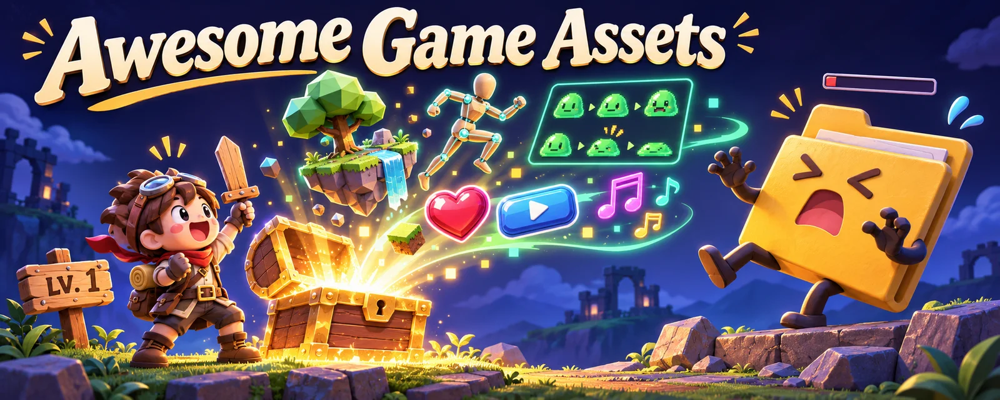

Original illustration: starter sword equipped. Asset loot unlocked.

A curated directory of game assets and tools with license notes, including restricted licenses: 3D models, sprites, textures, sound effects, VFX, ability / casting demos, animation and editors. Every entry lists its URL, a license we checked on the source page, and what it is good for.

> ⚠️ Repositories we found that look like piracy, cracks, paid-asset redistribution, star farming or malware are listed separately in [WARNING.md](WARNING.md) so you can avoid them. Do not use them.

## Contents

**[Browse the asset tables](#3d-models--2d-sprites)** · [Contribute](CONTRIBUTING.md)

Existing topical order; recent popularity is unknown. [Ordering notes](docs/discovery.md).

On phones, swipe tables sideways to compare projects, licenses and uses.

- [3D Models & 2D Sprites](#3d-models--2d-sprites)
- [UI, Icons & HUD](#ui-icons--hud)
- [Textures & Materials](#textures--materials)
- [Sound Effects & Audio](#sound-effects--audio)
- [Fonts](#fonts)
- [VFX, Particles & Shaders](#vfx-particles--shaders)
- [Ability, Casting & Combat Demos](#ability-casting--combat-demos)
- [Animation & Motion Capture](#animation--motion-capture)
- [Physics](#physics)
- [Game AI & Pathfinding](#game-ai--pathfinding)
- [Procedural Generation](#procedural-generation)
- [Engines & Frameworks](#engines--frameworks)
- [Tools & Pipelines](#tools--pipelines)
- [AI Asset Generation & Agent Skills](#ai-asset-generation--agent-skills)
- [Curated Lists & Design References](#curated-lists--design-references)

## Inclusion rules

- Only sources whose license is stated clearly on the project or its official site. Per-asset licenses are marked as such; check each asset before use.
- No pirated, cracked or star-farmed repositories (stars, forks and activity are checked), and no archived or unusable ones.
- Automated checks report broken links and bot-blocked or timed-out sources; a warning is not proof that a source is reachable.
- Licenses were checked on 2026-11-12 via the GitHub API `license` field or the official license page linked in each row.
- Embedded third-party previews require an explicit reuse-license record; other media are linked at the source. Category covers and rows marked *illustration* are original images generated for this list; prompts are in [docs/image-prompts.md](docs/image-prompts.md).

## 3D Models & 2D Sprites

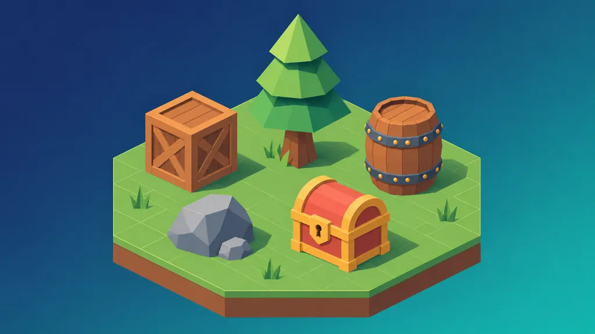

| Project / Preview | License | Good for |
| --- | --- | --- |
| [Kenney Game Assets](https://kenney.nl/assets) 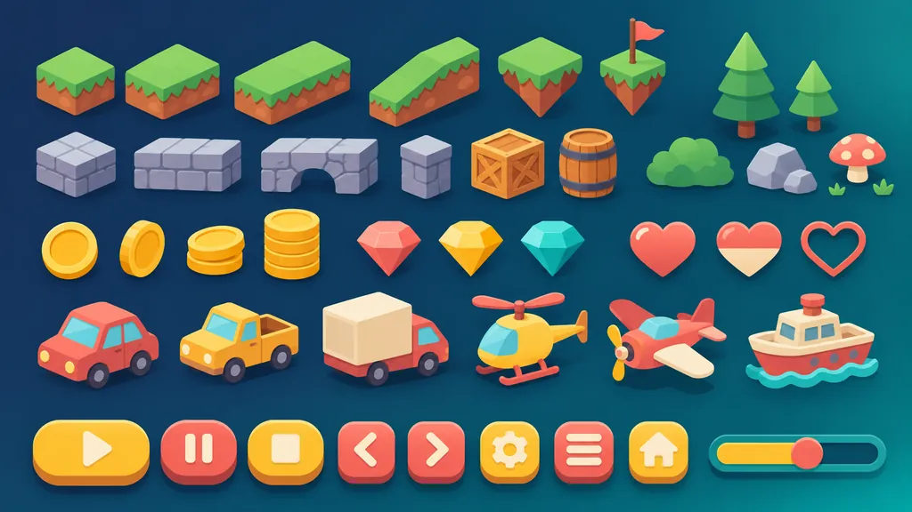 *illustration* | [CC0-1.0](https://kenney.nl/support) | Thousands of consistent 2D sprites, UI, 3D models and sound packs; great for prototypes and game jams. |
| [Quaternius](https://quaternius.com/) [View at source](https://quaternius.com/) | [CC0-1.0](https://quaternius.com/faq.html) | Low-poly 3D packs (characters, nature, buildings, weapons) in FBX/OBJ/glTF; free packs are CC0. |
| [OpenGameArt.org](https://opengameart.org/) 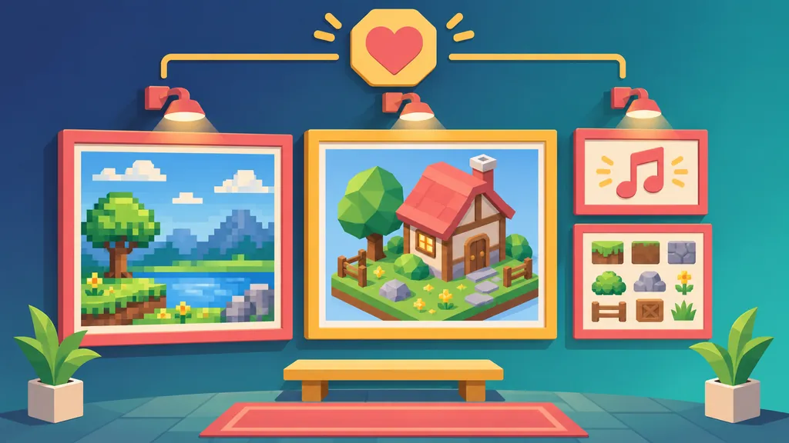 *illustration* | [Per asset (CC0 / CC-BY / CC-BY-SA / GPL / OGA-BY)](https://opengameart.org/content/faq) | Community library of 2D, 3D, music and SFX; each asset page states its license, so check before use. |
| [KhronosGroup/glTF-Sample-Assets](https://github.com/KhronosGroup/glTF-Sample-Assets) [View at source](https://github.com/KhronosGroup/glTF-Sample-Assets) | [Per model (mostly CC0 / CC-BY-4.0; a few under custom terms, see REUSE.toml)](https://github.com/KhronosGroup/glTF-Sample-Assets/tree/main/LICENSES) | Reference glTF models for testing loaders, PBR materials and engine import pipelines. |
| [Polyfork](https://polyfork.dev/assets) [View at source](https://polyfork.dev/assets) | [Free low-poly meshes: CC-BY-4.0 or Polyfork licence (your choice); ES modules and HD editions: Polyfork licence only](https://polyfork.dev/licensing) | 3,000+ free low-poly 3D models as GLB plus a three.js ES module; credit Polyfork under CC BY, or use the no-credit licence without redistributing files. Paid tiers add HD editions. |
| [The Base Mesh](https://www.thebasemesh.com/) [View at source](https://www.thebasemesh.com/) listed in [madjin/awesome-cc0](https://github.com/madjin/awesome-cc0) | [CC0-1.0](https://www.thebasemesh.com/) | 1,250+ real-world-scale base meshes for greyboxing, sculpting and prototyping. |
| [LiberatedPixelCup/Universal-LPC-Spritesheet-Character-Generator](https://github.com/LiberatedPixelCup/Universal-LPC-Spritesheet-Character-Generator) [View at source](https://github.com/LiberatedPixelCup/Universal-LPC-Spritesheet-Character-Generator) listed in [Calinou/awesome-gamedev](https://github.com/Calinou/awesome-gamedev) | [GPL-3.0 (code); art per asset (CC0 / CC-BY / CC-BY-SA / OGA-BY / GPL)](https://github.com/LiberatedPixelCup/Universal-LPC-Spritesheet-Character-Generator#licensing-and-attribution-credits) | Browser generator for layered RPG character spritesheets with walk, slash and cast animations; exports a credits file. |
| [makehumancommunity/makehuman](https://github.com/makehumancommunity/makehuman) 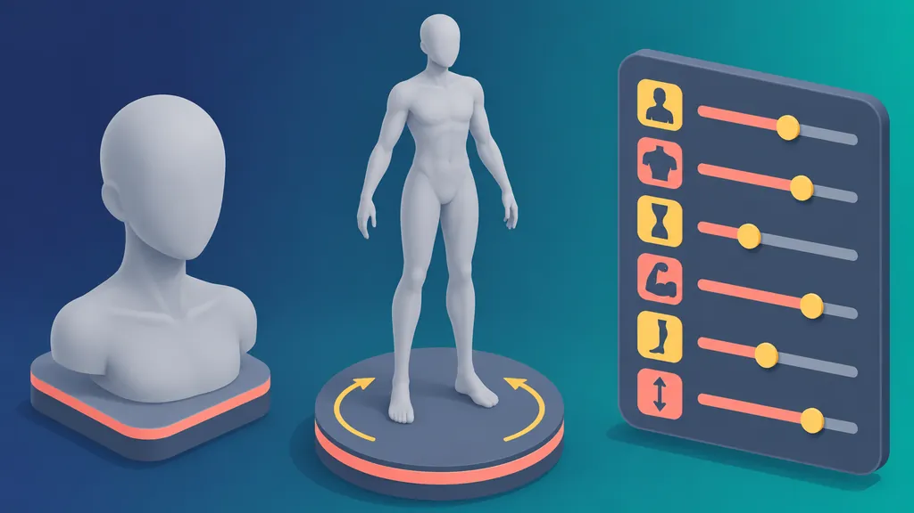 *illustration* | [AGPL-3.0 (code) / CC0-1.0 (bundled assets)](https://github.com/makehumancommunity/makehuman) | Parametric 3D human character creator; exported characters and bundled assets are CC0. |
| [vrm-c/UniVRM](https://github.com/vrm-c/UniVRM) [View at source](https://vrm.dev/en) | [MIT](https://github.com/vrm-c/UniVRM) | Unity importer/exporter for VRM humanoid avatars (glTF-based), with spring bones and expressions. |
| [PolygonalMind/initiative-opensource-release](https://github.com/PolygonalMind/initiative-opensource-release) [View at source](https://github.com/PolygonalMind/initiative-opensource-release) | [CC0-1.0](https://github.com/PolygonalMind/initiative-opensource-release) | CC0 releases from Polygonal Mind, including the 100 Avatars character packs and 3D environments. |
| [sparklinlabs/superpowers-asset-packs](https://github.com/sparklinlabs/superpowers-asset-packs) [View at source](https://github.com/sparklinlabs/superpowers-asset-packs) | [CC0-1.0](https://github.com/sparklinlabs/superpowers-asset-packs) | CC0 asset packs from the Superpowers engine: 2D and 3D packs with characters, vehicles, backgrounds, shooter and platformer sets. |
| [umasteeringgroup/UMA](https://github.com/umasteeringgroup/UMA) [View at source](https://github.com/umasteeringgroup/UMA) | [MIT](https://github.com/umasteeringgroup/UMA) | Unity Multipurpose Avatar: customizable characters with swappable wardrobe, DNA-driven body shapes and texture atlasing. |
| [dicebear/dicebear](https://github.com/dicebear/dicebear) [View at source](https://www.dicebear.com) | [MIT (code; avatar styles have their own licenses)](https://github.com/dicebear/dicebear) | Avatar library that generates SVG profile pictures from a seed in many styles; check each style's license. |
| [Kenney Modular Characters](https://kenney.nl/assets/modular-characters) [View at source](https://kenney.nl/assets/modular-characters) | [CC0-1.0](https://kenney.nl/assets/modular-characters) | Modular 2D character parts you can mix into many top-down or side-view characters. |
| [Kenney Roguelike Characters](https://kenney.nl/assets/roguelike-characters) [View at source](https://kenney.nl/assets/roguelike-characters) | [CC0-1.0](https://kenney.nl/assets/roguelike-characters) | 16x16 pixel roguelike character sprites with gear and outfits. |
| [Kenney Platformer Characters](https://kenney.nl/assets/platformer-characters) [View at source](https://kenney.nl/assets/platformer-characters) | [CC0-1.0](https://kenney.nl/assets/platformer-characters) | Side-view platformer characters with walk, jump and other poses. |
| [Kenney Toon Characters](https://kenney.nl/assets/toon-characters) [View at source](https://kenney.nl/assets/toon-characters) | [CC0-1.0](https://kenney.nl/assets/toon-characters) | Cartoon 2D characters in multiple poses for casual games. |
| [Quaternius Universal Base Characters](https://quaternius.com/packs/universalbasecharacters.html)  image: project [Quaternius Universal Base Characters](https://quaternius.com/packs/universalbasecharacters.html) | [CC0-1.0](https://quaternius.com/packs/universalbasecharacters.html) | Rigged low-poly base characters made to work with Quaternius' universal animation library. |
| [Quaternius Modular Character Outfits - Fantasy](https://quaternius.com/packs/modularcharacteroutfitsfantasy.html) [View at source](https://quaternius.com/packs/modularcharacteroutfitsfantasy.html) | [CC0-1.0](https://quaternius.com/packs/modularcharacteroutfitsfantasy.html) | Modular fantasy outfits (armor, robes, hats) for Quaternius base characters. |
| [Liberated Pixel Cup (LPC) Base Assets](https://opengameart.org/content/liberated-pixel-cup-lpc-base-assets-sprites-map-tiles) [View at source](https://opengameart.org/content/liberated-pixel-cup-lpc-base-assets-sprites-map-tiles) | [CC-BY-SA-3.0 / GPL-3.0](https://opengameart.org/content/liberated-pixel-cup-lpc-base-assets-sprites-map-tiles) | Liberated Pixel Cup base sprites and map tiles, the root of the large LPC character-art ecosystem. |
| [Kenney Pixel Platformer](https://kenney.nl/assets/pixel-platformer)  image: project [Kenney Pixel Platformer](https://kenney.nl/assets/pixel-platformer) | [CC0-1.0](https://kenney.nl/assets/pixel-platformer) | 18x18 pixel platformer tiles, characters and items. |
| [Kenney 1-Bit Pack](https://kenney.nl/assets/1-bit-pack) [View at source](https://kenney.nl/assets/1-bit-pack) | [CC0-1.0](https://kenney.nl/assets/1-bit-pack) | Over 1,000 one-bit 16x16 tiles for dungeons, towns, sci-fi and more. |
| [Kenney Tiny Dungeon](https://kenney.nl/assets/tiny-dungeon) [View at source](https://kenney.nl/assets/tiny-dungeon) | [CC0-1.0](https://kenney.nl/assets/tiny-dungeon) | Tiny 16x16 dungeon tiles, heroes and monsters. |
| [Kenney Tiny Town](https://kenney.nl/assets/tiny-town) [View at source](https://kenney.nl/assets/tiny-town) | [CC0-1.0](https://kenney.nl/assets/tiny-town) | Tiny 16x16 town tiles with houses, fences and nature. |
| [16x16 DungeonTileset II](https://0x72.itch.io/dungeontileset-ii) [View at source](https://0x72.itch.io/dungeontileset-ii) | [CC0-1.0 (assets) / MIT (code)](https://0x72.itch.io/dungeontileset-ii) | 16x16 dungeon tileset with animated characters, monsters and weapons. |
| [16x16 Fantasy tileset](https://opengameart.org/content/16x16-fantasy-tileset) [View at source](https://opengameart.org/content/16x16-fantasy-tileset) | [CC-BY-SA-3.0](https://opengameart.org/content/16x16-fantasy-tileset) | Mini characters and fantasy items for Game Boy/Famicom-style roguelikes and RPGs. |
| [A Blocky Dungeon](https://opengameart.org/content/a-blocky-dungeon) [View at source](https://opengameart.org/content/a-blocky-dungeon) | [CC0-1.0](https://opengameart.org/content/a-blocky-dungeon) | Blocky 16x16 dungeon tiles with doors, switches and animated props (no characters). |

## UI, Icons & HUD

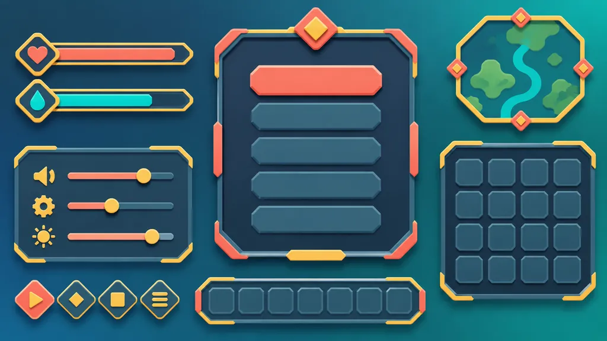

| Project / Preview | License | Good for |
| --- | --- | --- |
| [Game-icons.net](https://game-icons.net/) [View at source](https://game-icons.net/) listed in [Calinou/awesome-gamedev](https://github.com/Calinou/awesome-gamedev) | [CC-BY-3.0](https://game-icons.net/about.html) | 4,000+ free SVG/PNG game icons (skills, items, status effects); credit each icon's author. |
| [Those Awesome Guys: Controller & Keyboard Prompts](https://thoseawesomeguys.com/prompts/) 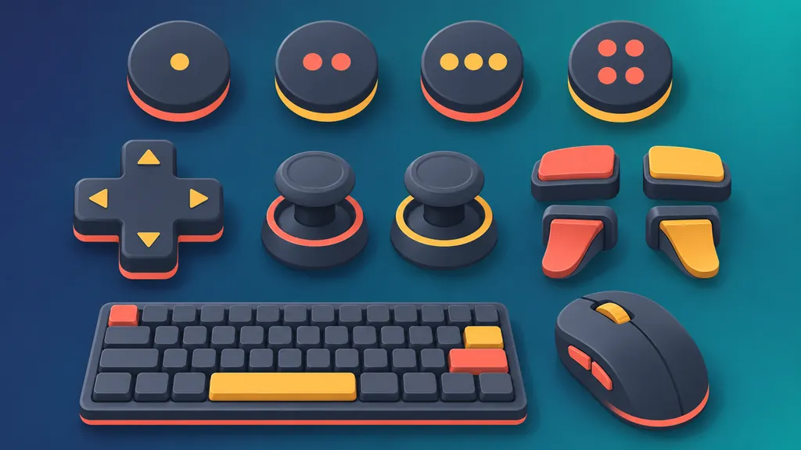 *illustration* listed in [Calinou/awesome-gamedev](https://github.com/Calinou/awesome-gamedev) | [CC0-1.0](https://thoseawesomeguys.com/prompts/) | Button prompt icons for keyboard, mouse and common controllers, for tutorials and input hints. |
| [ocornut/imgui](https://github.com/ocornut/imgui) [View at source](https://github.com/ocornut/imgui) | [MIT](https://github.com/ocornut/imgui) | Immediate-mode GUI library (Dear ImGui) for debug menus, in-game tools and editors. |
| [Kenney UI Pack](https://kenney.nl/assets/ui-pack)  image: project [Kenney UI Pack](https://kenney.nl/assets/ui-pack) | [CC0-1.0](https://kenney.nl/assets/ui-pack) | 430 UI elements (buttons, sliders, panels) in several colors for menus and HUDs. |
| [mikke89/RmlUi](https://github.com/mikke89/RmlUi) [View at source](https://github.com/mikke89/RmlUi) | [MIT](https://github.com/mikke89/RmlUi) | C++ game UI library that builds interfaces from HTML/CSS-like documents, with data binding and animation. |
| [Immediate-Mode-UI/Nuklear](https://github.com/Immediate-Mode-UI/Nuklear) [View at source](https://github.com/Immediate-Mode-UI/Nuklear) | [MIT or Unlicense](https://github.com/Immediate-Mode-UI/Nuklear) | Single-header ANSI C immediate-mode GUI for tools and in-game menus. |
| [emilk/egui](https://github.com/emilk/egui) [View at source](https://github.com/emilk/egui) | [MIT OR Apache-2.0](https://github.com/emilk/egui) | Easy immediate-mode GUI in Rust that runs natively and on the web; common in Rust game tools. |
| [nicbarker/clay](https://github.com/nicbarker/clay) [View at source](https://github.com/nicbarker/clay) | [Zlib](https://github.com/nicbarker/clay) | High-performance UI layout library in C with flexbox-like layout and renderer-agnostic output. |
| [memononen/nanovg](https://github.com/memononen/nanovg) [View at source](https://github.com/memononen/nanovg) | [Zlib](https://github.com/memononen/nanovg) | Antialiased 2D vector drawing on OpenGL for UI and visualizations. |
| [CedricGuillemet/ImGuizmo](https://github.com/CedricGuillemet/ImGuizmo) [View at source](https://github.com/CedricGuillemet/ImGuizmo) listed in [Calinou/awesome-gamedev](https://github.com/Calinou/awesome-gamedev) | [MIT](https://github.com/CedricGuillemet/ImGuizmo) | Immediate-mode 3D gizmos (move, rotate, scale) and other editor controls for Dear ImGui. |
| [epezent/implot](https://github.com/epezent/implot) [View at source](https://github.com/epezent/implot) | [MIT](https://github.com/epezent/implot) | Immediate-mode plotting for Dear ImGui; good for profilers and debug graphs. |
| [ebitenui/ebitenui](https://github.com/ebitenui/ebitenui) [View at source](https://github.com/ebitenui/ebitenui) | [MIT](https://github.com/ebitenui/ebitenui) | UI engine and widget library for Ebitengine games in Go. |
| [facebook/yoga](https://github.com/facebook/yoga) [View at source](https://yogalayout.dev/) | [MIT](https://github.com/facebook/yoga) | Embeddable flexbox layout engine; can drive game UI layout in C++, C# or JavaScript. |
| [wjakob/nanogui](https://github.com/wjakob/nanogui) 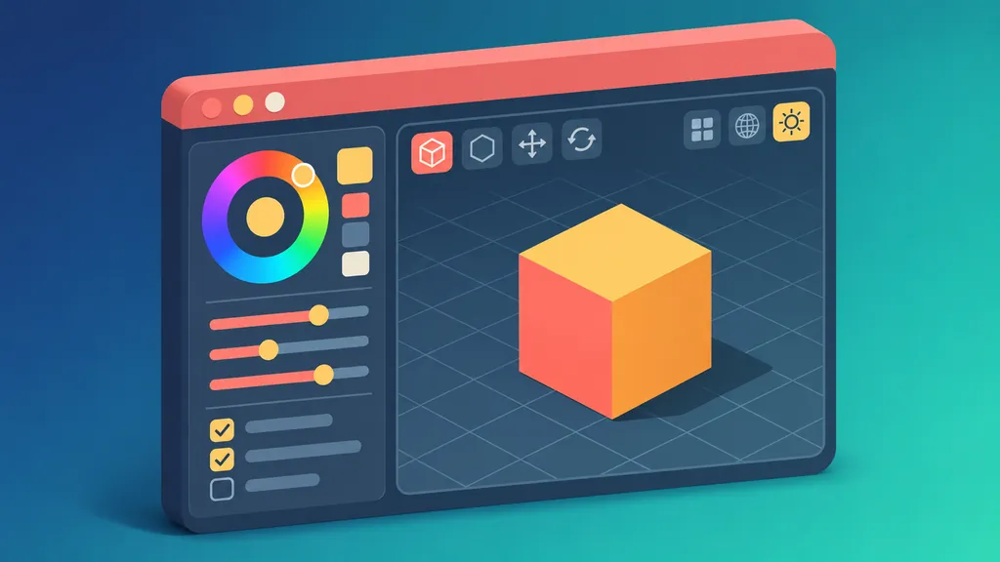 *illustration* | [BSD-3-Clause](https://github.com/wjakob/nanogui) | Minimalistic C++/Python GUI library for OpenGL, useful for quick tool panels. |
| [vladbat00/bevy_egui](https://github.com/vladbat00/bevy_egui) [View at source](https://github.com/vladbat00/bevy_egui) | [MIT](https://github.com/vladbat00/bevy_egui) | Integrates egui into the Bevy engine for debug panels and in-game editors. |
| [Kenney Crosshair Pack](https://kenney.nl/assets/crosshair-pack) [View at source](https://kenney.nl/assets/crosshair-pack) | [CC0-1.0](https://kenney.nl/assets/crosshair-pack) | Set of crosshair and reticle sprites for shooters and aiming UI. |
| [Kenney Cursor Pack](https://kenney.nl/assets/cursor-pack) [View at source](https://kenney.nl/assets/cursor-pack) | [CC0-1.0](https://kenney.nl/assets/cursor-pack) | Mouse cursors and pointer icons for game menus and strategy games. |
| [Kenney UI Pack (RPG Expansion)](https://kenney.nl/assets/ui-pack-rpg-expansion) [View at source](https://kenney.nl/assets/ui-pack-rpg-expansion) | [CC0-1.0](https://kenney.nl/assets/ui-pack-rpg-expansion) | RPG-style UI elements: panels, bars, buttons and frames. |
| [RPG GUI construction kit v1.0](https://opengameart.org/content/rpg-gui-construction-kit-v10) [View at source](https://opengameart.org/content/rpg-gui-construction-kit-v10) | [CC-BY-3.0](https://opengameart.org/content/rpg-gui-construction-kit-v10) | RPG GUI construction kit with frames, bars and buttons to assemble fantasy menus. |
| [Sci-fi User Interface](https://opengameart.org/content/sci-fi-user-interface) [View at source](https://opengameart.org/content/sci-fi-user-interface) | [CC0-1.0](https://opengameart.org/content/sci-fi-user-interface) | Sci-fi user interface elements for futuristic HUDs and menus. |

## Textures & Materials

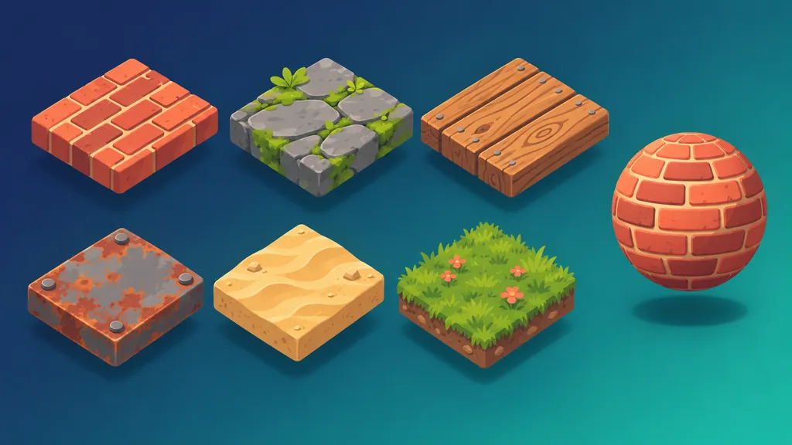

| Project / Preview | License | Good for |
| --- | --- | --- |
| [Poly Haven](https://polyhaven.com/) [View at source](https://polyhaven.com/) | [CC0-1.0](https://polyhaven.com/license) | High-quality PBR textures, HDRIs and photoscanned models; ideal for realistic scenes and lighting. |
| [ambientCG](https://ambientcg.com/) 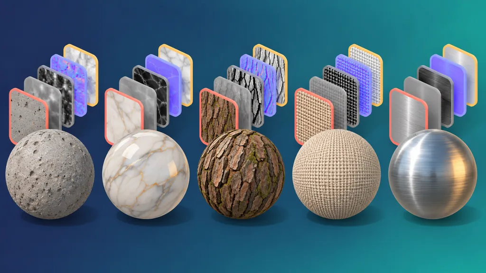 *illustration* | [CC0-1.0](https://docs.ambientcg.com/license/) | Large CC0 library of PBR materials, HDRIs and models with multiple resolutions. |
| [kmkolasinski/AwesomeBump](https://github.com/kmkolasinski/AwesomeBump) [View at source](https://github.com/kmkolasinski/AwesomeBump) listed in [Calinou/awesome-gamedev](https://github.com/Calinou/awesome-gamedev) listed in [madjin/awesome-cc0](https://github.com/madjin/awesome-cc0) | [GPL-3.0](https://github.com/kmkolasinski/AwesomeBump) | Generates normal, height, specular, AO, roughness and metallic maps from a single image (last updated 2023). |
| [armory3d/armorpaint](https://github.com/armory3d/armorpaint) [View at source](https://github.com/armory3d/armorpaint) | [Zlib](https://github.com/armory3d/armorpaint) | 3D painting tool for PBR texturing of models (source; prebuilt binaries are sold separately). |
| [azagaya/laigter](https://github.com/azagaya/laigter) [View at source](https://github.com/azagaya/laigter) | [GPL-3.0](https://github.com/azagaya/laigter) | Generates normal, specular and occlusion maps for 2D sprites to get dynamic lighting. |

## Sound Effects & Audio

| Project / Preview | License | Good for |
| --- | --- | --- |
| [Freesound](https://freesound.org/) 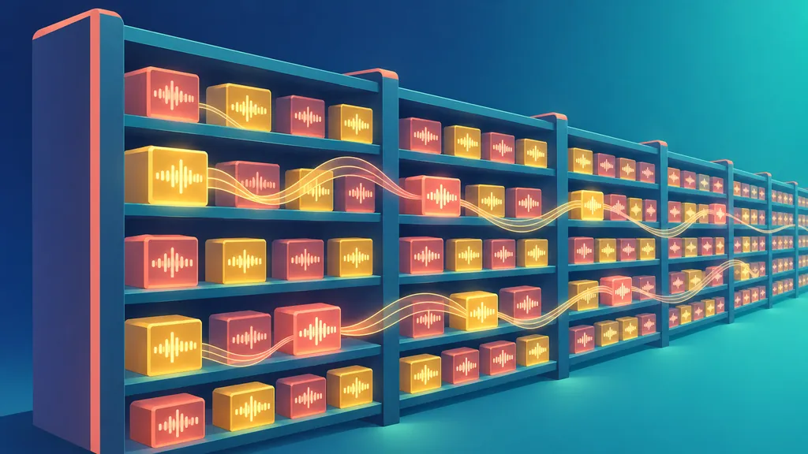 *illustration* | [Per sound (CC0 / CC-BY-4.0 / CC-BY-NC-4.0)](https://freesound.org/help/faq/) | Huge community sound library; filter by license (CC0 or CC-BY for commercial games) and credit when required. |
| [Sonniss #GameAudioGDC Bundles](https://sonniss.com/gameaudiogdc) [View at source](https://sonniss.com/gameaudiogdc) | [Royalty-free (Sonniss license: commercial use, no attribution required)](https://sonniss.com/gameaudiogdc) | Yearly free bundles of professional SFX, royalty-free for commercial games. |
| [chr15m/jsfxr](https://github.com/chr15m/jsfxr) [View at source](https://github.com/chr15m/jsfxr) | [Unlicense](https://github.com/chr15m/jsfxr) | Browser-based retro sound effect generator (sfxr port) for jumps, coins, hits and lasers. |
| [raysan5/rfxgen](https://github.com/raysan5/rfxgen) [View at source](https://github.com/raysan5/rfxgen) listed in [Calinou/awesome-gamedev](https://github.com/Calinou/awesome-gamedev) | [Zlib](https://github.com/raysan5/rfxgen) | Small sfxr-style sound effect generator from the raylib author; desktop and web. |
| [YuriSizov/boscaceoil-blue](https://github.com/YuriSizov/boscaceoil-blue) [View at source](https://github.com/YuriSizov/boscaceoil-blue) listed in [Calinou/awesome-gamedev](https://github.com/Calinou/awesome-gamedev) | [MIT](https://github.com/YuriSizov/boscaceoil-blue/blob/main/LICENSE) | Beginner-friendly step-sequencer music maker, a modern port of Terry Cavanagh's Bosca Ceoil; good for game loops and jingles. |
| [mackron/miniaudio](https://github.com/mackron/miniaudio) [View at source](https://github.com/mackron/miniaudio) | [Unlicense or MIT-0 (your choice)](https://github.com/mackron/miniaudio) | Single-file C audio playback and capture library with mixing and effects; easy to embed in engines. |
| [jarikomppa/soloud](https://github.com/jarikomppa/soloud) [View at source](https://github.com/jarikomppa/soloud) | [Zlib](https://github.com/jarikomppa/soloud) | Easy, portable C++ audio engine for games with 3D sound, filters and speech synthesis. |
| [Tonejs/Tone.js](https://github.com/Tonejs/Tone.js) 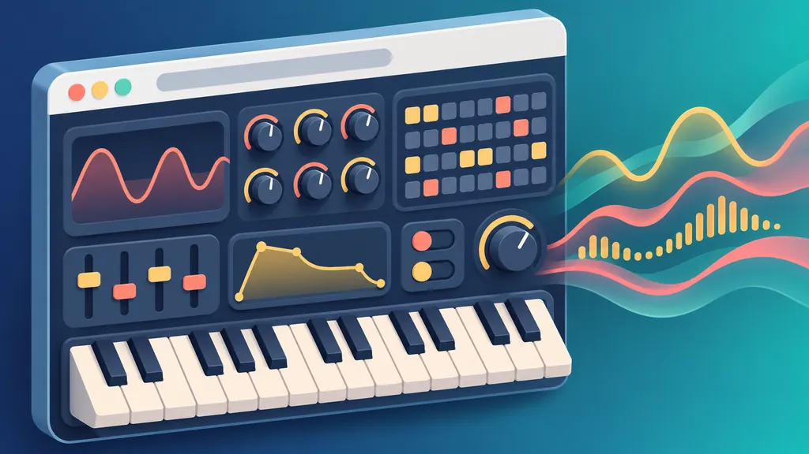 *illustration* | [MIT](https://github.com/Tonejs/Tone.js) | Web Audio framework for interactive music: synths, effects and scheduling in the browser. |
| [goldfire/howler.js](https://github.com/goldfire/howler.js) [View at source](https://github.com/goldfire/howler.js) | [MIT](https://github.com/goldfire/howler.js) | JavaScript audio library for web games: sprites, spatial audio and cross-browser playback. |
| [surge-synthesizer/surge](https://github.com/surge-synthesizer/surge) [View at source](https://github.com/surge-synthesizer/surge) | [GPL-3.0](https://github.com/surge-synthesizer/surge) | Surge XT, a powerful open-source synthesizer for designing game music and sound effects. |
| [increpare/bfxr](https://github.com/increpare/bfxr) 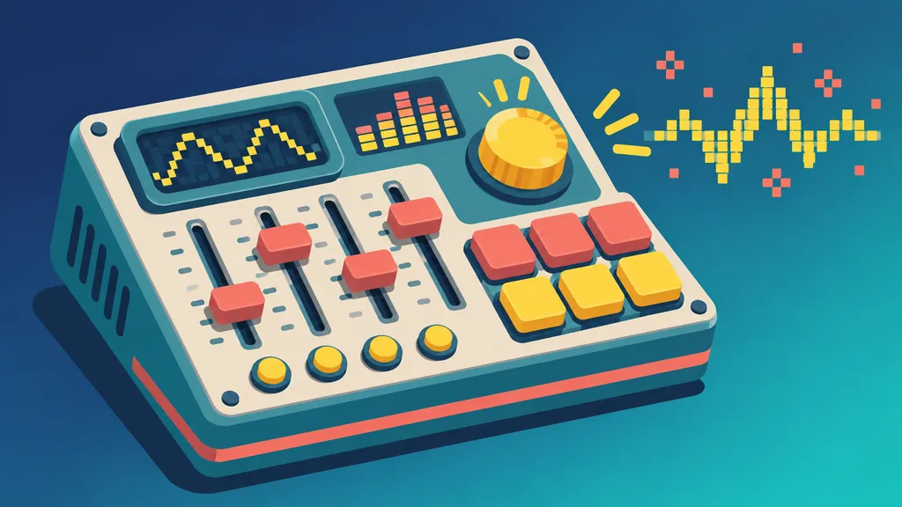 *illustration* | [Apache-2.0 (stated in README)](https://github.com/increpare/bfxr#readme) | Retro sound effect generator (extended sfxr) for jumps, pickups and explosions. |
| [Pixabay Sound Effects](https://pixabay.com/sound-effects/)  *illustration* ⚠ site returns 403 to automated checks; license verified manually | [Pixabay Content License (free, no attribution; no standalone resale)](https://pixabay.com/service/license-summary/) | Large library of royalty-free sound effects and music under the Pixabay Content License. |
| [ValveSoftware/steam-audio](https://github.com/ValveSoftware/steam-audio) 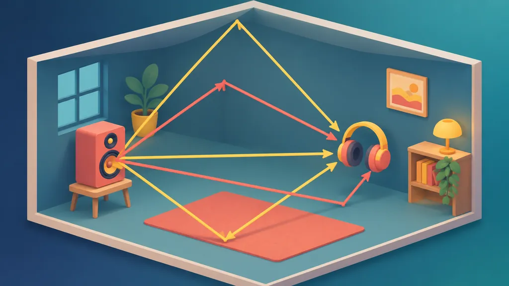 *illustration* | [Apache-2.0](https://github.com/ValveSoftware/steam-audio) | Spatial audio SDK with HRTF, occlusion and physics-based reverb; plugins for Unity, Unreal and FMOD. |
| [kcat/openal-soft](https://github.com/kcat/openal-soft) 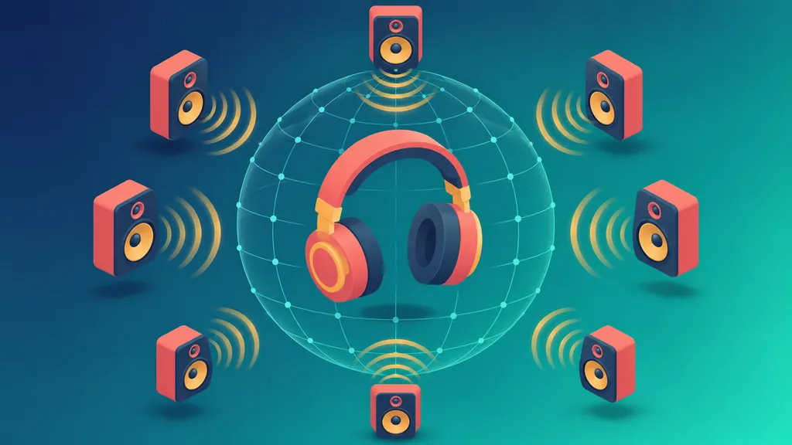 *illustration* | [LGPL-2.0-or-later](https://github.com/kcat/openal-soft) | Software implementation of the OpenAL 3D audio API, with HRTF and surround output. |
| [tesselode/kira](https://github.com/tesselode/kira) 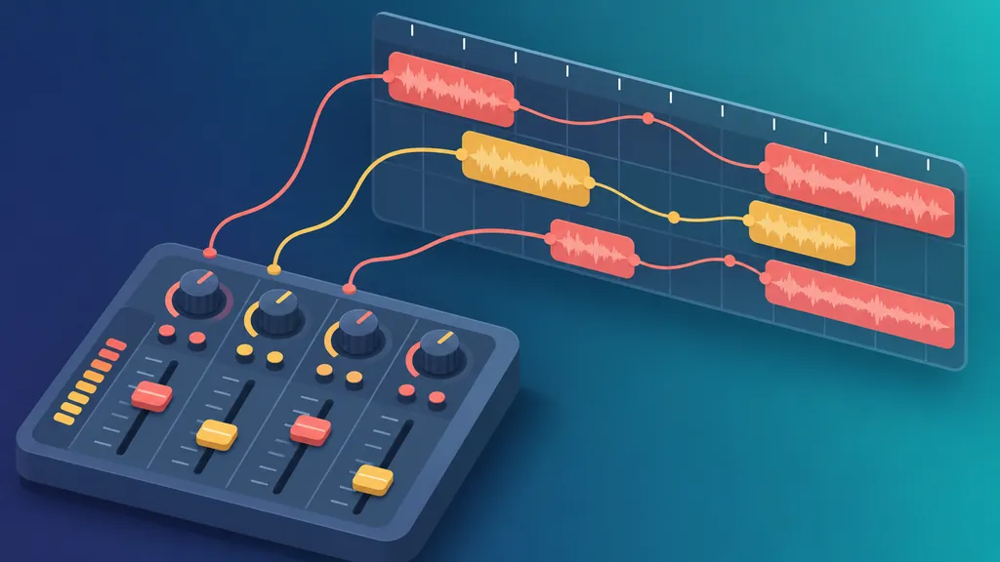 *illustration* | [MIT OR Apache-2.0](https://github.com/tesselode/kira) | Rust game audio library with tweenable parameters, mixer tracks, clocks and effects. |
| [LabSound/LabSound](https://github.com/LabSound/LabSound) [View at source](https://github.com/LabSound/LabSound) | [BSD-2-Clause / BSD-3-Clause](https://github.com/LabSound/LabSound) | Graph-based C++ audio engine derived from WebKit's WebAudio, for games and interactive apps. |
| [tildearrow/furnace](https://github.com/tildearrow/furnace) [View at source](https://github.com/tildearrow/furnace) | [GPL-2.0-or-later](https://github.com/tildearrow/furnace) | Multi-system chiptune tracker that emulates dozens of classic sound chips for retro music. |
| [milkytracker/MilkyTracker](https://github.com/milkytracker/MilkyTracker) [View at source](https://github.com/milkytracker/MilkyTracker) | [GPL-3.0 (MilkyPlay library: BSD-3-Clause)](https://github.com/milkytracker/MilkyTracker) | FastTracker II-compatible music tracker for MOD/XM chiptune and game music. |

## Fonts

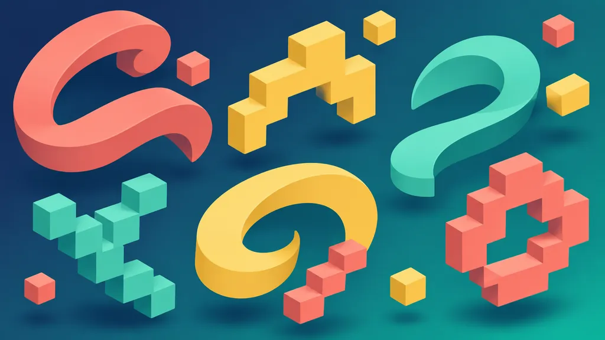

| Project / Preview | License | Good for |
| --- | --- | --- |
| [google/fonts](https://github.com/google/fonts) 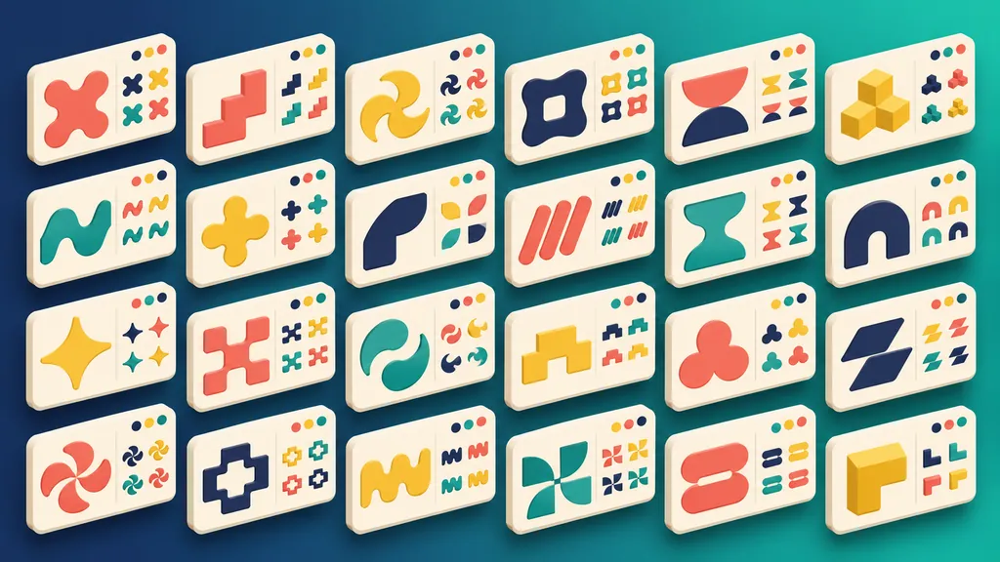 *illustration* | [Per family (OFL-1.1 / Apache-2.0 / UFL)](https://github.com/google/fonts#license) | All Google Fonts families as source files; each folder name is its license. Many support CJK. |
| [rektdeckard/departure-mono](https://github.com/rektdeckard/departure-mono) [View at source](https://github.com/rektdeckard/departure-mono) | [OFL-1.1 (font) / MIT (site)](https://github.com/rektdeckard/departure-mono) | Monospaced pixel font with a retro-futuristic look for HUDs and terminals. |
| [TakWolf/fusion-pixel-font](https://github.com/TakWolf/fusion-pixel-font) [View at source](https://github.com/TakWolf/fusion-pixel-font) | [OFL-1.1 (font) / MIT (build code)](https://github.com/TakWolf/fusion-pixel-font) | Open pixel font covering Chinese, Japanese, Korean and Latin, in 8/10/12 px sizes. |
| [TakWolf/ark-pixel-font](https://github.com/TakWolf/ark-pixel-font) [View at source](https://github.com/TakWolf/ark-pixel-font) | [OFL-1.1 (font) / MIT (build code)](https://github.com/TakWolf/ark-pixel-font) | Open pixel font for CJK and Latin, designed for pixel-art games. |
| [Kenney Fonts](https://kenney.nl/assets/kenney-fonts) [View at source](https://kenney.nl/assets/kenney-fonts) | [CC0-1.0](https://kenney.nl/assets/kenney-fonts) | 11 playful game fonts from Kenney, free for any project. |
| [IdreesInc/Monocraft](https://github.com/IdreesInc/Monocraft) [View at source](https://github.com/IdreesInc/Monocraft) | [OFL-1.1](https://github.com/IdreesInc/Monocraft) | Blocky monospaced font inspired by the Minecraft typeface, with programming ligatures. |
| [the-moonwitch/Cozette](https://github.com/the-moonwitch/Cozette) [View at source](https://github.com/the-moonwitch/Cozette) | [MIT](https://github.com/the-moonwitch/Cozette) | Small bitmap font with wide glyph coverage; works well for retro UI and terminals. |
| [fcambus/spleen](https://github.com/fcambus/spleen)  *illustration* | [BSD-2-Clause](https://github.com/fcambus/spleen) | Monospaced bitmap fonts in sizes from 5x8 to 32x64 for crisp pixel UI. |
| [sgigou/NF-Pixels](https://github.com/sgigou/NF-Pixels) [View at source](https://github.com/sgigou/NF-Pixels) | [OFL-1.1](https://github.com/sgigou/NF-Pixels) | Free pixel font with regular and bold styles for retro game text. |
| [scott0107000/BoutiqueBitmap7x7](https://github.com/scott0107000/BoutiqueBitmap7x7) [View at source](https://github.com/scott0107000/BoutiqueBitmap7x7) | [OFL-1.1](https://github.com/scott0107000/BoutiqueBitmap7x7) | Open-source 7x7 bitmap font covering Chinese, Japanese and Latin characters. |
| [monogram](https://datagoblin.itch.io/monogram) [View at source](https://datagoblin.itch.io/monogram) | [CC0-1.0](https://datagoblin.itch.io/monogram) | monogram: free monospace pixel font with wide character coverage. |
| [m5x7](https://managore.itch.io/m5x7) [View at source](https://managore.itch.io/m5x7) | [CC0-1.0](https://managore.itch.io/m5x7) | m5x7: tiny, readable pixel font by Daniel Linssen. |
| [Pixeloid](https://ggbot.itch.io/pixeloid-font) [View at source](https://ggbot.itch.io/pixeloid-font) | [OFL-1.1](https://ggbot.itch.io/pixeloid-font) | Pixeloid: pixel font family with sans, mono and bold styles. |
| [The League of Moveable Type](https://www.theleagueofmoveabletype.com/) [View at source](https://www.theleagueofmoveabletype.com/) | [OFL-1.1](https://www.theleagueofmoveabletype.com/) | Foundry of open-source display fonts, all under the SIL Open Font License. |

## VFX, Particles & Shaders

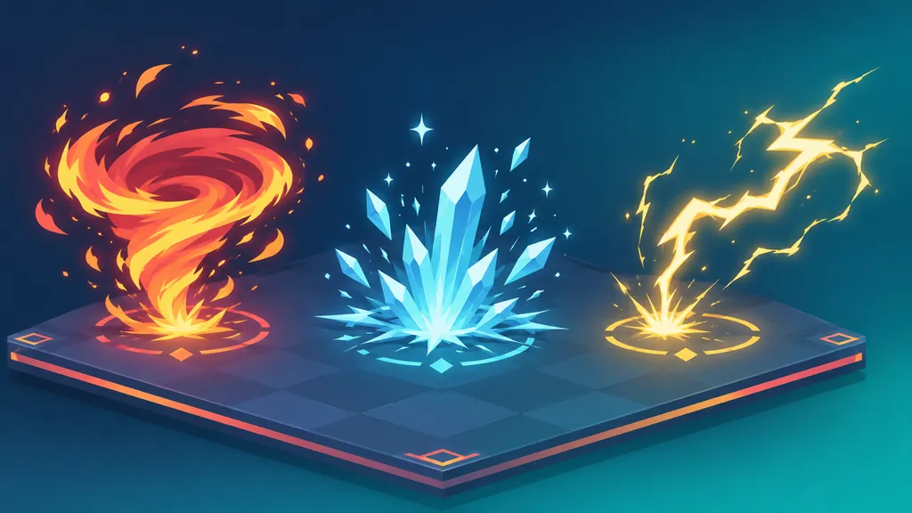

| Project / Preview | License | Good for |
| --- | --- | --- |
| [Alchemist0823/three.quarks](https://github.com/Alchemist0823/three.quarks) [View at source](https://github.com/Alchemist0823/three.quarks) | [MIT](https://github.com/Alchemist0823/three.quarks) | General-purpose particle system / VFX engine for three.js, with a visual editor. |
| [creativelifeform/three-nebula](https://github.com/creativelifeform/three-nebula) [View at source](https://three-nebula.org/) | [MIT](https://github.com/creativelifeform/three-nebula) | WebGL particle engine for three.js; JSON-defined emitters for fire, smoke and magic effects. |
| [effekseer/Effekseer](https://github.com/effekseer/Effekseer) [View at source](https://github.com/effekseer/Effekseer) | [MIT](https://github.com/effekseer/Effekseer) | Particle effect editor and runtime with plugins for Unity, Unreal, Godot and web. |
| [Kenney Particle Pack](https://kenney.nl/assets/particle-pack) [View at source](https://kenney.nl/assets/particle-pack) | [CC0-1.0](https://kenney.nl/assets/particle-pack) | 80 particle sprites (smoke, fire, sparks, magic) to drop into any particle system. |
| [JangaFX Free VDB Animations](https://jangafx.com/software/embergen/download/free-vdb-animations/) [View at source](https://jangafx.com/) listed in [madjin/awesome-cc0](https://github.com/madjin/awesome-cc0) | [CC0-1.0](https://jangafx.com/software/embergen/download/free-vdb-animations/) | Free volumetric fire, smoke and explosion simulations (OpenVDB) for Blender, Houdini and offline renders. |
| [pmndrs/postprocessing](https://github.com/pmndrs/postprocessing) 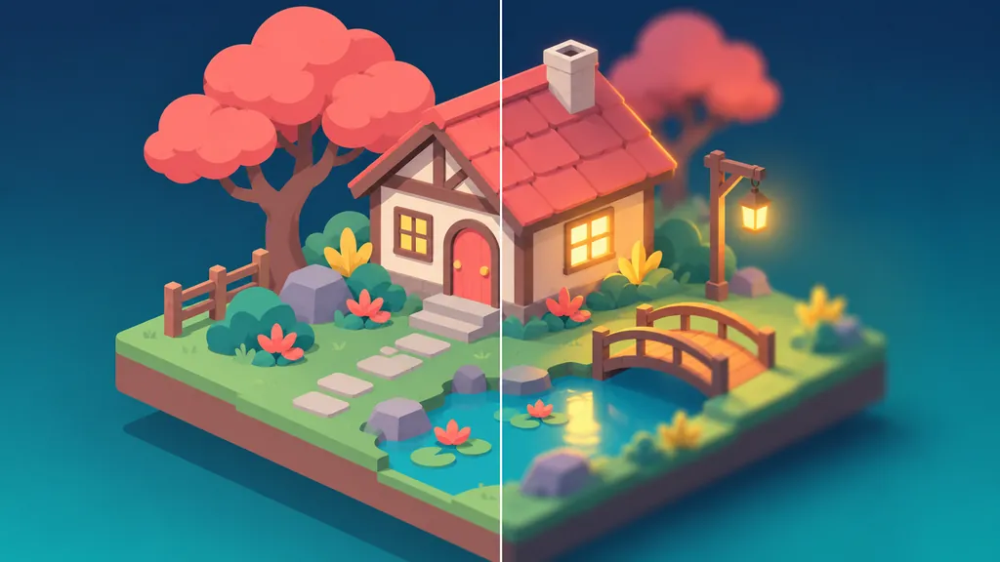 *illustration* | [Zlib](https://github.com/pmndrs/postprocessing) | Post-processing effects library for three.js: bloom, depth of field, SMAA, tone mapping and more. |
| [gdquest-demos/godot-shaders](https://github.com/gdquest-demos/godot-shaders) [View at source](https://github.com/gdquest-demos/godot-shaders) | [MIT (code) / CC-BY-NC-SA-4.0 (art)](https://github.com/gdquest-demos/godot-shaders) | Open-source Godot shader demos (dissolve, outline, water, toon and more) with readable code. |
| [gdquest-demos/godot-visual-effects](https://github.com/gdquest-demos/godot-visual-effects) [View at source](https://github.com/gdquest-demos/godot-visual-effects) | [MIT (code) / CC-BY-NC-SA-4.0 (art)](https://github.com/gdquest-demos/godot-visual-effects) | Godot visual-effects demos: particles, explosions, impacts and magic spells to learn from. |
| [Godot Shaders](https://godotshaders.com/) [View at source](https://godotshaders.com/) | [Per shader (CC0 / MIT / GPL-3.0); images not covered](https://godotshaders.com/license/) | Community library of Godot shaders; each post states its license, which covers the code only. |
| [CyberAgentGameEntertainment/NovaShader](https://github.com/CyberAgentGameEntertainment/NovaShader) [View at source](https://github.com/CyberAgentGameEntertainment/NovaShader) | [MIT](https://github.com/CyberAgentGameEntertainment/NovaShader) | Multi-purpose particle shader for Unity URP with distortion, dissolve, flow maps and more. |
| [pixijs-userland/particle-emitter](https://github.com/pixijs-userland/particle-emitter)  *illustration* | [MIT](https://github.com/pixijs-userland/particle-emitter) | Particle system for PixiJS with a visual editor for 2D effects like fire, smoke and sparks. |
| [djeedai/bevy_hanabi](https://github.com/djeedai/bevy_hanabi) 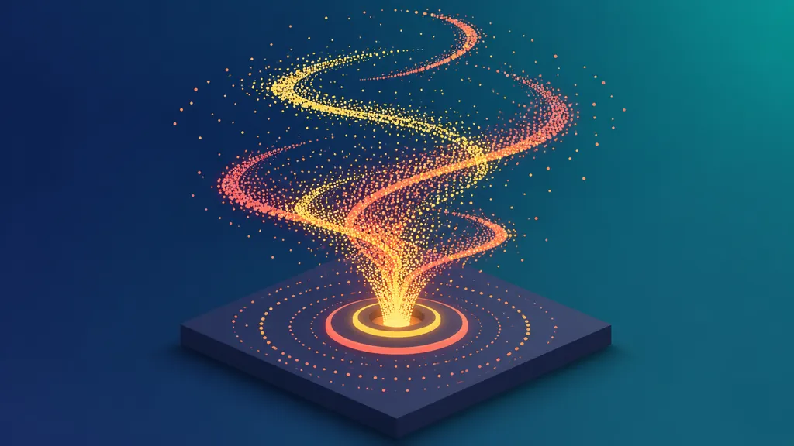 *illustration* | [MIT OR Apache-2.0](https://github.com/djeedai/bevy_hanabi) | GPU particle system plugin for Bevy that handles large numbers of particles. |
| [haowg/GODOT-VFX-LIBRARY](https://github.com/haowg/GODOT-VFX-LIBRARY) [View at source](https://github.com/haowg/GODOT-VFX-LIBRARY) | [MIT](https://github.com/haowg/GODOT-VFX-LIBRARY) | Collection of particle effects and shaders for Godot 4 action games: hits, slashes, explosions, auras. |
| [Chrisknyfe/boujie_water_shader](https://github.com/Chrisknyfe/boujie_water_shader) [View at source](https://github.com/Chrisknyfe/boujie_water_shader) | [MIT](https://github.com/Chrisknyfe/boujie_water_shader) | Stylized Godot 4 water shader with waves, foam and refraction. |
| [Arnklit/Waterways](https://github.com/Arnklit/Waterways) [View at source](https://github.com/Arnklit/Waterways) | [MIT](https://github.com/Arnklit/Waterways) | Godot add-on that builds river meshes from Bezier curves and bakes flow and foam maps. |
| [gdquest-demos/godot-4-stylized-sky](https://github.com/gdquest-demos/godot-4-stylized-sky) [View at source](https://github.com/gdquest-demos/godot-4-stylized-sky) | [MIT (code) / CC-BY-NC-SA-4.0 (art)](https://github.com/gdquest-demos/godot-4-stylized-sky) | Open-source stylized sky shader for Godot 4 with sun, moon, clouds and stars. |
| [stegu/webgl-noise](https://github.com/stegu/webgl-noise) 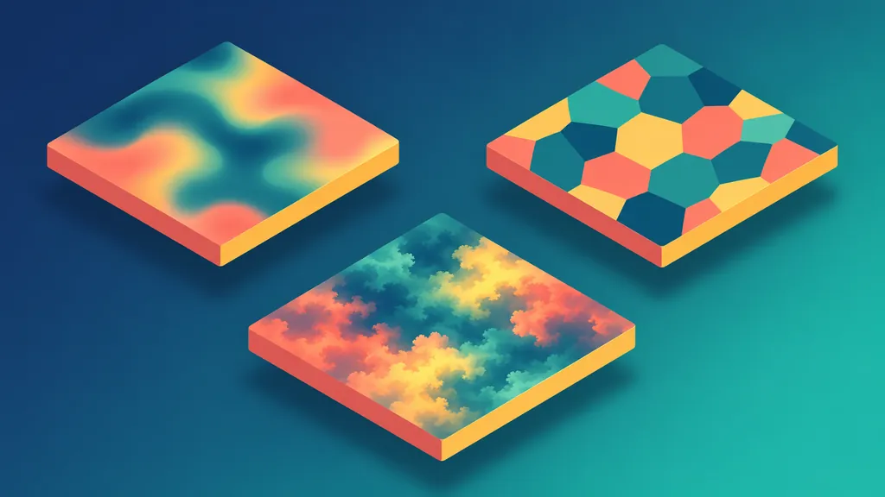 *illustration* | [MIT](https://github.com/stegu/webgl-noise) | GLSL simplex, Perlin and cellular noise functions for procedural shaders. |
| [wwwtyro/glsl-atmosphere](https://github.com/wwwtyro/glsl-atmosphere) [View at source](https://github.com/wwwtyro/glsl-atmosphere) | [Unlicense](https://github.com/wwwtyro/glsl-atmosphere) | GLSL sky renderer with Rayleigh and Mie scattering for realistic skies. |
| [Cyanilux/URP_ShaderGraphCustomLighting](https://github.com/Cyanilux/URP_ShaderGraphCustomLighting) 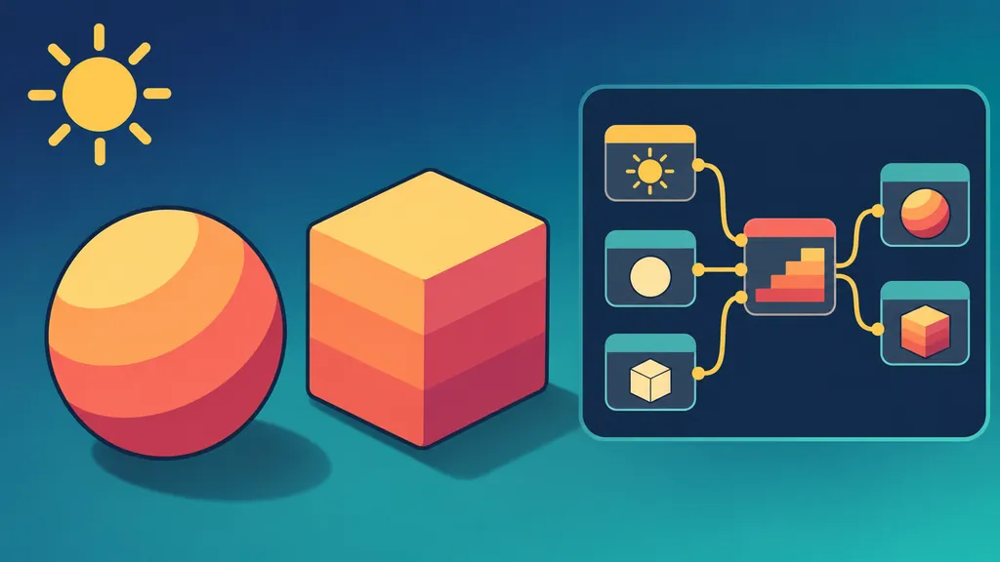 *illustration* | [MIT](https://github.com/Cyanilux/URP_ShaderGraphCustomLighting) | Custom lighting sub-graphs for Unity URP Shader Graph, handy for toon and stylized shading. |

## Ability, Casting & Combat Demos

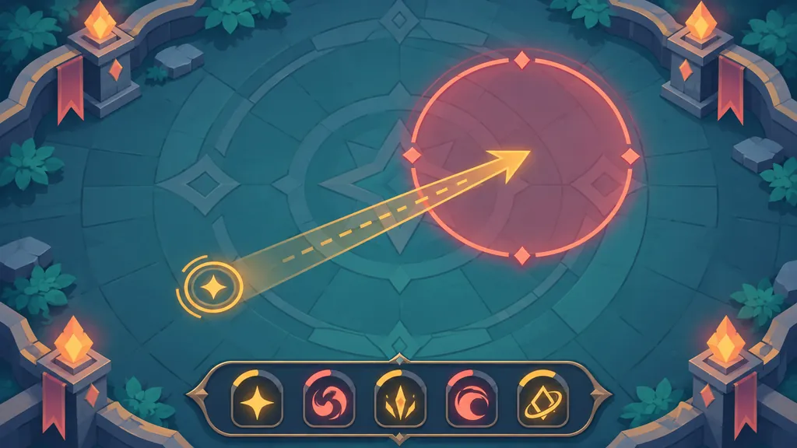

| Project / Preview | License | Good for |
| --- | --- | --- |
| [achrefelouafi/LinearAbiltyCastingThreeJS](https://github.com/achrefelouafi/LinearAbiltyCastingThreeJS) [View at source](https://github.com/achrefelouafi/LinearAbiltyCastingThreeJS) | [MIT](https://github.com/achrefelouafi/LinearAbiltyCastingThreeJS) | three.js demo of line-cast and far-cast abilities (aim arrow, target circle, beam, lance, meteor) with HUD. |
| [jammyfu/open-game-skills](https://github.com/jammyfu/open-game-skills) [View at source](https://github.com/jammyfu/open-game-skills) | [MIT](https://github.com/jammyfu/open-game-skills) | Agent skills for building games with coding agents: game feel, combat, camera and engine adapters, with runnable examples. |
| [tranek/GASDocumentation](https://github.com/tranek/GASDocumentation) [View at source](https://github.com/tranek/GASDocumentation) | [MIT](https://github.com/tranek/GASDocumentation) | Unofficial in-depth guide to Unreal Engine 5's Gameplay Ability System with a multiplayer sample project (UE 5.3). |
| [No78Vino/gameplay-ability-system-for-unity](https://github.com/No78Vino/gameplay-ability-system-for-unity) [View at source](https://github.com/No78Vino/gameplay-ability-system-for-unity) | [MIT](https://github.com/No78Vino/gameplay-ability-system-for-unity) | Unity implementation of Unreal's Gameplay Ability System (tags, attributes, effects, abilities); partial and still in progress. Docs in Chinese. |
| [tranek/GASShooter](https://github.com/tranek/GASShooter) 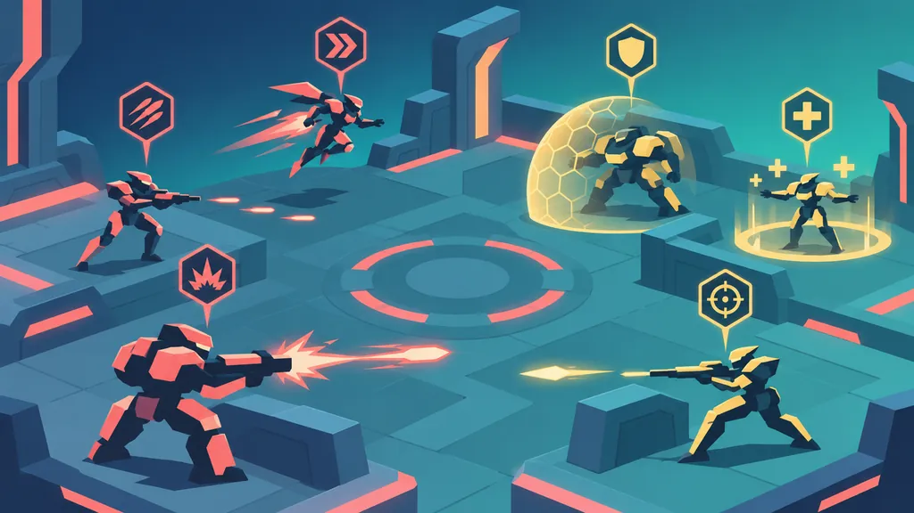 *illustration* | [MIT](https://github.com/tranek/GASShooter) | Advanced Unreal GAS sample: multiplayer FPS/TPS with weapons, abilities and prediction. |
| [Narxim/Narxim-GAS-Example](https://github.com/Narxim/Narxim-GAS-Example) [View at source](https://github.com/Narxim/Narxim-GAS-Example) | [MIT](https://github.com/Narxim/Narxim-GAS-Example) | Clean Unreal Gameplay Ability System template project with attributes and abilities set up. |
| [OctoD/godot-gameplay-abilities](https://github.com/OctoD/godot-gameplay-abilities) 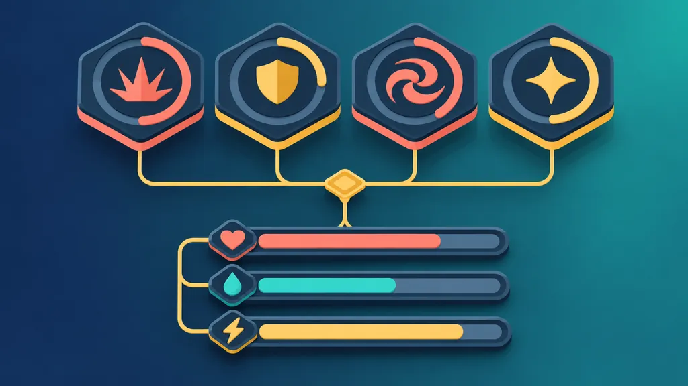 *illustration* | [MIT](https://github.com/OctoD/godot-gameplay-abilities) | Gameplay ability system for Godot: abilities, attributes, effects and cooldowns. |
| [Leafwing-Studios/leafwing_abilities](https://github.com/Leafwing-Studios/leafwing_abilities) 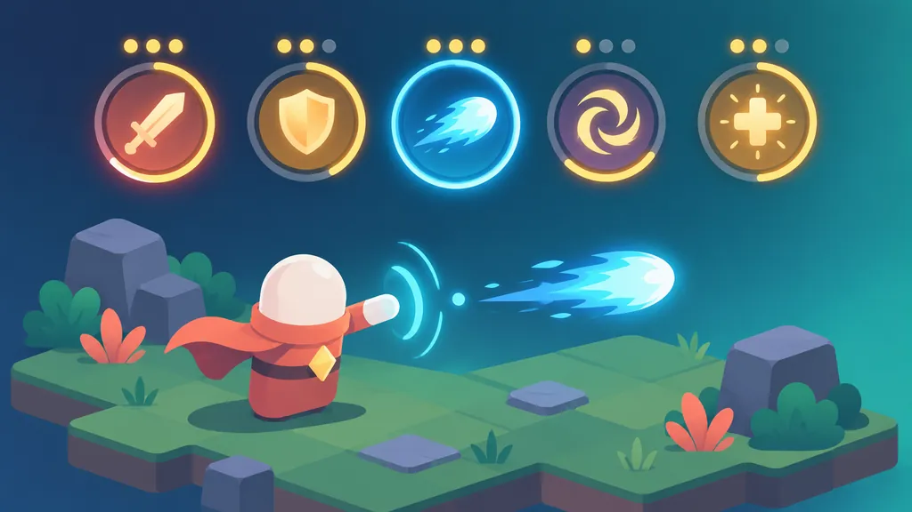 *illustration* | [MIT OR Apache-2.0](https://github.com/Leafwing-Studios/leafwing_abilities) | Ability management for Bevy: cooldowns, charges and resource pools tied to input actions. |
| [Pyxus/fray](https://github.com/Pyxus/fray) [View at source](https://github.com/Pyxus/fray) | [MIT](https://github.com/Pyxus/fray) | Godot combat framework with hierarchical state machines, input buffering and hitbox management. |
| [panthavma/castagne](https://github.com/panthavma/castagne) 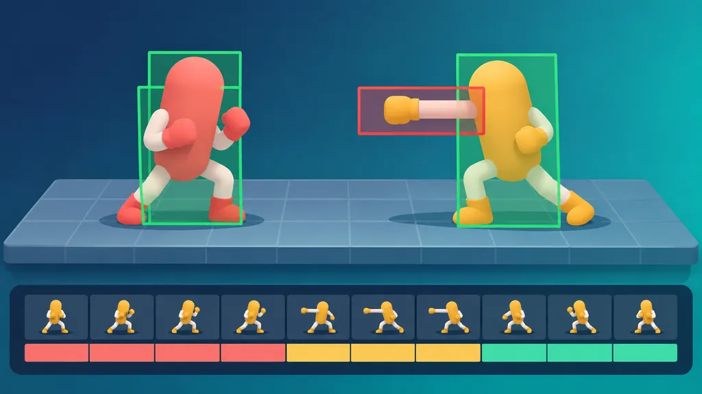 *illustration* | [MPL-2.0](https://github.com/panthavma/castagne) | Fighting game engine and toolkit for Godot with its own character scripting and frame-data tools. |
| [gdquest-demos/godot-2d-jrpg-combat](https://github.com/gdquest-demos/godot-2d-jrpg-combat) [View at source](https://github.com/gdquest-demos/godot-2d-jrpg-combat) | [MIT (code) / CC-BY-4.0 (art)](https://github.com/gdquest-demos/godot-2d-jrpg-combat) | 2D JRPG active-time-battle demo for Godot, showing turn order, skills and UI. |
| [gdquest-demos/godot-open-rpg](https://github.com/gdquest-demos/godot-open-rpg) [View at source](https://github.com/gdquest-demos/godot-open-rpg) | [MIT](https://github.com/gdquest-demos/godot-open-rpg) | Open-source Godot RPG demo for learning turn-based combat, inventory and dialogue. |
| [PhysaliaStudio/Flexi](https://github.com/PhysaliaStudio/Flexi) [View at source](https://github.com/PhysaliaStudio/Flexi) | [MIT](https://github.com/PhysaliaStudio/Flexi) | Unity gameplay ability framework with a node-graph editor for skills and effects. |
| [Relintai/entity_spell_system](https://github.com/Relintai/entity_spell_system) 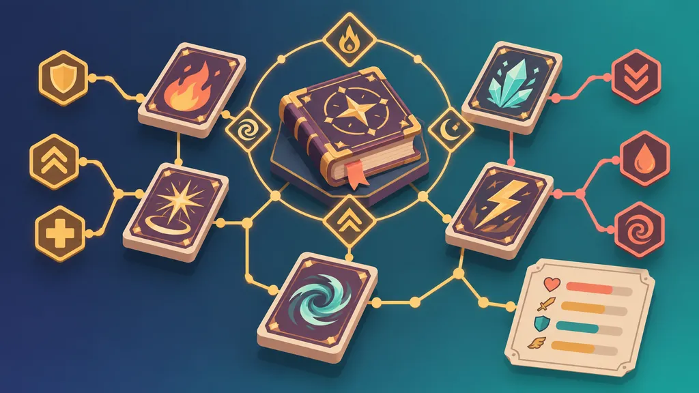 *illustration* listed in [Calinou/awesome-godot](https://github.com/Calinou/awesome-godot) | [MIT](https://github.com/Relintai/entity_spell_system) | C++ Godot module for entities, spells, auras and stats in complex (optionally multiplayer) RPGs. |
| [homemech/unity-pattern-combo](https://github.com/homemech/unity-pattern-combo) 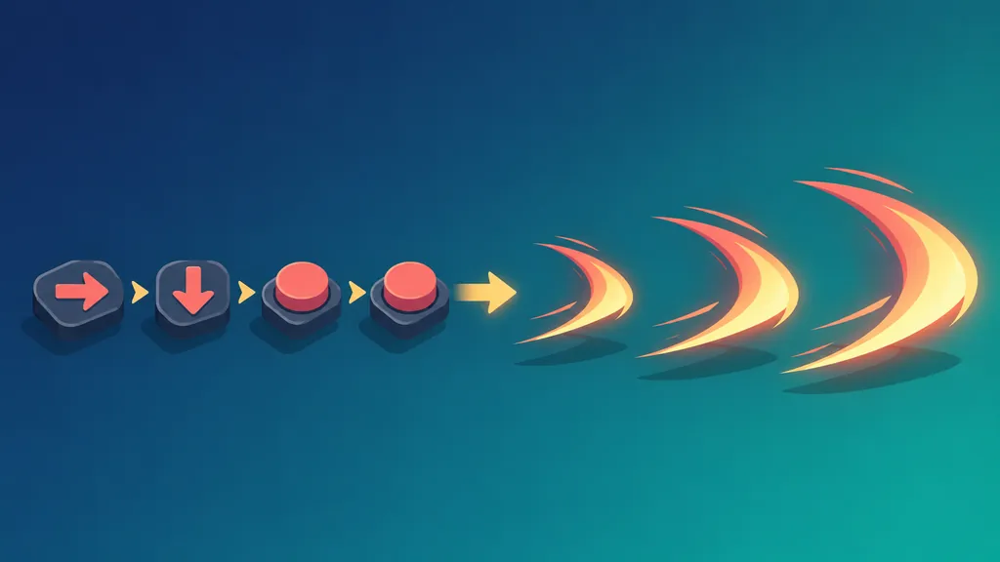 *illustration* | [MIT](https://github.com/homemech/unity-pattern-combo) | Unity example of an action/fighting-game combo system built with the command pattern. |

## Animation & Motion Capture

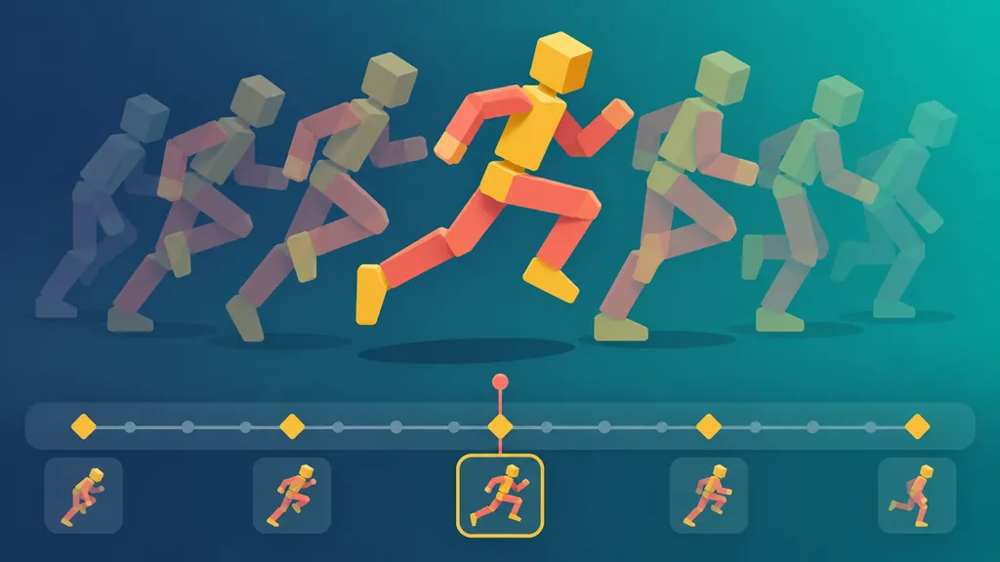

| Project / Preview | License | Good for |
| --- | --- | --- |
| [Quaternius Universal Animation Library](https://quaternius.com/packs/universalanimationlibrary.html) [View at source](https://quaternius.com/packs/universalanimationlibrary.html) | [CC0-1.0](https://quaternius.com/packs/universalanimationlibrary.html) | 120+ humanoid animations (locomotion, combat, emotes) on a universal rig, ready to retarget in Unity, Unreal and Godot. |
| [Kenney Animated Characters](https://kenney.nl/assets/animated-characters-1) [View at source](https://kenney.nl/assets/animated-characters-1) | [CC0-1.0](https://kenney.nl/assets/animated-characters-1) | Rigged, animated low-poly characters for quick 3D prototypes. |
| [synfig/synfig](https://github.com/synfig/synfig) [View at source](https://www.synfig.org/) listed in [Calinou/awesome-gamedev](https://github.com/Calinou/awesome-gamedev) | [GPL-3.0](https://github.com/synfig/synfig) | 2D vector and bone animation software for cutscenes and character animation. |
| [piskelapp/piskel](https://github.com/piskelapp/piskel) [View at source](https://www.piskelapp.com/) listed in [Calinou/awesome-gamedev](https://github.com/Calinou/awesome-gamedev) | [Apache-2.0](https://github.com/piskelapp/piskel) | Web-based sprite editor for frame-by-frame pixel animation, exports GIF and spritesheets. |
| [BandaiNamcoResearchInc/Bandai-Namco-Research-Motiondataset](https://github.com/BandaiNamcoResearchInc/Bandai-Namco-Research-Motiondataset) [View at source](https://github.com/BandaiNamcoResearchInc/Bandai-Namco-Research-Motiondataset) | [CC-BY-NC-4.0 (datasets) / MIT (scripts)](https://github.com/BandaiNamcoResearchInc/Bandai-Namco-Research-Motiondataset#license) | Motion-capture datasets with many styles of walking, fighting and gestures; non-commercial use only. |
| [DragonBones/DragonBonesJS](https://github.com/DragonBones/DragonBonesJS) [View at source](https://github.com/DragonBones/DragonBonesJS) | [MIT](https://github.com/DragonBones/DragonBonesJS) | JavaScript runtimes for DragonBones 2D skeletal animation (Pixi, Phaser, Egret and more). |
| [guillaumeblanc/ozz-animation](https://github.com/guillaumeblanc/ozz-animation) [View at source](https://github.com/guillaumeblanc/ozz-animation) | [MIT](https://github.com/guillaumeblanc/ozz-animation) | C++ skeletal animation library and toolset: sampling, blending, IK and an FBX/glTF import pipeline. |
| [nfrechette/acl](https://github.com/nfrechette/acl) 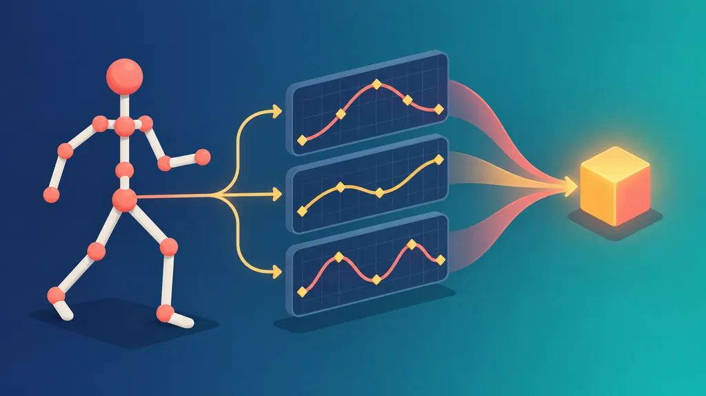 *illustration* | [MIT](https://github.com/nfrechette/acl) | Animation Compression Library: fast, high-accuracy compression and decompression of skeletal animation clips. |
| [Rokoko/rokoko-studio-live-blender](https://github.com/Rokoko/rokoko-studio-live-blender) [View at source](https://github.com/Rokoko/rokoko-studio-live-blender) | [LGPL-3.0](https://github.com/Rokoko/rokoko-studio-live-blender) | Blender add-on that streams live mocap from Rokoko Studio and retargets it onto your rigs. |
| [enziop/mixamo_converter](https://github.com/enziop/mixamo_converter)  *illustration* | [GPL-3.0](https://github.com/enziop/mixamo_converter) | Blender add-on that converts Mixamo animations to root motion for Unreal-style pipelines. |
| [freemocap/freemocap](https://github.com/freemocap/freemocap) [View at source](https://github.com/freemocap/freemocap) | [AGPL-3.0](https://github.com/freemocap/freemocap) | Markerless motion capture from ordinary webcams, with export to Blender and other formats. |
| [emilianavt/OpenSeeFace](https://github.com/emilianavt/OpenSeeFace) [View at source](https://github.com/emilianavt/OpenSeeFace) | [BSD-2-Clause](https://github.com/emilianavt/OpenSeeFace) | Real-time face and facial-landmark tracking on the CPU, with Unity integration for avatar puppeteering. |
| [google-ai-edge/mediapipe](https://github.com/google-ai-edge/mediapipe) [View at source](https://github.com/google-ai-edge/mediapipe) | [Apache-2.0](https://github.com/google-ai-edge/mediapipe) | Cross-platform ML solutions for pose, hand and face tracking that can drive characters or prototype mocap. |
| [ubisoft/ubisoft-laforge-animation-dataset](https://github.com/ubisoft/ubisoft-laforge-animation-dataset) [View at source](https://github.com/ubisoft/ubisoft-laforge-animation-dataset) | [CC-BY-NC-ND-4.0](https://github.com/ubisoft/ubisoft-laforge-animation-dataset) | Ubisoft La Forge LAFAN1 motion-capture dataset (BVH) for animation research; non-commercial, no derivatives. |
| [Inochi2D/inochi2d](https://github.com/Inochi2D/inochi2d) [View at source](https://github.com/Inochi2D/inochi2d) | [BSD-2-Clause](https://github.com/Inochi2D/inochi2d) | Open 2D puppet animation SDK for realtime rigged characters (VTuber-style), with its own editor. |
| [Samsung/rlottie](https://github.com/Samsung/rlottie) [View at source](https://github.com/Samsung/rlottie) | [MIT (some bundled parts under other licenses)](https://github.com/Samsung/rlottie) | Standalone C++ library that plays Lottie vector animations; useful for UI motion in games. |
| [rive-app/rive-runtime](https://github.com/rive-app/rive-runtime) [View at source](https://github.com/rive-app/rive-runtime) | [MIT](https://github.com/rive-app/rive-runtime) | Low-level C++ runtime and renderer for Rive interactive animations and state machines. |
| [mobius3/tweeny](https://github.com/mobius3/tweeny) 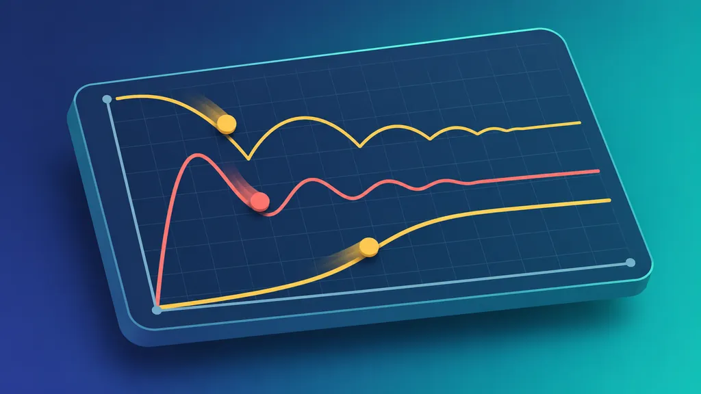 *illustration* | [MIT](https://github.com/mobius3/tweeny) | Modern header-only C++ tweening library with easing functions and multi-point tweens. |
| [Wasserwecken/bvhio](https://github.com/Wasserwecken/bvhio) 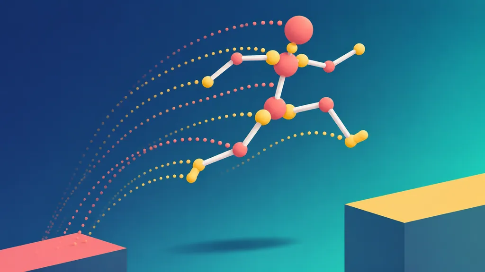 *illustration* | [MIT](https://github.com/Wasserwecken/bvhio) | Python library to read, write, edit and create BVH motion files with hierarchical transforms. |
| [eth-ait/aitviewer](https://github.com/eth-ait/aitviewer) [View at source](https://github.com/eth-ait/aitviewer) | [MIT](https://github.com/eth-ait/aitviewer) | Python viewer to visualize and interact with sequences of 3D data such as SMPL bodies and mocap. |
| [xbpeng/DeepMimic](https://github.com/xbpeng/DeepMimic) [View at source](https://github.com/xbpeng/DeepMimic) | [MIT](https://github.com/xbpeng/DeepMimic) | Research code for physics-based characters that learn skills by imitating mocap clips with deep RL. |
| [orangeduck/Motion-Matching](https://github.com/orangeduck/Motion-Matching) 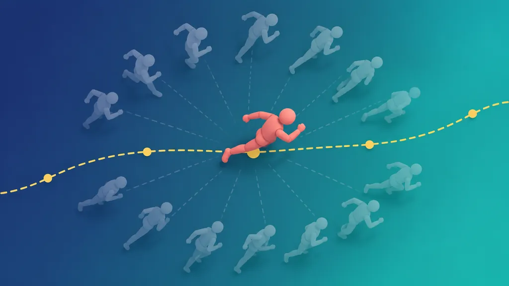 *illustration* | [MIT](https://github.com/orangeduck/Motion-Matching) | Example implementation of motion matching and learned motion matching for responsive character locomotion. |
| [KayKit Character Animations (legacy)](https://kaylousberg.itch.io/kaykit-animations) [View at source](https://kaylousberg.itch.io/kaykit-animations) | [CC0-1.0](https://kaylousberg.itch.io/kaykit-animations) | Legacy animation set for older KayKit low-poly characters: idle, walk, run, jump, climb, attacks and more; no longer updated. |
| [Blender Studio — Rain rig](https://studio.blender.org/characters/rain/v3/) [View at source](https://studio.blender.org/characters/rain/v3/) | [CC-BY (credit required)](https://studio.blender.org/characters/rain/v3/) | Rain: free character rig from Blender Studio for learning and practicing animation. |
| [Blender Studio — Snow rig](https://studio.blender.org/characters/snow/v4/) [View at source](https://studio.blender.org/characters/snow/v4/) | [CC-BY (credit required)](https://studio.blender.org/characters/snow/v4/) | Snow: free character rig from Blender Studio for learning and practicing animation. |
| [Blender Studio — Vincent rig](https://studio.blender.org/characters/vincent/v2/) [View at source](https://studio.blender.org/characters/vincent/v2/) | [CC-BY (credit required)](https://studio.blender.org/characters/vincent/v2/) | Vincent: cartoon character rig from Blender Studio for animation practice. |

## Physics

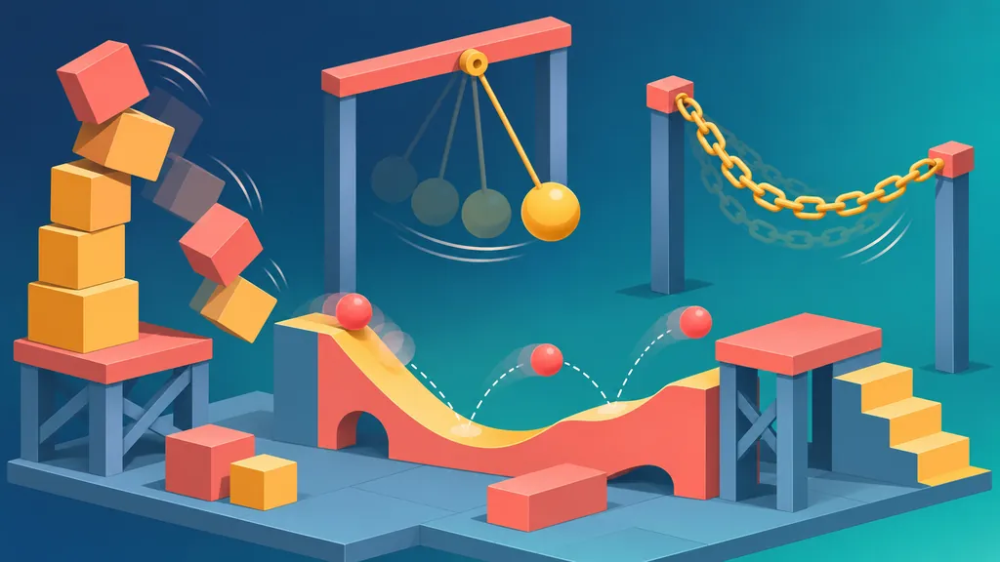

| Project / Preview | License | Good for |
| --- | --- | --- |
| [erincatto/box2d](https://github.com/erincatto/box2d) 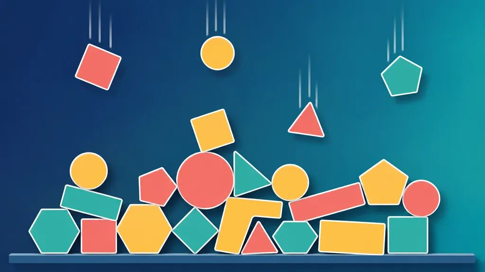 *illustration* | [MIT](https://github.com/erincatto/box2d) | Widely used 2D rigid-body physics engine in C. |
| [jrouwe/JoltPhysics](https://github.com/jrouwe/JoltPhysics) [View at source](https://github.com/jrouwe/JoltPhysics) | [MIT](https://github.com/jrouwe/JoltPhysics) | Fast multi-threaded 3D rigid-body physics engine for games and VR. |
| [bulletphysics/bullet3](https://github.com/bulletphysics/bullet3) [View at source](https://github.com/bulletphysics/bullet3) | [Zlib (except Extras and third-party libs)](https://github.com/bulletphysics/bullet3) | Mature 3D physics SDK for collision detection, rigid and soft bodies. |
| [dimforge/rapier](https://github.com/dimforge/rapier) [View at source](https://github.com/dimforge/rapier) | [Apache-2.0](https://github.com/dimforge/rapier) | 2D and 3D physics engine in Rust, also available for JavaScript via WASM. |
| [pmndrs/cannon-es](https://github.com/pmndrs/cannon-es) [View at source](https://github.com/pmndrs/cannon-es) | [MIT](https://github.com/pmndrs/cannon-es) | Lightweight 3D physics engine for the web, often paired with three.js. |
| [liabru/matter-js](https://github.com/liabru/matter-js) 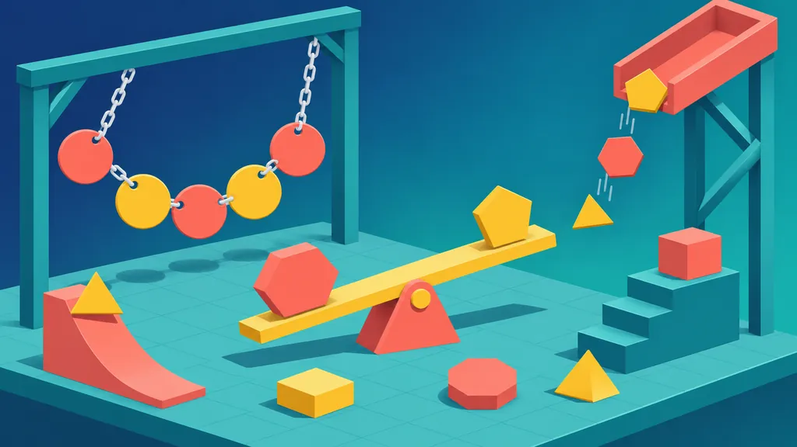 *illustration* | [MIT](https://github.com/liabru/matter-js) | 2D rigid-body physics engine for the web with a simple API. |
| [NVIDIA-Omniverse/PhysX](https://github.com/NVIDIA-Omniverse/PhysX) 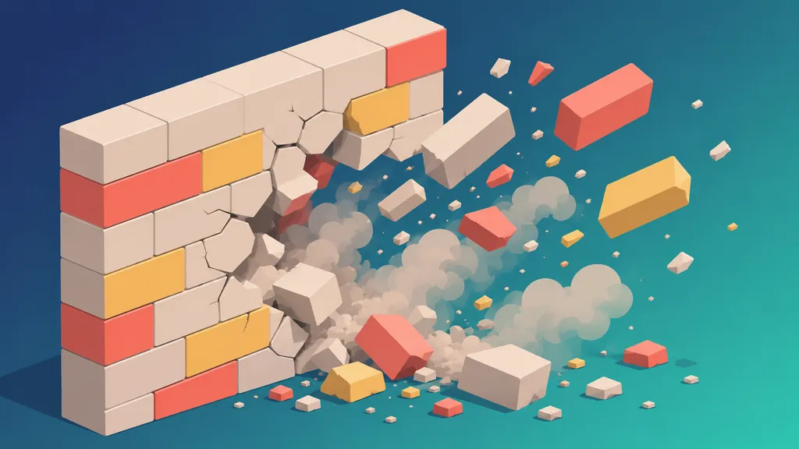 *illustration* | [BSD-3-Clause](https://github.com/NVIDIA-Omniverse/PhysX) | NVIDIA PhysX SDK, the 3D physics engine behind many commercial engines. |
| [slembcke/Chipmunk2D](https://github.com/slembcke/Chipmunk2D) 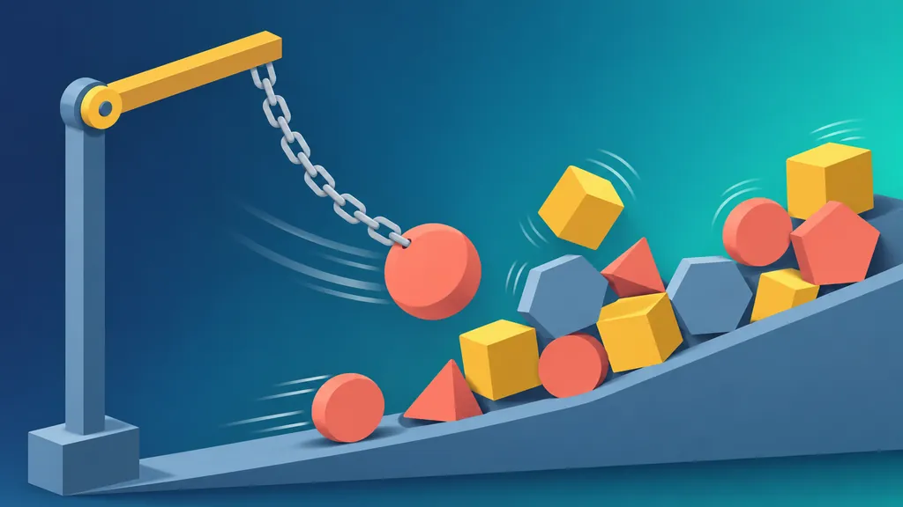 *illustration* listed in [ellisonleao/magictools](https://github.com/ellisonleao/magictools) | [MIT](https://github.com/slembcke/Chipmunk2D) | Fast, lightweight 2D rigid-body physics library in C. |
| [piqnt/planck.js](https://github.com/piqnt/planck.js) 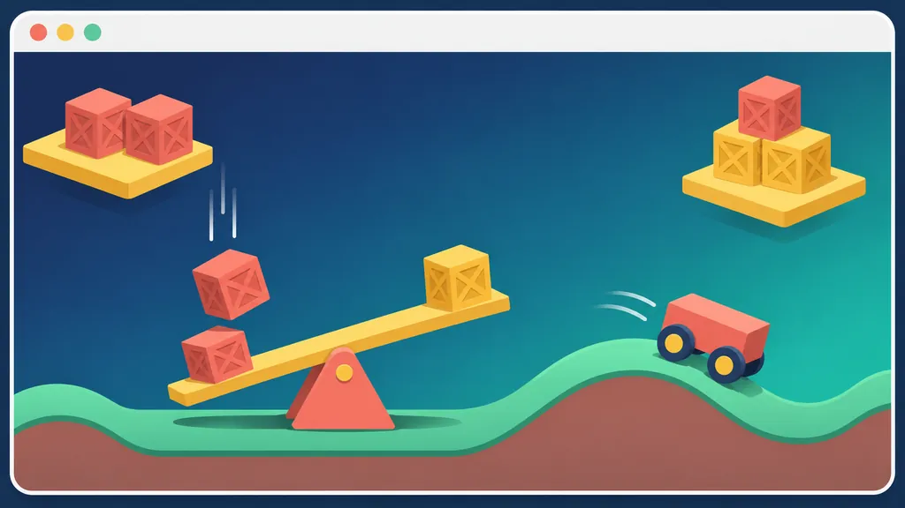 *illustration* | [MIT](https://github.com/piqnt/planck.js) | JavaScript/TypeScript rewrite of Box2D for 2D physics in browser games. |
| [bepu/bepuphysics2](https://github.com/bepu/bepuphysics2) [View at source](https://github.com/bepu/bepuphysics2) | [Apache-2.0](https://github.com/bepu/bepuphysics2) | Pure C# real-time 3D physics library built for speed. |
| [DanielChappuis/reactphysics3d](https://github.com/DanielChappuis/reactphysics3d) [View at source](https://github.com/DanielChappuis/reactphysics3d) | [Zlib](https://github.com/DanielChappuis/reactphysics3d) | C++ 3D physics engine for games: rigid bodies, joints and collision detection. |
| [InteractiveComputerGraphics/PositionBasedDynamics](https://github.com/InteractiveComputerGraphics/PositionBasedDynamics) [View at source](https://github.com/InteractiveComputerGraphics/PositionBasedDynamics) | [MIT](https://github.com/InteractiveComputerGraphics/PositionBasedDynamics) | C++ library for position-based simulation of rigid bodies, cloth, soft bodies and fluids. |
| [notgiven688/jitterphysics2](https://github.com/notgiven688/jitterphysics2) [View at source](https://github.com/notgiven688/jitterphysics2) | [MIT](https://github.com/notgiven688/jitterphysics2) | Fast, dependency-free 3D physics engine in C#. |
| [dyn4j/dyn4j](https://github.com/dyn4j/dyn4j) [View at source](https://github.com/dyn4j/dyn4j) | [BSD-3-Clause](https://github.com/dyn4j/dyn4j) | Java 2D collision detection and physics engine. |
| [schteppe/p2.js](https://github.com/schteppe/p2.js) 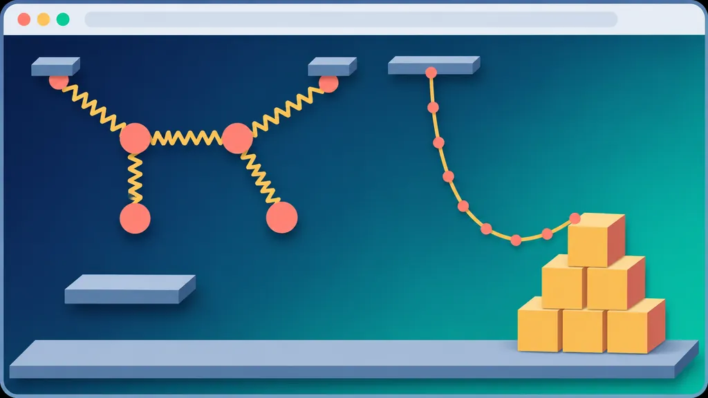 *illustration* | [MIT](https://github.com/schteppe/p2.js) | JavaScript 2D physics library with springs, constraints and a demo playground. |
| [saharan/OimoPhysics](https://github.com/saharan/OimoPhysics) [View at source](https://github.com/saharan/OimoPhysics) | [MIT](https://github.com/saharan/OimoPhysics) | Lightweight cross-platform 3D physics engine written in Haxe, with a JavaScript build. |
| [InteractiveComputerGraphics/SPlisHSPlasH](https://github.com/InteractiveComputerGraphics/SPlisHSPlasH) [View at source](https://github.com/InteractiveComputerGraphics/SPlisHSPlasH) | [MIT](https://github.com/InteractiveComputerGraphics/SPlisHSPlasH) | Open-source SPH fluid simulation library, good for baking water and liquid effects. |
| [lo-th/phy](https://github.com/lo-th/phy) [View at source](https://github.com/lo-th/phy) | [MIT](https://github.com/lo-th/phy) | Physics layer for three.js that wraps several engines (Oimo, Ammo, Rapier, Jolt, Havok, PhysX) behind one API. |
| [anuraghazra/Verly.js](https://github.com/anuraghazra/Verly.js) 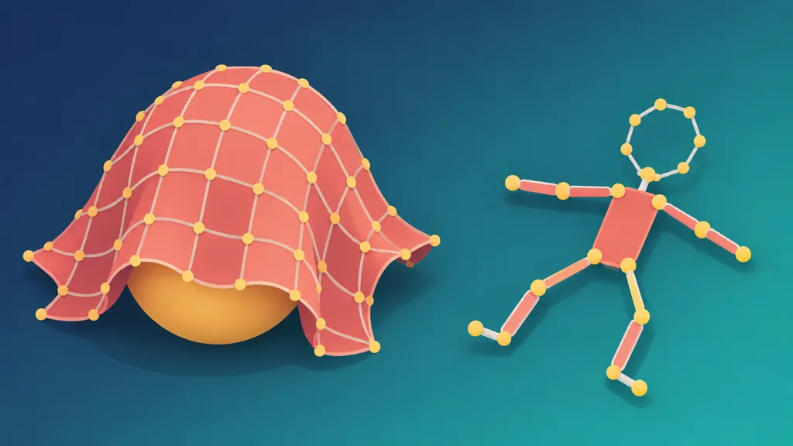 *illustration* | [MIT](https://github.com/anuraghazra/Verly.js) | Easy-to-integrate Verlet physics for ropes, cloth and ragdolls in JavaScript. |
| [projectchrono/chrono](https://github.com/projectchrono/chrono) 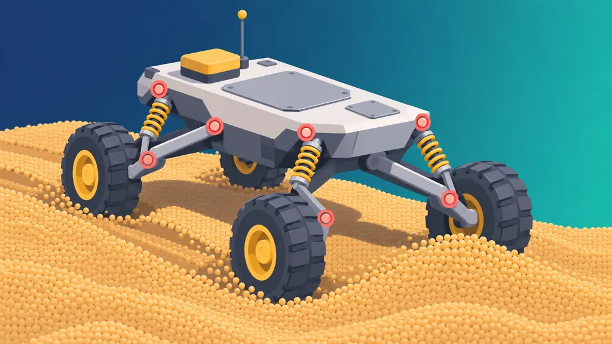 *illustration* | [BSD-3-Clause](https://github.com/projectchrono/chrono) | C++ multiphysics and multibody dynamics library for vehicles, granular terrain and robotics. |
| [google-deepmind/mujoco](https://github.com/google-deepmind/mujoco) [View at source](https://github.com/google-deepmind/mujoco) | [Apache-2.0](https://github.com/google-deepmind/mujoco) | General-purpose physics simulator for articulated bodies with contact, widely used for robotics and character control. |

## Game AI & Pathfinding

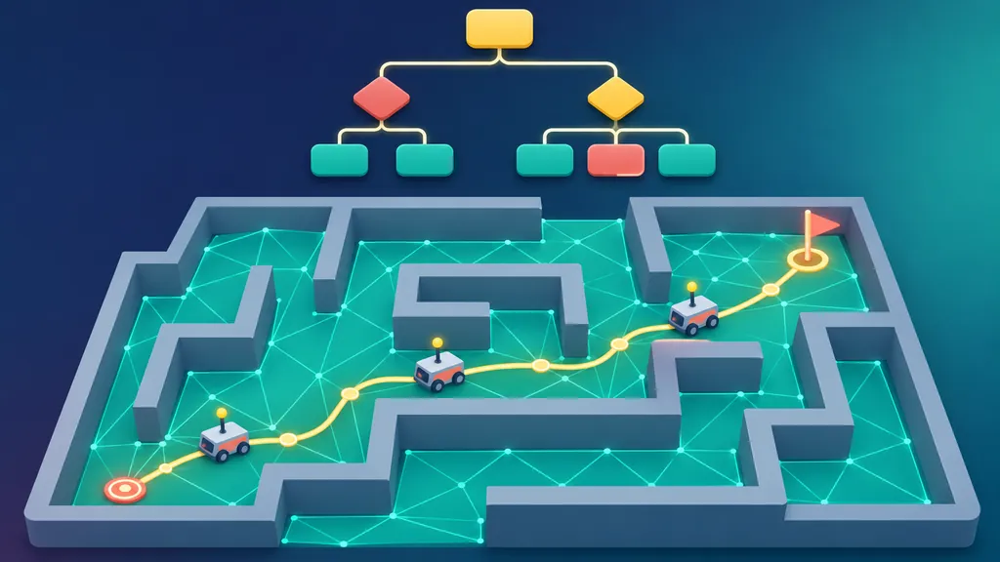

| Project / Preview | License | Good for |
| --- | --- | --- |
| [recastnavigation/recastnavigation](https://github.com/recastnavigation/recastnavigation) [View at source](https://github.com/recastnavigation/recastnavigation) | [Zlib](https://github.com/recastnavigation/recastnavigation) | Navmesh generation (Recast) and pathfinding / crowd simulation (Detour) for 3D games. |
| [qiao/PathFinding.js](https://github.com/qiao/PathFinding.js) 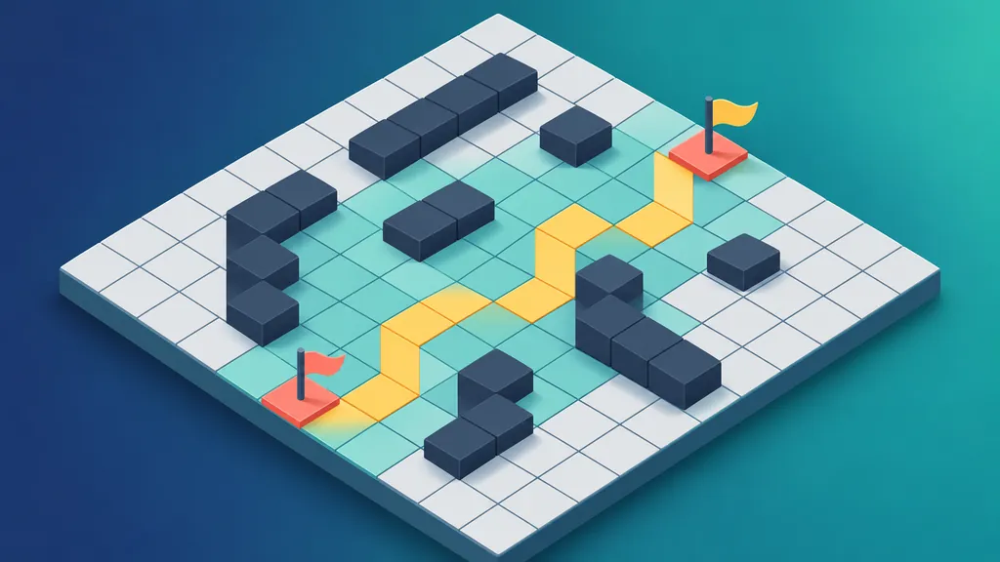 *illustration* | [MIT (stated in README)](https://github.com/qiao/PathFinding.js#license) | Grid pathfinding library for JavaScript (A*, Dijkstra, JPS) with an online visualizer. |
| [BehaviorTree/BehaviorTree.CPP](https://github.com/BehaviorTree/BehaviorTree.CPP) [View at source](https://github.com/BehaviorTree/BehaviorTree.CPP) | [MIT](https://github.com/BehaviorTree/BehaviorTree.CPP) | C++ behavior tree library with XML trees and the Groot visual editor. |
| [Mugen87/yuka](https://github.com/Mugen87/yuka) 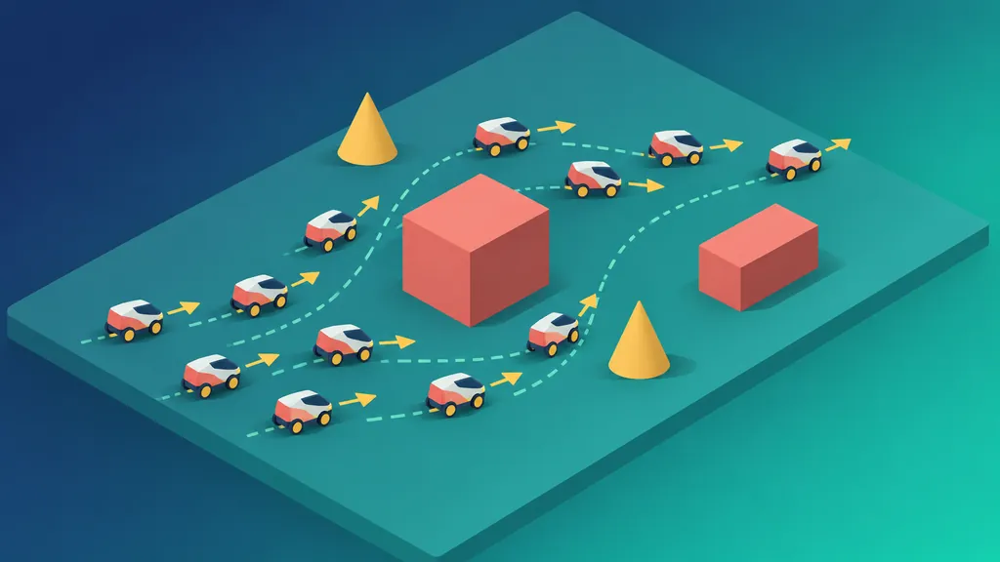 *illustration* | [MIT](https://github.com/Mugen87/yuka) | JavaScript game AI library: steering, state machines, goals, navmesh and perception. |
| [limbonaut/limboai](https://github.com/limbonaut/limboai) [View at source](https://github.com/limbonaut/limboai) | [MIT](https://github.com/limbonaut/limboai) | Behavior trees and state machines for Godot 4 with a visual editor and debugger. |
| [bitbrain/beehave](https://github.com/bitbrain/beehave) [View at source](https://github.com/bitbrain/beehave) | [MIT](https://github.com/bitbrain/beehave) | Behavior tree addon for Godot with a debug view for NPC logic. |
| [donmccurdy/three-pathfinding](https://github.com/donmccurdy/three-pathfinding) [View at source](https://github.com/donmccurdy/three-pathfinding) | [MIT](https://github.com/donmccurdy/three-pathfinding) | Navmesh pathfinding for three.js scenes. |
| [Unity-Technologies/ml-agents](https://github.com/Unity-Technologies/ml-agents) [View at source](https://unity.com/products/machine-learning-agents) | [Apache-2.0](https://github.com/Unity-Technologies/ml-agents) | Toolkit that uses Unity games and simulations as environments to train agents with reinforcement and imitation learning. |
| [MineDojo/Voyager](https://github.com/MineDojo/Voyager) [View at source](https://github.com/MineDojo/Voyager) | [MIT](https://github.com/MineDojo/Voyager) | Research agent that uses an LLM to explore, write skills and keep learning in an open-world sandbox game. |
| [libgdx/gdx-ai](https://github.com/libgdx/gdx-ai) [View at source](https://github.com/libgdx/gdx-ai) | [Apache-2.0](https://github.com/libgdx/gdx-ai) | Game AI framework for libGDX: steering behaviors, state machines, behavior trees, pathfinding and messaging. |
| [Yonaba/Jumper](https://github.com/Yonaba/Jumper) 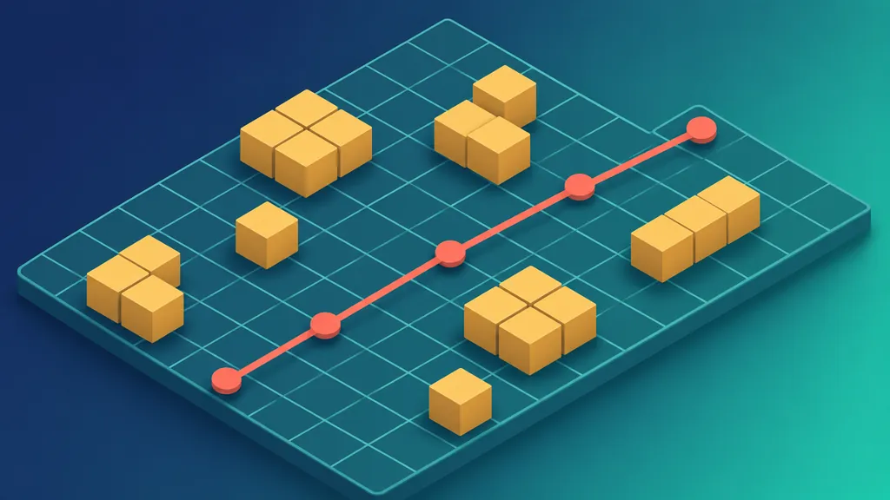 *illustration* | [MIT](https://github.com/Yonaba/Jumper) | Fast grid pathfinding library for Lua (LÖVE etc.) with A*, Jump Point Search and other finders. |
| [igiagkiozis/CrystalAI](https://github.com/igiagkiozis/CrystalAI)  *illustration* | [MIT](https://github.com/igiagkiozis/CrystalAI) | Utility-based AI framework in C# that scores options to pick agent actions. |
| [Sollimann/bonsai](https://github.com/Sollimann/bonsai) [View at source](https://github.com/Sollimann/bonsai) | [MIT](https://github.com/Sollimann/bonsai) | Behavior tree library for Rust with a visualizer, usable in games and robotics. |

## Procedural Generation

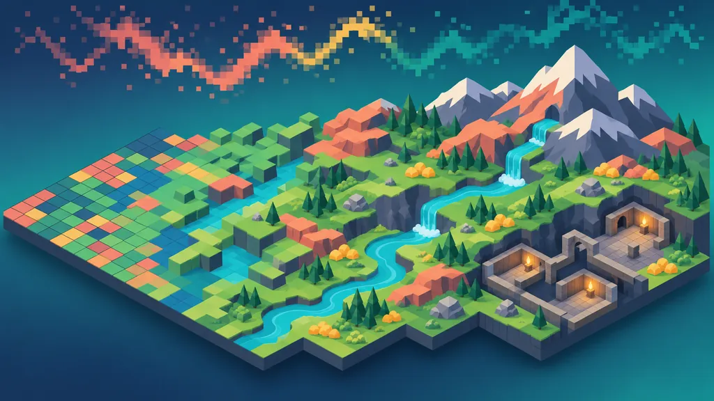

| Project / Preview | License | Good for |
| --- | --- | --- |
| [mxgmn/WaveFunctionCollapse](https://github.com/mxgmn/WaveFunctionCollapse) [View at source](https://github.com/mxgmn/WaveFunctionCollapse) | [MIT](https://github.com/mxgmn/WaveFunctionCollapse) | The original Wave Function Collapse algorithm for generating tile maps and textures from examples. |
| [BorisTheBrave/DeBroglie](https://github.com/BorisTheBrave/DeBroglie) 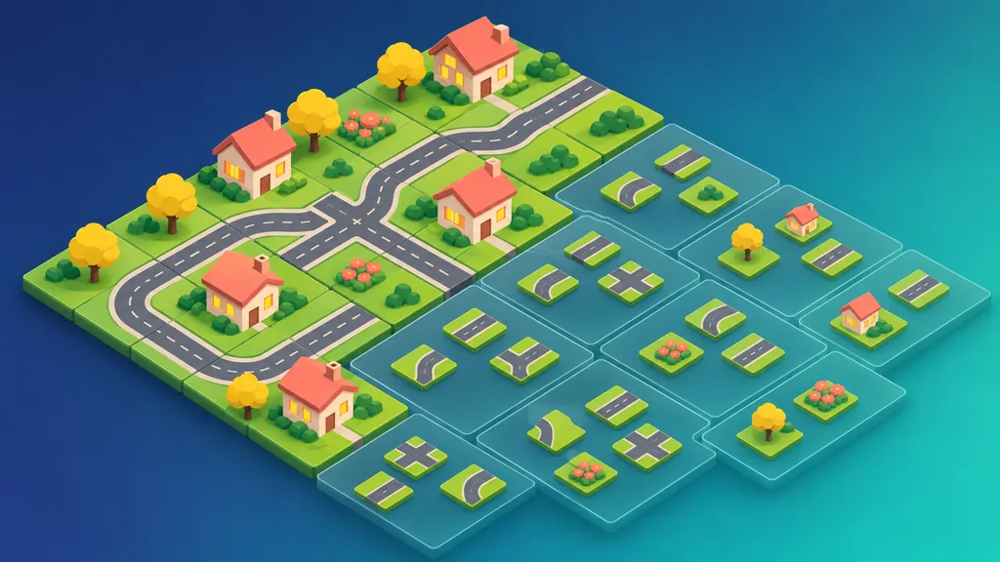 *illustration* | [MIT](https://github.com/BorisTheBrave/DeBroglie) | C# constraint-based procedural generation library (WFC and more) with many tile constraints. |
| [Auburn/FastNoiseLite](https://github.com/Auburn/FastNoiseLite) [View at source](https://github.com/Auburn/FastNoiseLite) | [MIT](https://github.com/Auburn/FastNoiseLite) | Portable noise library (Perlin, Simplex, Cellular) in many languages for terrain and textures. |
| [AlexeyBond/godot-constraint-solving](https://github.com/AlexeyBond/godot-constraint-solving) [View at source](https://github.com/AlexeyBond/godot-constraint-solving) | [MIT](https://github.com/AlexeyBond/godot-constraint-solving) | Wave Function Collapse addon for Godot 4 tile maps and grid maps. |
| [a1studmuffin/SpaceshipGenerator](https://github.com/a1studmuffin/SpaceshipGenerator) [View at source](https://github.com/a1studmuffin/SpaceshipGenerator) | [MIT](https://github.com/a1studmuffin/SpaceshipGenerator) | Blender script that generates textured 3D spaceships from a random seed (older, last updated 2024). |
| [Auburn/FastNoise2](https://github.com/Auburn/FastNoise2) [View at source](https://github.com/Auburn/FastNoise2) | [MIT](https://github.com/Auburn/FastNoise2) | SIMD noise generation library with a node-graph editor for building complex noise. |
| [marian42/wavefunctioncollapse](https://github.com/marian42/wavefunctioncollapse) [View at source](https://github.com/marian42/wavefunctioncollapse) | [MIT](https://github.com/marian42/wavefunctioncollapse) | Unity project that generates an infinite walkable city with wave function collapse. |
| [mxgmn/MarkovJunior](https://github.com/mxgmn/MarkovJunior) [View at source](https://github.com/mxgmn/MarkovJunior) | [MIT](https://github.com/mxgmn/MarkovJunior) | Probabilistic rewrite-rule language for generating levels, mazes and 3D structures, with 150+ examples. |
| [OndrejNepozitek/Edgar-DotNet](https://github.com/OndrejNepozitek/Edgar-DotNet) [View at source](https://github.com/OndrejNepozitek/Edgar-DotNet) | [MIT](https://github.com/OndrejNepozitek/Edgar-DotNet) | Graph-based procedural layout generator for dungeons with hand-made room templates. |
| [ondras/rot.js](https://github.com/ondras/rot.js) [View at source](https://github.com/ondras/rot.js) | [BSD-3-Clause](https://github.com/ondras/rot.js) | Roguelike toolkit in JavaScript: map generators, FOV, pathfinding and a terminal display. |
| [libtcod/libtcod](https://github.com/libtcod/libtcod)  *illustration* | [BSD-3-Clause](https://github.com/libtcod/libtcod) | C/C++ toolkit for roguelikes: field of view, pathfinding, map generation and a tile terminal. |
| [Syomus/ProceduralToolkit](https://github.com/Syomus/ProceduralToolkit)  *illustration* | [MIT](https://github.com/Syomus/ProceduralToolkit) | Procedural generation library for Unity with mesh builders, noise and example generators. |
| [Azgaar/Fantasy-Map-Generator](https://github.com/Azgaar/Fantasy-Map-Generator) [View at source](https://github.com/Azgaar/Fantasy-Map-Generator) | [MIT](https://github.com/Azgaar/Fantasy-Map-Generator) | Web app that generates detailed, editable fantasy world maps with states, rivers and cultures. |
| [Zylann/godot_voxel](https://github.com/Zylann/godot_voxel) [View at source](https://github.com/Zylann/godot_voxel) | [MIT](https://github.com/Zylann/godot_voxel) | Voxel terrain module for Godot with blocky and smooth terrain, LOD and procedural generation. |
| [Zylann/godot_heightmap_plugin](https://github.com/Zylann/godot_heightmap_plugin) [View at source](https://github.com/Zylann/godot_heightmap_plugin) | [MIT](https://github.com/Zylann/godot_heightmap_plugin) | Heightmap terrain plugin for Godot with sculpting, texture painting and a generator. |
| [Mindwerks/worldengine](https://github.com/Mindwerks/worldengine) [View at source](https://github.com/Mindwerks/worldengine) | [MIT](https://github.com/Mindwerks/worldengine) | World generator that simulates plate tectonics, rain shadow and erosion. |
| [redblobgames/mapgen4](https://github.com/redblobgames/mapgen4) [View at source](https://www.redblobgames.com/maps/mapgen4/) | [Apache-2.0](https://github.com/redblobgames/mapgen4) | Interactive procedural wilderness map generator by Red Blob Games. |
| [SebLague/Hydraulic-Erosion](https://github.com/SebLague/Hydraulic-Erosion) [View at source](https://github.com/SebLague/Hydraulic-Erosion) | [MIT](https://github.com/SebLague/Hydraulic-Erosion) | Unity example of hydraulic erosion simulation on procedural terrain. |
| [SebLague/Procedural-Landmass-Generation](https://github.com/SebLague/Procedural-Landmass-Generation)  *illustration* | [MIT](https://github.com/SebLague/Procedural-Landmass-Generation) | Unity project for noise-based endless terrain with LOD, from a well-known tutorial series. |
| [vazgriz/DungeonGenerator](https://github.com/vazgriz/DungeonGenerator) [View at source](https://github.com/vazgriz/DungeonGenerator) | [MIT](https://github.com/vazgriz/DungeonGenerator) | Unity dungeon generator using Delaunay triangulation and A* corridors in 2D and 3D. |
| [math-fehr/fast-wfc](https://github.com/math-fehr/fast-wfc)  *illustration* | [MIT](https://github.com/math-fehr/fast-wfc) | Performance-focused C++ implementation of wave function collapse. |

## Engines & Frameworks

| Project / Preview | License | Good for |
| --- | --- | --- |
| [godotengine/godot](https://github.com/godotengine/godot) [View at source](https://github.com/godotengine/godot) | [MIT](https://github.com/godotengine/godot) | Free open-source 2D and 3D game engine with its own editor and GDScript/C#. |
| [bevyengine/bevy](https://github.com/bevyengine/bevy)  *illustration* | [Apache-2.0 or MIT](https://github.com/bevyengine/bevy) | Data-driven game engine in Rust built on an ECS. |
| [defold/defold](https://github.com/defold/defold) [View at source](https://github.com/defold/defold) | [Defold License 1.0 (Apache-2.0 based)](https://github.com/defold/defold) | Lightweight engine for 2D/3D games with Lua scripting and one-click multi-platform builds. |
| [raysan5/raylib](https://github.com/raysan5/raylib) [View at source](https://github.com/raysan5/raylib) | [Zlib](https://github.com/raysan5/raylib) | Simple C library for learning and making games, with bindings for 60+ languages. |
| [love2d/love](https://github.com/love2d/love)  *illustration* | [Zlib](https://github.com/love2d/love) | LÖVE, a 2D game framework in Lua. |
| [phaserjs/phaser](https://github.com/phaserjs/phaser) [View at source](https://github.com/phaserjs/phaser) | [MIT](https://github.com/phaserjs/phaser) | HTML5 2D game framework for desktop and mobile browsers. |
| [mrdoob/three.js](https://github.com/mrdoob/three.js) [View at source](https://threejs.org/) | [MIT](https://github.com/mrdoob/three.js) | JavaScript 3D library (WebGL/WebGPU) behind most 3D web games and demos. |
| [BabylonJS/Babylon.js](https://github.com/BabylonJS/Babylon.js) [View at source](https://github.com/BabylonJS/Babylon.js) | [Apache-2.0](https://github.com/BabylonJS/Babylon.js) | Full-featured web 3D game and rendering engine with a playground and editor. |
| [o3de/o3de](https://github.com/o3de/o3de) [View at source](https://o3de.org) | [Apache-2.0 or MIT](https://github.com/o3de/o3de) | Open 3D Engine, a modular AAA-grade 3D engine from the Linux Foundation. |
| [stride3d/stride](https://github.com/stride3d/stride) [View at source](https://github.com/stride3d/stride) | [MIT](https://github.com/stride3d/stride) | C# 3D game engine with an editor, formerly Xenko. |
| [MonoGame/MonoGame](https://github.com/MonoGame/MonoGame) [View at source](https://github.com/MonoGame/MonoGame) | [Ms-PL](https://github.com/MonoGame/MonoGame) | C# framework for cross-platform 2D/3D games (XNA successor). |
| [libgdx/libgdx](https://github.com/libgdx/libgdx) [View at source](https://github.com/libgdx/libgdx) | [Apache-2.0](https://github.com/libgdx/libgdx) | Java game framework for desktop, Android, iOS and web. |
| [excaliburjs/Excalibur](https://github.com/excaliburjs/Excalibur) [View at source](https://github.com/excaliburjs/Excalibur) | [BSD-2-Clause](https://github.com/excaliburjs/Excalibur) | TypeScript 2D game engine for the web. |
| [pixijs/pixijs](https://github.com/pixijs/pixijs) [View at source](https://github.com/pixijs/pixijs) | [MIT](https://github.com/pixijs/pixijs) | Fast 2D WebGL/WebGPU renderer for web games and interactive graphics. |
| [playcanvas/engine](https://github.com/playcanvas/engine) [View at source](https://github.com/playcanvas/engine) | [MIT](https://github.com/playcanvas/engine) | WebGL/WebGPU 3D game engine (runtime) for the web. |
| [kaplayjs/kaplay](https://github.com/kaplayjs/kaplay) [View at source](https://github.com/kaplayjs/kaplay) | [MIT](https://github.com/kaplayjs/kaplay) | Beginner-friendly JavaScript game library (successor of Kaboom.js). |
| [hajimehoshi/ebiten](https://github.com/hajimehoshi/ebiten) [View at source](https://github.com/hajimehoshi/ebiten) | [Apache-2.0](https://github.com/hajimehoshi/ebiten) | Ebitengine, a simple 2D game engine for Go. |
| [FyroxEngine/Fyrox](https://github.com/FyroxEngine/Fyrox) [View at source](https://github.com/FyroxEngine/Fyrox) | [MIT](https://github.com/FyroxEngine/Fyrox) | 3D and 2D game engine in Rust with a scene editor. |
| [HeapsIO/heaps](https://github.com/HeapsIO/heaps) [View at source](https://github.com/HeapsIO/heaps) | [MIT](https://github.com/HeapsIO/heaps) | Cross-platform 2D/3D game engine for Haxe. |
| [panda3d/panda3d](https://github.com/panda3d/panda3d) [View at source](https://github.com/panda3d/panda3d) | [BSD-3-Clause](https://github.com/panda3d/panda3d) | Mature open-source 3D engine for Python and C++, originally developed by Disney and CMU. |
| [jMonkeyEngine/jmonkeyengine](https://github.com/jMonkeyEngine/jmonkeyengine) [View at source](https://github.com/jMonkeyEngine/jmonkeyengine) | [BSD-3-Clause](https://github.com/jMonkeyEngine/jmonkeyengine) | Complete 3D game development suite written in Java. |
| [pygame-community/pygame-ce](https://github.com/pygame-community/pygame-ce)  *illustration* | [LGPL-2.1-or-later](https://github.com/pygame-community/pygame-ce#license) | Community edition of pygame, a Python library on SDL for 2D games and multimedia. |
| [flame-engine/flame](https://github.com/flame-engine/flame)  *illustration* | [MIT](https://github.com/flame-engine/flame) | 2D game engine built on Flutter, for mobile, desktop and web games in Dart. |
| [kitao/pyxel](https://github.com/kitao/pyxel) [View at source](https://github.com/kitao/pyxel) listed in [ellisonleao/magictools](https://github.com/ellisonleao/magictools) | [MIT](https://github.com/kitao/pyxel) | Retro game engine for Python with a fixed palette, built-in sprite, tilemap and sound editors. |
| [HaxeFlixel/flixel](https://github.com/HaxeFlixel/flixel) [View at source](https://github.com/HaxeFlixel/flixel) | [MIT](https://github.com/HaxeFlixel/flixel) | Cross-platform 2D game engine powered by Haxe and OpenFL. |
| [coronalabs/corona](https://github.com/coronalabs/corona) [View at source](https://github.com/coronalabs/corona) | [MIT](https://github.com/coronalabs/corona) | Solar2D (formerly Corona SDK): Lua-based 2D engine for mobile and desktop games. |
| [not-fl3/macroquad](https://github.com/not-fl3/macroquad)  *illustration* | [MIT OR Apache-2.0](https://github.com/not-fl3/macroquad) | Simple cross-platform Rust game library that runs on desktop, mobile and the web. |
| [turanszkij/WickedEngine](https://github.com/turanszkij/WickedEngine) [View at source](https://github.com/turanszkij/WickedEngine) | [MIT](https://github.com/turanszkij/WickedEngine) | C++ 3D engine with modern graphics features and an editor. |
| [liballeg/allegro5](https://github.com/liballeg/allegro5)  *illustration* | [Zlib](https://github.com/liballeg/allegro5) | Long-running cross-platform C library for 2D games and multimedia. |

## Tools & Pipelines

| Project / Preview | License | Good for |
| --- | --- | --- |
| [Blender](https://www.blender.org/) [View at source](https://github.com/blender/blender) ⚠ official site returns 403 to automated checks; license verified manually | [GPL-3.0-or-later (binaries)](https://www.blender.org/about/license/) | Free 3D suite for modeling, rigging, animation and baking game assets; your output is yours. |
| [RodZill4/material-maker](https://github.com/RodZill4/material-maker) [View at source](https://github.com/RodZill4/material-maker) | [MIT](https://github.com/RodZill4/material-maker) | Node-based procedural texture and material authoring tool built on Godot. |
| [Orama-Interactive/Pixelorama](https://github.com/Orama-Interactive/Pixelorama) [View at source](https://github.com/Orama-Interactive/Pixelorama) | [MIT](https://github.com/Orama-Interactive/Pixelorama) | Pixel art editor for sprites, tiles and frame animation; runs on desktop and web. |
| [mapeditor/tiled](https://github.com/mapeditor/tiled)  *illustration* | [GPL-2.0 (editor) / BSD-2-Clause (libtiled)](https://github.com/mapeditor/tiled/blob/master/COPYING) | Flexible tile map / level editor; exports TMX/JSON used by most 2D engines. |
| [deepnight/ldtk](https://github.com/deepnight/ldtk) [View at source](https://ldtk.io/) | [MIT](https://github.com/deepnight/ldtk) | Modern, lightweight 2D level editor with auto-layer tiling and typed entity fields. |
| [audacity/audacity](https://github.com/audacity/audacity) [View at source](https://www.audacityteam.org/) | [GPL-3.0](https://github.com/audacity/audacity/blob/master/LICENSE.txt) | Audio editor for trimming, layering and cleaning up game sound effects. |
| [LMMS/lmms](https://github.com/LMMS/lmms)  *illustration* | [GPL-2.0](https://github.com/LMMS/lmms) | Free music production software (sequencer, synths, sampler) for game soundtracks and stingers. |
| [godotengine/godot-demo-projects](https://github.com/godotengine/godot-demo-projects)  *illustration* | [MIT](https://github.com/godotengine/godot-demo-projects) | Official Godot demo and template projects (2D, 3D, physics, UI) to learn from or start with. |
| [KDE/krita](https://github.com/KDE/krita) [View at source](https://krita.org/en/) listed in [Calinou/awesome-gamedev](https://github.com/Calinou/awesome-gamedev) | [GPL-3.0](https://github.com/KDE/krita) | Digital painting app for concept art, textures and hand-drawn animation. |
| [LibreSprite/LibreSprite](https://github.com/LibreSprite/LibreSprite) [View at source](https://github.com/LibreSprite/LibreSprite) | [GPL-2.0](https://github.com/LibreSprite/LibreSprite) | Free pixel-art and sprite animation editor (fork of the last GPL Aseprite). |
| [odrick/free-tex-packer](https://github.com/odrick/free-tex-packer) [View at source](https://github.com/odrick/free-tex-packer) | [MIT](https://github.com/odrick/free-tex-packer) | Free texture-atlas packer with exporters for Phaser, Pixi, Unity, Godot and more. |
| [Ogmo-Editor-3/OgmoEditor3-CE](https://github.com/Ogmo-Editor-3/OgmoEditor3-CE) [View at source](https://github.com/Ogmo-Editor-3/OgmoEditor3-CE) | [MIT](https://github.com/Ogmo-Editor-3/OgmoEditor3-CE) | Free, engine-agnostic 2D level editor with tiles, entities and decals (last updated 2024). |
| [TrenchBroom/TrenchBroom](https://github.com/TrenchBroom/TrenchBroom) [View at source](https://github.com/TrenchBroom/TrenchBroom) | [GPL-3.0](https://github.com/TrenchBroom/TrenchBroom) | Brush-based 3D level editor for Quake-style maps, usable with Godot via plugins. |
| [JannisX11/blockbench](https://github.com/JannisX11/blockbench) [View at source](https://github.com/JannisX11/blockbench) | [GPL-3.0](https://github.com/JannisX11/blockbench) | Low-poly and voxel-style 3D model editor with texturing and animation. |
| [guillaumechereau/goxel](https://github.com/guillaumechereau/goxel) [View at source](https://github.com/guillaumechereau/goxel) | [GPL-3.0](https://github.com/guillaumechereau/goxel) | Open-source voxel editor for 3D models and scenes. |
| [donmccurdy/glTF-Transform](https://github.com/donmccurdy/glTF-Transform) [View at source](https://github.com/donmccurdy/glTF-Transform) | [MIT](https://github.com/donmccurdy/glTF-Transform) | CLI and SDK to optimize glTF/GLB: compression, texture resize, deduplication. |
| [zeux/meshoptimizer](https://github.com/zeux/meshoptimizer)  *illustration* | [MIT](https://github.com/zeux/meshoptimizer) | Mesh optimization library and gltfpack tool for smaller, faster 3D assets. |
| [assimp/assimp](https://github.com/assimp/assimp) [View at source](https://www.assimp.org) | [BSD-3-Clause (modified)](https://github.com/assimp/assimp) | Open Asset Import Library: loads 40+ 3D formats into one data structure. |
| [inkle/ink](https://github.com/inkle/ink)  *illustration* | [MIT](https://github.com/inkle/ink) | Scripting language and engine for branching interactive narrative, with Unity integration. |
| [YarnSpinnerTool/YarnSpinner](https://github.com/YarnSpinnerTool/YarnSpinner) [View at source](https://github.com/YarnSpinnerTool/YarnSpinner) | [MIT](https://github.com/YarnSpinnerTool/YarnSpinner) | Dialogue language and engine-agnostic runtime for writing branching game dialogue. |
| [UltimateDoomBuilder/UltimateDoomBuilder](https://github.com/UltimateDoomBuilder/UltimateDoomBuilder)  *illustration* | [GPL-3.0](https://github.com/UltimateDoomBuilder/UltimateDoomBuilder) | Map editor for Doom-engine games with 2D and 3D editing modes. |
| [crashinvaders/gdx-texture-packer-gui](https://github.com/crashinvaders/gdx-texture-packer-gui) [View at source](https://github.com/crashinvaders/gdx-texture-packer-gui) | [Apache-2.0](https://github.com/crashinvaders/gdx-texture-packer-gui) | GUI for packing and managing texture atlases (libGDX format). |
| [CesiumGS/gltf-pipeline](https://github.com/CesiumGS/gltf-pipeline)  *illustration* | [Apache-2.0](https://github.com/CesiumGS/gltf-pipeline) | Command-line tools to optimize glTF assets: Draco compression, embedding and format conversion. |
| [google/draco](https://github.com/google/draco)  *illustration* | [Apache-2.0](https://github.com/google/draco) | Library to compress and decompress 3D meshes and point clouds for smaller downloads. |
| [microsoft/DirectXTex](https://github.com/microsoft/DirectXTex) [View at source](https://github.com/microsoft/DirectXTex) | [MIT](https://github.com/microsoft/DirectXTex) | Texture processing library and texconv tool for DDS, mipmaps and block compression. |
| [BinomialLLC/basis_universal](https://github.com/BinomialLLC/basis_universal) [View at source](https://github.com/BinomialLLC/basis_universal) | [Apache-2.0](https://github.com/BinomialLLC/basis_universal) | GPU texture codec that transcodes one file to many GPU formats (BC, ASTC, ETC). |
| [KhronosGroup/KTX-Software](https://github.com/KhronosGroup/KTX-Software)  *illustration* | [Apache-2.0 (bundled parts under other open licenses)](https://github.com/KhronosGroup/KTX-Software) | Khronos KTX texture library and tools for creating and validating KTX2 files. |
| [ufbx/ufbx](https://github.com/ufbx/ufbx)  *illustration* | [MIT or Unlicense](https://github.com/ufbx/ufbx) | Single-source-file C FBX loader that handles meshes, skinning, animation and materials. |
| [glslify/glslify](https://github.com/glslify/glslify)  *illustration* | [MIT](https://github.com/glslify/glslify) | Node.js-style module system for GLSL that lets you import shader functions from npm. |

## AI Asset Generation & Agent Skills

| Project / Preview | License | Good for |
| --- | --- | --- |
| [microsoft/TRELLIS](https://github.com/microsoft/TRELLIS) [View at source](https://github.com/microsoft/TRELLIS) | [MIT](https://github.com/microsoft/TRELLIS) | Image/text-to-3D model generation (meshes, radiance fields, Gaussians) from Microsoft. |
| [VAST-AI-Research/TripoSR](https://github.com/VAST-AI-Research/TripoSR) [View at source](https://github.com/VAST-AI-Research/TripoSR) | [MIT](https://github.com/VAST-AI-Research/TripoSR) | Fast single-image to 3D mesh reconstruction model. |
| [TencentARC/InstantMesh](https://github.com/TencentARC/InstantMesh)  *illustration* | [Apache-2.0](https://github.com/TencentARC/InstantMesh) | Single image to 3D mesh generation with multi-view diffusion. |
| [Comfy-Org/ComfyUI](https://github.com/Comfy-Org/ComfyUI) [View at source](https://github.com/Comfy-Org/ComfyUI) | [GPL-3.0](https://github.com/Comfy-Org/ComfyUI) | Node-based UI for diffusion models to generate textures, sprites and concept art. |
| [facebookresearch/audiocraft](https://github.com/facebookresearch/audiocraft)  *illustration* | [MIT (code); model weights CC-BY-NC-4.0](https://github.com/facebookresearch/audiocraft) | Meta's audio generation library (MusicGen, AudioGen) for music and sound effects; weights are non-commercial. |
| [Tencent-Hunyuan/Hunyuan3D-2](https://github.com/Tencent-Hunyuan/Hunyuan3D-2) [View at source](https://github.com/Tencent-Hunyuan/Hunyuan3D-2) | [Tencent Hunyuan 3D 2.0 Community License (not valid in EU, UK, South Korea)](https://github.com/Tencent-Hunyuan/Hunyuan3D-2) | Text/image-to-3D generation with textured meshes; check the territory and usage limits in its license. |
| [gamedev-skills/awesome-gamedev-agent-skills](https://github.com/gamedev-skills/awesome-gamedev-agent-skills) [View at source](https://github.com/gamedev-skills/awesome-gamedev-agent-skills) | [Apache-2.0](https://github.com/gamedev-skills/awesome-gamedev-agent-skills) | Collection of game-dev skills and a router for AI coding agents. |
| [3DTopia/LGM](https://github.com/3DTopia/LGM)  *illustration* | [MIT](https://github.com/3DTopia/LGM) | Large multi-view Gaussian model that turns a text prompt or one image into a high-resolution 3D Gaussian asset in seconds. |
| [dreamgaussian/dreamgaussian](https://github.com/dreamgaussian/dreamgaussian)  *illustration* | [MIT](https://github.com/dreamgaussian/dreamgaussian) | Generative Gaussian splatting that makes a textured 3D mesh from an image or text in minutes. |
| [openai/shap-e](https://github.com/openai/shap-e) [View at source](https://github.com/openai/shap-e) | [MIT](https://github.com/openai/shap-e) | Text- or image-conditioned 3D object generator that outputs meshes and implicit fields. |
| [openai/point-e](https://github.com/openai/point-e) [View at source](https://github.com/openai/point-e) | [MIT](https://github.com/openai/point-e) | Point-cloud diffusion model for quick text-to-3D drafts, with point-cloud-to-mesh conversion. |
| [thu-ml/CRM](https://github.com/thu-ml/CRM) [View at source](https://github.com/thu-ml/CRM) | [MIT](https://github.com/thu-ml/CRM) | Single image to textured 3D mesh in about ten seconds with a convolutional reconstruction model. |
| [xxlong0/Wonder3D](https://github.com/xxlong0/Wonder3D) [View at source](https://github.com/xxlong0/Wonder3D) | [MIT](https://github.com/xxlong0/Wonder3D) | Single image to 3D via cross-domain diffusion that predicts multi-view normals and colors. |
| [AiuniAI/Unique3D](https://github.com/AiuniAI/Unique3D) [View at source](https://github.com/AiuniAI/Unique3D) | [MIT](https://github.com/AiuniAI/Unique3D) | High-quality single-image-to-mesh generation with detailed textures. |
| [carson-katri/dream-textures](https://github.com/carson-katri/dream-textures) [View at source](https://github.com/carson-katri/dream-textures) listed in [simoninithomas/awesome-ai-tools-for-game-dev](https://github.com/simoninithomas/awesome-ai-tools-for-game-dev) | [GPL-3.0](https://github.com/carson-katri/dream-textures) | Blender add-on that runs Stable Diffusion inside Blender to make seamless textures and project them onto models. |
| [OpenTexture/Paint3D](https://github.com/OpenTexture/Paint3D) [View at source](https://github.com/OpenTexture/Paint3D) | [Apache-2.0](https://github.com/OpenTexture/Paint3D) | Generates lighting-free UV textures for untextured 3D meshes from text or image prompts. |
| [Stable-X/StableNormal](https://github.com/Stable-X/StableNormal)  *illustration* | [Apache-2.0](https://github.com/Stable-X/StableNormal) | Estimates sharp, stable normal maps from a single image; handy for turning photos or concept art into normal maps. |
| [KohakuBlueleaf/PixelOE](https://github.com/KohakuBlueleaf/PixelOE) [View at source](https://github.com/KohakuBlueleaf/PixelOE) | [Apache-2.0](https://github.com/KohakuBlueleaf/PixelOE) | Turns high-res images into clean pixel art with contrast-aware outline expansion; no AI model required. |
| [aldegad/sprite-gen](https://github.com/aldegad/sprite-gen) [View at source](https://github.com/aldegad/sprite-gen) | [Apache-2.0](https://github.com/aldegad/sprite-gen) | Agent skill and Python CLI that turns one base image into game sprite atlases or transparent animation loops. |
| [Retro-Diffusion/pixel-art-fixer](https://github.com/Retro-Diffusion/pixel-art-fixer) [View at source](https://github.com/Retro-Diffusion/pixel-art-fixer) | [MIT](https://github.com/Retro-Diffusion/pixel-art-fixer) | Converts fake, off-grid "pixel art" (e.g. from image generators) into true grid-aligned pixel art. |
| [suno-ai/bark](https://github.com/suno-ai/bark) [View at source](https://github.com/suno-ai/bark) listed in [simoninithomas/awesome-ai-tools-for-game-dev](https://github.com/simoninithomas/awesome-ai-tools-for-game-dev) | [MIT](https://github.com/suno-ai/bark) | Text-prompted generative audio model for speech, non-verbal sounds and simple music. |
| [Stability-AI/stable-audio-tools](https://github.com/Stability-AI/stable-audio-tools)  *illustration* | [MIT](https://github.com/Stability-AI/stable-audio-tools) | Training and inference code for conditional audio generation models, including Stable Audio Open. |
| [open-mmlab/Amphion](https://github.com/open-mmlab/Amphion)  *illustration* | [MIT](https://github.com/open-mmlab/Amphion) | Toolkit for audio, music and speech generation (TTS, voice conversion, singing voice and more). |

## Curated Lists & Design References

| Project / Preview | License | Good for |
| --- | --- | --- |
| [ellisonleao/magictools](https://github.com/ellisonleao/magictools) [View at source](https://github.com/ellisonleao/magictools) | [MIT](https://github.com/ellisonleao/magictools) | Long-running list of game development resources: engines, art, audio, tools. |
| [Calinou/awesome-gamedev](https://github.com/Calinou/awesome-gamedev)  *illustration* | [CC-BY-SA-4.0](https://github.com/Calinou/awesome-gamedev) | List of free software and free culture resources for making games. |
| [madjin/awesome-cc0](https://github.com/madjin/awesome-cc0)  *illustration* | [CC0-1.0](https://github.com/madjin/awesome-cc0) | List of CC0 assets from across the web: models, textures, sound. |
| [FronkonGames/Awesome-Gamedev](https://github.com/FronkonGames/Awesome-Gamedev) [View at source](https://github.com/FronkonGames/Awesome-Gamedev) | [MIT](https://github.com/FronkonGames/Awesome-Gamedev) | Curated list of game development resources: tools, tutorials, libraries. |
| [dawdle-deer/awesome-learn-gamedev](https://github.com/dawdle-deer/awesome-learn-gamedev) [View at source](https://github.com/dawdle-deer/awesome-learn-gamedev) | [CC0-1.0](https://github.com/dawdle-deer/awesome-learn-gamedev) | Curated learning resources for game development. |
| [Calinou/awesome-godot](https://github.com/Calinou/awesome-godot)  *illustration* | [CC-BY-4.0](https://github.com/Calinou/awesome-godot) | Curated list of Godot plugins, scripts, templates and projects. |
| [munificent/game-programming-patterns](https://github.com/munificent/game-programming-patterns)  *illustration* | [MIT (code) / CC-BY-NC-ND-4.0 (book text)](https://github.com/munificent/game-programming-patterns) | Source of the free online book Game Programming Patterns (design patterns for game code). |
| [love2d-community/awesome-love2d](https://github.com/love2d-community/awesome-love2d) [View at source](https://github.com/love2d-community/awesome-love2d) | [CC0-1.0](https://github.com/love2d-community/awesome-love2d) | Curated list of LÖVE libraries, tools and resources. |
| [rafaskb/awesome-libgdx](https://github.com/rafaskb/awesome-libgdx) [View at source](https://github.com/rafaskb/awesome-libgdx) | [CC0-1.0](https://github.com/rafaskb/awesome-libgdx) | Curated list of libGDX libraries, tools and tutorials. |
| [pico-8/awesome-PICO-8](https://github.com/pico-8/awesome-PICO-8) [View at source](https://github.com/pico-8/awesome-PICO-8) | [CC0-1.0](https://github.com/pico-8/awesome-PICO-8) | Curated list of PICO-8 resources, tools, carts and tutorials. |
| [bobeff/open-source-games](https://github.com/bobeff/open-source-games)  *illustration* | [CC0-1.0](https://github.com/bobeff/open-source-games) | Large list of open-source games and remakes, handy for reading real game code. |
| [hzoo/awesome-gametalks](https://github.com/hzoo/awesome-gametalks)  *illustration* | [MIT](https://github.com/hzoo/awesome-gametalks) | Curated list of talks on game development, design and postmortems. |
| [flame-engine/awesome-flame](https://github.com/flame-engine/awesome-flame) [View at source](https://github.com/flame-engine/awesome-flame) | [CC0-1.0](https://github.com/flame-engine/awesome-flame) | Curated list of Flame engine games, libraries, tools and tutorials. |
| [Siilwyn/awesome-pixel-art](https://github.com/Siilwyn/awesome-pixel-art) [View at source](https://github.com/Siilwyn/awesome-pixel-art) | [CC0-1.0](https://github.com/Siilwyn/awesome-pixel-art) | Curated list of pixel art tools, tutorials, palettes and communities. |
| [radek-sprta/awesome-game-remakes](https://github.com/radek-sprta/awesome-game-remakes)  *illustration* | [CC-BY-SA-4.0](https://github.com/radek-sprta/awesome-game-remakes) | List of actively maintained open-source game remakes and engine re-implementations. |
| [Roobyx/awesome-game-design](https://github.com/Roobyx/awesome-game-design)  *illustration* | [CC-BY-4.0](https://github.com/Roobyx/awesome-game-design) | List of game design learning materials, examples and tools. |
| [ncase/loopy](https://github.com/ncase/loopy) [View at source](https://github.com/ncase/loopy) | [CC0-1.0](https://github.com/ncase/loopy) | Browser tool for drawing interactive systems and feedback loops; handy for sketching game economies. |

## Credits

Some entries were found through these lists. We only took the pointers: every source was re-checked (license, reachability) and every description was rewritten for this list, nothing was copied wholesale. Entries found this way say *listed in* with a link to the list.

- [Calinou/awesome-gamedev](https://github.com/Calinou/awesome-gamedev) · CC-BY-SA-4.0
- [madjin/awesome-cc0](https://github.com/madjin/awesome-cc0) · CC0-1.0
- [ellisonleao/magictools](https://github.com/ellisonleao/magictools) · MIT
- [simoninithomas/awesome-ai-tools-for-game-dev](https://github.com/simoninithomas/awesome-ai-tools-for-game-dev) · CC0-1.0
- [Calinou/awesome-godot](https://github.com/Calinou/awesome-godot) · CC-BY-4.0

## Contributing

See [CONTRIBUTING.md](CONTRIBUTING.md). Edit `data/entries.json`, then run `python3 tools/render_readme.py` and `python3 tools/verify.py`.

## License

The list text is [CC0 1.0](LICENSE). Linked assets and tools keep their own licenses. Preview images belong to their projects and are linked, not copied.
