# Awesome Game Assets（开源游戏素材清单）

[English](README.md) · **简体中文**

精选许可证清楚的游戏素材和工具：3D 模型、2D 精灵、贴图材质、音效、特效、技能 / 施法演示、动画和编辑器。每条写明地址、在来源页核实过的许可证，以及适合做什么。

> ⚠️ 搜到的疑似盗版、破解、付费素材二次分发、刷星或恶意软件仓库单独列在 [WARNING.zh-CN.md](WARNING.zh-CN.md)，用于避坑，请勿使用。

## 目录

- [3D 模型与 2D 素材](#3d-模型与-2d-素材)
- [UI、图标与 HUD](#ui图标与-hud)
- [贴图与材质](#贴图与材质)
- [音效与音频](#音效与音频)
- [字体](#字体)
- [特效、粒子与着色器](#特效粒子与着色器)
- [技能 / 施法 / 战斗演示](#技能--施法--战斗演示)
- [动画与动捕](#动画与动捕)
- [物理](#物理)
- [游戏 AI 与寻路](#游戏-ai-与寻路)
- [程序化生成](#程序化生成)
- [引擎与框架](#引擎与框架)
- [工具与管线](#工具与管线)
- [AI 素材生成与 Agent Skill](#ai-素材生成与-agent-skill)
- [其他清单与设计参考](#其他清单与设计参考)

## 收录规则

- 只收在项目或官网上写清许可证的来源。按素材单独授权的会标明，使用前请逐个确认。
- 不收盗版、破解或刷星的仓库（看过 star、fork 和活跃度），不收已归档且不可用的仓库。
- 每条链接都检查过：404 剔除；对自动检查返回 403 或超时的保留并标 ⚠。
- 许可证于 2026-11-12 核实：GitHub 仓库看 API 的 `license` 字段，网站看每行链接的官方许可页。
- 预览图用项目自己的图，直接引用原地址（每行注明出处）。分类封面和标注 *示意图* 的条目是为本清单原创生成的，提示词见 [docs/image-prompts.md](docs/image-prompts.md)。

## 3D 模型与 2D 素材

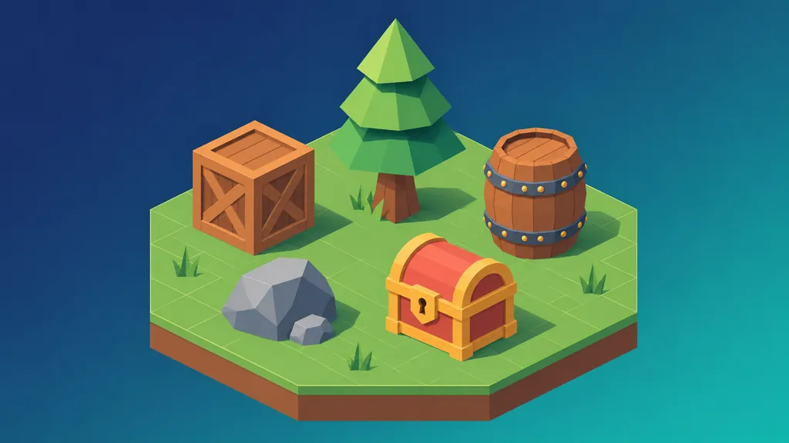

| 预览 | 项目 | 许可证 | 适合做什么 |
| --- | --- | --- | --- |
| 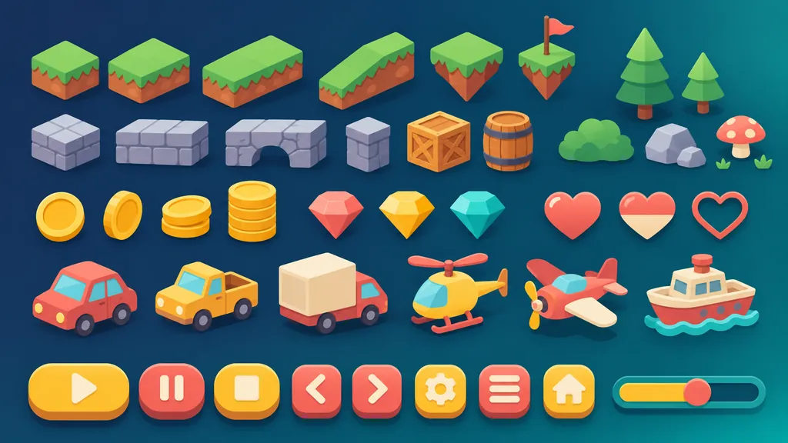 | [Kenney Game Assets](https://kenney.nl/assets) *示意图* | [CC0-1.0](https://kenney.nl/support) | 上千套风格统一的 2D 精灵、UI、3D 模型和音效包，适合做原型和 Game Jam。 |
|  | [Quaternius](https://quaternius.com/) 图片来源：项目 [Quaternius](https://quaternius.com/) | [CC0-1.0](https://quaternius.com/faq.html) | 低多边形 3D 素材包（角色、自然、建筑、武器），FBX/OBJ/glTF 格式，免费包为 CC0。 |
|  | [OpenGameArt.org](https://opengameart.org/) *示意图* | [按素材单独授权（CC0 / CC-BY / CC-BY-SA / GPL / OGA-BY）](https://opengameart.org/content/faq) | 社区共享的 2D、3D、音乐和音效库；每个素材页都标明许可证，使用前逐个确认。 |
|  | [KhronosGroup/glTF-Sample-Assets](https://github.com/KhronosGroup/glTF-Sample-Assets) 图片来源：项目 [KhronosGroup/glTF-Sample-Assets](https://github.com/KhronosGroup/glTF-Sample-Assets) | [按模型单独授权（多为 CC0 / CC-BY-4.0，少数为自定义条款，见 REUSE.toml）](https://github.com/KhronosGroup/glTF-Sample-Assets/tree/main/LICENSES) | 官方 glTF 参考模型，适合测试加载器、PBR 材质和引擎导入流程。 |
|  | [Polyfork](https://polyfork.dev/assets) 图片来源：项目 [Polyfork](https://polyfork.dev/assets) | [免费低多边形模型文件：CC-BY-4.0 或 Polyfork 许可（二选一）；ES 模块和 HD 版：仅 Polyfork 许可](https://polyfork.dev/licensing) | 3000+ 个免费低多边形 3D 模型，GLB 加 three.js ES 模块；走 CC BY 要署名 Polyfork，走 Polyfork 许可不用署名但不能转发文件。付费档另有 HD 版。 |
|  | [The Base Mesh](https://www.thebasemesh.com/) 图片来源：项目 [The Base Mesh](https://www.thebasemesh.com/) 参考清单 [madjin/awesome-cc0](https://github.com/madjin/awesome-cc0) | [CC0-1.0](https://www.thebasemesh.com/) | 1250+ 个按真实尺寸做的基础网格，适合白盒搭场景、雕刻起稿和做原型。 |
|  | [LiberatedPixelCup/Universal-LPC-Spritesheet-Character-Generator](https://github.com/LiberatedPixelCup/Universal-LPC-Spritesheet-Character-Generator) 图片来源：项目 [LiberatedPixelCup/Universal-LPC-Spritesheet-Character-Generator](https://github.com/LiberatedPixelCup/Universal-LPC-Spritesheet-Character-Generator) 参考清单 [Calinou/awesome-gamedev](https://github.com/Calinou/awesome-gamedev) | [GPL-3.0（代码）；美术按素材单独授权（CC0 / CC-BY / CC-BY-SA / OGA-BY / GPL）](https://github.com/LiberatedPixelCup/Universal-LPC-Spritesheet-Character-Generator#licensing-and-attribution-credits) | 网页版 RPG 角色精灵表生成器，分层拼装，含行走、劈砍、施法动画，可导出署名清单。 |
| 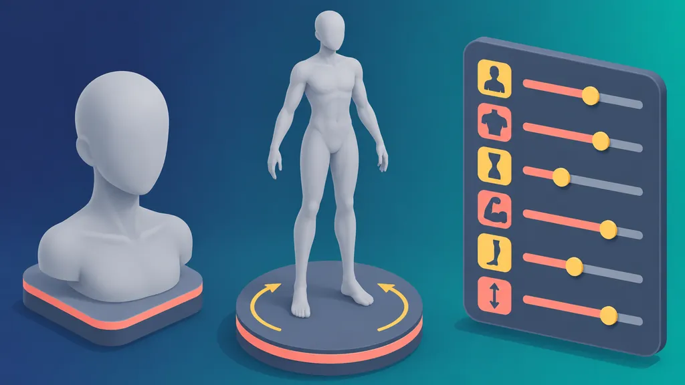 | [makehumancommunity/makehuman](https://github.com/makehumancommunity/makehuman) *示意图* | [AGPL-3.0（代码）/ CC0-1.0（自带素材）](https://github.com/makehumancommunity/makehuman) | 参数化 3D 人物角色生成器；导出的角色和自带素材为 CC0。 |
|  | [vrm-c/UniVRM](https://github.com/vrm-c/UniVRM) 图片来源：项目 [vrm-c/UniVRM](https://vrm.dev/en) | [MIT](https://github.com/vrm-c/UniVRM) | Unity 的 VRM 人形角色导入导出工具（基于 glTF），支持弹簧骨骼和表情。 |
|  | [PolygonalMind/initiative-opensource-release](https://github.com/PolygonalMind/initiative-opensource-release) 图片来源：项目 [PolygonalMind/initiative-opensource-release](https://github.com/PolygonalMind/initiative-opensource-release) | [CC0-1.0](https://github.com/PolygonalMind/initiative-opensource-release) | Polygonal Mind 的 CC0 开源发布，含 100 Avatars 角色包和 3D 场景。 |
|  | [sparklinlabs/superpowers-asset-packs](https://github.com/sparklinlabs/superpowers-asset-packs) 图片来源：项目 [sparklinlabs/superpowers-asset-packs](https://github.com/sparklinlabs/superpowers-asset-packs) | [CC0-1.0](https://github.com/sparklinlabs/superpowers-asset-packs) | Superpowers 引擎的 CC0 素材包：2D 与 3D，含角色、载具、背景、射击和平台跳跃套装。 |
|  | [umasteeringgroup/UMA](https://github.com/umasteeringgroup/UMA) 图片来源：项目 [umasteeringgroup/UMA](https://github.com/umasteeringgroup/UMA) | [MIT](https://github.com/umasteeringgroup/UMA) | Unity 多用途角色系统：可换装、按 DNA 调体型，并自动合并贴图。 |
|  | [dicebear/dicebear](https://github.com/dicebear/dicebear) 图片来源：项目 [dicebear/dicebear](https://www.dicebear.com) | [MIT（代码；各头像风格另有许可）](https://github.com/dicebear/dicebear) | 头像库，按种子生成多种风格的 SVG 头像；用前看各风格自己的许可。 |
|  | [Kenney Modular Characters](https://kenney.nl/assets/modular-characters) 图片来源：项目 [Kenney Modular Characters](https://kenney.nl/assets/modular-characters) | [CC0-1.0](https://kenney.nl/assets/modular-characters) | 可拼装的 2D 角色部件，能组合出很多俯视或侧视角色。 |
|  | [Kenney Roguelike Characters](https://kenney.nl/assets/roguelike-characters) 图片来源：项目 [Kenney Roguelike Characters](https://kenney.nl/assets/roguelike-characters) | [CC0-1.0](https://kenney.nl/assets/roguelike-characters) | 16x16 像素 Roguelike 角色精灵，含装备和服饰。 |
|  | [Kenney Platformer Characters](https://kenney.nl/assets/platformer-characters) 图片来源：项目 [Kenney Platformer Characters](https://kenney.nl/assets/platformer-characters) | [CC0-1.0](https://kenney.nl/assets/platformer-characters) | 侧视平台跳跃角色，含走、跳等姿势。 |
|  | [Kenney Toon Characters](https://kenney.nl/assets/toon-characters) 图片来源：项目 [Kenney Toon Characters](https://kenney.nl/assets/toon-characters) | [CC0-1.0](https://kenney.nl/assets/toon-characters) | 卡通 2D 角色，多种姿势，适合休闲游戏。 |
|  | [Quaternius Universal Base Characters](https://quaternius.com/packs/universalbasecharacters.html) 图片来源：项目 [Quaternius Universal Base Characters](https://quaternius.com/packs/universalbasecharacters.html) | [CC0-1.0](https://quaternius.com/packs/universalbasecharacters.html) | 已绑定骨骼的低多边形基础角色，配合 Quaternius 通用动画库使用。 |
|  | [Quaternius Modular Character Outfits - Fantasy](https://quaternius.com/packs/modularcharacteroutfitsfantasy.html) 图片来源：项目 [Quaternius Modular Character Outfits - Fantasy](https://quaternius.com/packs/modularcharacteroutfitsfantasy.html) | [CC0-1.0](https://quaternius.com/packs/modularcharacteroutfitsfantasy.html) | Quaternius 基础角色的模块化奇幻服装（盔甲、长袍、帽子）。 |
|  | [Liberated Pixel Cup (LPC) Base Assets](https://opengameart.org/content/liberated-pixel-cup-lpc-base-assets-sprites-map-tiles) 图片来源：项目 [Liberated Pixel Cup (LPC) Base Assets](https://opengameart.org/content/liberated-pixel-cup-lpc-base-assets-sprites-map-tiles) | [CC-BY-SA-3.0 / GPL-3.0](https://opengameart.org/content/liberated-pixel-cup-lpc-base-assets-sprites-map-tiles) | Liberated Pixel Cup 基础精灵和地图图块，是庞大 LPC 角色美术生态的源头。 |
|  | [Kenney Pixel Platformer](https://kenney.nl/assets/pixel-platformer) 图片来源：项目 [Kenney Pixel Platformer](https://kenney.nl/assets/pixel-platformer) | [CC0-1.0](https://kenney.nl/assets/pixel-platformer) | 18x18 像素平台跳跃图块、角色和道具。 |
|  | [Kenney 1-Bit Pack](https://kenney.nl/assets/1-bit-pack) 图片来源：项目 [Kenney 1-Bit Pack](https://kenney.nl/assets/1-bit-pack) | [CC0-1.0](https://kenney.nl/assets/1-bit-pack) | 1000 多个 1-bit 16x16 图块，地牢、城镇、科幻等都有。 |
|  | [Kenney Tiny Dungeon](https://kenney.nl/assets/tiny-dungeon) 图片来源：项目 [Kenney Tiny Dungeon](https://kenney.nl/assets/tiny-dungeon) | [CC0-1.0](https://kenney.nl/assets/tiny-dungeon) | 小巧的 16x16 地牢图块、英雄和怪物。 |
|  | [Kenney Tiny Town](https://kenney.nl/assets/tiny-town) 图片来源：项目 [Kenney Tiny Town](https://kenney.nl/assets/tiny-town) | [CC0-1.0](https://kenney.nl/assets/tiny-town) | 小巧的 16x16 城镇图块：房屋、篱笆和自然景物。 |
|  | [16x16 DungeonTileset II](https://0x72.itch.io/dungeontileset-ii) 图片来源：项目 [16x16 DungeonTileset II](https://0x72.itch.io/dungeontileset-ii) | [CC0-1.0（素材）/ MIT（代码）](https://0x72.itch.io/dungeontileset-ii) | 16x16 地牢图块，含带动画的角色、怪物和武器。 |
|  | [16x16 Fantasy tileset](https://opengameart.org/content/16x16-fantasy-tileset) 图片来源：项目 [16x16 Fantasy tileset](https://opengameart.org/content/16x16-fantasy-tileset) | [CC-BY-SA-3.0](https://opengameart.org/content/16x16-fantasy-tileset) | Game Boy / 红白机风的迷你角色和奇幻道具，适合 Roguelike 和 RPG。 |
|  | [A Blocky Dungeon](https://opengameart.org/content/a-blocky-dungeon) 图片来源：项目 [A Blocky Dungeon](https://opengameart.org/content/a-blocky-dungeon) | [CC0-1.0](https://opengameart.org/content/a-blocky-dungeon) | 方块风 16x16 地牢图块，含门、开关和动画道具（不含角色）。 |

## UI、图标与 HUD

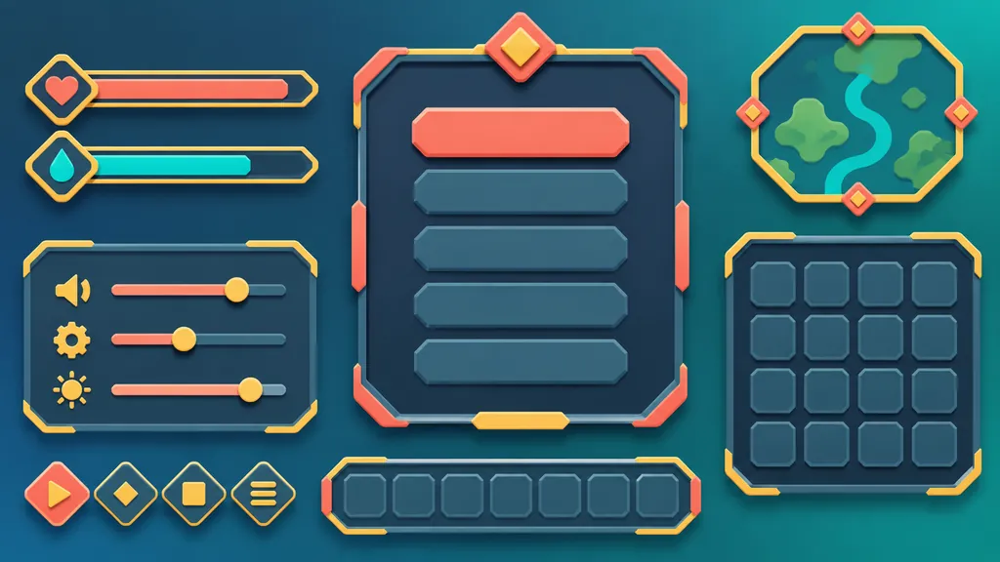

| 预览 | 项目 | 许可证 | 适合做什么 |
| --- | --- | --- | --- |
|  | [Game-icons.net](https://game-icons.net/) 图片来源：项目 [Game-icons.net](https://game-icons.net/) 参考清单 [Calinou/awesome-gamedev](https://github.com/Calinou/awesome-gamedev) | [CC-BY-3.0](https://game-icons.net/about.html) | 4000+ 个 SVG/PNG 游戏图标（技能、道具、状态），按要求给每个图标作者署名。 |
|  | [Those Awesome Guys: Controller & Keyboard Prompts](https://thoseawesomeguys.com/prompts/) *示意图* 参考清单 [Calinou/awesome-gamedev](https://github.com/Calinou/awesome-gamedev) | [CC0-1.0](https://thoseawesomeguys.com/prompts/) | 键盘、鼠标和常见手柄的按键提示图标，做新手引导和操作提示用。 |
|  | [ocornut/imgui](https://github.com/ocornut/imgui) 图片来源：项目 [ocornut/imgui](https://github.com/ocornut/imgui) | [MIT](https://github.com/ocornut/imgui) | 即时模式 GUI 库（Dear ImGui），做调试菜单、游戏内工具和编辑器。 |
|  | [Kenney UI Pack](https://kenney.nl/assets/ui-pack) 图片来源：项目 [Kenney UI Pack](https://kenney.nl/assets/ui-pack) | [CC0-1.0](https://kenney.nl/assets/ui-pack) | 430 个 UI 元素（按钮、滑条、面板），多种配色，做菜单和 HUD。 |
|  | [mikke89/RmlUi](https://github.com/mikke89/RmlUi) 图片来源：项目 [mikke89/RmlUi](https://github.com/mikke89/RmlUi) | [MIT](https://github.com/mikke89/RmlUi) | C++ 游戏 UI 库，用类 HTML/CSS 文档搭界面，支持数据绑定和动画。 |
|  | [Immediate-Mode-UI/Nuklear](https://github.com/Immediate-Mode-UI/Nuklear) 图片来源：项目 [Immediate-Mode-UI/Nuklear](https://github.com/Immediate-Mode-UI/Nuklear) | [MIT or Unlicense](https://github.com/Immediate-Mode-UI/Nuklear) | 单头文件 ANSI C 即时模式 GUI，做工具和游戏内菜单。 |
|  | [emilk/egui](https://github.com/emilk/egui) 图片来源：项目 [emilk/egui](https://github.com/emilk/egui) | [MIT OR Apache-2.0](https://github.com/emilk/egui) | Rust 的易用即时模式 GUI，原生和网页都能跑，常用于 Rust 游戏工具。 |
|  | [nicbarker/clay](https://github.com/nicbarker/clay) 图片来源：项目 [nicbarker/clay](https://github.com/nicbarker/clay) | [Zlib](https://github.com/nicbarker/clay) | C 语言高性能 UI 布局库，类 flexbox 布局，与渲染器无关。 |
|  | [memononen/nanovg](https://github.com/memononen/nanovg) 图片来源：项目 [memononen/nanovg](https://github.com/memononen/nanovg) | [Zlib](https://github.com/memononen/nanovg) | 基于 OpenGL 的抗锯齿 2D 矢量绘图库，做 UI 和可视化。 |
|  | [CedricGuillemet/ImGuizmo](https://github.com/CedricGuillemet/ImGuizmo) 图片来源：项目 [CedricGuillemet/ImGuizmo](https://github.com/CedricGuillemet/ImGuizmo) 参考清单 [Calinou/awesome-gamedev](https://github.com/Calinou/awesome-gamedev) | [MIT](https://github.com/CedricGuillemet/ImGuizmo) | Dear ImGui 的即时模式 3D 操作手柄（移动、旋转、缩放）等编辑器控件。 |
|  | [epezent/implot](https://github.com/epezent/implot) 图片来源：项目 [epezent/implot](https://github.com/epezent/implot) | [MIT](https://github.com/epezent/implot) | Dear ImGui 的即时模式绘图，适合性能分析和调试曲线。 |
|  | [ebitenui/ebitenui](https://github.com/ebitenui/ebitenui) 图片来源：项目 [ebitenui/ebitenui](https://github.com/ebitenui/ebitenui) | [MIT](https://github.com/ebitenui/ebitenui) | Go 语言 Ebitengine 游戏的 UI 引擎和控件库。 |
|  | [facebook/yoga](https://github.com/facebook/yoga) 图片来源：项目 [facebook/yoga](https://yogalayout.dev/) | [MIT](https://github.com/facebook/yoga) | 可嵌入的 flexbox 布局引擎，可在 C++、C#、JavaScript 里驱动游戏 UI 布局。 |
|  | [wjakob/nanogui](https://github.com/wjakob/nanogui) *示意图* | [BSD-3-Clause](https://github.com/wjakob/nanogui) | 极简 C++/Python OpenGL GUI 库，适合快速做工具面板。 |
|  | [vladbat00/bevy_egui](https://github.com/vladbat00/bevy_egui) 图片来源：项目 [vladbat00/bevy_egui](https://github.com/vladbat00/bevy_egui) | [MIT](https://github.com/vladbat00/bevy_egui) | 把 egui 接进 Bevy 引擎，做调试面板和游戏内编辑器。 |
|  | [Kenney Crosshair Pack](https://kenney.nl/assets/crosshair-pack) 图片来源：项目 [Kenney Crosshair Pack](https://kenney.nl/assets/crosshair-pack) | [CC0-1.0](https://kenney.nl/assets/crosshair-pack) | 准星和瞄准图标合集，做射击游戏和瞄准 UI。 |
|  | [Kenney Cursor Pack](https://kenney.nl/assets/cursor-pack) 图片来源：项目 [Kenney Cursor Pack](https://kenney.nl/assets/cursor-pack) | [CC0-1.0](https://kenney.nl/assets/cursor-pack) | 鼠标指针和光标图标，适合游戏菜单和策略游戏。 |
|  | [Kenney UI Pack (RPG Expansion)](https://kenney.nl/assets/ui-pack-rpg-expansion) 图片来源：项目 [Kenney UI Pack (RPG Expansion)](https://kenney.nl/assets/ui-pack-rpg-expansion) | [CC0-1.0](https://kenney.nl/assets/ui-pack-rpg-expansion) | RPG 风格 UI 元素：面板、血条、按钮和边框。 |
|  | [RPG GUI construction kit v1.0](https://opengameart.org/content/rpg-gui-construction-kit-v10) 图片来源：项目 [RPG GUI construction kit v1.0](https://opengameart.org/content/rpg-gui-construction-kit-v10) | [CC-BY-3.0](https://opengameart.org/content/rpg-gui-construction-kit-v10) | RPG GUI 拼装套件，含边框、条和按钮，拼奇幻风菜单。 |
|  | [Sci-fi User Interface](https://opengameart.org/content/sci-fi-user-interface) 图片来源：项目 [Sci-fi User Interface](https://opengameart.org/content/sci-fi-user-interface) | [CC0-1.0](https://opengameart.org/content/sci-fi-user-interface) | 科幻风界面元素，做未来感 HUD 和菜单。 |

## 贴图与材质

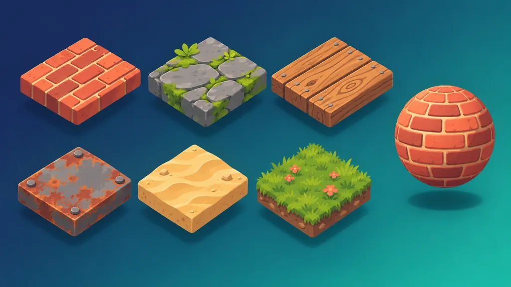

| 预览 | 项目 | 许可证 | 适合做什么 |
| --- | --- | --- | --- |
|  | [Poly Haven](https://polyhaven.com/) 图片来源：项目 [Poly Haven](https://polyhaven.com/) | [CC0-1.0](https://polyhaven.com/license) | 高质量 PBR 贴图、HDRI 环境光和扫描模型，适合写实场景和打光。 |
| 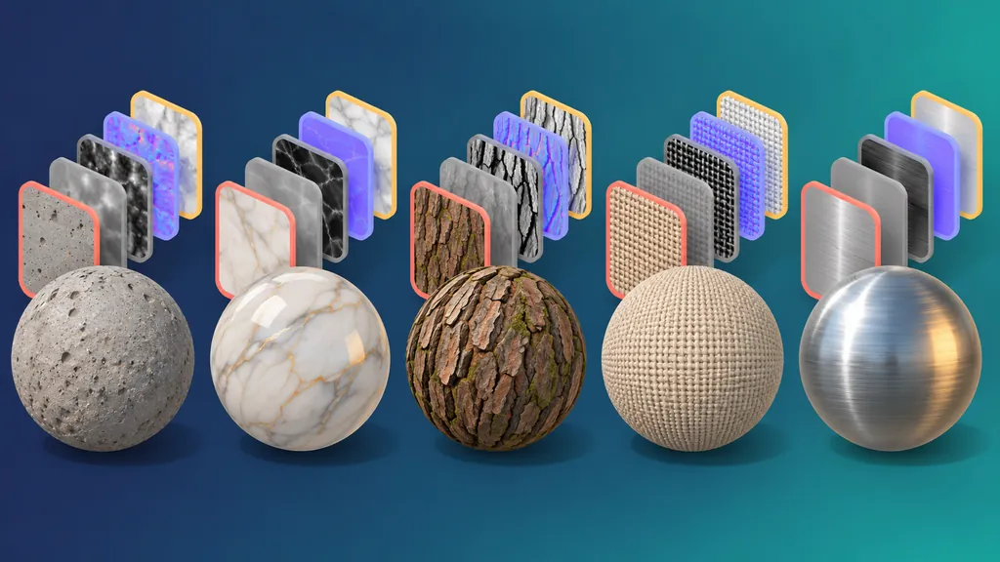 | [ambientCG](https://ambientcg.com/) *示意图* | [CC0-1.0](https://docs.ambientcg.com/license/) | 大量 CC0 PBR 材质、HDRI 和模型，提供多种分辨率。 |
|  | [kmkolasinski/AwesomeBump](https://github.com/kmkolasinski/AwesomeBump) 图片来源：项目 [kmkolasinski/AwesomeBump](https://github.com/kmkolasinski/AwesomeBump) 参考清单 [Calinou/awesome-gamedev](https://github.com/Calinou/awesome-gamedev) 参考清单 [madjin/awesome-cc0](https://github.com/madjin/awesome-cc0) | [GPL-3.0](https://github.com/kmkolasinski/AwesomeBump) | 从一张图生成法线、高度、高光、AO、粗糙度和金属度贴图（最后更新 2023 年）。 |
|  | [armory3d/armorpaint](https://github.com/armory3d/armorpaint) 图片来源：项目 [armory3d/armorpaint](https://github.com/armory3d/armorpaint) | [Zlib](https://github.com/armory3d/armorpaint) | PBR 3D 贴图绘制工具（源码开源，官方预编译版另售）。 |
|  | [azagaya/laigter](https://github.com/azagaya/laigter) 图片来源：项目 [azagaya/laigter](https://github.com/azagaya/laigter) | [GPL-3.0](https://github.com/azagaya/laigter) | 给 2D 精灵生成法线、高光和遮蔽贴图，实现动态光照。 |

## 音效与音频

| 预览 | 项目 | 许可证 | 适合做什么 |
| --- | --- | --- | --- |
|  | [Freesound](https://freesound.org/) *示意图* | [按音效单独授权（CC0 / CC-BY-4.0 / CC-BY-NC-4.0）](https://freesound.org/help/faq/) | 超大社区音效库；按许可证筛选（商用游戏选 CC0 或 CC-BY），需要署名时照做。 |
|  | [Sonniss #GameAudioGDC Bundles](https://sonniss.com/gameaudiogdc) 图片来源：项目 [Sonniss #GameAudioGDC Bundles](https://sonniss.com/gameaudiogdc) | [免版税（Sonniss 许可：可商用，无需署名）](https://sonniss.com/gameaudiogdc) | 每年免费放出的专业音效合集，商用游戏免版税。 |
|  | [chr15m/jsfxr](https://github.com/chr15m/jsfxr) 图片来源：项目 [chr15m/jsfxr](https://github.com/chr15m/jsfxr) | [Unlicense](https://github.com/chr15m/jsfxr) | 浏览器里的复古音效生成器（sfxr 移植），一键出跳跃、金币、受击、激光音。 |
|  | [raysan5/rfxgen](https://github.com/raysan5/rfxgen) 图片来源：项目 [raysan5/rfxgen](https://github.com/raysan5/rfxgen) 参考清单 [Calinou/awesome-gamedev](https://github.com/Calinou/awesome-gamedev) | [Zlib](https://github.com/raysan5/rfxgen) | raylib 作者做的小型 sfxr 风格音效生成器，桌面版和网页版都有。 |
|  | [YuriSizov/boscaceoil-blue](https://github.com/YuriSizov/boscaceoil-blue) 图片来源：项目 [YuriSizov/boscaceoil-blue](https://github.com/YuriSizov/boscaceoil-blue) 参考清单 [Calinou/awesome-gamedev](https://github.com/Calinou/awesome-gamedev) | [MIT](https://github.com/YuriSizov/boscaceoil-blue/blob/main/LICENSE) | 新手友好的步进音序器作曲工具，是 Terry Cavanagh 的 Bosca Ceoil 现代移植版，适合做游戏循环配乐和短旋律。 |
|  | [mackron/miniaudio](https://github.com/mackron/miniaudio) 图片来源：项目 [mackron/miniaudio](https://github.com/mackron/miniaudio) | [Unlicense 或 MIT-0（二选一）](https://github.com/mackron/miniaudio) | 单文件 C 音频播放 / 录音库，带混音和效果，好嵌进引擎。 |
|  | [jarikomppa/soloud](https://github.com/jarikomppa/soloud) 图片来源：项目 [jarikomppa/soloud](https://github.com/jarikomppa/soloud) | [Zlib](https://github.com/jarikomppa/soloud) | 简单易移植的 C++ 游戏音频引擎，支持 3D 音效、滤波器和语音合成。 |
|  | [Tonejs/Tone.js](https://github.com/Tonejs/Tone.js) *示意图* | [MIT](https://github.com/Tonejs/Tone.js) | Web Audio 交互音乐框架：浏览器里的合成器、效果器和节拍调度。 |
|  | [goldfire/howler.js](https://github.com/goldfire/howler.js) 图片来源：项目 [goldfire/howler.js](https://github.com/goldfire/howler.js) | [MIT](https://github.com/goldfire/howler.js) | 网页游戏音频库：音频精灵、空间音效、跨浏览器播放。 |
|  | [surge-synthesizer/surge](https://github.com/surge-synthesizer/surge) 图片来源：项目 [surge-synthesizer/surge](https://github.com/surge-synthesizer/surge) | [GPL-3.0](https://github.com/surge-synthesizer/surge) | Surge XT，强大的开源合成器，做游戏音乐和音效。 |
|  | [increpare/bfxr](https://github.com/increpare/bfxr) *示意图* | [Apache-2.0（README 中声明）](https://github.com/increpare/bfxr#readme) | 复古音效生成器（sfxr 增强版），做跳跃、拾取、爆炸音。 |
|  | [Pixabay Sound Effects](https://pixabay.com/sound-effects/) *示意图* ⚠ 网站对自动检查返回 403，许可证已人工核实 | [Pixabay 内容许可（免费、免署名；不得原样转卖）](https://pixabay.com/service/license-summary/) | 大量免版税音效和音乐，采用 Pixabay 内容许可。 |
| 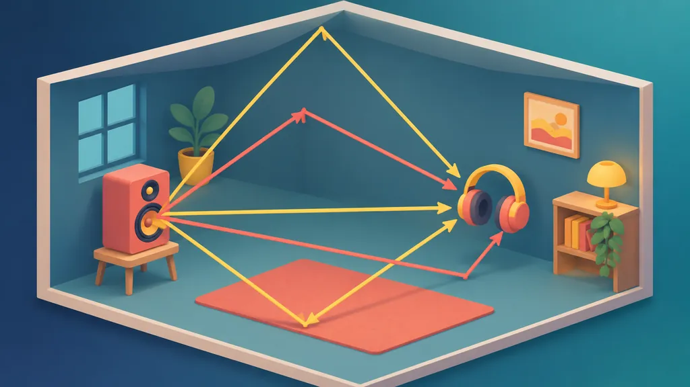 | [ValveSoftware/steam-audio](https://github.com/ValveSoftware/steam-audio) *示意图* | [Apache-2.0](https://github.com/ValveSoftware/steam-audio) | 空间音频 SDK：HRTF、遮挡和基于物理的混响，提供 Unity、Unreal、FMOD 插件。 |
|  | [kcat/openal-soft](https://github.com/kcat/openal-soft) *示意图* | [LGPL-2.0-or-later](https://github.com/kcat/openal-soft) | OpenAL 3D 音频 API 的软件实现，支持 HRTF 和环绕声输出。 |
| 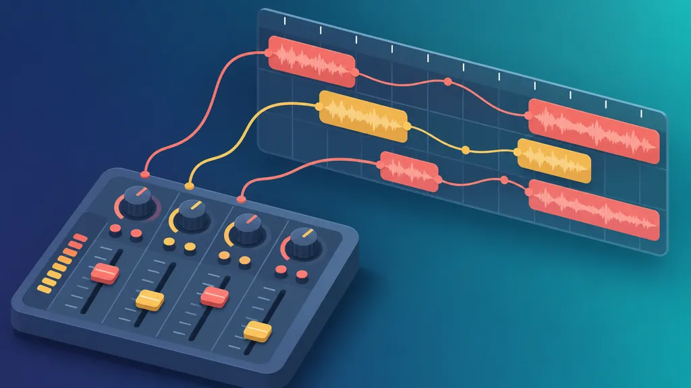 | [tesselode/kira](https://github.com/tesselode/kira) *示意图* | [MIT OR Apache-2.0](https://github.com/tesselode/kira) | Rust 游戏音频库，参数可补间，有混音轨、时钟和效果器。 |
|  | [LabSound/LabSound](https://github.com/LabSound/LabSound) 图片来源：项目 [LabSound/LabSound](https://github.com/LabSound/LabSound) | [BSD-2-Clause / BSD-3-Clause](https://github.com/LabSound/LabSound) | 基于音频图的 C++ 引擎，源自 WebKit 的 WebAudio，适合游戏和交互应用。 |
|  | [tildearrow/furnace](https://github.com/tildearrow/furnace) 图片来源：项目 [tildearrow/furnace](https://github.com/tildearrow/furnace) | [GPL-2.0-or-later](https://github.com/tildearrow/furnace) | 多系统芯片音乐编曲器，模拟几十种经典音源芯片，做复古音乐。 |
|  | [milkytracker/MilkyTracker](https://github.com/milkytracker/MilkyTracker) 图片来源：项目 [milkytracker/MilkyTracker](https://github.com/milkytracker/MilkyTracker) | [GPL-3.0（MilkyPlay 库：BSD-3-Clause）](https://github.com/milkytracker/MilkyTracker) | 兼容 FastTracker II 的音乐编曲器，做 MOD/XM 芯片乐和游戏配乐。 |

## 字体

| 预览 | 项目 | 许可证 | 适合做什么 |
| --- | --- | --- | --- |
| 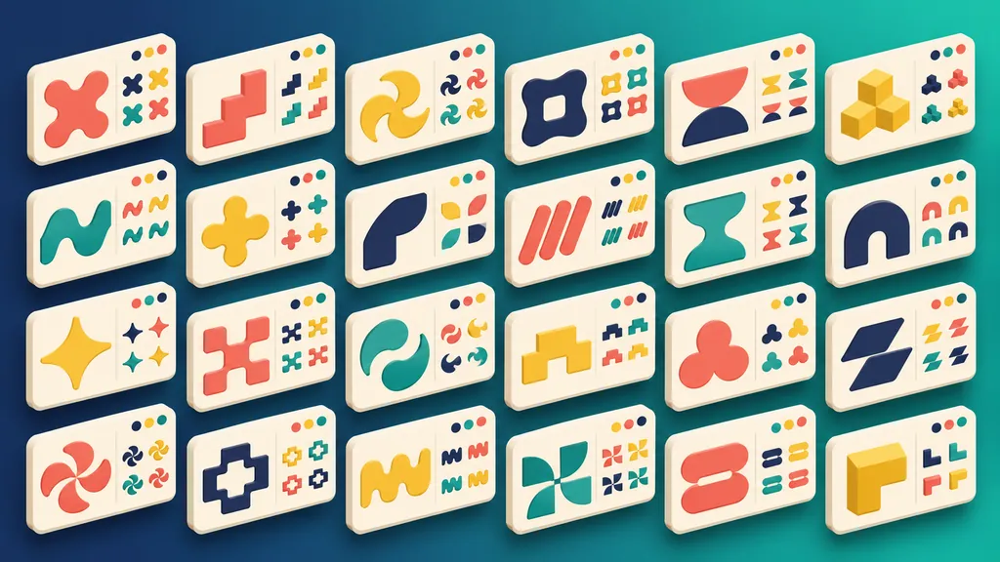 | [google/fonts](https://github.com/google/fonts) *示意图* | [按字体家族单独授权（OFL-1.1 / Apache-2.0 / UFL）](https://github.com/google/fonts#license) | Google Fonts 全部字体源文件；目录名就是许可证，不少支持中日韩。 |
|  | [rektdeckard/departure-mono](https://github.com/rektdeckard/departure-mono) 图片来源：项目 [rektdeckard/departure-mono](https://github.com/rektdeckard/departure-mono) | [OFL-1.1（字体）/ MIT（网站）](https://github.com/rektdeckard/departure-mono) | 复古未来感的等宽像素字体，适合 HUD 和终端界面。 |
|  | [TakWolf/fusion-pixel-font](https://github.com/TakWolf/fusion-pixel-font) 图片来源：项目 [TakWolf/fusion-pixel-font](https://github.com/TakWolf/fusion-pixel-font) | [OFL-1.1（字体）/ MIT（构建程序）](https://github.com/TakWolf/fusion-pixel-font) | 开源泛中日韩像素字体，覆盖中日韩和拉丁字符，有 8/10/12 像素尺寸。 |
|  | [TakWolf/ark-pixel-font](https://github.com/TakWolf/ark-pixel-font) 图片来源：项目 [TakWolf/ark-pixel-font](https://github.com/TakWolf/ark-pixel-font) | [OFL-1.1（字体）/ MIT（构建程序）](https://github.com/TakWolf/ark-pixel-font) | 开源中日韩像素字体（方舟像素字体），为像素风游戏设计。 |
|  | [Kenney Fonts](https://kenney.nl/assets/kenney-fonts) 图片来源：项目 [Kenney Fonts](https://kenney.nl/assets/kenney-fonts) | [CC0-1.0](https://kenney.nl/assets/kenney-fonts) | Kenney 的 11 款游戏风格字体，任何项目都能用。 |
|  | [IdreesInc/Monocraft](https://github.com/IdreesInc/Monocraft) 图片来源：项目 [IdreesInc/Monocraft](https://github.com/IdreesInc/Monocraft) | [OFL-1.1](https://github.com/IdreesInc/Monocraft) | 方块风等宽字体，灵感来自 Minecraft 字体，带编程连字。 |
|  | [the-moonwitch/Cozette](https://github.com/the-moonwitch/Cozette) 图片来源：项目 [the-moonwitch/Cozette](https://github.com/the-moonwitch/Cozette) | [MIT](https://github.com/the-moonwitch/Cozette) | 小号位图字体，字形覆盖广，适合复古 UI 和终端。 |
|  | [fcambus/spleen](https://github.com/fcambus/spleen) *示意图* | [BSD-2-Clause](https://github.com/fcambus/spleen) | 等宽位图字体，从 5x8 到 32x64 多种尺寸，像素 UI 很清晰。 |
|  | [sgigou/NF-Pixels](https://github.com/sgigou/NF-Pixels) 图片来源：项目 [sgigou/NF-Pixels](https://github.com/sgigou/NF-Pixels) | [OFL-1.1](https://github.com/sgigou/NF-Pixels) | 免费像素字体，有常规和粗体，适合复古游戏文字。 |
|  | [scott0107000/BoutiqueBitmap7x7](https://github.com/scott0107000/BoutiqueBitmap7x7) 图片来源：项目 [scott0107000/BoutiqueBitmap7x7](https://github.com/scott0107000/BoutiqueBitmap7x7) | [OFL-1.1](https://github.com/scott0107000/BoutiqueBitmap7x7) | 开源 7x7 点阵字体，覆盖中文、日文和拉丁字母。 |
|  | [monogram](https://datagoblin.itch.io/monogram) 图片来源：项目 [monogram](https://datagoblin.itch.io/monogram) | [CC0-1.0](https://datagoblin.itch.io/monogram) | monogram：免费等宽像素字体，字符覆盖广。 |
|  | [m5x7](https://managore.itch.io/m5x7) 图片来源：项目 [m5x7](https://managore.itch.io/m5x7) | [CC0-1.0](https://managore.itch.io/m5x7) | m5x7：Daniel Linssen 的小巧易读像素字体。 |
|  | [Pixeloid](https://ggbot.itch.io/pixeloid-font) 图片来源：项目 [Pixeloid](https://ggbot.itch.io/pixeloid-font) | [OFL-1.1](https://ggbot.itch.io/pixeloid-font) | Pixeloid：像素字体家族，有无衬线、等宽和粗体。 |
|  | [The League of Moveable Type](https://www.theleagueofmoveabletype.com/) 图片来源：项目 [The League of Moveable Type](https://www.theleagueofmoveabletype.com/) | [OFL-1.1](https://www.theleagueofmoveabletype.com/) | 开源展示字体铸字坊，字体都用 SIL OFL 许可。 |

## 特效、粒子与着色器

| 预览 | 项目 | 许可证 | 适合做什么 |
| --- | --- | --- | --- |
|  | [Alchemist0823/three.quarks](https://github.com/Alchemist0823/three.quarks) 图片来源：项目 [Alchemist0823/three.quarks](https://github.com/Alchemist0823/three.quarks) | [MIT](https://github.com/Alchemist0823/three.quarks) | three.js 通用粒子 / 特效引擎，带可视化编辑器。 |
|  | [creativelifeform/three-nebula](https://github.com/creativelifeform/three-nebula) 图片来源：项目 [creativelifeform/three-nebula](https://three-nebula.org/) | [MIT](https://github.com/creativelifeform/three-nebula) | three.js 的 WebGL 粒子引擎，用 JSON 定义发射器，做火焰、烟雾、魔法特效。 |
|  | [effekseer/Effekseer](https://github.com/effekseer/Effekseer) 图片来源：项目 [effekseer/Effekseer](https://github.com/effekseer/Effekseer) | [MIT](https://github.com/effekseer/Effekseer) | 粒子特效编辑器和运行时，支持 Unity、Unreal、Godot 和 Web。 |
|  | [Kenney Particle Pack](https://kenney.nl/assets/particle-pack) 图片来源：项目 [Kenney Particle Pack](https://kenney.nl/assets/particle-pack) | [CC0-1.0](https://kenney.nl/assets/particle-pack) | 80 张粒子贴图（烟、火、火花、魔法），可直接放进任意粒子系统。 |
|  | [JangaFX Free VDB Animations](https://jangafx.com/software/embergen/download/free-vdb-animations/) 图片来源：项目 [JangaFX Free VDB Animations](https://jangafx.com/) 参考清单 [madjin/awesome-cc0](https://github.com/madjin/awesome-cc0) | [CC0-1.0](https://jangafx.com/software/embergen/download/free-vdb-animations/) | 免费体积火焰、烟雾、爆炸模拟（OpenVDB），用于 Blender、Houdini 和离线渲染。 |
| 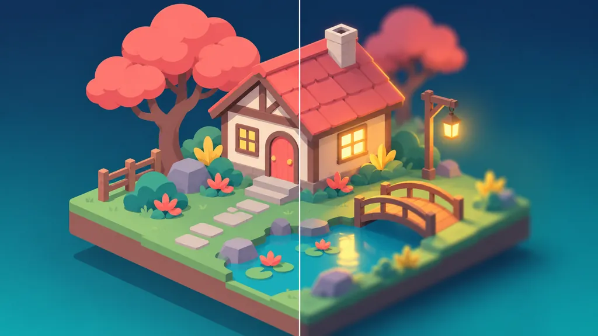 | [pmndrs/postprocessing](https://github.com/pmndrs/postprocessing) *示意图* | [Zlib](https://github.com/pmndrs/postprocessing) | three.js 后处理特效库：泛光、景深、SMAA 抗锯齿、色调映射等。 |
|  | [gdquest-demos/godot-shaders](https://github.com/gdquest-demos/godot-shaders) 图片来源：项目 [gdquest-demos/godot-shaders](https://github.com/gdquest-demos/godot-shaders) | [MIT（代码）/ CC-BY-NC-SA-4.0（美术）](https://github.com/gdquest-demos/godot-shaders) | 开源 Godot 着色器示例（溶解、描边、水面、卡通渲染等），代码易读。 |
|  | [gdquest-demos/godot-visual-effects](https://github.com/gdquest-demos/godot-visual-effects) 图片来源：项目 [gdquest-demos/godot-visual-effects](https://github.com/gdquest-demos/godot-visual-effects) | [MIT（代码）/ CC-BY-NC-SA-4.0（美术）](https://github.com/gdquest-demos/godot-visual-effects) | Godot 视觉特效示例：粒子、爆炸、受击、魔法技能，可以照着学。 |
|  | [Godot Shaders](https://godotshaders.com/) 图片来源：项目 [Godot Shaders](https://godotshaders.com/) | [按着色器单独授权（CC0 / MIT / GPL-3.0）；配图不在授权内](https://godotshaders.com/license/) | Godot 着色器社区库；每个帖子标明许可证，只覆盖代码。 |
|  | [CyberAgentGameEntertainment/NovaShader](https://github.com/CyberAgentGameEntertainment/NovaShader) 图片来源：项目 [CyberAgentGameEntertainment/NovaShader](https://github.com/CyberAgentGameEntertainment/NovaShader) | [MIT](https://github.com/CyberAgentGameEntertainment/NovaShader) | Unity URP 多功能粒子着色器，含扭曲、溶解、流动贴图等。 |
|  | [pixijs-userland/particle-emitter](https://github.com/pixijs-userland/particle-emitter) *示意图* | [MIT](https://github.com/pixijs-userland/particle-emitter) | PixiJS 粒子系统，配可视化编辑器，做火焰、烟雾、火花等 2D 特效。 |
|  | [djeedai/bevy_hanabi](https://github.com/djeedai/bevy_hanabi) *示意图* | [MIT OR Apache-2.0](https://github.com/djeedai/bevy_hanabi) | Bevy 的 GPU 粒子系统插件，可处理大量粒子。 |
|  | [haowg/GODOT-VFX-LIBRARY](https://github.com/haowg/GODOT-VFX-LIBRARY) 图片来源：项目 [haowg/GODOT-VFX-LIBRARY](https://github.com/haowg/GODOT-VFX-LIBRARY) | [MIT](https://github.com/haowg/GODOT-VFX-LIBRARY) | Godot 4 动作游戏特效合集：受击、刀光、爆炸、光环等粒子和着色器。 |
|  | [Chrisknyfe/boujie_water_shader](https://github.com/Chrisknyfe/boujie_water_shader) 图片来源：项目 [Chrisknyfe/boujie_water_shader](https://github.com/Chrisknyfe/boujie_water_shader) | [MIT](https://github.com/Chrisknyfe/boujie_water_shader) | Godot 4 风格化水面着色器，含波浪、泡沫和折射。 |
|  | [Arnklit/Waterways](https://github.com/Arnklit/Waterways) 图片来源：项目 [Arnklit/Waterways](https://github.com/Arnklit/Waterways) | [MIT](https://github.com/Arnklit/Waterways) | Godot 插件：用贝塞尔曲线生成河流网格并烘焙流向和泡沫贴图。 |
|  | [gdquest-demos/godot-4-stylized-sky](https://github.com/gdquest-demos/godot-4-stylized-sky) 图片来源：项目 [gdquest-demos/godot-4-stylized-sky](https://github.com/gdquest-demos/godot-4-stylized-sky) | [MIT（代码）/ CC-BY-NC-SA-4.0（美术）](https://github.com/gdquest-demos/godot-4-stylized-sky) | Godot 4 开源风格化天空着色器，含太阳、月亮、云和星空。 |
| 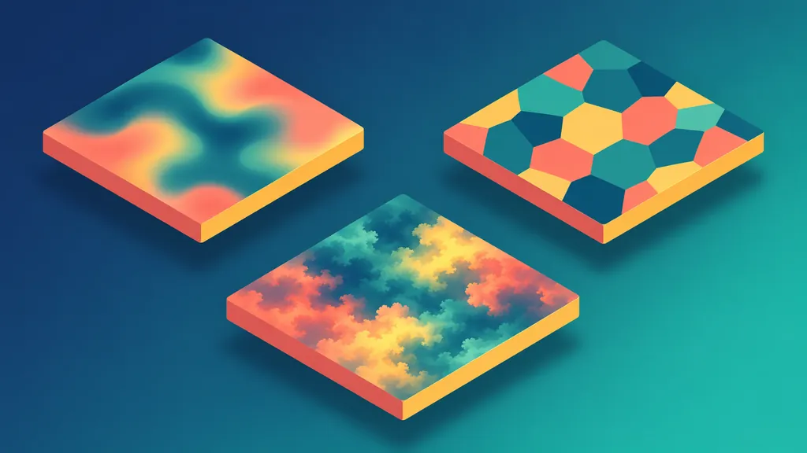 | [stegu/webgl-noise](https://github.com/stegu/webgl-noise) *示意图* | [MIT](https://github.com/stegu/webgl-noise) | GLSL 的 simplex、Perlin 和蜂窝噪声函数，做程序化着色器。 |
|  | [wwwtyro/glsl-atmosphere](https://github.com/wwwtyro/glsl-atmosphere) 图片来源：项目 [wwwtyro/glsl-atmosphere](https://github.com/wwwtyro/glsl-atmosphere) | [Unlicense](https://github.com/wwwtyro/glsl-atmosphere) | GLSL 天空渲染，含瑞利散射和米氏散射，做真实天空。 |
| 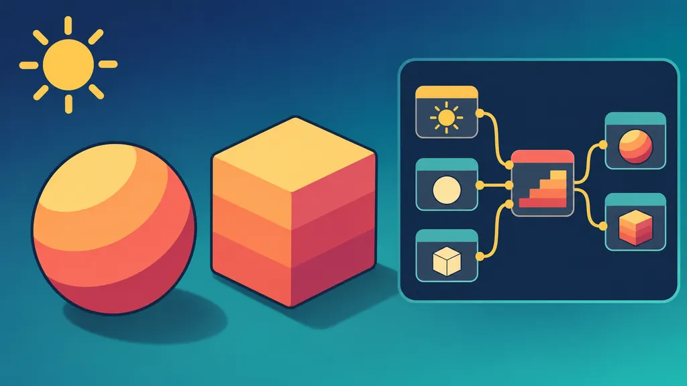 | [Cyanilux/URP_ShaderGraphCustomLighting](https://github.com/Cyanilux/URP_ShaderGraphCustomLighting) *示意图* | [MIT](https://github.com/Cyanilux/URP_ShaderGraphCustomLighting) | Unity URP Shader Graph 的自定义光照子图，适合卡通和风格化渲染。 |

## 技能 / 施法 / 战斗演示

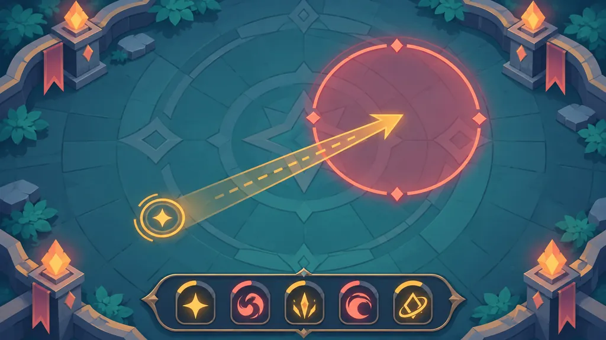

| 预览 | 项目 | 许可证 | 适合做什么 |
| --- | --- | --- | --- |
|  | [achrefelouafi/LinearAbiltyCastingThreeJS](https://github.com/achrefelouafi/LinearAbiltyCastingThreeJS) 图片来源：项目 [achrefelouafi/LinearAbiltyCastingThreeJS](https://github.com/achrefelouafi/LinearAbiltyCastingThreeJS) | [MIT](https://github.com/achrefelouafi/LinearAbiltyCastingThreeJS) | three.js 技能施法演示：直线施法和远程落点（瞄准箭头、目标圈、光束、冰矛、陨石），带 HUD。 |
|  | [jammyfu/open-game-skills](https://github.com/jammyfu/open-game-skills) 图片来源：项目 [jammyfu/open-game-skills](https://github.com/jammyfu/open-game-skills) | [MIT](https://github.com/jammyfu/open-game-skills) | 给编程 Agent 用的游戏开发 skill：手感、战斗、镜头、引擎适配，附可运行示例。 |
|  | [tranek/GASDocumentation](https://github.com/tranek/GASDocumentation) 图片来源：项目 [tranek/GASDocumentation](https://github.com/tranek/GASDocumentation) | [MIT](https://github.com/tranek/GASDocumentation) | 非官方的 Unreal Engine 5 Gameplay Ability System 深度指南，附多人示例工程（UE 5.3）。 |
|  | [No78Vino/gameplay-ability-system-for-unity](https://github.com/No78Vino/gameplay-ability-system-for-unity) 图片来源：项目 [No78Vino/gameplay-ability-system-for-unity](https://github.com/No78Vino/gameplay-ability-system-for-unity) | [MIT](https://github.com/No78Vino/gameplay-ability-system-for-unity) | Unreal Gameplay Ability System 的 Unity 实现（标签、属性、效果、技能），功能部分完成、仍在完善，文档为中文。 |
| 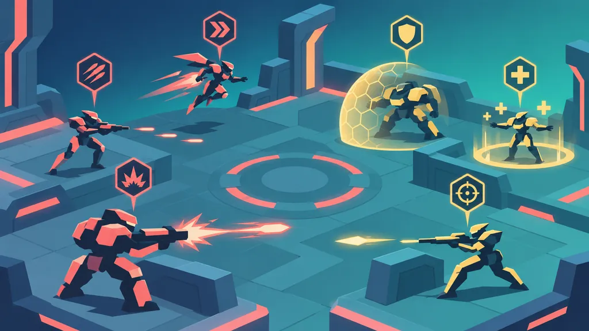 | [tranek/GASShooter](https://github.com/tranek/GASShooter) *示意图* | [MIT](https://github.com/tranek/GASShooter) | 进阶 Unreal GAS 示例：多人 FPS/TPS，含武器、技能和预测。 |
|  | [Narxim/Narxim-GAS-Example](https://github.com/Narxim/Narxim-GAS-Example) 图片来源：项目 [Narxim/Narxim-GAS-Example](https://github.com/Narxim/Narxim-GAS-Example) | [MIT](https://github.com/Narxim/Narxim-GAS-Example) | 干净的 Unreal Gameplay Ability System 模板工程，已配好属性和技能。 |
|  | [OctoD/godot-gameplay-abilities](https://github.com/OctoD/godot-gameplay-abilities) *示意图* | [MIT](https://github.com/OctoD/godot-gameplay-abilities) | Godot 的技能系统：技能、属性、效果和冷却。 |
| 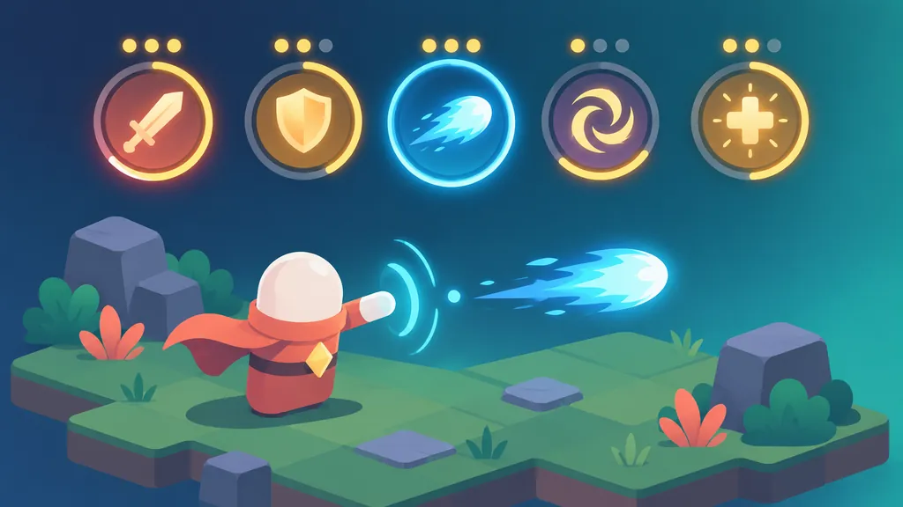 | [Leafwing-Studios/leafwing_abilities](https://github.com/Leafwing-Studios/leafwing_abilities) *示意图* | [MIT OR Apache-2.0](https://github.com/Leafwing-Studios/leafwing_abilities) | Bevy 的技能管理：冷却、充能和资源池，并与输入动作绑定。 |
|  | [Pyxus/fray](https://github.com/Pyxus/fray) 图片来源：项目 [Pyxus/fray](https://github.com/Pyxus/fray) | [MIT](https://github.com/Pyxus/fray) | Godot 战斗框架：分层状态机、输入缓冲和判定框管理。 |
| 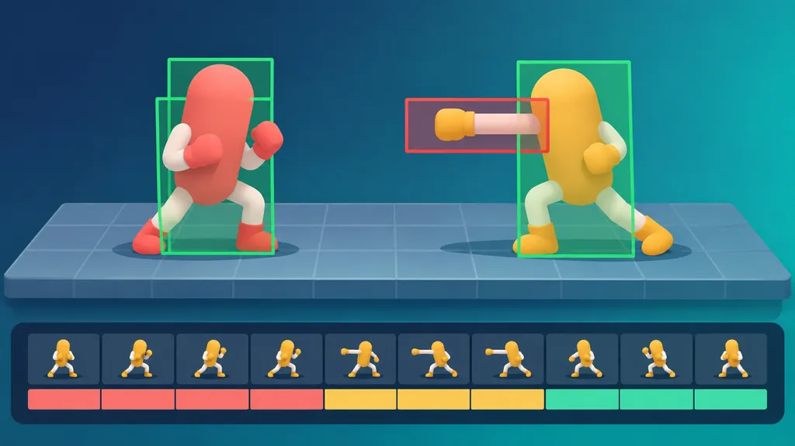 | [panthavma/castagne](https://github.com/panthavma/castagne) *示意图* | [MPL-2.0](https://github.com/panthavma/castagne) | 基于 Godot 的格斗游戏引擎和工具包，带角色脚本和帧数据工具。 |
|  | [gdquest-demos/godot-2d-jrpg-combat](https://github.com/gdquest-demos/godot-2d-jrpg-combat) 图片来源：项目 [gdquest-demos/godot-2d-jrpg-combat](https://github.com/gdquest-demos/godot-2d-jrpg-combat) | [MIT（代码）/ CC-BY-4.0（美术）](https://github.com/gdquest-demos/godot-2d-jrpg-combat) | Godot 的 2D JRPG 即时回合（ATB）战斗示例，演示出手顺序、技能和 UI。 |
|  | [gdquest-demos/godot-open-rpg](https://github.com/gdquest-demos/godot-open-rpg) 图片来源：项目 [gdquest-demos/godot-open-rpg](https://github.com/gdquest-demos/godot-open-rpg) | [MIT](https://github.com/gdquest-demos/godot-open-rpg) | 开源 Godot RPG 示例，学回合制战斗、背包和对话。 |
|  | [PhysaliaStudio/Flexi](https://github.com/PhysaliaStudio/Flexi) 图片来源：项目 [PhysaliaStudio/Flexi](https://github.com/PhysaliaStudio/Flexi) | [MIT](https://github.com/PhysaliaStudio/Flexi) | Unity 技能框架，用节点图编辑器做技能和效果。 |
|  | [Relintai/entity_spell_system](https://github.com/Relintai/entity_spell_system) *示意图* 参考清单 [Calinou/awesome-godot](https://github.com/Calinou/awesome-godot) | [MIT](https://github.com/Relintai/entity_spell_system) | Godot 的 C++ 模块，为复杂 RPG（可联机）提供实体、法术、光环和属性。 |
|  | [homemech/unity-pattern-combo](https://github.com/homemech/unity-pattern-combo) *示意图* | [MIT](https://github.com/homemech/unity-pattern-combo) | 用命令模式实现的动作 / 格斗游戏连招系统 Unity 示例。 |

## 动画与动捕

| 预览 | 项目 | 许可证 | 适合做什么 |
| --- | --- | --- | --- |
|  | [Quaternius Universal Animation Library](https://quaternius.com/packs/universalanimationlibrary.html) 图片来源：项目 [Quaternius Universal Animation Library](https://quaternius.com/packs/universalanimationlibrary.html) | [CC0-1.0](https://quaternius.com/packs/universalanimationlibrary.html) | 120+ 人形动画（移动、战斗、表情动作），通用骨骼，可在 Unity、Unreal、Godot 里重定向。 |
|  | [Kenney Animated Characters](https://kenney.nl/assets/animated-characters-1) 图片来源：项目 [Kenney Animated Characters](https://kenney.nl/assets/animated-characters-1) | [CC0-1.0](https://kenney.nl/assets/animated-characters-1) | 带骨骼和动画的低多边形角色，适合快速做 3D 原型。 |
|  | [synfig/synfig](https://github.com/synfig/synfig) 图片来源：项目 [synfig/synfig](https://www.synfig.org/) 参考清单 [Calinou/awesome-gamedev](https://github.com/Calinou/awesome-gamedev) | [GPL-3.0](https://github.com/synfig/synfig) | 2D 矢量和骨骼动画软件，做过场和角色动画。 |
|  | [piskelapp/piskel](https://github.com/piskelapp/piskel) 图片来源：项目 [piskelapp/piskel](https://www.piskelapp.com/) 参考清单 [Calinou/awesome-gamedev](https://github.com/Calinou/awesome-gamedev) | [Apache-2.0](https://github.com/piskelapp/piskel) | 网页版精灵编辑器，逐帧做像素动画，可导出 GIF 和精灵表。 |
|  | [BandaiNamcoResearchInc/Bandai-Namco-Research-Motiondataset](https://github.com/BandaiNamcoResearchInc/Bandai-Namco-Research-Motiondataset) 图片来源：项目 [BandaiNamcoResearchInc/Bandai-Namco-Research-Motiondataset](https://github.com/BandaiNamcoResearchInc/Bandai-Namco-Research-Motiondataset) | [CC-BY-NC-4.0（数据集）/ MIT（脚本）](https://github.com/BandaiNamcoResearchInc/Bandai-Namco-Research-Motiondataset#license) | 动捕数据集，含多种风格的走路、格斗和手势动作；仅限非商业使用。 |
|  | [DragonBones/DragonBonesJS](https://github.com/DragonBones/DragonBonesJS) 图片来源：项目 [DragonBones/DragonBonesJS](https://github.com/DragonBones/DragonBonesJS) | [MIT](https://github.com/DragonBones/DragonBonesJS) | DragonBones 2D 骨骼动画的 JavaScript 运行时（支持 Pixi、Phaser、Egret 等）。 |
|  | [guillaumeblanc/ozz-animation](https://github.com/guillaumeblanc/ozz-animation) 图片来源：项目 [guillaumeblanc/ozz-animation](https://github.com/guillaumeblanc/ozz-animation) | [MIT](https://github.com/guillaumeblanc/ozz-animation) | C++ 骨骼动画库和工具集：采样、混合、IK，以及 FBX/glTF 导入管线。 |
|  | [nfrechette/acl](https://github.com/nfrechette/acl) *示意图* | [MIT](https://github.com/nfrechette/acl) | 动画压缩库：骨骼动画片段的快速、高精度压缩与解压。 |
|  | [Rokoko/rokoko-studio-live-blender](https://github.com/Rokoko/rokoko-studio-live-blender) 图片来源：项目 [Rokoko/rokoko-studio-live-blender](https://github.com/Rokoko/rokoko-studio-live-blender) | [LGPL-3.0](https://github.com/Rokoko/rokoko-studio-live-blender) | Blender 插件：从 Rokoko Studio 实时接收动捕并重定向到你的骨架上。 |
|  | [enziop/mixamo_converter](https://github.com/enziop/mixamo_converter) *示意图* | [GPL-3.0](https://github.com/enziop/mixamo_converter) | Blender 插件，把 Mixamo 动画转成根运动，方便接 Unreal 类管线。 |
|  | [freemocap/freemocap](https://github.com/freemocap/freemocap) 图片来源：项目 [freemocap/freemocap](https://github.com/freemocap/freemocap) | [AGPL-3.0](https://github.com/freemocap/freemocap) | 用普通摄像头做无标记动捕，可导出到 Blender 等格式。 |
|  | [emilianavt/OpenSeeFace](https://github.com/emilianavt/OpenSeeFace) 图片来源：项目 [emilianavt/OpenSeeFace](https://github.com/emilianavt/OpenSeeFace) | [BSD-2-Clause](https://github.com/emilianavt/OpenSeeFace) | CPU 实时人脸与面部关键点追踪，带 Unity 集成，可驱动虚拟形象。 |
|  | [google-ai-edge/mediapipe](https://github.com/google-ai-edge/mediapipe) 图片来源：项目 [google-ai-edge/mediapipe](https://github.com/google-ai-edge/mediapipe) | [Apache-2.0](https://github.com/google-ai-edge/mediapipe) | 跨平台机器学习方案，做姿态、手部和人脸追踪，可驱动角色或做动捕原型。 |
|  | [ubisoft/ubisoft-laforge-animation-dataset](https://github.com/ubisoft/ubisoft-laforge-animation-dataset) 图片来源：项目 [ubisoft/ubisoft-laforge-animation-dataset](https://github.com/ubisoft/ubisoft-laforge-animation-dataset) | [CC-BY-NC-ND-4.0](https://github.com/ubisoft/ubisoft-laforge-animation-dataset) | 育碧 La Forge 的 LAFAN1 动捕数据集（BVH），用于动画研究；非商业、禁止演绎。 |
|  | [Inochi2D/inochi2d](https://github.com/Inochi2D/inochi2d) 图片来源：项目 [Inochi2D/inochi2d](https://github.com/Inochi2D/inochi2d) | [BSD-2-Clause](https://github.com/Inochi2D/inochi2d) | 开源 2D 木偶动画 SDK，做实时绑定角色（VTuber 风格），有配套编辑器。 |
|  | [Samsung/rlottie](https://github.com/Samsung/rlottie) 图片来源：项目 [Samsung/rlottie](https://github.com/Samsung/rlottie) | [MIT（部分附带代码另有许可）](https://github.com/Samsung/rlottie) | 独立的 C++ Lottie 矢量动画播放库，适合游戏 UI 动效。 |
|  | [rive-app/rive-runtime](https://github.com/rive-app/rive-runtime) 图片来源：项目 [rive-app/rive-runtime](https://github.com/rive-app/rive-runtime) | [MIT](https://github.com/rive-app/rive-runtime) | Rive 交互动画和状态机的底层 C++ 运行时与渲染器。 |
|  | [mobius3/tweeny](https://github.com/mobius3/tweeny) *示意图* | [MIT](https://github.com/mobius3/tweeny) | 现代 C++ 补间库，仅头文件，带缓动函数和多点补间。 |
| 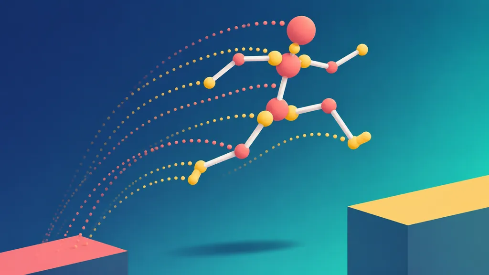 | [Wasserwecken/bvhio](https://github.com/Wasserwecken/bvhio) *示意图* | [MIT](https://github.com/Wasserwecken/bvhio) | Python 库，读写、编辑和创建 BVH 动作文件，支持层级变换。 |
|  | [eth-ait/aitviewer](https://github.com/eth-ait/aitviewer) 图片来源：项目 [eth-ait/aitviewer](https://github.com/eth-ait/aitviewer) | [MIT](https://github.com/eth-ait/aitviewer) | Python 查看器，可视化并交互 3D 序列数据，如 SMPL 人体和动捕。 |
|  | [xbpeng/DeepMimic](https://github.com/xbpeng/DeepMimic) 图片来源：项目 [xbpeng/DeepMimic](https://github.com/xbpeng/DeepMimic) | [MIT](https://github.com/xbpeng/DeepMimic) | 研究代码：物理角色用深度强化学习模仿动捕片段学技能。 |
|  | [orangeduck/Motion-Matching](https://github.com/orangeduck/Motion-Matching) *示意图* | [MIT](https://github.com/orangeduck/Motion-Matching) | Motion Matching 及 Learned Motion Matching 示例实现，做响应灵敏的角色移动。 |
|  | [KayKit Character Animations (legacy)](https://kaylousberg.itch.io/kaykit-animations) 图片来源：项目 [KayKit Character Animations (legacy)](https://kaylousberg.itch.io/kaykit-animations) | [CC0-1.0](https://kaylousberg.itch.io/kaykit-animations) | 旧版 KayKit 低多边形角色的动画集：待机、走、跑、跳、攀爬、攻击等；已不再更新。 |
|  | [Blender Studio — Rain rig](https://studio.blender.org/characters/rain/v3/) 图片来源：项目 [Blender Studio — Rain rig](https://studio.blender.org/characters/rain/v3/) | [CC-BY（需署名）](https://studio.blender.org/characters/rain/v3/) | Rain：Blender Studio 免费角色绑定，用来学习和练习动画。 |
|  | [Blender Studio — Snow rig](https://studio.blender.org/characters/snow/v4/) 图片来源：项目 [Blender Studio — Snow rig](https://studio.blender.org/characters/snow/v4/) | [CC-BY（需署名）](https://studio.blender.org/characters/snow/v4/) | Snow：Blender Studio 免费角色绑定，用来学习和练习动画。 |
|  | [Blender Studio — Vincent rig](https://studio.blender.org/characters/vincent/v2/) 图片来源：项目 [Blender Studio — Vincent rig](https://studio.blender.org/characters/vincent/v2/) | [CC-BY（需署名）](https://studio.blender.org/characters/vincent/v2/) | Vincent：Blender Studio 卡通角色绑定，用来练动画。 |

## 物理

| 预览 | 项目 | 许可证 | 适合做什么 |
| --- | --- | --- | --- |
| 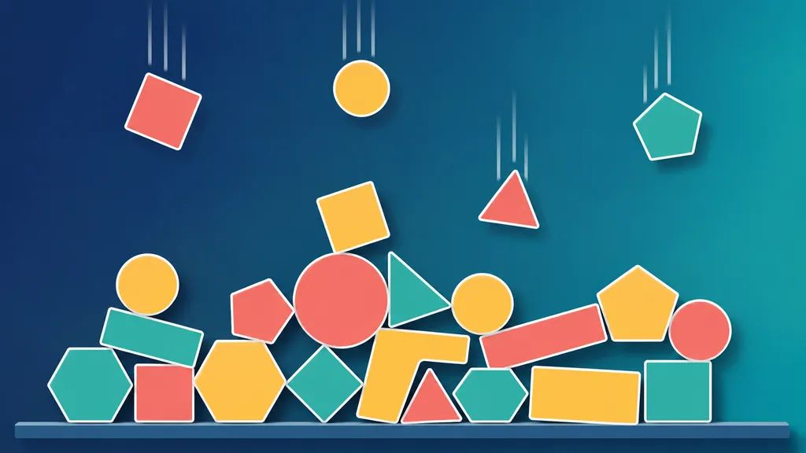 | [erincatto/box2d](https://github.com/erincatto/box2d) *示意图* | [MIT](https://github.com/erincatto/box2d) | C 写的 2D 刚体物理引擎，应用很广。 |
|  | [jrouwe/JoltPhysics](https://github.com/jrouwe/JoltPhysics) 图片来源：项目 [jrouwe/JoltPhysics](https://github.com/jrouwe/JoltPhysics) | [MIT](https://github.com/jrouwe/JoltPhysics) | 高性能多线程 3D 刚体物理引擎，适合游戏和 VR。 |
|  | [bulletphysics/bullet3](https://github.com/bulletphysics/bullet3) 图片来源：项目 [bulletphysics/bullet3](https://github.com/bulletphysics/bullet3) | [Zlib（Extras 和第三方库除外）](https://github.com/bulletphysics/bullet3) | 成熟的 3D 物理 SDK：碰撞检测、刚体和软体。 |
|  | [dimforge/rapier](https://github.com/dimforge/rapier) 图片来源：项目 [dimforge/rapier](https://github.com/dimforge/rapier) | [Apache-2.0](https://github.com/dimforge/rapier) | Rust 写的 2D/3D 物理引擎，也能通过 WASM 在 JavaScript 里用。 |
|  | [pmndrs/cannon-es](https://github.com/pmndrs/cannon-es) 图片来源：项目 [pmndrs/cannon-es](https://github.com/pmndrs/cannon-es) | [MIT](https://github.com/pmndrs/cannon-es) | 轻量网页 3D 物理引擎，常和 three.js 搭配。 |
|  | [liabru/matter-js](https://github.com/liabru/matter-js) *示意图* | [MIT](https://github.com/liabru/matter-js) | 网页 2D 刚体物理引擎，接口简单。 |
| 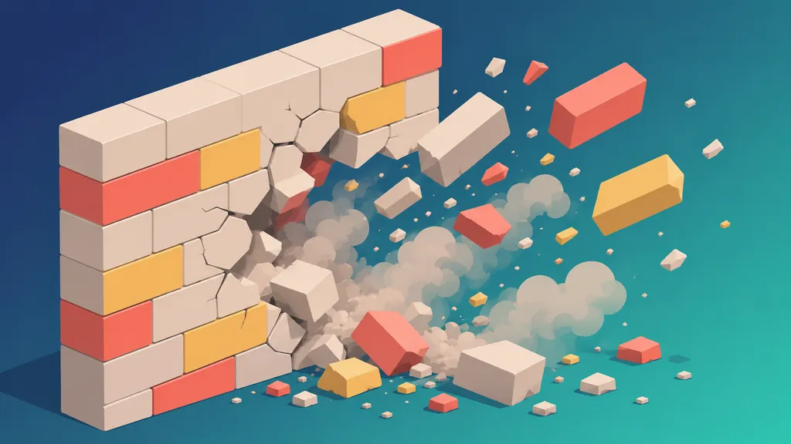 | [NVIDIA-Omniverse/PhysX](https://github.com/NVIDIA-Omniverse/PhysX) *示意图* | [BSD-3-Clause](https://github.com/NVIDIA-Omniverse/PhysX) | NVIDIA PhysX SDK，许多商业引擎背后的 3D 物理引擎。 |
|  | [slembcke/Chipmunk2D](https://github.com/slembcke/Chipmunk2D) *示意图* 参考清单 [ellisonleao/magictools](https://github.com/ellisonleao/magictools) | [MIT](https://github.com/slembcke/Chipmunk2D) | 快速轻量的 2D 刚体物理库，C 语言编写。 |
| 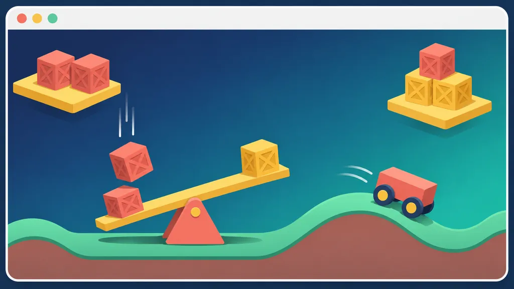 | [piqnt/planck.js](https://github.com/piqnt/planck.js) *示意图* | [MIT](https://github.com/piqnt/planck.js) | Box2D 的 JavaScript/TypeScript 重写版，做网页游戏 2D 物理。 |
|  | [bepu/bepuphysics2](https://github.com/bepu/bepuphysics2) 图片来源：项目 [bepu/bepuphysics2](https://github.com/bepu/bepuphysics2) | [Apache-2.0](https://github.com/bepu/bepuphysics2) | 纯 C# 实时 3D 物理库，主打速度。 |
|  | [DanielChappuis/reactphysics3d](https://github.com/DanielChappuis/reactphysics3d) 图片来源：项目 [DanielChappuis/reactphysics3d](https://github.com/DanielChappuis/reactphysics3d) | [Zlib](https://github.com/DanielChappuis/reactphysics3d) | 面向游戏的 C++ 3D 物理引擎：刚体、关节和碰撞检测。 |
|  | [InteractiveComputerGraphics/PositionBasedDynamics](https://github.com/InteractiveComputerGraphics/PositionBasedDynamics) 图片来源：项目 [InteractiveComputerGraphics/PositionBasedDynamics](https://github.com/InteractiveComputerGraphics/PositionBasedDynamics) | [MIT](https://github.com/InteractiveComputerGraphics/PositionBasedDynamics) | C++ 位置动力学库，模拟刚体、布料、软体和流体。 |
|  | [notgiven688/jitterphysics2](https://github.com/notgiven688/jitterphysics2) 图片来源：项目 [notgiven688/jitterphysics2](https://github.com/notgiven688/jitterphysics2) | [MIT](https://github.com/notgiven688/jitterphysics2) | 快速、零依赖的 C# 3D 物理引擎。 |
|  | [dyn4j/dyn4j](https://github.com/dyn4j/dyn4j) 图片来源：项目 [dyn4j/dyn4j](https://github.com/dyn4j/dyn4j) | [BSD-3-Clause](https://github.com/dyn4j/dyn4j) | Java 2D 碰撞检测和物理引擎。 |
| 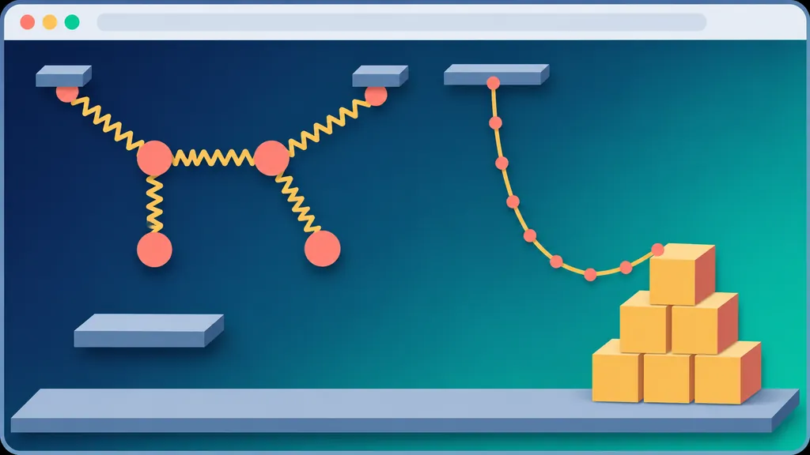 | [schteppe/p2.js](https://github.com/schteppe/p2.js) *示意图* | [MIT](https://github.com/schteppe/p2.js) | JavaScript 2D 物理库，有弹簧、约束和演示场景。 |
|  | [saharan/OimoPhysics](https://github.com/saharan/OimoPhysics) 图片来源：项目 [saharan/OimoPhysics](https://github.com/saharan/OimoPhysics) | [MIT](https://github.com/saharan/OimoPhysics) | 轻量跨平台 3D 物理引擎，用 Haxe 编写，有 JavaScript 版。 |
|  | [InteractiveComputerGraphics/SPlisHSPlasH](https://github.com/InteractiveComputerGraphics/SPlisHSPlasH) 图片来源：项目 [InteractiveComputerGraphics/SPlisHSPlasH](https://github.com/InteractiveComputerGraphics/SPlisHSPlasH) | [MIT](https://github.com/InteractiveComputerGraphics/SPlisHSPlasH) | 开源 SPH 流体模拟库，适合烘焙水和液体效果。 |
|  | [lo-th/phy](https://github.com/lo-th/phy) 图片来源：项目 [lo-th/phy](https://github.com/lo-th/phy) | [MIT](https://github.com/lo-th/phy) | three.js 物理层，用一套 API 封装多种引擎（Oimo、Ammo、Rapier、Jolt、Havok、PhysX）。 |
| 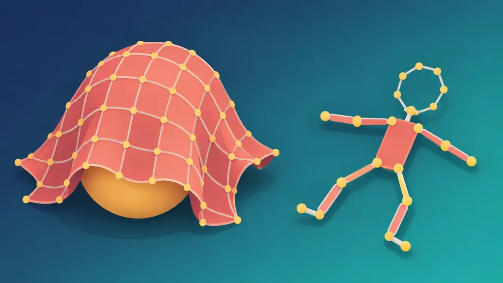 | [anuraghazra/Verly.js](https://github.com/anuraghazra/Verly.js) *示意图* | [MIT](https://github.com/anuraghazra/Verly.js) | 容易接入的 JavaScript Verlet 物理，做绳子、布料和布娃娃。 |
| 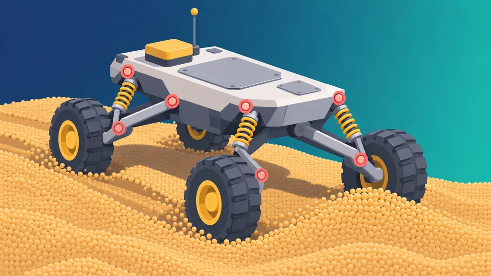 | [projectchrono/chrono](https://github.com/projectchrono/chrono) *示意图* | [BSD-3-Clause](https://github.com/projectchrono/chrono) | C++ 多物理场与多体动力学库，做载具、颗粒地形和机器人仿真。 |
|  | [google-deepmind/mujoco](https://github.com/google-deepmind/mujoco) 图片来源：项目 [google-deepmind/mujoco](https://github.com/google-deepmind/mujoco) | [Apache-2.0](https://github.com/google-deepmind/mujoco) | 通用物理模拟器，擅长带接触的关节体，常用于机器人和角色控制。 |

## 游戏 AI 与寻路

| 预览 | 项目 | 许可证 | 适合做什么 |
| --- | --- | --- | --- |
|  | [recastnavigation/recastnavigation](https://github.com/recastnavigation/recastnavigation) 图片来源：项目 [recastnavigation/recastnavigation](https://github.com/recastnavigation/recastnavigation) | [Zlib](https://github.com/recastnavigation/recastnavigation) | 3D 游戏导航网格生成（Recast）和寻路 / 群体模拟（Detour）。 |
| 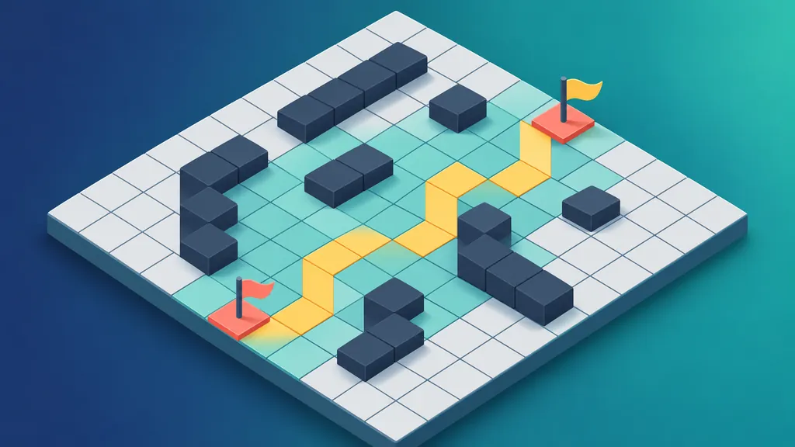 | [qiao/PathFinding.js](https://github.com/qiao/PathFinding.js) *示意图* | [MIT（README 中声明）](https://github.com/qiao/PathFinding.js#license) | JavaScript 网格寻路库（A*、Dijkstra、JPS），附在线可视化。 |
|  | [BehaviorTree/BehaviorTree.CPP](https://github.com/BehaviorTree/BehaviorTree.CPP) 图片来源：项目 [BehaviorTree/BehaviorTree.CPP](https://github.com/BehaviorTree/BehaviorTree.CPP) | [MIT](https://github.com/BehaviorTree/BehaviorTree.CPP) | C++ 行为树库，XML 定义行为树，配 Groot 可视化编辑器。 |
|  | [Mugen87/yuka](https://github.com/Mugen87/yuka) *示意图* | [MIT](https://github.com/Mugen87/yuka) | JavaScript 游戏 AI 库：转向行为、状态机、目标驱动、导航网格和感知。 |
|  | [limbonaut/limboai](https://github.com/limbonaut/limboai) 图片来源：项目 [limbonaut/limboai](https://github.com/limbonaut/limboai) | [MIT](https://github.com/limbonaut/limboai) | Godot 4 的行为树和状态机，带可视化编辑器和调试器。 |
|  | [bitbrain/beehave](https://github.com/bitbrain/beehave) 图片来源：项目 [bitbrain/beehave](https://github.com/bitbrain/beehave) | [MIT](https://github.com/bitbrain/beehave) | Godot 行为树插件，带 NPC 逻辑调试视图。 |
|  | [donmccurdy/three-pathfinding](https://github.com/donmccurdy/three-pathfinding) 图片来源：项目 [donmccurdy/three-pathfinding](https://github.com/donmccurdy/three-pathfinding) | [MIT](https://github.com/donmccurdy/three-pathfinding) | three.js 场景的导航网格寻路。 |
|  | [Unity-Technologies/ml-agents](https://github.com/Unity-Technologies/ml-agents) 图片来源：项目 [Unity-Technologies/ml-agents](https://unity.com/products/machine-learning-agents) | [Apache-2.0](https://github.com/Unity-Technologies/ml-agents) | 把 Unity 游戏和仿真当环境，用强化学习和模仿学习训练智能体。 |
|  | [MineDojo/Voyager](https://github.com/MineDojo/Voyager) 图片来源：项目 [MineDojo/Voyager](https://github.com/MineDojo/Voyager) | [MIT](https://github.com/MineDojo/Voyager) | 研究型智能体：用大模型在开放世界沙盒游戏里探索、写技能并持续学习。 |
|  | [libgdx/gdx-ai](https://github.com/libgdx/gdx-ai) 图片来源：项目 [libgdx/gdx-ai](https://github.com/libgdx/gdx-ai) | [Apache-2.0](https://github.com/libgdx/gdx-ai) | libGDX 的游戏 AI 框架：转向行为、状态机、行为树、寻路和消息系统。 |
|  | [Yonaba/Jumper](https://github.com/Yonaba/Jumper) *示意图* | [MIT](https://github.com/Yonaba/Jumper) | Lua 网格寻路库（可用于 LÖVE 等），含 A*、跳点搜索（JPS）等算法。 |
|  | [igiagkiozis/CrystalAI](https://github.com/igiagkiozis/CrystalAI) *示意图* | [MIT](https://github.com/igiagkiozis/CrystalAI) | C# 效用 AI 框架，给候选行为打分来决定智能体动作。 |
|  | [Sollimann/bonsai](https://github.com/Sollimann/bonsai) 图片来源：项目 [Sollimann/bonsai](https://github.com/Sollimann/bonsai) | [MIT](https://github.com/Sollimann/bonsai) | Rust 行为树库，带可视化工具，可用于游戏和机器人。 |

## 程序化生成

| 预览 | 项目 | 许可证 | 适合做什么 |
| --- | --- | --- | --- |
|  | [mxgmn/WaveFunctionCollapse](https://github.com/mxgmn/WaveFunctionCollapse) 图片来源：项目 [mxgmn/WaveFunctionCollapse](https://github.com/mxgmn/WaveFunctionCollapse) | [MIT](https://github.com/mxgmn/WaveFunctionCollapse) | 原版波函数坍缩算法，从样例生成瓦片地图和纹理。 |
| 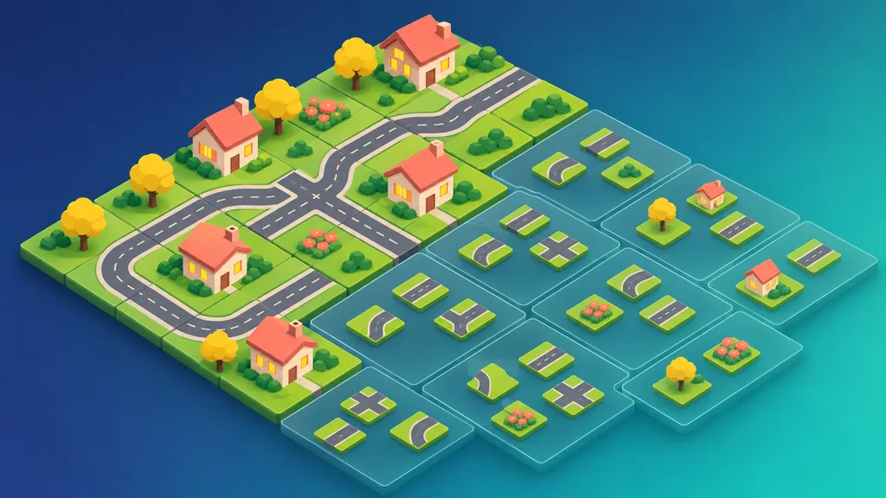 | [BorisTheBrave/DeBroglie](https://github.com/BorisTheBrave/DeBroglie) *示意图* | [MIT](https://github.com/BorisTheBrave/DeBroglie) | C# 约束式程序化生成库（WFC 等），支持多种图块约束。 |
|  | [Auburn/FastNoiseLite](https://github.com/Auburn/FastNoiseLite) 图片来源：项目 [Auburn/FastNoiseLite](https://github.com/Auburn/FastNoiseLite) | [MIT](https://github.com/Auburn/FastNoiseLite) | 多语言可移植噪声库（Perlin、Simplex、Cellular），做地形和纹理。 |
|  | [AlexeyBond/godot-constraint-solving](https://github.com/AlexeyBond/godot-constraint-solving) 图片来源：项目 [AlexeyBond/godot-constraint-solving](https://github.com/AlexeyBond/godot-constraint-solving) | [MIT](https://github.com/AlexeyBond/godot-constraint-solving) | Godot 4 的波函数坍缩插件，用于 TileMap 和 GridMap。 |
|  | [a1studmuffin/SpaceshipGenerator](https://github.com/a1studmuffin/SpaceshipGenerator) 图片来源：项目 [a1studmuffin/SpaceshipGenerator](https://github.com/a1studmuffin/SpaceshipGenerator) | [MIT](https://github.com/a1studmuffin/SpaceshipGenerator) | Blender 脚本，用随机种子生成带贴图的 3D 飞船（较老，最后更新 2024 年）。 |
|  | [Auburn/FastNoise2](https://github.com/Auburn/FastNoise2) 图片来源：项目 [Auburn/FastNoise2](https://github.com/Auburn/FastNoise2) | [MIT](https://github.com/Auburn/FastNoise2) | SIMD 噪声生成库，带节点图编辑器，搭复杂噪声。 |
|  | [marian42/wavefunctioncollapse](https://github.com/marian42/wavefunctioncollapse) 图片来源：项目 [marian42/wavefunctioncollapse](https://github.com/marian42/wavefunctioncollapse) | [MIT](https://github.com/marian42/wavefunctioncollapse) | 用波函数坍缩生成可无限漫游城市的 Unity 项目。 |
|  | [mxgmn/MarkovJunior](https://github.com/mxgmn/MarkovJunior) 图片来源：项目 [mxgmn/MarkovJunior](https://github.com/mxgmn/MarkovJunior) | [MIT](https://github.com/mxgmn/MarkovJunior) | 概率重写规则语言，生成关卡、迷宫和 3D 结构，附 150 多个示例。 |
|  | [OndrejNepozitek/Edgar-DotNet](https://github.com/OndrejNepozitek/Edgar-DotNet) 图片来源：项目 [OndrejNepozitek/Edgar-DotNet](https://github.com/OndrejNepozitek/Edgar-DotNet) | [MIT](https://github.com/OndrejNepozitek/Edgar-DotNet) | 基于图的程序化布局生成器，用手工房间模板生成地牢。 |
|  | [ondras/rot.js](https://github.com/ondras/rot.js) 图片来源：项目 [ondras/rot.js](https://github.com/ondras/rot.js) | [BSD-3-Clause](https://github.com/ondras/rot.js) | JavaScript 的 Roguelike 工具包：地图生成、视野、寻路和终端显示。 |
| 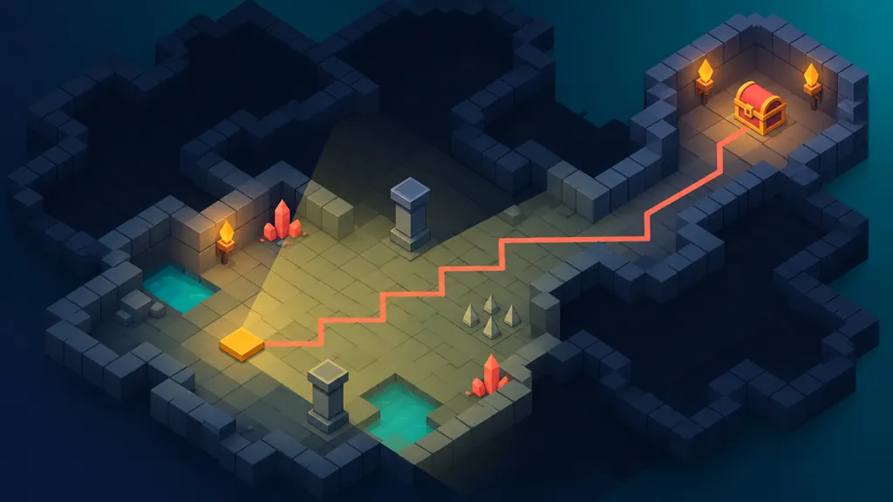 | [libtcod/libtcod](https://github.com/libtcod/libtcod) *示意图* | [BSD-3-Clause](https://github.com/libtcod/libtcod) | C/C++ Roguelike 工具包：视野、寻路、地图生成和图块终端。 |
|  | [Syomus/ProceduralToolkit](https://github.com/Syomus/ProceduralToolkit) *示意图* | [MIT](https://github.com/Syomus/ProceduralToolkit) | Unity 程序化生成库，含网格构建、噪声和示例生成器。 |
|  | [Azgaar/Fantasy-Map-Generator](https://github.com/Azgaar/Fantasy-Map-Generator) 图片来源：项目 [Azgaar/Fantasy-Map-Generator](https://github.com/Azgaar/Fantasy-Map-Generator) | [MIT](https://github.com/Azgaar/Fantasy-Map-Generator) | 网页应用，生成可编辑的奇幻世界地图，含国家、河流和文化。 |
|  | [Zylann/godot_voxel](https://github.com/Zylann/godot_voxel) 图片来源：项目 [Zylann/godot_voxel](https://github.com/Zylann/godot_voxel) | [MIT](https://github.com/Zylann/godot_voxel) | Godot 体素地形模块，支持方块和平滑地形、LOD 和程序化生成。 |
|  | [Zylann/godot_heightmap_plugin](https://github.com/Zylann/godot_heightmap_plugin) 图片来源：项目 [Zylann/godot_heightmap_plugin](https://github.com/Zylann/godot_heightmap_plugin) | [MIT](https://github.com/Zylann/godot_heightmap_plugin) | Godot 高度图地形插件，可雕刻、画贴图，还带生成器。 |
|  | [Mindwerks/worldengine](https://github.com/Mindwerks/worldengine) 图片来源：项目 [Mindwerks/worldengine](https://github.com/Mindwerks/worldengine) | [MIT](https://github.com/Mindwerks/worldengine) | 世界生成器，模拟板块构造、雨影和侵蚀。 |
|  | [redblobgames/mapgen4](https://github.com/redblobgames/mapgen4) 图片来源：项目 [redblobgames/mapgen4](https://www.redblobgames.com/maps/mapgen4/) | [Apache-2.0](https://github.com/redblobgames/mapgen4) | Red Blob Games 的交互式程序化荒野地图生成器。 |
|  | [SebLague/Hydraulic-Erosion](https://github.com/SebLague/Hydraulic-Erosion) 图片来源：项目 [SebLague/Hydraulic-Erosion](https://github.com/SebLague/Hydraulic-Erosion) | [MIT](https://github.com/SebLague/Hydraulic-Erosion) | 在程序化地形上模拟水力侵蚀的 Unity 示例。 |
| 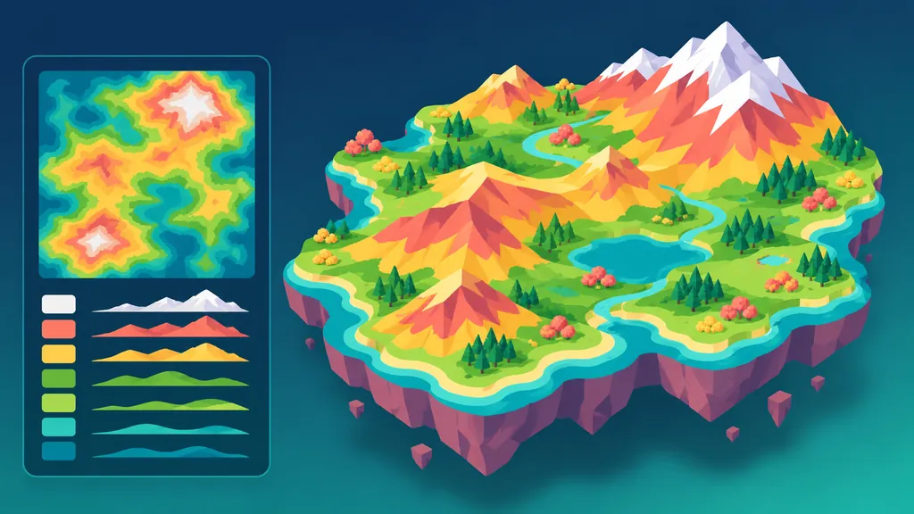 | [SebLague/Procedural-Landmass-Generation](https://github.com/SebLague/Procedural-Landmass-Generation) *示意图* | [MIT](https://github.com/SebLague/Procedural-Landmass-Generation) | 基于噪声的无限地形 Unity 项目，带 LOD，配套知名教程系列。 |
|  | [vazgriz/DungeonGenerator](https://github.com/vazgriz/DungeonGenerator) 图片来源：项目 [vazgriz/DungeonGenerator](https://github.com/vazgriz/DungeonGenerator) | [MIT](https://github.com/vazgriz/DungeonGenerator) | Unity 地牢生成器，用 Delaunay 三角剖分和 A* 走廊，支持 2D 和 3D。 |
|  | [math-fehr/fast-wfc](https://github.com/math-fehr/fast-wfc) *示意图* | [MIT](https://github.com/math-fehr/fast-wfc) | 注重性能的 C++ 波函数坍缩实现。 |

## 引擎与框架

| 预览 | 项目 | 许可证 | 适合做什么 |
| --- | --- | --- | --- |
|  | [godotengine/godot](https://github.com/godotengine/godot) 图片来源：项目 [godotengine/godot](https://github.com/godotengine/godot) | [MIT](https://github.com/godotengine/godot) | 免费开源 2D/3D 游戏引擎，自带编辑器，支持 GDScript/C#。 |
|  | [bevyengine/bevy](https://github.com/bevyengine/bevy) *示意图* | [Apache-2.0 或 MIT](https://github.com/bevyengine/bevy) | Rust 写的数据驱动游戏引擎，基于 ECS。 |
|  | [defold/defold](https://github.com/defold/defold) 图片来源：项目 [defold/defold](https://github.com/defold/defold) | [Defold 许可 1.0（基于 Apache-2.0）](https://github.com/defold/defold) | 轻量 2D/3D 引擎，Lua 脚本，一键多平台打包。 |
|  | [raysan5/raylib](https://github.com/raysan5/raylib) 图片来源：项目 [raysan5/raylib](https://github.com/raysan5/raylib) | [Zlib](https://github.com/raysan5/raylib) | 简单的 C 游戏库，适合入门，有 60 多种语言绑定。 |
|  | [love2d/love](https://github.com/love2d/love) *示意图* | [Zlib](https://github.com/love2d/love) | LÖVE，Lua 写游戏的 2D 框架。 |
|  | [phaserjs/phaser](https://github.com/phaserjs/phaser) 图片来源：项目 [phaserjs/phaser](https://github.com/phaserjs/phaser) | [MIT](https://github.com/phaserjs/phaser) | HTML5 2D 游戏框架，桌面和手机浏览器都能跑。 |
|  | [mrdoob/three.js](https://github.com/mrdoob/three.js) 图片来源：项目 [mrdoob/three.js](https://threejs.org/) | [MIT](https://github.com/mrdoob/three.js) | JavaScript 3D 库（WebGL/WebGPU），多数网页 3D 游戏和演示都基于它。 |
|  | [BabylonJS/Babylon.js](https://github.com/BabylonJS/Babylon.js) 图片来源：项目 [BabylonJS/Babylon.js](https://github.com/BabylonJS/Babylon.js) | [Apache-2.0](https://github.com/BabylonJS/Babylon.js) | 功能完整的网页 3D 游戏 / 渲染引擎，带在线 Playground 和编辑器。 |
|  | [o3de/o3de](https://github.com/o3de/o3de) 图片来源：项目 [o3de/o3de](https://o3de.org) | [Apache-2.0 或 MIT](https://github.com/o3de/o3de) | Open 3D Engine，Linux 基金会旗下的模块化 3A 级 3D 引擎。 |
|  | [stride3d/stride](https://github.com/stride3d/stride) 图片来源：项目 [stride3d/stride](https://github.com/stride3d/stride) | [MIT](https://github.com/stride3d/stride) | C# 3D 游戏引擎，带编辑器，前身是 Xenko。 |
|  | [MonoGame/MonoGame](https://github.com/MonoGame/MonoGame) 图片来源：项目 [MonoGame/MonoGame](https://github.com/MonoGame/MonoGame) | [Ms-PL](https://github.com/MonoGame/MonoGame) | C# 跨平台 2D/3D 游戏框架（XNA 继任者）。 |
|  | [libgdx/libgdx](https://github.com/libgdx/libgdx) 图片来源：项目 [libgdx/libgdx](https://github.com/libgdx/libgdx) | [Apache-2.0](https://github.com/libgdx/libgdx) | Java 游戏框架，支持桌面、安卓、iOS 和网页。 |
|  | [excaliburjs/Excalibur](https://github.com/excaliburjs/Excalibur) 图片来源：项目 [excaliburjs/Excalibur](https://github.com/excaliburjs/Excalibur) | [BSD-2-Clause](https://github.com/excaliburjs/Excalibur) | TypeScript 写的网页 2D 游戏引擎。 |
|  | [pixijs/pixijs](https://github.com/pixijs/pixijs) 图片来源：项目 [pixijs/pixijs](https://github.com/pixijs/pixijs) | [MIT](https://github.com/pixijs/pixijs) | 高速 2D WebGL/WebGPU 渲染器，做网页游戏和交互图形。 |
|  | [playcanvas/engine](https://github.com/playcanvas/engine) 图片来源：项目 [playcanvas/engine](https://github.com/playcanvas/engine) | [MIT](https://github.com/playcanvas/engine) | 网页 WebGL/WebGPU 3D 游戏引擎（运行时）。 |
|  | [kaplayjs/kaplay](https://github.com/kaplayjs/kaplay) 图片来源：项目 [kaplayjs/kaplay](https://github.com/kaplayjs/kaplay) | [MIT](https://github.com/kaplayjs/kaplay) | 新手友好的 JavaScript 游戏库（Kaboom.js 的继任者）。 |
|  | [hajimehoshi/ebiten](https://github.com/hajimehoshi/ebiten) 图片来源：项目 [hajimehoshi/ebiten](https://github.com/hajimehoshi/ebiten) | [Apache-2.0](https://github.com/hajimehoshi/ebiten) | Ebitengine，Go 语言的简单 2D 游戏引擎。 |
|  | [FyroxEngine/Fyrox](https://github.com/FyroxEngine/Fyrox) 图片来源：项目 [FyroxEngine/Fyrox](https://github.com/FyroxEngine/Fyrox) | [MIT](https://github.com/FyroxEngine/Fyrox) | Rust 写的 3D/2D 游戏引擎，带场景编辑器。 |
|  | [HeapsIO/heaps](https://github.com/HeapsIO/heaps) 图片来源：项目 [HeapsIO/heaps](https://github.com/HeapsIO/heaps) | [MIT](https://github.com/HeapsIO/heaps) | Haxe 语言的跨平台 2D/3D 游戏引擎。 |
|  | [panda3d/panda3d](https://github.com/panda3d/panda3d) 图片来源：项目 [panda3d/panda3d](https://github.com/panda3d/panda3d) | [BSD-3-Clause](https://github.com/panda3d/panda3d) | 成熟的开源 3D 引擎，支持 Python 和 C++，最初由迪士尼和卡内基梅隆大学开发。 |
|  | [jMonkeyEngine/jmonkeyengine](https://github.com/jMonkeyEngine/jmonkeyengine) 图片来源：项目 [jMonkeyEngine/jmonkeyengine](https://github.com/jMonkeyEngine/jmonkeyengine) | [BSD-3-Clause](https://github.com/jMonkeyEngine/jmonkeyengine) | 用 Java 写的完整 3D 游戏开发套件。 |
|  | [pygame-community/pygame-ce](https://github.com/pygame-community/pygame-ce) *示意图* | [LGPL-2.1-or-later](https://github.com/pygame-community/pygame-ce#license) | pygame 社区版，基于 SDL 的 Python 2D 游戏和多媒体库。 |
|  | [flame-engine/flame](https://github.com/flame-engine/flame) *示意图* | [MIT](https://github.com/flame-engine/flame) | 基于 Flutter 的 2D 游戏引擎，用 Dart 做移动端、桌面和网页游戏。 |
|  | [kitao/pyxel](https://github.com/kitao/pyxel) 图片来源：项目 [kitao/pyxel](https://github.com/kitao/pyxel) 参考清单 [ellisonleao/magictools](https://github.com/ellisonleao/magictools) | [MIT](https://github.com/kitao/pyxel) | Python 复古游戏引擎，固定调色板，内置精灵、地图和音效编辑器。 |
|  | [HaxeFlixel/flixel](https://github.com/HaxeFlixel/flixel) 图片来源：项目 [HaxeFlixel/flixel](https://github.com/HaxeFlixel/flixel) | [MIT](https://github.com/HaxeFlixel/flixel) | 基于 Haxe 和 OpenFL 的跨平台 2D 游戏引擎。 |
|  | [coronalabs/corona](https://github.com/coronalabs/corona) 图片来源：项目 [coronalabs/corona](https://github.com/coronalabs/corona) | [MIT](https://github.com/coronalabs/corona) | Solar2D（原 Corona SDK）：基于 Lua 的 2D 引擎，做移动端和桌面游戏。 |
|  | [not-fl3/macroquad](https://github.com/not-fl3/macroquad) *示意图* | [MIT OR Apache-2.0](https://github.com/not-fl3/macroquad) | 简单的跨平台 Rust 游戏库，桌面、移动端和网页都能跑。 |
|  | [turanszkij/WickedEngine](https://github.com/turanszkij/WickedEngine) 图片来源：项目 [turanszkij/WickedEngine](https://github.com/turanszkij/WickedEngine) | [MIT](https://github.com/turanszkij/WickedEngine) | C++ 3D 引擎，带现代图形特性和编辑器。 |
|  | [liballeg/allegro5](https://github.com/liballeg/allegro5) *示意图* | [Zlib](https://github.com/liballeg/allegro5) | 老牌跨平台 C 语言库，做 2D 游戏和多媒体。 |

## 工具与管线

| 预览 | 项目 | 许可证 | 适合做什么 |
| --- | --- | --- | --- |
|  | [Blender](https://www.blender.org/) 图片来源：项目 [Blender](https://github.com/blender/blender) ⚠ 官网对自动检查返回 403，许可证已人工核实 | [GPL-3.0-or-later（发行版）](https://www.blender.org/about/license/) | 免费 3D 全家桶：建模、绑骨、动画、烘焙；做出来的作品归你。 |
|  | [RodZill4/material-maker](https://github.com/RodZill4/material-maker) 图片来源：项目 [RodZill4/material-maker](https://github.com/RodZill4/material-maker) | [MIT](https://github.com/RodZill4/material-maker) | 基于 Godot 的节点式程序化贴图 / 材质制作工具。 |
|  | [Orama-Interactive/Pixelorama](https://github.com/Orama-Interactive/Pixelorama) 图片来源：项目 [Orama-Interactive/Pixelorama](https://github.com/Orama-Interactive/Pixelorama) | [MIT](https://github.com/Orama-Interactive/Pixelorama) | 像素画编辑器，画精灵、图块和逐帧动画；桌面和网页都能用。 |
| 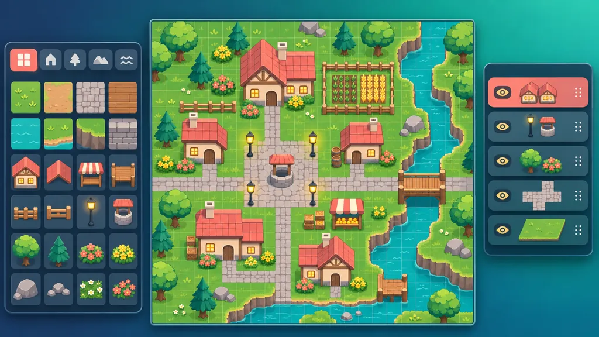 | [mapeditor/tiled](https://github.com/mapeditor/tiled) *示意图* | [GPL-2.0（编辑器）/ BSD-2-Clause（libtiled）](https://github.com/mapeditor/tiled/blob/master/COPYING) | 灵活的瓦片地图 / 关卡编辑器，导出的 TMX/JSON 被大多数 2D 引擎支持。 |
|  | [deepnight/ldtk](https://github.com/deepnight/ldtk) 图片来源：项目 [deepnight/ldtk](https://ldtk.io/) | [MIT](https://github.com/deepnight/ldtk) | 现代轻量 2D 关卡编辑器，支持自动图层铺块和带类型的实体字段。 |
|  | [audacity/audacity](https://github.com/audacity/audacity) 图片来源：项目 [audacity/audacity](https://www.audacityteam.org/) | [GPL-3.0](https://github.com/audacity/audacity/blob/master/LICENSE.txt) | 音频编辑器，剪切、叠加、降噪游戏音效。 |
|  | [LMMS/lmms](https://github.com/LMMS/lmms) *示意图* | [GPL-2.0](https://github.com/LMMS/lmms) | 免费编曲软件（音序器、合成器、采样器），做游戏配乐和短提示音。 |
|  | [godotengine/godot-demo-projects](https://github.com/godotengine/godot-demo-projects) *示意图* | [MIT](https://github.com/godotengine/godot-demo-projects) | Godot 官方示例和模板项目（2D、3D、物理、UI），可以照着学或直接起步。 |
|  | [KDE/krita](https://github.com/KDE/krita) 图片来源：项目 [KDE/krita](https://krita.org/en/) 参考清单 [Calinou/awesome-gamedev](https://github.com/Calinou/awesome-gamedev) | [GPL-3.0](https://github.com/KDE/krita) | 数字绘画软件，画概念图、贴图和手绘动画。 |
|  | [LibreSprite/LibreSprite](https://github.com/LibreSprite/LibreSprite) 图片来源：项目 [LibreSprite/LibreSprite](https://github.com/LibreSprite/LibreSprite) | [GPL-2.0](https://github.com/LibreSprite/LibreSprite) | 免费像素画和精灵动画编辑器（从最后一个 GPL 版 Aseprite 分叉）。 |
|  | [odrick/free-tex-packer](https://github.com/odrick/free-tex-packer) 图片来源：项目 [odrick/free-tex-packer](https://github.com/odrick/free-tex-packer) | [MIT](https://github.com/odrick/free-tex-packer) | 免费图集打包工具，可导出 Phaser、Pixi、Unity、Godot 等格式。 |
|  | [Ogmo-Editor-3/OgmoEditor3-CE](https://github.com/Ogmo-Editor-3/OgmoEditor3-CE) 图片来源：项目 [Ogmo-Editor-3/OgmoEditor3-CE](https://github.com/Ogmo-Editor-3/OgmoEditor3-CE) | [MIT](https://github.com/Ogmo-Editor-3/OgmoEditor3-CE) | 免费、不绑引擎的 2D 关卡编辑器，支持图块、实体和贴花（最后更新 2024 年）。 |
|  | [TrenchBroom/TrenchBroom](https://github.com/TrenchBroom/TrenchBroom) 图片来源：项目 [TrenchBroom/TrenchBroom](https://github.com/TrenchBroom/TrenchBroom) | [GPL-3.0](https://github.com/TrenchBroom/TrenchBroom) | Quake 风格的笔刷式 3D 关卡编辑器，可借插件用于 Godot。 |
|  | [JannisX11/blockbench](https://github.com/JannisX11/blockbench) 图片来源：项目 [JannisX11/blockbench](https://github.com/JannisX11/blockbench) | [GPL-3.0](https://github.com/JannisX11/blockbench) | 低多边形 / 方块风 3D 模型编辑器，可画贴图、做动画。 |
|  | [guillaumechereau/goxel](https://github.com/guillaumechereau/goxel) 图片来源：项目 [guillaumechereau/goxel](https://github.com/guillaumechereau/goxel) | [GPL-3.0](https://github.com/guillaumechereau/goxel) | 开源体素编辑器，做 3D 模型和场景。 |
|  | [donmccurdy/glTF-Transform](https://github.com/donmccurdy/glTF-Transform) 图片来源：项目 [donmccurdy/glTF-Transform](https://github.com/donmccurdy/glTF-Transform) | [MIT](https://github.com/donmccurdy/glTF-Transform) | 优化 glTF/GLB 的命令行和 SDK：压缩、缩贴图、去重。 |
| 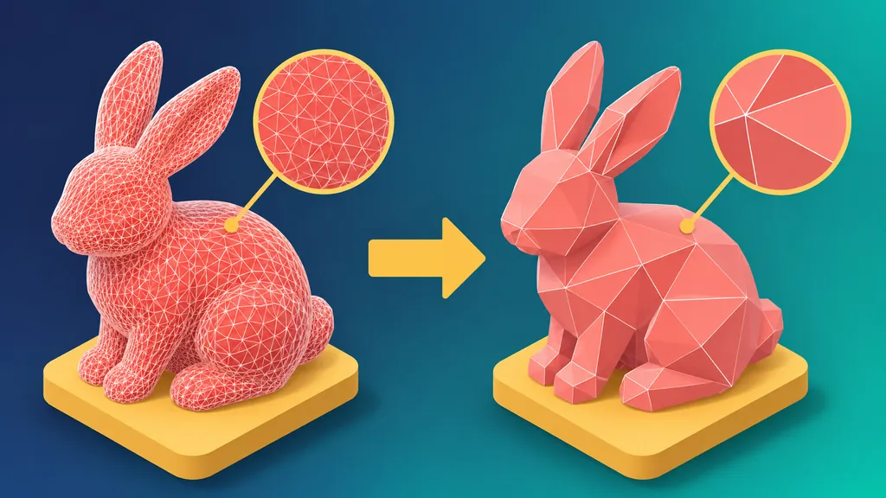 | [zeux/meshoptimizer](https://github.com/zeux/meshoptimizer) *示意图* | [MIT](https://github.com/zeux/meshoptimizer) | 网格优化库和 gltfpack 工具，让 3D 资产更小更快。 |
|  | [assimp/assimp](https://github.com/assimp/assimp) 图片来源：项目 [assimp/assimp](https://www.assimp.org) | [BSD-3-Clause（修改版）](https://github.com/assimp/assimp) | 开放资产导入库：把 40 多种 3D 格式读成统一数据结构。 |
|  | [inkle/ink](https://github.com/inkle/ink) *示意图* | [MIT](https://github.com/inkle/ink) | 写分支互动叙事的脚本语言和引擎，有 Unity 集成。 |
|  | [YarnSpinnerTool/YarnSpinner](https://github.com/YarnSpinnerTool/YarnSpinner) 图片来源：项目 [YarnSpinnerTool/YarnSpinner](https://github.com/YarnSpinnerTool/YarnSpinner) | [MIT](https://github.com/YarnSpinnerTool/YarnSpinner) | 写分支游戏对话的语言和与引擎无关的运行时。 |
| 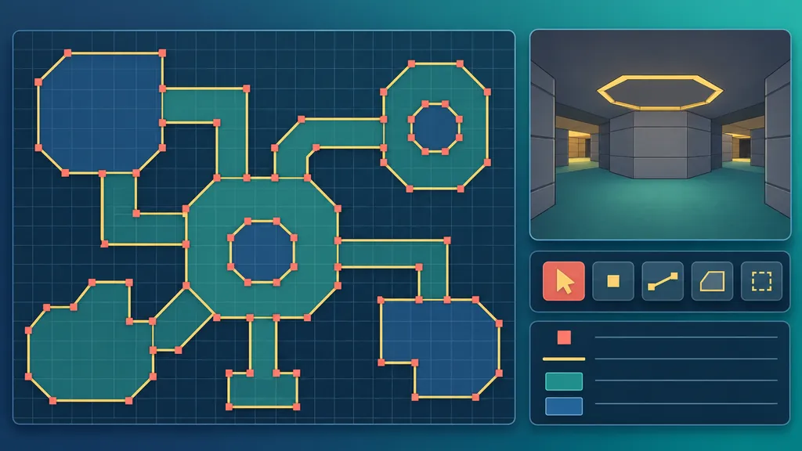 | [UltimateDoomBuilder/UltimateDoomBuilder](https://github.com/UltimateDoomBuilder/UltimateDoomBuilder) *示意图* | [GPL-3.0](https://github.com/UltimateDoomBuilder/UltimateDoomBuilder) | Doom 引擎类游戏的地图编辑器，有 2D 和 3D 编辑模式。 |
|  | [crashinvaders/gdx-texture-packer-gui](https://github.com/crashinvaders/gdx-texture-packer-gui) 图片来源：项目 [crashinvaders/gdx-texture-packer-gui](https://github.com/crashinvaders/gdx-texture-packer-gui) | [Apache-2.0](https://github.com/crashinvaders/gdx-texture-packer-gui) | 打包和管理纹理图集的图形界面工具（libGDX 格式）。 |
| 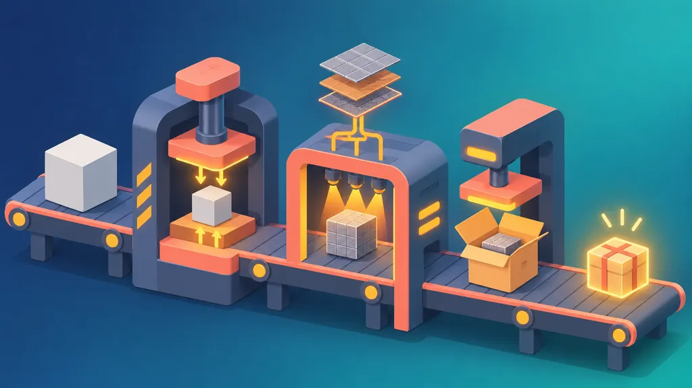 | [CesiumGS/gltf-pipeline](https://github.com/CesiumGS/gltf-pipeline) *示意图* | [Apache-2.0](https://github.com/CesiumGS/gltf-pipeline) | 优化 glTF 素材的命令行工具：Draco 压缩、嵌入资源和格式转换。 |
| 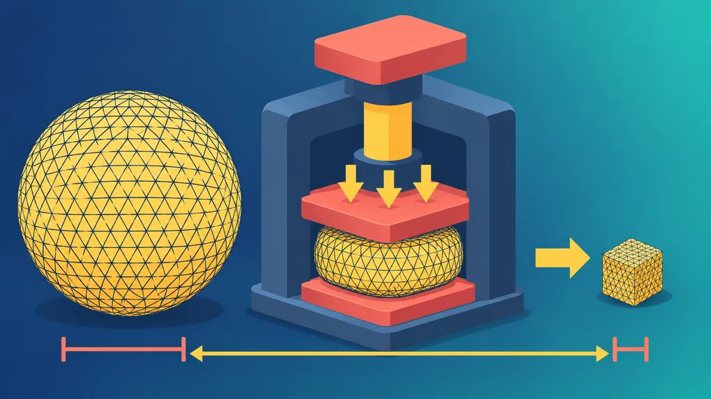 | [google/draco](https://github.com/google/draco) *示意图* | [Apache-2.0](https://github.com/google/draco) | 压缩和解压 3D 网格与点云的库，减小下载体积。 |
|  | [microsoft/DirectXTex](https://github.com/microsoft/DirectXTex) 图片来源：项目 [microsoft/DirectXTex](https://github.com/microsoft/DirectXTex) | [MIT](https://github.com/microsoft/DirectXTex) | 纹理处理库和 texconv 工具，处理 DDS、mipmap 和块压缩。 |
|  | [BinomialLLC/basis_universal](https://github.com/BinomialLLC/basis_universal) 图片来源：项目 [BinomialLLC/basis_universal](https://github.com/BinomialLLC/basis_universal) | [Apache-2.0](https://github.com/BinomialLLC/basis_universal) | GPU 纹理编解码器，一个文件可转成多种 GPU 格式（BC、ASTC、ETC）。 |
| 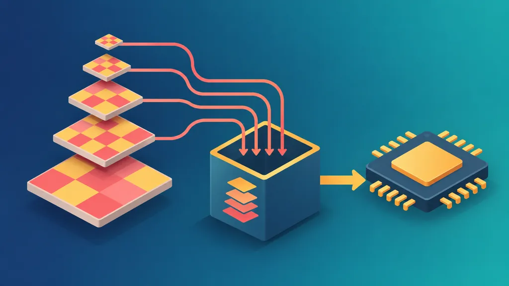 | [KhronosGroup/KTX-Software](https://github.com/KhronosGroup/KTX-Software) *示意图* | [Apache-2.0（附带部分另有开源许可）](https://github.com/KhronosGroup/KTX-Software) | Khronos 的 KTX 纹理库和工具，创建和校验 KTX2 文件。 |
|  | [ufbx/ufbx](https://github.com/ufbx/ufbx) *示意图* | [MIT or Unlicense](https://github.com/ufbx/ufbx) | 单文件 C 语言 FBX 加载器，支持网格、蒙皮、动画和材质。 |
|  | [glslify/glslify](https://github.com/glslify/glslify) *示意图* | [MIT](https://github.com/glslify/glslify) | GLSL 的 Node.js 式模块系统，可从 npm 引入着色器函数。 |

## AI 素材生成与 Agent Skill

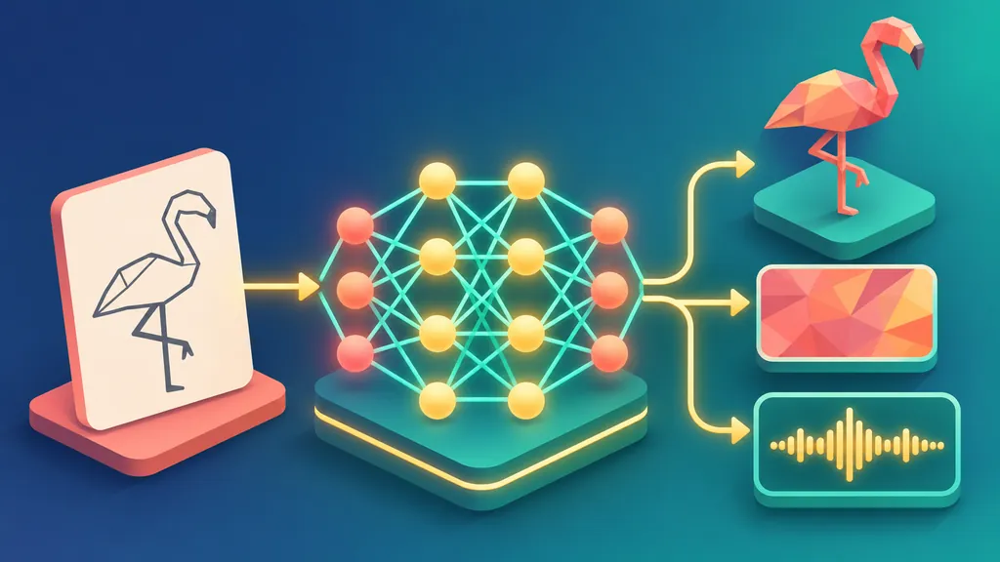

| 预览 | 项目 | 许可证 | 适合做什么 |
| --- | --- | --- | --- |
|  | [microsoft/TRELLIS](https://github.com/microsoft/TRELLIS) 图片来源：项目 [microsoft/TRELLIS](https://github.com/microsoft/TRELLIS) | [MIT](https://github.com/microsoft/TRELLIS) | 微软的图像 / 文本生成 3D 模型（网格、辐射场、高斯）。 |
|  | [VAST-AI-Research/TripoSR](https://github.com/VAST-AI-Research/TripoSR) 图片来源：项目 [VAST-AI-Research/TripoSR](https://github.com/VAST-AI-Research/TripoSR) | [MIT](https://github.com/VAST-AI-Research/TripoSR) | 单张图快速重建 3D 网格的模型。 |
| 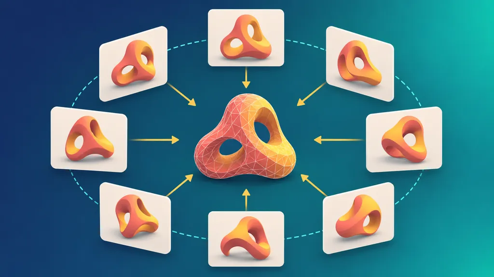 | [TencentARC/InstantMesh](https://github.com/TencentARC/InstantMesh) *示意图* | [Apache-2.0](https://github.com/TencentARC/InstantMesh) | 单张图生成 3D 网格，基于多视角扩散。 |
|  | [Comfy-Org/ComfyUI](https://github.com/Comfy-Org/ComfyUI) 图片来源：项目 [Comfy-Org/ComfyUI](https://github.com/Comfy-Org/ComfyUI) | [GPL-3.0](https://github.com/Comfy-Org/ComfyUI) | 扩散模型的节点式界面，生成贴图、精灵和概念图。 |
|  | [facebookresearch/audiocraft](https://github.com/facebookresearch/audiocraft) *示意图* | [MIT（代码）；模型权重 CC-BY-NC-4.0](https://github.com/facebookresearch/audiocraft) | Meta 的音频生成库（MusicGen、AudioGen），生成音乐和音效；权重仅限非商业。 |
|  | [Tencent-Hunyuan/Hunyuan3D-2](https://github.com/Tencent-Hunyuan/Hunyuan3D-2) 图片来源：项目 [Tencent-Hunyuan/Hunyuan3D-2](https://github.com/Tencent-Hunyuan/Hunyuan3D-2) | [腾讯混元 3D 2.0 社区许可（不适用于欧盟、英国、韩国）](https://github.com/Tencent-Hunyuan/Hunyuan3D-2) | 文本 / 图像生成带贴图的 3D 网格；使用前看清许可里的地区和用途限制。 |
|  | [gamedev-skills/awesome-gamedev-agent-skills](https://github.com/gamedev-skills/awesome-gamedev-agent-skills) 图片来源：项目 [gamedev-skills/awesome-gamedev-agent-skills](https://github.com/gamedev-skills/awesome-gamedev-agent-skills) | [Apache-2.0](https://github.com/gamedev-skills/awesome-gamedev-agent-skills) | 给 AI 编程 Agent 用的游戏开发 skill 合集和路由。 |
| 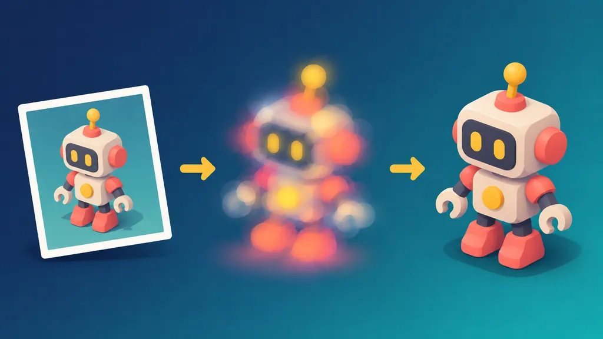 | [3DTopia/LGM](https://github.com/3DTopia/LGM) *示意图* | [MIT](https://github.com/3DTopia/LGM) | 多视角高斯大模型：一句提示词或一张图，几秒生成高分辨率 3D 高斯素材。 |
| 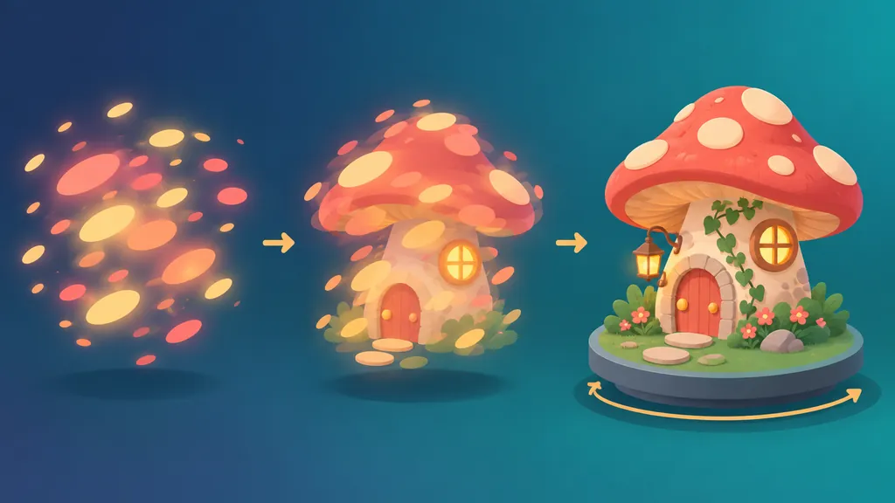 | [dreamgaussian/dreamgaussian](https://github.com/dreamgaussian/dreamgaussian) *示意图* | [MIT](https://github.com/dreamgaussian/dreamgaussian) | 生成式高斯泼溅：从图片或文字几分钟做出带贴图的 3D 网格。 |
|  | [openai/shap-e](https://github.com/openai/shap-e) 图片来源：项目 [openai/shap-e](https://github.com/openai/shap-e) | [MIT](https://github.com/openai/shap-e) | 按文字或图片生成 3D 物体，可导出网格和隐式场。 |
|  | [openai/point-e](https://github.com/openai/point-e) 图片来源：项目 [openai/point-e](https://github.com/openai/point-e) | [MIT](https://github.com/openai/point-e) | 点云扩散模型，快速出文字转 3D 草模，并可把点云转成网格。 |
|  | [thu-ml/CRM](https://github.com/thu-ml/CRM) 图片来源：项目 [thu-ml/CRM](https://github.com/thu-ml/CRM) | [MIT](https://github.com/thu-ml/CRM) | 卷积重建模型，单张图约十秒出带贴图的 3D 网格。 |
|  | [xxlong0/Wonder3D](https://github.com/xxlong0/Wonder3D) 图片来源：项目 [xxlong0/Wonder3D](https://github.com/xxlong0/Wonder3D) | [MIT](https://github.com/xxlong0/Wonder3D) | 跨域扩散做单图转 3D，同时预测多视角法线和颜色。 |
|  | [AiuniAI/Unique3D](https://github.com/AiuniAI/Unique3D) 图片来源：项目 [AiuniAI/Unique3D](https://github.com/AiuniAI/Unique3D) | [MIT](https://github.com/AiuniAI/Unique3D) | 单图生成高质量 3D 网格，贴图细节较好。 |
|  | [carson-katri/dream-textures](https://github.com/carson-katri/dream-textures) 图片来源：项目 [carson-katri/dream-textures](https://github.com/carson-katri/dream-textures) 参考清单 [simoninithomas/awesome-ai-tools-for-game-dev](https://github.com/simoninithomas/awesome-ai-tools-for-game-dev) | [GPL-3.0](https://github.com/carson-katri/dream-textures) | Blender 插件，在 Blender 里跑 Stable Diffusion 生成无缝贴图并投射到模型上。 |
|  | [OpenTexture/Paint3D](https://github.com/OpenTexture/Paint3D) 图片来源：项目 [OpenTexture/Paint3D](https://github.com/OpenTexture/Paint3D) | [Apache-2.0](https://github.com/OpenTexture/Paint3D) | 给没贴图的 3D 网格按文字或图片生成不带烘焙光照的 UV 贴图。 |
| 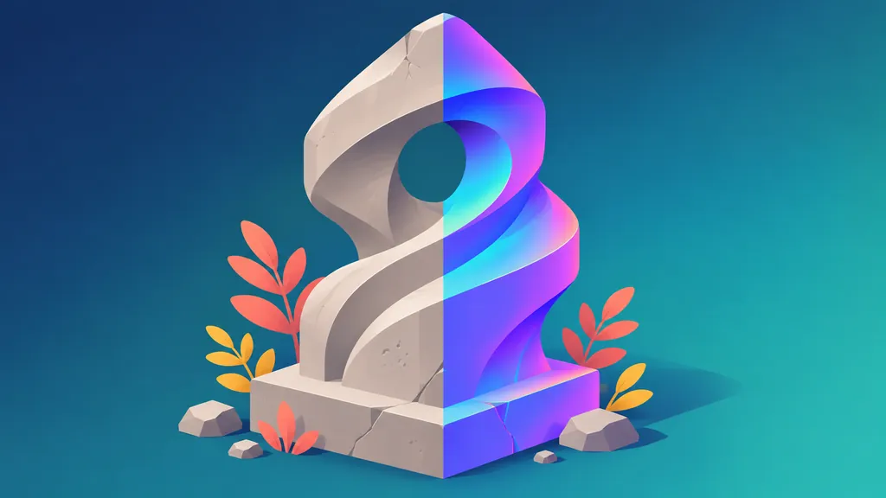 | [Stable-X/StableNormal](https://github.com/Stable-X/StableNormal) *示意图* | [Apache-2.0](https://github.com/Stable-X/StableNormal) | 从单张图估计清晰稳定的法线图，可以把照片或原画转成法线贴图。 |
|  | [KohakuBlueleaf/PixelOE](https://github.com/KohakuBlueleaf/PixelOE) 图片来源：项目 [KohakuBlueleaf/PixelOE](https://github.com/KohakuBlueleaf/PixelOE) | [Apache-2.0](https://github.com/KohakuBlueleaf/PixelOE) | 用对比度感知的描边扩展把高清图转成干净的像素画，不需要 AI 模型。 |
|  | [aldegad/sprite-gen](https://github.com/aldegad/sprite-gen) 图片来源：项目 [aldegad/sprite-gen](https://github.com/aldegad/sprite-gen) | [Apache-2.0](https://github.com/aldegad/sprite-gen) | Agent Skill 加 Python 命令行：一张底图做出游戏精灵图集或透明动画循环。 |
|  | [Retro-Diffusion/pixel-art-fixer](https://github.com/Retro-Diffusion/pixel-art-fixer) 图片来源：项目 [Retro-Diffusion/pixel-art-fixer](https://github.com/Retro-Diffusion/pixel-art-fixer) | [MIT](https://github.com/Retro-Diffusion/pixel-art-fixer) | 把图像生成器出的“假像素画”（不对齐网格）还原成真正对齐网格的像素画。 |
|  | [suno-ai/bark](https://github.com/suno-ai/bark) 图片来源：项目 [suno-ai/bark](https://github.com/suno-ai/bark) 参考清单 [simoninithomas/awesome-ai-tools-for-game-dev](https://github.com/simoninithomas/awesome-ai-tools-for-game-dev) | [MIT](https://github.com/suno-ai/bark) | 文字提示生成音频的模型，能出语音、非语言声音和简单音乐。 |
|  | [Stability-AI/stable-audio-tools](https://github.com/Stability-AI/stable-audio-tools) *示意图* | [MIT](https://github.com/Stability-AI/stable-audio-tools) | 条件音频生成模型的训练与推理代码，含 Stable Audio Open。 |
|  | [open-mmlab/Amphion](https://github.com/open-mmlab/Amphion) *示意图* | [MIT](https://github.com/open-mmlab/Amphion) | 音频、音乐和语音生成工具包（TTS、变声、歌声合成等）。 |

## 其他清单与设计参考

| 预览 | 项目 | 许可证 | 适合做什么 |
| --- | --- | --- | --- |
|  | [ellisonleao/magictools](https://github.com/ellisonleao/magictools) 图片来源：项目 [ellisonleao/magictools](https://github.com/ellisonleao/magictools) | [MIT](https://github.com/ellisonleao/magictools) | 老牌游戏开发资源清单：引擎、美术、音频、工具。 |
|  | [Calinou/awesome-gamedev](https://github.com/Calinou/awesome-gamedev) *示意图* | [CC-BY-SA-4.0](https://github.com/Calinou/awesome-gamedev) | 制作游戏用的自由软件和自由文化资源清单。 |
|  | [madjin/awesome-cc0](https://github.com/madjin/awesome-cc0) *示意图* | [CC0-1.0](https://github.com/madjin/awesome-cc0) | 全网 CC0 素材清单：模型、贴图、声音。 |
|  | [FronkonGames/Awesome-Gamedev](https://github.com/FronkonGames/Awesome-Gamedev) 图片来源：项目 [FronkonGames/Awesome-Gamedev](https://github.com/FronkonGames/Awesome-Gamedev) | [MIT](https://github.com/FronkonGames/Awesome-Gamedev) | 精选游戏开发资源：工具、教程、库。 |
|  | [dawdle-deer/awesome-learn-gamedev](https://github.com/dawdle-deer/awesome-learn-gamedev) 图片来源：项目 [dawdle-deer/awesome-learn-gamedev](https://github.com/dawdle-deer/awesome-learn-gamedev) | [CC0-1.0](https://github.com/dawdle-deer/awesome-learn-gamedev) | 游戏开发学习资源精选。 |
|  | [Calinou/awesome-godot](https://github.com/Calinou/awesome-godot) *示意图* | [CC-BY-4.0](https://github.com/Calinou/awesome-godot) | Godot 插件、脚本、模板和项目精选清单。 |
|  | [munificent/game-programming-patterns](https://github.com/munificent/game-programming-patterns) *示意图* | [MIT（代码）/ CC-BY-NC-ND-4.0（书的正文）](https://github.com/munificent/game-programming-patterns) | 免费在线书《游戏编程模式》的源码（游戏代码设计模式）。 |
|  | [love2d-community/awesome-love2d](https://github.com/love2d-community/awesome-love2d) 图片来源：项目 [love2d-community/awesome-love2d](https://github.com/love2d-community/awesome-love2d) | [CC0-1.0](https://github.com/love2d-community/awesome-love2d) | LÖVE 引擎的库、工具和资源精选清单。 |
|  | [rafaskb/awesome-libgdx](https://github.com/rafaskb/awesome-libgdx) 图片来源：项目 [rafaskb/awesome-libgdx](https://github.com/rafaskb/awesome-libgdx) | [CC0-1.0](https://github.com/rafaskb/awesome-libgdx) | libGDX 的库、工具和教程精选清单。 |
|  | [pico-8/awesome-PICO-8](https://github.com/pico-8/awesome-PICO-8) 图片来源：项目 [pico-8/awesome-PICO-8](https://github.com/pico-8/awesome-PICO-8) | [CC0-1.0](https://github.com/pico-8/awesome-PICO-8) | PICO-8 的资源、工具、卡带和教程精选清单。 |
|  | [bobeff/open-source-games](https://github.com/bobeff/open-source-games) *示意图* | [CC0-1.0](https://github.com/bobeff/open-source-games) | 开源游戏和重制版大清单，适合读真实游戏代码。 |
|  | [hzoo/awesome-gametalks](https://github.com/hzoo/awesome-gametalks) *示意图* | [MIT](https://github.com/hzoo/awesome-gametalks) | 游戏开发、设计和复盘演讲精选清单。 |
|  | [flame-engine/awesome-flame](https://github.com/flame-engine/awesome-flame) 图片来源：项目 [flame-engine/awesome-flame](https://github.com/flame-engine/awesome-flame) | [CC0-1.0](https://github.com/flame-engine/awesome-flame) | Flame 引擎的游戏、库、工具和教程精选清单。 |
|  | [Siilwyn/awesome-pixel-art](https://github.com/Siilwyn/awesome-pixel-art) 图片来源：项目 [Siilwyn/awesome-pixel-art](https://github.com/Siilwyn/awesome-pixel-art) | [CC0-1.0](https://github.com/Siilwyn/awesome-pixel-art) | 像素画工具、教程、调色板和社区精选清单。 |
| 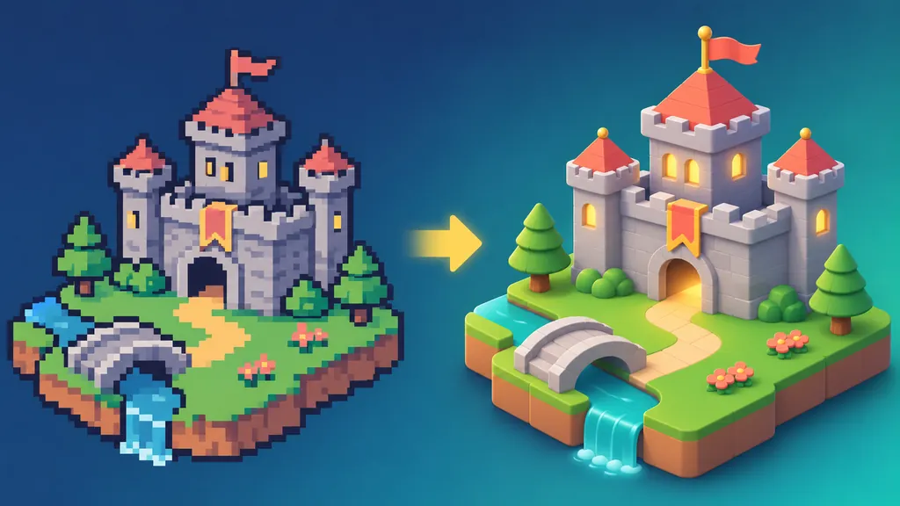 | [radek-sprta/awesome-game-remakes](https://github.com/radek-sprta/awesome-game-remakes) *示意图* | [CC-BY-SA-4.0](https://github.com/radek-sprta/awesome-game-remakes) | 活跃维护的开源游戏重制和引擎重实现清单。 |
|  | [Roobyx/awesome-game-design](https://github.com/Roobyx/awesome-game-design) *示意图* | [CC-BY-4.0](https://github.com/Roobyx/awesome-game-design) | 游戏设计学习资料、案例和工具清单。 |
|  | [ncase/loopy](https://github.com/ncase/loopy) 图片来源：项目 [ncase/loopy](https://github.com/ncase/loopy) | [CC0-1.0](https://github.com/ncase/loopy) | 浏览器里画交互式系统和反馈回路的工具，适合推演游戏经济。 |

## 致谢 / 参考清单

部分条目是从下面这些清单里发现的。我们只借了线索：每个来源都重新核实了许可证和可达性，描述全部为本清单重写，没有整份照搬。通过它们找到的条目会写「参考清单」并链接原清单。

| 清单 | 许可证 |
| --- | --- |
| [Calinou/awesome-gamedev](https://github.com/Calinou/awesome-gamedev) | CC-BY-SA-4.0 |
| [madjin/awesome-cc0](https://github.com/madjin/awesome-cc0) | CC0-1.0 |
| [ellisonleao/magictools](https://github.com/ellisonleao/magictools) | MIT |
| [simoninithomas/awesome-ai-tools-for-game-dev](https://github.com/simoninithomas/awesome-ai-tools-for-game-dev) | CC0-1.0 |
| [Calinou/awesome-godot](https://github.com/Calinou/awesome-godot) | CC-BY-4.0 |

## 参与贡献

见 [CONTRIBUTING.md](CONTRIBUTING.md)。改 `data/entries.json`，再跑 `python3 tools/render_readme.py` 和 `python3 tools/verify.py`。

## 许可证

清单文字采用 [CC0 1.0](LICENSE)。链接的素材和工具各自沿用原许可证。预览图归原项目所有，只引用不复制。
