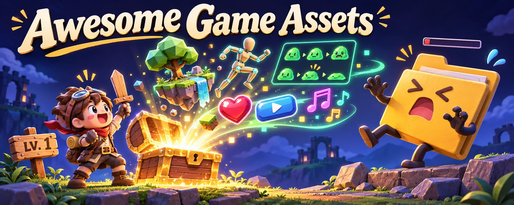

# Awesome Game Assets（遊戲素材導覽）

[English](README.md) · [简体中文](README.zh-CN.md) · **繁體中文** · [日本語](README.ja.md) · [한국어](README.ko.md)

原創頭圖：開局一把木劍，素材全靠撿。

精選遊戲素材與工具導覽，附授權說明，也包含有限制條件的授權：3D 模型、精靈圖、貼圖、音效、視覺特效、技能／施法範例、動畫與編輯器。每項列出網址、在來源頁核對過的授權，以及適合的用途。

> ⚠️ 疑似盜版、破解、付費素材違規轉散布、灌星或含惡意軟體的儲存庫，另列於 [WARNING.md](WARNING.md)，協助辨識風險，請勿使用。

## 目錄

**[瀏覽素材表格](#3d-模型與-2d-精靈圖)** · [參與貢獻](CONTRIBUTING.md)

每類預設顯示前 15 項，其餘可展開。GitHub 專案依累計星標排序（2026-11-12 快照）；沒有可比較數據的網站列於其後，並非近期成長排行。[排序說明](docs/discovery.md)。

使用手機時可左右滑動表格，比較專案、授權與用途。

- [3D 模型與 2D 精靈圖](#3d-模型與-2d-精靈圖)
- [UI、圖示與 HUD](#ui圖示與-hud)
- [貼圖與材質](#貼圖與材質)
- [音效與音訊](#音效與音訊)
- [字型](#字型)
- [視覺特效、粒子與著色器](#視覺特效粒子與著色器)
- [技能、施法與戰鬥範例](#技能施法與戰鬥範例)
- [動畫與動作擷取](#動畫與動作擷取)
- [物理模擬](#物理模擬)
- [遊戲 AI 與路徑搜尋](#遊戲-ai-與路徑搜尋)
- [程序生成](#程序生成)
- [引擎與框架](#引擎與框架)
- [工具與製作流程](#工具與製作流程)
- [AI 素材生成與代理技能](#ai-素材生成與代理技能)
- [精選清單與設計參考](#精選清單與設計參考)

## 收錄原則

- 只收錄在專案或官方網站明確標示授權的來源。逐項授權的素材會特別註明，使用前請逐一確認。
- 不收錄盜版、破解或灌星儲存庫；已檢查星標、Fork 與活動情形，也排除已封存或無法使用的來源。
- 自動檢查會回報失效連結、阻擋機器人或逾時的來源；警告不代表來源已確認可正常存取。
- 授權於 2026-11-12 核對，依據 GitHub API 的 `license` 欄位，或各列連結的官方授權頁。
- 預覽圖連結至原專案並標示出處。此處展示不代表授予再利用權，請確認連結中的素材條款。頭圖與分類插畫為生成圖；缺少原始預覽時會明確標示，不以虛構效果替代。

## 3D 模型與 2D 精靈圖

| 專案／預覽 | 授權與使用方式 | 適合用途 |
| --- | --- | --- |
| [dicebear/dicebear](https://github.com/dicebear/dicebear)  圖片出處：專案 [dicebear/dicebear](https://www.dicebear.com) GitHub ★ 10,068 | 使用前逐項確認素材或元件的授權條件 ([MIT (code; avatar styles have their own licenses)](https://github.com/dicebear/dicebear)) | 依種子生成多種風格 SVG 頭像的函式庫；請確認各風格的授權。 |
| [vrm-c/UniVRM](https://github.com/vrm-c/UniVRM)  圖片出處：專案 [vrm-c/UniVRM](https://vrm.dev/en) GitHub ★ 3,421 | 可商用、可修改；保留必要的著作權與授權聲明 ([MIT](https://github.com/vrm-c/UniVRM)) | Unity 的 VRM 人形角色匯入／匯出工具，以 glTF 為基礎，支援彈簧骨骼與表情。 |
| [LiberatedPixelCup/Universal-LPC-Spritesheet-Character-Generator](https://github.com/LiberatedPixelCup/Universal-LPC-Spritesheet-Character-Generator)  圖片出處：專案 [LiberatedPixelCup/Universal-LPC-Spritesheet-Character-Generator](https://github.com/LiberatedPixelCup/Universal-LPC-Spritesheet-Character-Generator) 收錄於 [Calinou/awesome-gamedev](https://github.com/Calinou/awesome-gamedev) GitHub ★ 2,003 | 使用前逐項確認素材或元件的授權條件 ([GPL-3.0 (code); art per asset (CC0 / CC-BY / CC-BY-SA / OGA-BY / GPL)](https://github.com/LiberatedPixelCup/Universal-LPC-Spritesheet-Character-Generator#licensing-and-attribution-credits)) | 瀏覽器版分層 RPG 角色圖集產生器，含行走、揮砍與施法動畫，並可匯出作者署名檔。 |
| [makehumancommunity/makehuman](https://github.com/makehumancommunity/makehuman) [尚未找到可用原始預覽圖 · 查看專案](https://github.com/makehumancommunity/makehuman) GitHub ★ 1,646 | 素材可商用、免署名；程式碼須遵守 AGPL ([AGPL-3.0 (code) / CC0-1.0 (bundled assets)](https://github.com/makehumancommunity/makehuman)) | 參數化 3D 人物製作工具；匯出的角色與隨附素材採 CC0 授權。 |
| [sparklinlabs/superpowers-asset-packs](https://github.com/sparklinlabs/superpowers-asset-packs)  圖片出處：專案 [sparklinlabs/superpowers-asset-packs](https://github.com/sparklinlabs/superpowers-asset-packs) GitHub ★ 1,280 | 可商用、可修改，免署名 ([CC0-1.0](https://github.com/sparklinlabs/superpowers-asset-packs)) | Superpowers 引擎的 CC0 素材包，含 2D／3D 角色、載具、背景，以及射擊與平台遊戲素材。 |
| [KhronosGroup/glTF-Sample-Assets](https://github.com/KhronosGroup/glTF-Sample-Assets)  圖片出處：專案 [KhronosGroup/glTF-Sample-Assets](https://github.com/KhronosGroup/glTF-Sample-Assets) GitHub ★ 1,154 | 使用前逐項確認素材或元件的授權條件 ([Per model (mostly CC0 / CC-BY-4.0; a few under custom terms, see REUSE.toml)](https://github.com/KhronosGroup/glTF-Sample-Assets/tree/main/LICENSES)) | 供測試載入器、PBR 材質與引擎匯入流程的 glTF 參考模型。 |
| [umasteeringgroup/UMA](https://github.com/umasteeringgroup/UMA)  圖片出處：專案 [umasteeringgroup/UMA](https://github.com/umasteeringgroup/UMA) 專案識別圖，非素材效果預覽 GitHub ★ 876 | 可商用、可修改；保留必要的著作權與授權聲明 ([MIT](https://github.com/umasteeringgroup/UMA)) | Unity Multipurpose Avatar：可自訂角色系統，支援換裝、DNA 參數驅動體型與貼圖圖集。 |
| [PolygonalMind/initiative-opensource-release](https://github.com/PolygonalMind/initiative-opensource-release)  圖片出處：專案 [PolygonalMind/initiative-opensource-release](https://raw.githubusercontent.com/PolygonalMind/initiative-opensource-release/master/README.md) GitHub ★ 41 | 可商用、可修改，免署名 ([CC0-1.0](https://github.com/PolygonalMind/initiative-opensource-release)) | Polygonal Mind 釋出的 CC0 素材，包含 100 Avatars 角色包與 3D 環境。 |
| [Kenney Game Assets](https://kenney.nl/assets)  圖片出處：專案 [Kenney Game Assets](https://kenney.nl/assets) 尚無可比較的熱門程度數據 | 可商用、可修改，免署名 ([CC0-1.0](https://kenney.nl/support)) | 上千套風格一致的 2D 精靈圖、UI、3D 模型與音效包，適合製作原型與參加 Game Jam。 |
| [Quaternius](https://quaternius.com/)  圖片出處：專案 [Quaternius](https://quaternius.com/) 尚無可比較的熱門程度數據 | 可商用、可修改，免署名 ([CC0-1.0](https://quaternius.com/faq.html)) | 低多邊形 3D 素材包，含角色、自然景物、建築與武器，提供 FBX／OBJ／glTF；免費素材採 CC0 授權。 |
| [OpenGameArt.org](https://opengameart.org/)  圖片出處：專案 [OpenGameArt.org](https://opengameart.org/content/tilesets-base-rpg-2d) 尚無可比較的熱門程度數據 | 使用前逐項確認素材或元件的授權條件 ([Per asset (CC0 / CC-BY / CC-BY-SA / GPL / OGA-BY)](https://opengameart.org/content/faq)) | 社群共享的 2D、3D、音樂與音效資料庫；各素材頁會註明授權，使用前請逐項確認。 |
| [Polyfork](https://polyfork.dev/assets)  圖片出處：專案 [Polyfork](https://polyfork.dev/assets) 尚無可比較的熱門程度數據 | 低多邊形模型須署名或選用 Polyfork 條款；高畫質版與模組另有條款 ([Free low-poly meshes: CC-BY-4.0 or Polyfork licence (your choice); ES modules and HD editions: Polyfork licence only](https://polyfork.dev/licensing)) | 超過 3,000 個免費低多邊形 3D 模型，提供 GLB 與 three.js ES 模組；可依 CC BY 標示 Polyfork 出處，或選擇免署名但不得再散布檔案的授權。付費方案另含高畫質版本。 |
| [The Base Mesh](https://www.thebasemesh.com/)  圖片出處：專案 [The Base Mesh](https://www.thebasemesh.com/) 收錄於 [madjin/awesome-cc0](https://github.com/madjin/awesome-cc0) 尚無可比較的熱門程度數據 | 可商用、可修改，免署名 ([CC0-1.0](https://www.thebasemesh.com/)) | 超過 1,250 個符合真實尺寸的基礎網格，適合灰盒場景、雕刻與原型製作。 |
| [Kenney Modular Characters](https://kenney.nl/assets/modular-characters)  圖片出處：專案 [Kenney Modular Characters](https://kenney.nl/assets/modular-characters) 尚無可比較的熱門程度數據 | 可商用、可修改，免署名 ([CC0-1.0](https://kenney.nl/assets/modular-characters)) | 可自由搭配的模組化 2D 角色部件，適合俯視與側視角色。 |
| [Kenney Roguelike Characters](https://kenney.nl/assets/roguelike-characters)  圖片出處：專案 [Kenney Roguelike Characters](https://kenney.nl/assets/roguelike-characters) 尚無可比較的熱門程度數據 | 可商用、可修改，免署名 ([CC0-1.0](https://kenney.nl/assets/roguelike-characters)) | 16×16 像素 Roguelike 角色精靈圖，附裝備與服裝。 |

展開其餘 12 項

| 專案／預覽 | 授權與使用方式 | 適合用途 |
| --- | --- | --- |
| [Kenney Platformer Characters](https://kenney.nl/assets/platformer-characters)  圖片出處：專案 [Kenney Platformer Characters](https://kenney.nl/assets/platformer-characters) 尚無可比較的熱門程度數據 | 可商用、可修改，免署名 ([CC0-1.0](https://kenney.nl/assets/platformer-characters)) | 側視平台遊戲角色，含行走、跳躍與其他姿勢。 |
| [Kenney Toon Characters](https://kenney.nl/assets/toon-characters)  圖片出處：專案 [Kenney Toon Characters](https://kenney.nl/assets/toon-characters) 尚無可比較的熱門程度數據 | 可商用、可修改，免署名 ([CC0-1.0](https://kenney.nl/assets/toon-characters)) | 多姿勢的卡通 2D 角色，適合休閒遊戲。 |
| [Quaternius Universal Base Characters](https://quaternius.com/packs/universalbasecharacters.html)  圖片出處：專案 [Quaternius Universal Base Characters](https://quaternius.com/packs/universalbasecharacters.html) 尚無可比較的熱門程度數據 | 可商用、可修改，免署名 ([CC0-1.0](https://quaternius.com/packs/universalbasecharacters.html)) | 已綁定骨架的低多邊形基礎角色，設計上可搭配 Quaternius 通用動畫庫。 |
| [Quaternius Modular Character Outfits - Fantasy](https://quaternius.com/packs/modularcharacteroutfitsfantasy.html)  圖片出處：專案 [Quaternius Modular Character Outfits - Fantasy](https://quaternius.com/packs/modularcharacteroutfitsfantasy.html) 尚無可比較的熱門程度數據 | 可商用、可修改，免署名 ([CC0-1.0](https://quaternius.com/packs/modularcharacteroutfitsfantasy.html)) | Quaternius 基礎角色用的模組化奇幻服裝，含盔甲、長袍與帽子。 |
| [Liberated Pixel Cup (LPC) Base Assets](https://opengameart.org/content/liberated-pixel-cup-lpc-base-assets-sprites-map-tiles)  圖片出處：專案 [Liberated Pixel Cup (LPC) Base Assets](https://opengameart.org/content/liberated-pixel-cup-lpc-base-assets-sprites-map-tiles) 尚無可比較的熱門程度數據 | 可商用，須署名；改作須以相同條款分享 ([CC-BY-SA-3.0 / GPL-3.0](https://opengameart.org/content/liberated-pixel-cup-lpc-base-assets-sprites-map-tiles)) | Liberated Pixel Cup 基礎精靈圖與地圖圖塊，是大型 LPC 角色美術生態的基礎。 |
| [Kenney Pixel Platformer](https://kenney.nl/assets/pixel-platformer)  圖片出處：專案 [Kenney Pixel Platformer](https://kenney.nl/assets/pixel-platformer) 尚無可比較的熱門程度數據 | 可商用、可修改，免署名 ([CC0-1.0](https://kenney.nl/assets/pixel-platformer)) | 18×18 像素平台遊戲圖塊、角色與道具。 |
| [Kenney 1-Bit Pack](https://kenney.nl/assets/1-bit-pack)  圖片出處：專案 [Kenney 1-Bit Pack](https://kenney.nl/assets/1-bit-pack) 尚無可比較的熱門程度數據 | 可商用、可修改，免署名 ([CC0-1.0](https://kenney.nl/assets/1-bit-pack)) | 超過 1,000 張單位元 16×16 圖塊，涵蓋地城、城鎮與科幻等題材。 |
| [Kenney Tiny Dungeon](https://kenney.nl/assets/tiny-dungeon)  圖片出處：專案 [Kenney Tiny Dungeon](https://kenney.nl/assets/tiny-dungeon) 尚無可比較的熱門程度數據 | 可商用、可修改，免署名 ([CC0-1.0](https://kenney.nl/assets/tiny-dungeon)) | 小巧的 16×16 地城圖塊、英雄與怪物。 |
| [Kenney Tiny Town](https://kenney.nl/assets/tiny-town)  圖片出處：專案 [Kenney Tiny Town](https://kenney.nl/assets/tiny-town) 尚無可比較的熱門程度數據 | 可商用、可修改，免署名 ([CC0-1.0](https://kenney.nl/assets/tiny-town)) | 小巧的 16×16 城鎮圖塊，包含房屋、圍欄與自然景物。 |
| [16x16 DungeonTileset II](https://0x72.itch.io/dungeontileset-ii)  圖片出處：專案 [16x16 DungeonTileset II](https://0x72.itch.io/dungeontileset-ii) 尚無可比較的熱門程度數據 | 素材可商用、免署名；程式碼須保留 MIT 聲明 ([CC0-1.0 (assets) / MIT (code)](https://0x72.itch.io/dungeontileset-ii)) | 16×16 地城圖塊集，包含具動畫的角色、怪物與武器。 |
| [16x16 Fantasy tileset](https://opengameart.org/content/16x16-fantasy-tileset)  圖片出處：專案 [16x16 Fantasy tileset](https://opengameart.org/content/16x16-fantasy-tileset) 尚無可比較的熱門程度數據 | 可商用，須署名；改作須以相同條款分享 ([CC-BY-SA-3.0](https://opengameart.org/content/16x16-fantasy-tileset)) | 迷你角色與奇幻道具，適合 Game Boy／Famicom 風格的 Roguelike 及 RPG。 |
| [A Blocky Dungeon](https://opengameart.org/content/a-blocky-dungeon)  圖片出處：專案 [A Blocky Dungeon](https://opengameart.org/content/a-blocky-dungeon) 尚無可比較的熱門程度數據 | 可商用、可修改，免署名 ([CC0-1.0](https://opengameart.org/content/a-blocky-dungeon)) | 方塊風格的 16×16 地城圖塊，含門、開關與動畫物件，不含角色。 |

## UI、圖示與 HUD

| 專案／預覽 | 授權與使用方式 | 適合用途 |
| --- | --- | --- |
| [ocornut/imgui](https://github.com/ocornut/imgui)  圖片出處：專案 [ocornut/imgui](https://github.com/ocornut/imgui) GitHub ★ 77,076 | 可商用、可修改；保留必要的著作權與授權聲明 ([MIT](https://github.com/ocornut/imgui)) | 立即模式 GUI 函式庫 Dear ImGui，適合除錯選單、遊戲內工具與編輯器。 |
| [emilk/egui](https://github.com/emilk/egui)  圖片出處：專案 [emilk/egui](https://github.com/emilk/egui) 專案識別圖，非素材效果預覽 GitHub ★ 32,236 | 可商用、可修改；保留必要的著作權與授權聲明 ([MIT OR Apache-2.0](https://github.com/emilk/egui)) | 簡單易用的 Rust 立即模式 GUI，支援原生與網頁，常用於 Rust 遊戲工具。 |
| [facebook/yoga](https://github.com/facebook/yoga)  圖片出處：專案 [facebook/yoga](https://yogalayout.dev/) 專案識別圖，非素材效果預覽 GitHub ★ 18,951 | 可商用、可修改；保留必要的著作權與授權聲明 ([MIT](https://github.com/facebook/yoga)) | 可嵌入的 flexbox 排版引擎，可在 C++、C# 或 JavaScript 中驅動遊戲 UI 配置。 |
| [nicbarker/clay](https://github.com/nicbarker/clay)  圖片出處：專案 [nicbarker/clay](https://github.com/nicbarker/clay) GitHub ★ 18,405 | 可商用、可修改；保留必要的著作權與授權聲明 ([Zlib](https://github.com/nicbarker/clay)) | 高效能 C 語言 UI 排版函式庫，提供類 flexbox 版面配置，輸出不綁定算圖器。 |
| [Immediate-Mode-UI/Nuklear](https://github.com/Immediate-Mode-UI/Nuklear)  圖片出處：專案 [Immediate-Mode-UI/Nuklear](https://github.com/Immediate-Mode-UI/Nuklear) GitHub ★ 11,506 | 可商用、可修改；保留必要的著作權與授權聲明 ([MIT or Unlicense](https://github.com/Immediate-Mode-UI/Nuklear)) | 單一標頭檔的 ANSI C 立即模式 GUI，適合工具與遊戲內選單。 |
| [epezent/implot](https://github.com/epezent/implot)  圖片出處：專案 [epezent/implot](https://github.com/epezent/implot) GitHub ★ 6,275 | 可商用、可修改；保留必要的著作權與授權聲明 ([MIT](https://github.com/epezent/implot)) | Dear ImGui 立即模式圖表工具，適合效能分析與除錯圖表。 |
| [memononen/nanovg](https://github.com/memononen/nanovg)  圖片出處：專案 [memononen/nanovg](https://github.com/memononen/nanovg) GitHub ★ 5,738 | 可商用、可修改；保留必要的著作權與授權聲明 ([Zlib](https://github.com/memononen/nanovg)) | 在 OpenGL 上繪製反鋸齒 2D 向量圖形，適合 UI 與視覺化。 |
| [wjakob/nanogui](https://github.com/wjakob/nanogui)  圖片出處：專案 [wjakob/nanogui](https://github.com/wjakob/nanogui/blob/master/README.rst) GitHub ★ 4,865 | 可商用、可修改；保留必要的著作權與授權聲明 ([BSD-3-Clause](https://github.com/wjakob/nanogui)) | 精簡的 OpenGL C++／Python GUI 函式庫，適合快速製作工具面板。 |
| [mikke89/RmlUi](https://github.com/mikke89/RmlUi)  圖片出處：專案 [mikke89/RmlUi](https://github.com/mikke89/RmlUi) 專案識別圖，非素材效果預覽 GitHub ★ 4,620 | 可商用、可修改；保留必要的著作權與授權聲明 ([MIT](https://github.com/mikke89/RmlUi)) | 以類似 HTML／CSS 的文件建立介面的 C++ 遊戲 UI 函式庫，支援資料繫結與動畫。 |
| [CedricGuillemet/ImGuizmo](https://github.com/CedricGuillemet/ImGuizmo)  圖片出處：專案 [CedricGuillemet/ImGuizmo](https://github.com/CedricGuillemet/ImGuizmo) 收錄於 [Calinou/awesome-gamedev](https://github.com/Calinou/awesome-gamedev) GitHub ★ 4,061 | 可商用、可修改；保留必要的著作權與授權聲明 ([MIT](https://github.com/CedricGuillemet/ImGuizmo)) | Dear ImGui 用的立即模式 3D 操作控件，包含移動、旋轉、縮放與其他編輯器控制項。 |
| [vladbat00/bevy_egui](https://github.com/vladbat00/bevy_egui)  圖片出處：專案 [vladbat00/bevy_egui](https://github.com/vladbat00/bevy_egui) GitHub ★ 1,440 | 可商用、可修改；保留必要的著作權與授權聲明 ([MIT](https://github.com/vladbat00/bevy_egui)) | 將 egui 整合至 Bevy，引入除錯面板與遊戲內編輯器。 |
| [ebitenui/ebitenui](https://github.com/ebitenui/ebitenui)  圖片出處：專案 [ebitenui/ebitenui](https://github.com/ebitenui/ebitenui) GitHub ★ 947 | 可商用、可修改；保留必要的著作權與授權聲明 ([MIT](https://github.com/ebitenui/ebitenui)) | Go 語言 Ebitengine 遊戲的 UI 引擎與控制項函式庫。 |
| [Game-icons.net](https://game-icons.net/)  圖片出處：專案 [Game-icons.net](https://game-icons.net/) 收錄於 [Calinou/awesome-gamedev](https://github.com/Calinou/awesome-gamedev) 尚無可比較的熱門程度數據 | 可商用，須署名 ([CC-BY-3.0](https://game-icons.net/about.html)) | 超過 4,000 個免費 SVG／PNG 遊戲圖示，涵蓋技能、道具與狀態效果；須標示各圖示作者。 |
| [Those Awesome Guys: Controller & Keyboard Prompts](https://thoseawesomeguys.com/prompts/) [尚未找到可用原始預覽圖 · 查看專案](https://thoseawesomeguys.com/prompts/) 收錄於 [Calinou/awesome-gamedev](https://github.com/Calinou/awesome-gamedev) 尚無可比較的熱門程度數據 | 可商用、可修改，免署名 ([CC0-1.0](https://thoseawesomeguys.com/prompts/)) | 鍵盤、滑鼠與常見控制器的按鍵提示圖示，適合教學與操作提示。 |
| [Kenney UI Pack](https://kenney.nl/assets/ui-pack)  圖片出處：專案 [Kenney UI Pack](https://kenney.nl/assets/ui-pack) 尚無可比較的熱門程度數據 | 可商用、可修改，免署名 ([CC0-1.0](https://kenney.nl/assets/ui-pack)) | 430 個多色 UI 元件，含按鈕、滑桿與面板，適合選單及 HUD。 |

展開其餘 5 項

| 專案／預覽 | 授權與使用方式 | 適合用途 |
| --- | --- | --- |
| [Kenney Crosshair Pack](https://kenney.nl/assets/crosshair-pack)  圖片出處：專案 [Kenney Crosshair Pack](https://kenney.nl/assets/crosshair-pack) 尚無可比較的熱門程度數據 | 可商用、可修改，免署名 ([CC0-1.0](https://kenney.nl/assets/crosshair-pack)) | 供射擊遊戲與瞄準介面使用的準星精靈圖。 |
| [Kenney Cursor Pack](https://kenney.nl/assets/cursor-pack)  圖片出處：專案 [Kenney Cursor Pack](https://kenney.nl/assets/cursor-pack) 尚無可比較的熱門程度數據 | 可商用、可修改，免署名 ([CC0-1.0](https://kenney.nl/assets/cursor-pack)) | 滑鼠游標與指標圖示，適合遊戲選單及策略遊戲。 |
| [Kenney UI Pack (RPG Expansion)](https://kenney.nl/assets/ui-pack-rpg-expansion)  圖片出處：專案 [Kenney UI Pack (RPG Expansion)](https://kenney.nl/assets/ui-pack-rpg-expansion) 尚無可比較的熱門程度數據 | 可商用、可修改，免署名 ([CC0-1.0](https://kenney.nl/assets/ui-pack-rpg-expansion)) | RPG 風格 UI 元件，包含面板、狀態條、按鈕與邊框。 |
| [RPG GUI construction kit v1.0](https://opengameart.org/content/rpg-gui-construction-kit-v10)  圖片出處：專案 [RPG GUI construction kit v1.0](https://opengameart.org/content/rpg-gui-construction-kit-v10) 尚無可比較的熱門程度數據 | 可商用，須署名 ([CC-BY-3.0](https://opengameart.org/content/rpg-gui-construction-kit-v10)) | RPG GUI 組件包，提供邊框、狀態條與按鈕，可組合奇幻風格選單。 |
| [Sci-fi User Interface](https://opengameart.org/content/sci-fi-user-interface)  圖片出處：專案 [Sci-fi User Interface](https://opengameart.org/content/sci-fi-user-interface) 尚無可比較的熱門程度數據 | 可商用、可修改，免署名 ([CC0-1.0](https://opengameart.org/content/sci-fi-user-interface)) | 科幻風格介面元件，適合未來感 HUD 與選單。 |

## 貼圖與材質

| 專案／預覽 | 授權與使用方式 | 適合用途 |
| --- | --- | --- |
| [armory3d/armorpaint](https://github.com/armory3d/armorpaint)  圖片出處：專案 [armory3d/armorpaint](https://github.com/armory3d/armorpaint) GitHub ★ 5,485 | 可商用、可修改；保留必要的著作權與授權聲明 ([Zlib](https://github.com/armory3d/armorpaint)) | 為 3D 模型繪製 PBR 貼圖的工具；提供原始碼，預先編譯的執行檔另售。 |
| [kmkolasinski/AwesomeBump](https://github.com/kmkolasinski/AwesomeBump)  圖片出處：專案 [kmkolasinski/AwesomeBump](https://github.com/kmkolasinski/AwesomeBump) 收錄於 [Calinou/awesome-gamedev](https://github.com/Calinou/awesome-gamedev) 收錄於 [madjin/awesome-cc0](https://github.com/madjin/awesome-cc0) GitHub ★ 1,785 | 可商用；散布受授權涵蓋的程式碼時須依規定開放原始碼 ([GPL-3.0](https://github.com/kmkolasinski/AwesomeBump)) | 從單張圖片產生法線、高度、鏡面反射、AO、粗糙度與金屬度貼圖；最後更新於 2023 年。 |
| [azagaya/laigter](https://github.com/azagaya/laigter)  圖片出處：專案 [azagaya/laigter](https://raw.githubusercontent.com/azagaya/laigter/master/README.md) GitHub ★ 1,402 | 可商用；散布受授權涵蓋的程式碼時須依規定開放原始碼 ([GPL-3.0](https://github.com/azagaya/laigter)) | 為 2D 精靈圖產生法線、鏡面反射與遮蔽貼圖，製作動態光照效果。 |
| [Poly Haven](https://polyhaven.com/)  圖片出處：專案 [Poly Haven](https://polyhaven.com/) 尚無可比較的熱門程度數據 | 可商用、可修改，免署名 ([CC0-1.0](https://polyhaven.com/license)) | 高品質 PBR 貼圖、HDRI 與攝影掃描模型，適合寫實場景及打光。 |
| [ambientCG](https://ambientcg.com/) [尚未找到可用原始預覽圖 · 查看專案](https://ambientcg.com/) 尚無可比較的熱門程度數據 | 可商用、可修改，免署名 ([CC0-1.0](https://docs.ambientcg.com/license/)) | 大型 CC0 素材庫，提供多種解析度的 PBR 材質、HDRI 與模型。 |

## 音效與音訊

| 專案／預覽 | 授權與使用方式 | 適合用途 |
| --- | --- | --- |
| [goldfire/howler.js](https://github.com/goldfire/howler.js)  圖片出處：專案 [goldfire/howler.js](https://github.com/goldfire/howler.js) 專案識別圖，非素材效果預覽 GitHub ★ 25,443 | 可商用、可修改；保留必要的著作權與授權聲明 ([MIT](https://github.com/goldfire/howler.js)) | 網頁遊戲用 JavaScript 音訊函式庫，支援音效片段集、空間音訊與跨瀏覽器播放。 |
| [Tonejs/Tone.js](https://github.com/Tonejs/Tone.js) [尚未找到可用原始預覽圖 · 查看專案](https://github.com/Tonejs/Tone.js) GitHub ★ 14,897 | 可商用、可修改；保留必要的著作權與授權聲明 ([MIT](https://github.com/Tonejs/Tone.js)) | 互動音樂用 Web Audio 框架，可在瀏覽器中使用合成器、音效與排程。 |
| [mackron/miniaudio](https://github.com/mackron/miniaudio)  圖片出處：專案 [mackron/miniaudio](https://github.com/mackron/miniaudio) 專案識別圖，非素材效果預覽 GitHub ★ 7,615 | 可商用、可修改；保留必要的著作權與授權聲明 ([Unlicense or MIT-0 (your choice)](https://github.com/mackron/miniaudio)) | 單檔 C 音訊播放與擷取函式庫，具混音及效果處理，容易嵌入引擎。 |
| [surge-synthesizer/surge](https://github.com/surge-synthesizer/surge)  圖片出處：專案 [surge-synthesizer/surge](https://surge-synthesizer.github.io/) GitHub ★ 4,116 | 可商用；散布受授權涵蓋的程式碼時須依規定開放原始碼 ([GPL-3.0](https://github.com/surge-synthesizer/surge)) | Surge XT 開放原始碼合成器，功能強大，可設計遊戲音樂與音效。 |
| [tildearrow/furnace](https://github.com/tildearrow/furnace)  圖片出處：專案 [tildearrow/furnace](https://github.com/tildearrow/furnace) GitHub ★ 3,912 | 可商用；散布受授權涵蓋的程式碼時須依規定開放原始碼 ([GPL-2.0-or-later](https://github.com/tildearrow/furnace)) | 支援多系統的晶片音樂編曲工具，模擬數十種經典音效晶片以製作復古音樂。 |
| [ValveSoftware/steam-audio](https://github.com/ValveSoftware/steam-audio) [尚未找到可用原始預覽圖 · 查看專案](https://github.com/ValveSoftware/steam-audio) GitHub ★ 3,006 | 可商用、可修改；保留必要的著作權與授權聲明 ([Apache-2.0](https://github.com/ValveSoftware/steam-audio)) | 空間音訊 SDK，支援 HRTF、遮蔽與物理混響，提供 Unity、Unreal 及 FMOD 外掛。 |
| [kcat/openal-soft](https://github.com/kcat/openal-soft) [尚未找到可用原始預覽圖 · 查看專案](https://github.com/kcat/openal-soft) GitHub ★ 2,775 | 可商用；散布時須依規定提供函式庫修改內容與原始碼 ([LGPL-2.0-or-later](https://github.com/kcat/openal-soft)) | OpenAL 3D 音訊 API 的軟體實作，支援 HRTF 與環繞音效輸出。 |
| [jarikomppa/soloud](https://github.com/jarikomppa/soloud)  圖片出處：專案 [jarikomppa/soloud](https://github.com/jarikomppa/soloud) 專案識別圖，非素材效果預覽 GitHub ★ 2,195 | 可商用、可修改；保留必要的著作權與授權聲明 ([Zlib](https://github.com/jarikomppa/soloud)) | 簡單、可攜的 C++ 遊戲音訊引擎，支援 3D 音效、濾波器與語音合成。 |
| [milkytracker/MilkyTracker](https://github.com/milkytracker/MilkyTracker)  圖片出處：專案 [milkytracker/MilkyTracker](https://github.com/milkytracker/MilkyTracker) GitHub ★ 2,132 | 可商用；散布受授權涵蓋的程式碼時須依規定開放原始碼 ([GPL-3.0 (MilkyPlay library: BSD-3-Clause)](https://github.com/milkytracker/MilkyTracker)) | 相容 FastTracker II 的音樂編曲工具，可製作 MOD／XM 晶片音樂與遊戲配樂。 |
| [tesselode/kira](https://github.com/tesselode/kira) [尚未找到可用原始預覽圖 · 查看專案](https://github.com/tesselode/kira) GitHub ★ 1,078 | 可商用、可修改；保留必要的著作權與授權聲明 ([MIT OR Apache-2.0](https://github.com/tesselode/kira)) | Rust 遊戲音訊函式庫，支援可補間的參數、混音軌、時鐘與音訊效果。 |
| [increpare/bfxr](https://github.com/increpare/bfxr) [尚未找到可用原始預覽圖 · 查看專案](https://github.com/increpare/bfxr) GitHub ★ 1,028 | 可商用、可修改；保留必要的著作權與授權聲明 ([Apache-2.0 (stated in README)](https://github.com/increpare/bfxr#readme)) | 擴充自 sfxr 的復古音效產生器，適合跳躍、拾取與爆炸音效。 |
| [YuriSizov/boscaceoil-blue](https://github.com/YuriSizov/boscaceoil-blue)  圖片出處：專案 [YuriSizov/boscaceoil-blue](https://yurisizov.itch.io/boscaceoil-blue) 收錄於 [Calinou/awesome-gamedev](https://github.com/Calinou/awesome-gamedev) GitHub ★ 841 | 可商用、可修改；保留必要的著作權與授權聲明 ([MIT](https://github.com/YuriSizov/boscaceoil-blue/blob/main/LICENSE)) | 適合新手的步進音序音樂工具，是 Terry Cavanagh 的 Bosca Ceoil 現代移植版，適合遊戲循環配樂與短樂句。 |
| [LabSound/LabSound](https://github.com/LabSound/LabSound)  圖片出處：專案 [LabSound/LabSound](https://github.com/LabSound/LabSound) 專案識別圖，非素材效果預覽 GitHub ★ 795 | 可商用、可修改；保留必要的著作權與授權聲明 ([BSD-2-Clause / BSD-3-Clause](https://github.com/LabSound/LabSound)) | 衍生自 WebKit WebAudio 的圖形節點式 C++ 音訊引擎，適合遊戲與互動應用程式。 |
| [raysan5/rfxgen](https://github.com/raysan5/rfxgen)  圖片出處：專案 [raysan5/rfxgen](https://github.com/raysan5/rfxgen) 收錄於 [Calinou/awesome-gamedev](https://github.com/Calinou/awesome-gamedev) GitHub ★ 520 | 可商用、可修改；保留必要的著作權與授權聲明 ([Zlib](https://github.com/raysan5/rfxgen)) | raylib 作者製作的小型 sfxr 風格音效產生器，支援桌面與網頁。 |
| [chr15m/jsfxr](https://github.com/chr15m/jsfxr)  圖片出處：專案 [chr15m/jsfxr](https://github.com/chr15m/jsfxr) GitHub ★ 464 | 可商用、可修改，免署名 ([Unlicense](https://github.com/chr15m/jsfxr)) | 瀏覽器版復古音效產生器，由 sfxr 移植，適合跳躍、金幣、擊中與雷射音效。 |

展開其餘 3 項

| 專案／預覽 | 授權與使用方式 | 適合用途 |
| --- | --- | --- |
| [Freesound](https://freesound.org/) [尚未找到可用原始預覽圖 · 查看專案](https://freesound.org/) 尚無可比較的熱門程度數據 | 使用前逐項確認素材或元件的授權條件 ([Per sound (CC0 / CC-BY-4.0 / CC-BY-NC-4.0)](https://freesound.org/help/faq/)) | 大型社群音效庫；請依授權篩選，商業遊戲可選 CC0 或 CC-BY，並依規定署名。 |
| [Sonniss #GameAudioGDC Bundles](https://sonniss.com/gameaudiogdc)  圖片出處：專案 [Sonniss #GameAudioGDC Bundles](https://sonniss.com/gameaudiogdc) 尚無可比較的熱門程度數據 | 可商用、免署名，不可單獨再散布 ([Royalty-free (Sonniss license: commercial use, no attribution required)](https://sonniss.com/gameaudiogdc)) | 每年推出的免費專業音效包，可用於商業遊戲，免逐次支付權利金。 |
| [Pixabay Sound Effects](https://pixabay.com/sound-effects/) [尚未找到可用原始預覽圖 · 查看專案](https://pixabay.com/sound-effects/) ⚠ 網站對自動檢查回傳 403；授權已人工核對 尚無可比較的熱門程度數據 | 可商用，不可原樣單獨轉售 ([Pixabay Content License (free, no attribution; no standalone resale)](https://pixabay.com/service/license-summary/)) | 依 Pixabay Content License 提供的大型音效與音樂庫，免逐次支付權利金。 |

## 字型

| 專案／預覽 | 授權與使用方式 | 適合用途 |
| --- | --- | --- |
| [google/fonts](https://github.com/google/fonts) [尚未找到可用原始預覽圖 · 查看專案](https://github.com/google/fonts) GitHub ★ 20,754 | 使用前逐項確認素材或元件的授權條件 ([Per family (OFL-1.1 / Apache-2.0 / UFL)](https://github.com/google/fonts#license)) | Google Fonts 全部字型家族的原始檔，依授權分類存放；許多字型支援中日韓文字。 |
| [IdreesInc/Monocraft](https://github.com/IdreesInc/Monocraft)  圖片出處：專案 [IdreesInc/Monocraft](https://github.com/IdreesInc/Monocraft) GitHub ★ 11,483 | 可商用及嵌入；保留字型授權，不可單獨販售字型 ([OFL-1.1](https://github.com/IdreesInc/Monocraft)) | 受 Minecraft 字型啟發的方塊等寬字型，支援程式設計連字。 |
| [TakWolf/ark-pixel-font](https://github.com/TakWolf/ark-pixel-font)  圖片出處：專案 [TakWolf/ark-pixel-font](https://github.com/TakWolf/ark-pixel-font) GitHub ★ 4,961 | 可商用及嵌入；保留字型授權，不可單獨販售字型 ([OFL-1.1 (font) / MIT (build code)](https://github.com/TakWolf/ark-pixel-font)) | 為像素風遊戲設計的開放授權字型，支援中日韓與拉丁字元。 |
| [the-moonwitch/Cozette](https://github.com/the-moonwitch/Cozette)  圖片出處：專案 [the-moonwitch/Cozette](https://github.com/the-moonwitch/Cozette) GitHub ★ 3,880 | 可商用、可修改；保留必要的著作權與授權聲明 ([MIT](https://github.com/the-moonwitch/Cozette)) | 涵蓋多種字元的小尺寸點陣字型，適合復古 UI 與終端機。 |
| [rektdeckard/departure-mono](https://github.com/rektdeckard/departure-mono)  圖片出處：專案 [rektdeckard/departure-mono](https://github.com/rektdeckard/departure-mono) GitHub ★ 3,642 | 可商用及嵌入；保留字型授權，不可單獨販售字型 ([OFL-1.1 (font) / MIT (site)](https://github.com/rektdeckard/departure-mono)) | 帶有復古未來風格的等寬像素字型，適合 HUD 與終端機介面。 |
| [TakWolf/fusion-pixel-font](https://github.com/TakWolf/fusion-pixel-font)  圖片出處：專案 [TakWolf/fusion-pixel-font](https://github.com/TakWolf/fusion-pixel-font) GitHub ★ 3,481 | 可商用及嵌入；保留字型授權，不可單獨販售字型 ([OFL-1.1 (font) / MIT (build code)](https://github.com/TakWolf/fusion-pixel-font)) | 開放授權的像素字型，涵蓋中、日、韓及拉丁字元，提供 8／10／12 px 尺寸。 |
| [fcambus/spleen](https://github.com/fcambus/spleen)  圖片出處：專案 [fcambus/spleen](https://github.com/fcambus/spleen) GitHub ★ 1,421 | 可商用、可修改；保留必要的著作權與授權聲明 ([BSD-2-Clause](https://github.com/fcambus/spleen)) | 從 5×8 到 32×64 的等寬點陣字型，適合清晰的像素 UI。 |
| [scott0107000/BoutiqueBitmap7x7](https://github.com/scott0107000/BoutiqueBitmap7x7)  圖片出處：專案 [scott0107000/BoutiqueBitmap7x7](https://github.com/scott0107000/BoutiqueBitmap7x7) GitHub ★ 165 | 可商用及嵌入；保留字型授權，不可單獨販售字型 ([OFL-1.1](https://github.com/scott0107000/BoutiqueBitmap7x7)) | 開放原始碼的 7×7 點陣字型，涵蓋中文、日文與拉丁字元。 |
| [sgigou/NF-Pixels](https://github.com/sgigou/NF-Pixels)  圖片出處：專案 [sgigou/NF-Pixels](https://github.com/sgigou/NF-Pixels) GitHub ★ 32 | 可商用及嵌入；保留字型授權，不可單獨販售字型 ([OFL-1.1](https://github.com/sgigou/NF-Pixels)) | 免費像素字型，提供標準與粗體，適合復古遊戲文字。 |
| [Kenney Fonts](https://kenney.nl/assets/kenney-fonts)  圖片出處：專案 [Kenney Fonts](https://kenney.nl/assets/kenney-fonts) 尚無可比較的熱門程度數據 | 可商用、可修改，免署名 ([CC0-1.0](https://kenney.nl/assets/kenney-fonts)) | Kenney 提供的 11 款活潑遊戲字型，可免費用於各類專案。 |
| [monogram](https://datagoblin.itch.io/monogram)  圖片出處：專案 [monogram](https://datagoblin.itch.io/monogram) 尚無可比較的熱門程度數據 | 可商用、可修改，免署名 ([CC0-1.0](https://datagoblin.itch.io/monogram)) | monogram：免費等寬像素字型，涵蓋多種字元。 |
| [m5x7](https://managore.itch.io/m5x7)  圖片出處：專案 [m5x7](https://managore.itch.io/m5x7) 尚無可比較的熱門程度數據 | 可商用、可修改，免署名 ([CC0-1.0](https://managore.itch.io/m5x7)) | m5x7：Daniel Linssen 製作的小巧易讀像素字型。 |
| [Pixeloid](https://ggbot.itch.io/pixeloid-font)  圖片出處：專案 [Pixeloid](https://ggbot.itch.io/pixeloid-font) 尚無可比較的熱門程度數據 | 可商用及嵌入；保留字型授權，不可單獨販售字型 ([OFL-1.1](https://ggbot.itch.io/pixeloid-font)) | Pixeloid 像素字型家族，提供無襯線、等寬與粗體樣式。 |
| [The League of Moveable Type](https://www.theleagueofmoveabletype.com/)  圖片出處：專案 [The League of Moveable Type](https://www.theleagueofmoveabletype.com/) 尚無可比較的熱門程度數據 | 可商用及嵌入；保留字型授權，不可單獨販售字型 ([OFL-1.1](https://www.theleagueofmoveabletype.com/)) | 開放原始碼展示字型製作團隊，全部字型採 SIL Open Font License。 |

## 視覺特效、粒子與著色器

| 專案／預覽 | 授權與使用方式 | 適合用途 |
| --- | --- | --- |
| [gdquest-demos/godot-shaders](https://github.com/gdquest-demos/godot-shaders)  圖片出處：專案 [gdquest-demos/godot-shaders](https://github.com/gdquest-demos/godot-shaders) GitHub ★ 4,202 | 所列內容／權重僅限非商用，須署名；改作須沿用相同授權 ([MIT (code) / CC-BY-NC-SA-4.0 (art)](https://github.com/gdquest-demos/godot-shaders)) | 開放原始碼的 Godot 著色器範例，涵蓋溶解、描邊、水面與卡通風格，程式碼易讀。 |
| [pmndrs/postprocessing](https://github.com/pmndrs/postprocessing) [尚未找到可用原始預覽圖 · 查看專案](https://github.com/pmndrs/postprocessing) GitHub ★ 2,973 | 可商用、可修改；保留必要的著作權與授權聲明 ([Zlib](https://github.com/pmndrs/postprocessing)) | three.js 後製特效函式庫，含泛光、景深、SMAA、色調映射等效果。 |
| [effekseer/Effekseer](https://github.com/effekseer/Effekseer)  圖片出處：專案 [effekseer/Effekseer](https://github.com/effekseer/Effekseer) GitHub ★ 2,065 | 可商用、可修改；保留必要的著作權與授權聲明 ([MIT](https://github.com/effekseer/Effekseer)) | 粒子特效編輯器及執行環境，提供 Unity、Unreal、Godot 與網頁外掛。 |
| [CyberAgentGameEntertainment/NovaShader](https://github.com/CyberAgentGameEntertainment/NovaShader) [查看原始來源](https://github.com/CyberAgentGameEntertainment/NovaShader) GitHub ★ 1,672 | 可商用、可修改；保留必要的著作權與授權聲明 ([MIT](https://github.com/CyberAgentGameEntertainment/NovaShader)) | Unity URP 多用途粒子著色器，支援扭曲、溶解、流向貼圖等效果。 |
| [djeedai/bevy_hanabi](https://github.com/djeedai/bevy_hanabi) [尚未找到可用原始預覽圖 · 查看專案](https://github.com/djeedai/bevy_hanabi) GitHub ★ 1,448 | 可商用、可修改；保留必要的著作權與授權聲明 ([MIT OR Apache-2.0](https://github.com/djeedai/bevy_hanabi)) | Bevy 的 GPU 粒子系統外掛，可處理大量粒子。 |
| [Arnklit/Waterways](https://github.com/Arnklit/Waterways)  圖片出處：專案 [Arnklit/Waterways](https://github.com/Arnklit/Waterways) GitHub ★ 1,351 | 可商用、可修改；保留必要的著作權與授權聲明 ([MIT](https://github.com/Arnklit/Waterways)) | Godot 擴充套件，可由貝茲曲線建立河流網格，並烘焙流向與泡沫貼圖。 |
| [gdquest-demos/godot-visual-effects](https://github.com/gdquest-demos/godot-visual-effects)  圖片出處：專案 [gdquest-demos/godot-visual-effects](https://github.com/gdquest-demos/godot-visual-effects) GitHub ★ 1,348 | 所列內容／權重僅限非商用，須署名；改作須沿用相同授權 ([MIT (code) / CC-BY-NC-SA-4.0 (art)](https://github.com/gdquest-demos/godot-visual-effects)) | 可供學習的 Godot 視覺特效範例，包含粒子、爆炸、撞擊與魔法。 |
| [creativelifeform/three-nebula](https://github.com/creativelifeform/three-nebula)  圖片出處：專案 [creativelifeform/three-nebula](https://three-nebula.org/) GitHub ★ 1,249 | 可商用、可修改；保留必要的著作權與授權聲明 ([MIT](https://github.com/creativelifeform/three-nebula)) | three.js 的 WebGL 粒子引擎，以 JSON 定義發射器，製作火焰、煙霧與魔法效果。 |
| [Alchemist0823/three.quarks](https://github.com/Alchemist0823/three.quarks)  圖片出處：專案 [Alchemist0823/three.quarks](https://github.com/Alchemist0823/three.quarks) GitHub ★ 1,199 | 可商用、可修改；保留必要的著作權與授權聲明 ([MIT](https://github.com/Alchemist0823/three.quarks)) | three.js 通用粒子系統與視覺特效引擎，附視覺化編輯器。 |
| [pixijs-userland/particle-emitter](https://github.com/pixijs-userland/particle-emitter) [尚未找到可用原始預覽圖 · 查看專案](https://github.com/pixijs-userland/particle-emitter) GitHub ★ 853 | 可商用、可修改；保留必要的著作權與授權聲明 ([MIT](https://github.com/pixijs-userland/particle-emitter)) | PixiJS 粒子系統，附視覺化編輯器，可製作火焰、煙霧與火花等 2D 特效。 |
| [Cyanilux/URP_ShaderGraphCustomLighting](https://github.com/Cyanilux/URP_ShaderGraphCustomLighting) [尚未找到可用原始預覽圖 · 查看專案](https://github.com/Cyanilux/URP_ShaderGraphCustomLighting) GitHub ★ 789 | 可商用、可修改；保留必要的著作權與授權聲明 ([MIT](https://github.com/Cyanilux/URP_ShaderGraphCustomLighting)) | Unity URP Shader Graph 的自訂光照子圖，適合卡通與風格化著色。 |
| [wwwtyro/glsl-atmosphere](https://github.com/wwwtyro/glsl-atmosphere)  圖片出處：專案 [wwwtyro/glsl-atmosphere](https://github.com/wwwtyro/glsl-atmosphere) GitHub ★ 634 | 可商用、可修改，免署名 ([Unlicense](https://github.com/wwwtyro/glsl-atmosphere)) | 使用瑞利與米氏散射的 GLSL 天空算圖器，可製作寫實天空。 |
| [stegu/webgl-noise](https://github.com/stegu/webgl-noise) [尚未找到可用原始預覽圖 · 查看專案](https://github.com/stegu/webgl-noise) GitHub ★ 599 | 可商用、可修改；保留必要的著作權與授權聲明 ([MIT](https://github.com/stegu/webgl-noise)) | GLSL 的 Simplex、Perlin 與 Cellular 雜訊函式，適合程序式著色器。 |
| [haowg/GODOT-VFX-LIBRARY](https://github.com/haowg/GODOT-VFX-LIBRARY)  圖片出處：專案 [haowg/GODOT-VFX-LIBRARY](https://github.com/haowg/GODOT-VFX-LIBRARY) GitHub ★ 358 | 可商用、可修改；保留必要的著作權與授權聲明 ([MIT](https://github.com/haowg/GODOT-VFX-LIBRARY)) | Godot 4 動作遊戲用的粒子特效與著色器集合，包含打擊、斬擊、爆炸與光環。 |
| [gdquest-demos/godot-4-stylized-sky](https://github.com/gdquest-demos/godot-4-stylized-sky)  圖片出處：專案 [gdquest-demos/godot-4-stylized-sky](https://github.com/gdquest-demos/godot-4-stylized-sky) 專案識別圖，非素材效果預覽 GitHub ★ 311 | 所列內容／權重僅限非商用，須署名；改作須沿用相同授權 ([MIT (code) / CC-BY-NC-SA-4.0 (art)](https://github.com/gdquest-demos/godot-4-stylized-sky)) | 開放原始碼的 Godot 4 風格化天空著色器，含太陽、月亮、雲層與星星。 |

展開其餘 4 項

| 專案／預覽 | 授權與使用方式 | 適合用途 |
| --- | --- | --- |
| [Chrisknyfe/boujie_water_shader](https://github.com/Chrisknyfe/boujie_water_shader)  圖片出處：專案 [Chrisknyfe/boujie_water_shader](https://github.com/Chrisknyfe/boujie_water_shader) GitHub ★ 189 | 可商用、可修改；保留必要的著作權與授權聲明 ([MIT](https://github.com/Chrisknyfe/boujie_water_shader)) | Godot 4 風格化水面著色器，支援波浪、泡沫與折射。 |
| [Kenney Particle Pack](https://kenney.nl/assets/particle-pack)  圖片出處：專案 [Kenney Particle Pack](https://kenney.nl/assets/particle-pack) 尚無可比較的熱門程度數據 | 可商用、可修改，免署名 ([CC0-1.0](https://kenney.nl/assets/particle-pack)) | 80 張粒子精靈圖，涵蓋煙霧、火焰、火花與魔法，可搭配各種粒子系統。 |
| [JangaFX Free VDB Animations](https://jangafx.com/software/embergen/download/free-vdb-animations/)  圖片出處：專案 [JangaFX Free VDB Animations](https://jangafx.com/) 收錄於 [madjin/awesome-cc0](https://github.com/madjin/awesome-cc0) 尚無可比較的熱門程度數據 | 可商用、可修改，免署名 ([CC0-1.0](https://jangafx.com/software/embergen/download/free-vdb-animations/)) | 免費的體積火焰、煙霧與爆炸模擬素材，採 OpenVDB 格式，適用 Blender、Houdini 與離線算圖。 |
| [Godot Shaders](https://godotshaders.com/)  圖片出處：專案 [Godot Shaders](https://godotshaders.com/) 尚無可比較的熱門程度數據 | 使用前逐項確認素材或元件的授權條件 ([Per shader (CC0 / MIT / GPL-3.0); images not covered](https://godotshaders.com/license/)) | Godot 著色器社群資料庫；每篇貼文會標示授權，僅涵蓋程式碼，不含圖片。 |

## 技能、施法與戰鬥範例

| 專案／預覽 | 授權與使用方式 | 適合用途 |
| --- | --- | --- |
| [tranek/GASDocumentation](https://github.com/tranek/GASDocumentation)  圖片出處：專案 [tranek/GASDocumentation](https://github.com/tranek/GASDocumentation) GitHub ★ 5,995 | 可商用、可修改；保留必要的著作權與授權聲明 ([MIT](https://github.com/tranek/GASDocumentation)) | Unreal Engine 5 Gameplay Ability System 的非官方深入指南，附 UE 5.3 多人遊戲範例專案。 |
| [gdquest-demos/godot-open-rpg](https://github.com/gdquest-demos/godot-open-rpg)  圖片出處：專案 [gdquest-demos/godot-open-rpg](https://github.com/gdquest-demos/godot-open-rpg) GitHub ★ 3,085 | 可商用、可修改；保留必要的著作權與授權聲明 ([MIT](https://github.com/gdquest-demos/godot-open-rpg)) | 開放原始碼的 Godot RPG 範例，適合學習回合制戰鬥、物品欄與對話。 |
| [achrefelouafi/LinearAbiltyCastingThreeJS](https://github.com/achrefelouafi/LinearAbiltyCastingThreeJS)  圖片出處：專案 [achrefelouafi/LinearAbiltyCastingThreeJS](https://github.com/achrefelouafi/LinearAbiltyCastingThreeJS) GitHub ★ 1,201 | 可商用、可修改；保留必要的著作權與授權聲明 ([MIT](https://github.com/achrefelouafi/LinearAbiltyCastingThreeJS)) | three.js 直線與遠距施法範例，含瞄準箭頭、目標圈、光束、長矛、隕石及 HUD。 |
| [tranek/GASShooter](https://github.com/tranek/GASShooter) [尚未找到可用原始預覽圖 · 查看專案](https://github.com/tranek/GASShooter) GitHub ★ 1,174 | 可商用、可修改；保留必要的著作權與授權聲明 ([MIT](https://github.com/tranek/GASShooter)) | 進階 Unreal GAS 範例：多人 FPS／TPS，含武器、技能與預測機制。 |
| [No78Vino/gameplay-ability-system-for-unity](https://github.com/No78Vino/gameplay-ability-system-for-unity)  圖片出處：專案 [No78Vino/gameplay-ability-system-for-unity](https://github.com/No78Vino/gameplay-ability-system-for-unity) GitHub ★ 857 | 可商用、可修改；保留必要的著作權與授權聲明 ([MIT](https://github.com/No78Vino/gameplay-ability-system-for-unity)) | 以 Unity 實作 Unreal Gameplay Ability System，涵蓋標籤、屬性、效果與技能；尚未完整，持續開發中，文件為中文。 |
| [Narxim/Narxim-GAS-Example](https://github.com/Narxim/Narxim-GAS-Example)  圖片出處：專案 [Narxim/Narxim-GAS-Example](https://github.com/Narxim/Narxim-GAS-Example) GitHub ★ 456 | 可商用、可修改；保留必要的著作權與授權聲明 ([MIT](https://github.com/Narxim/Narxim-GAS-Example)) | 結構清楚的 Unreal Gameplay Ability System 範本，已設定屬性與技能。 |
| [gdquest-demos/godot-2d-jrpg-combat](https://github.com/gdquest-demos/godot-2d-jrpg-combat)  圖片出處：專案 [gdquest-demos/godot-2d-jrpg-combat](https://github.com/gdquest-demos/godot-2d-jrpg-combat) GitHub ★ 319 | 可商用，須署名 ([MIT (code) / CC-BY-4.0 (art)](https://github.com/gdquest-demos/godot-2d-jrpg-combat)) | Godot 2D JRPG 即時回合制戰鬥範例，展示行動順序、技能與 UI。 |
| [Pyxus/fray](https://github.com/Pyxus/fray)  圖片出處：專案 [Pyxus/fray](https://github.com/Pyxus/fray) GitHub ★ 313 | 可商用、可修改；保留必要的著作權與授權聲明 ([MIT](https://github.com/Pyxus/fray)) | Godot 戰鬥框架，支援階層式狀態機、輸入緩衝與攻擊判定區域管理。 |
| [PhysaliaStudio/Flexi](https://github.com/PhysaliaStudio/Flexi)  圖片出處：專案 [PhysaliaStudio/Flexi](https://github.com/PhysaliaStudio/Flexi) GitHub ★ 245 | 可商用、可修改；保留必要的著作權與授權聲明 ([MIT](https://github.com/PhysaliaStudio/Flexi)) | Unity 遊戲技能框架，附技能與效果用的節點圖編輯器。 |
| [Relintai/entity_spell_system](https://github.com/Relintai/entity_spell_system) [尚未找到可用原始預覽圖 · 查看專案](https://github.com/Relintai/entity_spell_system) 收錄於 [Calinou/awesome-godot](https://github.com/Calinou/awesome-godot) GitHub ★ 202 | 可商用、可修改；保留必要的著作權與授權聲明 ([MIT](https://github.com/Relintai/entity_spell_system)) | C++ Godot 模組，提供複雜 RPG 的實體、法術、光環與數值系統，可選擇支援多人。 |
| [panthavma/castagne](https://github.com/panthavma/castagne)  圖片出處：專案 [panthavma/castagne](https://castagneengine.com/) GitHub ★ 156 | 可商用；散布時須提供受授權涵蓋檔案的修改原始碼 ([MPL-2.0](https://github.com/panthavma/castagne)) | Godot 格鬥遊戲引擎與工具組，附角色腳本系統及影格資料工具。 |
| [Leafwing-Studios/leafwing_abilities](https://github.com/Leafwing-Studios/leafwing_abilities) [尚未找到可用原始預覽圖 · 查看專案](https://github.com/Leafwing-Studios/leafwing_abilities) GitHub ★ 86 | 可商用、可修改；保留必要的著作權與授權聲明 ([MIT OR Apache-2.0](https://github.com/Leafwing-Studios/leafwing_abilities)) | Bevy 技能管理工具，將冷卻時間、充能次數及資源池與輸入動作連結。 |
| [OctoD/godot-gameplay-abilities](https://github.com/OctoD/godot-gameplay-abilities) [尚未找到可用原始預覽圖 · 查看專案](https://github.com/OctoD/godot-gameplay-abilities) GitHub ★ 79 | 可商用、可修改；保留必要的著作權與授權聲明 ([MIT](https://github.com/OctoD/godot-gameplay-abilities)) | Godot 遊戲技能系統，支援技能、屬性、效果與冷卻時間。 |
| [homemech/unity-pattern-combo](https://github.com/homemech/unity-pattern-combo) [尚未找到可用原始預覽圖 · 查看專案](https://github.com/homemech/unity-pattern-combo) GitHub ★ 68 | 可商用、可修改；保留必要的著作權與授權聲明 ([MIT](https://github.com/homemech/unity-pattern-combo)) | 以命令模式實作動作／格鬥遊戲連段系統的 Unity 範例。 |
| [jammyfu/open-game-skills](https://github.com/jammyfu/open-game-skills)  圖片出處：專案 [jammyfu/open-game-skills](https://github.com/jammyfu/open-game-skills) GitHub ★ 13 | 可商用、可修改；保留必要的著作權與授權聲明 ([MIT](https://github.com/jammyfu/open-game-skills)) | 供程式設計代理製作遊戲的技能集，涵蓋操作手感、戰鬥、攝影機與引擎介接，附可執行範例。 |

## 動畫與動作擷取

| 專案／預覽 | 授權與使用方式 | 適合用途 |
| --- | --- | --- |
| [google-ai-edge/mediapipe](https://github.com/google-ai-edge/mediapipe)  圖片出處：專案 [google-ai-edge/mediapipe](https://github.com/google-ai-edge/mediapipe) GitHub ★ 37,651 | 可商用、可修改；保留必要的著作權與授權聲明 ([Apache-2.0](https://github.com/google-ai-edge/mediapipe)) | 跨平台機器學習方案，支援姿勢、手部與臉部追蹤，可驅動角色或製作動作擷取原型。 |
| [piskelapp/piskel](https://github.com/piskelapp/piskel)  圖片出處：專案 [piskelapp/piskel](https://www.piskelapp.com/) 收錄於 [Calinou/awesome-gamedev](https://github.com/Calinou/awesome-gamedev) GitHub ★ 12,980 | 可商用、可修改；保留必要的著作權與授權聲明 ([Apache-2.0](https://github.com/piskelapp/piskel)) | 網頁版精靈圖編輯器，可製作逐格像素動畫並匯出 GIF 與圖集。 |
| [freemocap/freemocap](https://github.com/freemocap/freemocap)  圖片出處：專案 [freemocap/freemocap](https://github.com/freemocap/freemocap) GitHub ★ 10,782 | 可商用；散布或提供網路服務時須履行原始碼分享義務 ([AGPL-3.0](https://github.com/freemocap/freemocap)) | 使用一般網路攝影機的無標記動作擷取工具，可匯出至 Blender 等格式。 |
| [BandaiNamcoResearchInc/Bandai-Namco-Research-Motiondataset](https://github.com/BandaiNamcoResearchInc/Bandai-Namco-Research-Motiondataset)  圖片出處：專案 [BandaiNamcoResearchInc/Bandai-Namco-Research-Motiondataset](https://github.com/BandaiNamcoResearchInc/Bandai-Namco-Research-Motiondataset) GitHub ★ 3,387 | 所列內容／權重僅限非商用，須署名 ([CC-BY-NC-4.0 (datasets) / MIT (scripts)](https://github.com/BandaiNamcoResearchInc/Bandai-Namco-Research-Motiondataset#license)) | 包含多種行走、格鬥與手勢風格的動作擷取資料集，僅限非商業用途。 |
| [guillaumeblanc/ozz-animation](https://github.com/guillaumeblanc/ozz-animation)  圖片出處：專案 [guillaumeblanc/ozz-animation](https://github.com/guillaumeblanc/ozz-animation) 專案識別圖，非素材效果預覽 GitHub ★ 3,142 | 可商用、可修改；保留必要的著作權與授權聲明 ([MIT](https://github.com/guillaumeblanc/ozz-animation)) | C++ 骨骼動畫函式庫與工具組，支援取樣、混合、IK，以及 FBX／glTF 匯入流程。 |
| [xbpeng/DeepMimic](https://github.com/xbpeng/DeepMimic)  圖片出處：專案 [xbpeng/DeepMimic](https://github.com/xbpeng/DeepMimic) GitHub ★ 3,133 | 可商用、可修改；保留必要的著作權與授權聲明 ([MIT](https://github.com/xbpeng/DeepMimic)) | 以深度強化學習模仿動作擷取片段，讓物理角色學會技能的研究程式碼。 |
| [synfig/synfig](https://github.com/synfig/synfig)  圖片出處：專案 [synfig/synfig](https://www.synfig.org/) 收錄於 [Calinou/awesome-gamedev](https://github.com/Calinou/awesome-gamedev) GitHub ★ 2,407 | 可商用；散布受授權涵蓋的程式碼時須依規定開放原始碼 ([GPL-3.0](https://github.com/synfig/synfig)) | 2D 向量與骨骼動畫軟體，適合過場動畫及角色動畫。 |
| [emilianavt/OpenSeeFace](https://github.com/emilianavt/OpenSeeFace)  圖片出處：專案 [emilianavt/OpenSeeFace](https://github.com/emilianavt/OpenSeeFace) 專案識別圖，非素材效果預覽 GitHub ★ 2,114 | 可商用、可修改；保留必要的著作權與授權聲明 ([BSD-2-Clause](https://github.com/emilianavt/OpenSeeFace)) | 在 CPU 上即時追蹤臉部與臉部特徵點，提供 Unity 整合以驅動虛擬角色。 |
| [Inochi2D/inochi2d](https://github.com/Inochi2D/inochi2d)  圖片出處：專案 [Inochi2D/inochi2d](https://github.com/Inochi2D/inochi2d) GitHub ★ 1,855 | 可商用、可修改；保留必要的著作權與授權聲明 ([BSD-2-Clause](https://github.com/Inochi2D/inochi2d)) | 開放的 2D 人偶動畫 SDK，適合 VTuber 風格的即時骨架角色，附專屬編輯器。 |
| [ubisoft/ubisoft-laforge-animation-dataset](https://github.com/ubisoft/ubisoft-laforge-animation-dataset)  圖片出處：專案 [ubisoft/ubisoft-laforge-animation-dataset](https://github.com/ubisoft/ubisoft-laforge-animation-dataset) GitHub ★ 1,650 | 僅限非商用，須署名，不得改作 ([CC-BY-NC-ND-4.0](https://github.com/ubisoft/ubisoft-laforge-animation-dataset)) | Ubisoft La Forge 的 LAFAN1 動作擷取資料集，採 BVH 格式供動畫研究；限非商用且不得改作。 |
| [nfrechette/acl](https://github.com/nfrechette/acl) [尚未找到可用原始預覽圖 · 查看專案](https://github.com/nfrechette/acl) GitHub ★ 1,604 | 可商用、可修改；保留必要的著作權與授權聲明 ([MIT](https://github.com/nfrechette/acl)) | Animation Compression Library：快速且高精度的骨骼動畫片段壓縮與解壓縮工具。 |
| [Samsung/rlottie](https://github.com/Samsung/rlottie)  圖片出處：專案 [Samsung/rlottie](https://github.com/Samsung/rlottie) 專案識別圖，非素材效果預覽 GitHub ★ 1,448 | 使用前逐項確認素材或元件的授權條件 ([MIT (some bundled parts under other licenses)](https://github.com/Samsung/rlottie)) | 獨立 C++ 函式庫，可播放 Lottie 向量動畫，適合遊戲 UI 動畫。 |
| [rive-app/rive-runtime](https://github.com/rive-app/rive-runtime)  圖片出處：專案 [rive-app/rive-runtime](https://github.com/rive-app/rive-runtime) 專案識別圖，非素材效果預覽 GitHub ★ 1,254 | 可商用、可修改；保留必要的著作權與授權聲明 ([MIT](https://github.com/rive-app/rive-runtime)) | Rive 互動動畫與狀態機的底層 C++ 執行環境及算圖器。 |
| [orangeduck/Motion-Matching](https://github.com/orangeduck/Motion-Matching) [尚未找到可用原始預覽圖 · 查看專案](https://github.com/orangeduck/Motion-Matching) GitHub ★ 941 | 可商用、可修改；保留必要的著作權與授權聲明 ([MIT](https://github.com/orangeduck/Motion-Matching)) | 動作匹配與學習式動作匹配的實作範例，用於反應靈敏的角色移動。 |
| [DragonBones/DragonBonesJS](https://github.com/DragonBones/DragonBonesJS)  圖片出處：專案 [DragonBones/DragonBonesJS](https://github.com/DragonBones/DragonBonesJS) GitHub ★ 862 | 可商用、可修改；保留必要的著作權與授權聲明 ([MIT](https://github.com/DragonBones/DragonBonesJS)) | DragonBones 2D 骨骼動畫的 JavaScript 執行環境，支援 Pixi、Phaser、Egret 等。 |

展開其餘 11 項

| 專案／預覽 | 授權與使用方式 | 適合用途 |
| --- | --- | --- |
| [mobius3/tweeny](https://github.com/mobius3/tweeny) [尚未找到可用原始預覽圖 · 查看專案](https://github.com/mobius3/tweeny) GitHub ★ 858 | 可商用、可修改；保留必要的著作權與授權聲明 ([MIT](https://github.com/mobius3/tweeny)) | 現代 C++ 純標頭檔補間動畫函式庫，支援緩動函式與多點補間。 |
| [enziop/mixamo_converter](https://github.com/enziop/mixamo_converter) [尚未找到可用原始預覽圖 · 查看專案](https://github.com/enziop/mixamo_converter) GitHub ★ 823 | 可商用；散布受授權涵蓋的程式碼時須依規定開放原始碼 ([GPL-3.0](https://github.com/enziop/mixamo_converter)) | Blender 擴充套件，將 Mixamo 動畫轉成根骨骼位移動畫，適合 Unreal 類型的製作流程。 |
| [eth-ait/aitviewer](https://github.com/eth-ait/aitviewer)  圖片出處：專案 [eth-ait/aitviewer](https://github.com/eth-ait/aitviewer) GitHub ★ 761 | 可商用、可修改；保留必要的著作權與授權聲明 ([MIT](https://github.com/eth-ait/aitviewer)) | Python 檢視器，可視覺化並互動檢視 SMPL 人體、動作擷取等 3D 資料序列。 |
| [Rokoko/rokoko-studio-live-blender](https://github.com/Rokoko/rokoko-studio-live-blender)  圖片出處：專案 [Rokoko/rokoko-studio-live-blender](https://github.com/Rokoko/rokoko-studio-live-blender) GitHub ★ 516 | 可商用；散布時須依規定提供函式庫修改內容與原始碼 ([LGPL-3.0](https://github.com/Rokoko/rokoko-studio-live-blender)) | Blender 擴充套件，可接收 Rokoko Studio 即時動作擷取串流，並重定向至你的骨架。 |
| [Wasserwecken/bvhio](https://github.com/Wasserwecken/bvhio) [尚未找到可用原始預覽圖 · 查看專案](https://github.com/Wasserwecken/bvhio) GitHub ★ 70 | 可商用、可修改；保留必要的著作權與授權聲明 ([MIT](https://github.com/Wasserwecken/bvhio)) | Python 函式庫，可透過階層式變換讀寫、編輯及建立 BVH 動作檔案。 |
| [Quaternius Universal Animation Library](https://quaternius.com/packs/universalanimationlibrary.html)  圖片出處：專案 [Quaternius Universal Animation Library](https://quaternius.com/packs/universalanimationlibrary.html) 尚無可比較的熱門程度數據 | 可商用、可修改，免署名 ([CC0-1.0](https://quaternius.com/packs/universalanimationlibrary.html)) | 超過 120 組共用骨架的人形動畫，含移動、戰鬥與情緒動作，可在 Unity、Unreal 與 Godot 中重定向。 |
| [Kenney Animated Characters](https://kenney.nl/assets/animated-characters-1)  圖片出處：專案 [Kenney Animated Characters](https://kenney.nl/assets/animated-characters-1) 尚無可比較的熱門程度數據 | 可商用、可修改，免署名 ([CC0-1.0](https://kenney.nl/assets/animated-characters-1)) | 已綁定骨架並附動畫的低多邊形角色，適合快速製作 3D 原型。 |
| [KayKit Character Animations (legacy)](https://kaylousberg.itch.io/kaykit-animations)  圖片出處：專案 [KayKit Character Animations (legacy)](https://kaylousberg.itch.io/kaykit-animations) 尚無可比較的熱門程度數據 | 可商用、可修改，免署名 ([CC0-1.0](https://kaylousberg.itch.io/kaykit-animations)) | 舊版 KayKit 低多邊形角色動畫集，含待機、走路、跑步、跳躍、攀爬與攻擊等；已停止更新。 |
| [Blender Studio — Rain rig](https://studio.blender.org/characters/rain/v3/)  圖片出處：專案 [Blender Studio — Rain rig](https://studio.blender.org/characters/rain/v3/) 尚無可比較的熱門程度數據 | 可商用，須署名 ([CC-BY (credit required)](https://studio.blender.org/characters/rain/v3/)) | Rain：Blender Studio 免費角色骨架，適合學習與練習動畫。 |
| [Blender Studio — Snow rig](https://studio.blender.org/characters/snow/v4/)  圖片出處：專案 [Blender Studio — Snow rig](https://studio.blender.org/characters/snow/v4/) 尚無可比較的熱門程度數據 | 可商用，須署名 ([CC-BY (credit required)](https://studio.blender.org/characters/snow/v4/)) | Snow：Blender Studio 免費角色骨架，適合學習與練習動畫。 |
| [Blender Studio — Vincent rig](https://studio.blender.org/characters/vincent/v2/)  圖片出處：專案 [Blender Studio — Vincent rig](https://studio.blender.org/characters/vincent/v2/) 尚無可比較的熱門程度數據 | 可商用，須署名 ([CC-BY (credit required)](https://studio.blender.org/characters/vincent/v2/)) | Vincent：Blender Studio 卡通角色骨架，供動畫練習使用。 |

## 物理模擬

| 專案／預覽 | 授權與使用方式 | 適合用途 |
| --- | --- | --- |
| [liabru/matter-js](https://github.com/liabru/matter-js) [尚未找到可用原始預覽圖 · 查看專案](https://github.com/liabru/matter-js) GitHub ★ 18,619 | 可商用、可修改；保留必要的著作權與授權聲明 ([MIT](https://github.com/liabru/matter-js)) | 網頁用 2D 剛體物理引擎，API 簡單易用。 |
| [google-deepmind/mujoco](https://github.com/google-deepmind/mujoco)  圖片出處：專案 [google-deepmind/mujoco](https://github.com/google-deepmind/mujoco) 專案識別圖，非素材效果預覽 GitHub ★ 17,698 | 可商用、可修改；保留必要的著作權與授權聲明 ([Apache-2.0](https://github.com/google-deepmind/mujoco)) | 支援接觸與關節連接剛體的通用物理模擬器，廣泛用於機器人及角色控制。 |
| [bulletphysics/bullet3](https://github.com/bulletphysics/bullet3)  圖片出處：專案 [bulletphysics/bullet3](https://github.com/bulletphysics/bullet3) GitHub ★ 14,855 | 使用前逐項確認素材或元件的授權條件 ([Zlib (except Extras and third-party libs)](https://github.com/bulletphysics/bullet3)) | 成熟的 3D 物理 SDK，支援碰撞偵測、剛體與軟體模擬。 |
| [jrouwe/JoltPhysics](https://github.com/jrouwe/JoltPhysics)  圖片出處：專案 [jrouwe/JoltPhysics](https://github.com/jrouwe/JoltPhysics) GitHub ★ 12,274 | 可商用、可修改；保留必要的著作權與授權聲明 ([MIT](https://github.com/jrouwe/JoltPhysics)) | 高速、多執行緒的 3D 剛體物理引擎，適合遊戲與 VR。 |
| [erincatto/box2d](https://github.com/erincatto/box2d) [尚未找到可用原始預覽圖 · 查看專案](https://github.com/erincatto/box2d) GitHub ★ 10,489 | 可商用、可修改；保留必要的著作權與授權聲明 ([MIT](https://github.com/erincatto/box2d)) | 廣泛使用的 C 語言 2D 剛體物理引擎。 |
| [dimforge/rapier](https://github.com/dimforge/rapier)  圖片出處：專案 [dimforge/rapier](https://github.com/dimforge/rapier) 專案識別圖，非素材效果預覽 GitHub ★ 6,060 | 可商用、可修改；保留必要的著作權與授權聲明 ([Apache-2.0](https://github.com/dimforge/rapier)) | Rust 編寫的 2D／3D 物理引擎，也可透過 WASM 在 JavaScript 使用。 |
| [piqnt/planck.js](https://github.com/piqnt/planck.js) [尚未找到可用原始預覽圖 · 查看專案](https://github.com/piqnt/planck.js) GitHub ★ 5,318 | 可商用、可修改；保留必要的著作權與授權聲明 ([MIT](https://github.com/piqnt/planck.js)) | 以 JavaScript／TypeScript 重寫 Box2D，供瀏覽器遊戲使用 2D 物理模擬。 |
| [NVIDIA-Omniverse/PhysX](https://github.com/NVIDIA-Omniverse/PhysX) [尚未找到可用原始預覽圖 · 查看專案](https://github.com/NVIDIA-Omniverse/PhysX) GitHub ★ 4,844 | 可商用、可修改；保留必要的著作權與授權聲明 ([BSD-3-Clause](https://github.com/NVIDIA-Omniverse/PhysX)) | NVIDIA PhysX SDK，是許多商業引擎採用的 3D 物理引擎。 |
| [projectchrono/chrono](https://github.com/projectchrono/chrono) [尚未找到可用原始預覽圖 · 查看專案](https://github.com/projectchrono/chrono) GitHub ★ 3,151 | 可商用、可修改；保留必要的著作權與授權聲明 ([BSD-3-Clause](https://github.com/projectchrono/chrono)) | C++ 多物理場與多體動力學函式庫，適用載具、顆粒地形及機器人。 |
| [bepu/bepuphysics2](https://github.com/bepu/bepuphysics2)  圖片出處：專案 [bepu/bepuphysics2](https://github.com/bepu/bepuphysics2) GitHub ★ 2,980 | 可商用、可修改；保留必要的著作權與授權聲明 ([Apache-2.0](https://github.com/bepu/bepuphysics2)) | 以效能為目標的純 C# 即時 3D 物理函式庫。 |
| [schteppe/p2.js](https://github.com/schteppe/p2.js) [尚未找到可用原始預覽圖 · 查看專案](https://github.com/schteppe/p2.js) GitHub ★ 2,694 | 可商用、可修改；保留必要的著作權與授權聲明 ([MIT](https://github.com/schteppe/p2.js)) | JavaScript 2D 物理函式庫，含彈簧、約束與互動示範場。 |
| [slembcke/Chipmunk2D](https://github.com/slembcke/Chipmunk2D) [尚未找到可用原始預覽圖 · 查看專案](https://github.com/slembcke/Chipmunk2D) 收錄於 [ellisonleao/magictools](https://github.com/ellisonleao/magictools) GitHub ★ 2,411 | 可商用、可修改；保留必要的著作權與授權聲明 ([MIT](https://github.com/slembcke/Chipmunk2D)) | 快速輕量的 C 語言 2D 剛體物理函式庫。 |
| [InteractiveComputerGraphics/PositionBasedDynamics](https://github.com/InteractiveComputerGraphics/PositionBasedDynamics)  圖片出處：專案 [InteractiveComputerGraphics/PositionBasedDynamics](https://github.com/InteractiveComputerGraphics/PositionBasedDynamics) GitHub ★ 2,293 | 可商用、可修改；保留必要的著作權與授權聲明 ([MIT](https://github.com/InteractiveComputerGraphics/PositionBasedDynamics)) | 以位置為基礎模擬剛體、布料、軟體與流體的 C++ 函式庫。 |
| [pmndrs/cannon-es](https://github.com/pmndrs/cannon-es)  圖片出處：專案 [pmndrs/cannon-es](https://github.com/pmndrs/cannon-es) GitHub ★ 2,090 | 可商用、可修改；保留必要的著作權與授權聲明 ([MIT](https://github.com/pmndrs/cannon-es)) | 輕量網頁 3D 物理引擎，常與 three.js 搭配。 |
| [InteractiveComputerGraphics/SPlisHSPlasH](https://github.com/InteractiveComputerGraphics/SPlisHSPlasH)  圖片出處：專案 [InteractiveComputerGraphics/SPlisHSPlasH](https://github.com/InteractiveComputerGraphics/SPlisHSPlasH) 專案識別圖，非素材效果預覽 GitHub ★ 1,960 | 可商用、可修改；保留必要的著作權與授權聲明 ([MIT](https://github.com/InteractiveComputerGraphics/SPlisHSPlasH)) | 開放原始碼的 SPH 流體模擬函式庫，適合烘焙水與液體特效。 |

展開其餘 6 項

| 專案／預覽 | 授權與使用方式 | 適合用途 |
| --- | --- | --- |
| [DanielChappuis/reactphysics3d](https://github.com/DanielChappuis/reactphysics3d)  圖片出處：專案 [DanielChappuis/reactphysics3d](https://github.com/DanielChappuis/reactphysics3d) 專案識別圖，非素材效果預覽 GitHub ★ 1,774 | 可商用、可修改；保留必要的著作權與授權聲明 ([Zlib](https://github.com/DanielChappuis/reactphysics3d)) | C++ 遊戲用 3D 物理引擎，支援剛體、關節與碰撞偵測。 |
| [saharan/OimoPhysics](https://github.com/saharan/OimoPhysics)  圖片出處：專案 [saharan/OimoPhysics](https://github.com/saharan/OimoPhysics) GitHub ★ 960 | 可商用、可修改；保留必要的著作權與授權聲明 ([MIT](https://github.com/saharan/OimoPhysics)) | 以 Haxe 編寫的輕量跨平台 3D 物理引擎，提供 JavaScript 版本。 |
| [lo-th/phy](https://github.com/lo-th/phy)  圖片出處：專案 [lo-th/phy](https://github.com/lo-th/phy) 專案識別圖，非素材效果預覽 GitHub ★ 744 | 可商用、可修改；保留必要的著作權與授權聲明 ([MIT](https://github.com/lo-th/phy)) | three.js 的物理介接層，以單一 API 包裝 Oimo、Ammo、Rapier、Jolt、Havok、PhysX 等引擎。 |
| [anuraghazra/Verly.js](https://github.com/anuraghazra/Verly.js) [尚未找到可用原始預覽圖 · 查看專案](https://github.com/anuraghazra/Verly.js) GitHub ★ 711 | 可商用、可修改；保留必要的著作權與授權聲明 ([MIT](https://github.com/anuraghazra/Verly.js)) | 容易整合的 JavaScript Verlet 物理工具，適合繩索、布料與布娃娃模擬。 |
| [dyn4j/dyn4j](https://github.com/dyn4j/dyn4j)  圖片出處：專案 [dyn4j/dyn4j](https://github.com/dyn4j/dyn4j) 專案識別圖，非素材效果預覽 GitHub ★ 542 | 可商用、可修改；保留必要的著作權與授權聲明 ([BSD-3-Clause](https://github.com/dyn4j/dyn4j)) | Java 2D 碰撞偵測與物理引擎。 |
| [notgiven688/jitterphysics2](https://github.com/notgiven688/jitterphysics2)  圖片出處：專案 [notgiven688/jitterphysics2](https://github.com/notgiven688/jitterphysics2) 專案識別圖，非素材效果預覽 GitHub ★ 456 | 可商用、可修改；保留必要的著作權與授權聲明 ([MIT](https://github.com/notgiven688/jitterphysics2)) | 快速且無外部相依套件的 C# 3D 物理引擎。 |

## 遊戲 AI 與路徑搜尋

| 專案／預覽 | 授權與使用方式 | 適合用途 |
| --- | --- | --- |
| [Unity-Technologies/ml-agents](https://github.com/Unity-Technologies/ml-agents)  圖片出處：專案 [Unity-Technologies/ml-agents](https://unity.com/products/machine-learning-agents) 專案識別圖，非素材效果預覽 GitHub ★ 19,866 | 可商用、可修改；保留必要的著作權與授權聲明 ([Apache-2.0](https://github.com/Unity-Technologies/ml-agents)) | 以 Unity 遊戲與模擬作為環境，透過強化學習及模仿學習訓練代理的工具組。 |
| [qiao/PathFinding.js](https://github.com/qiao/PathFinding.js) [尚未找到可用原始預覽圖 · 查看專案](https://github.com/qiao/PathFinding.js) GitHub ★ 8,728 | 可商用、可修改；保留必要的著作權與授權聲明 ([MIT (stated in README)](https://github.com/qiao/PathFinding.js#license)) | JavaScript 網格路徑搜尋函式庫，含 A*、Dijkstra、JPS，附線上視覺化工具。 |
| [recastnavigation/recastnavigation](https://github.com/recastnavigation/recastnavigation)  圖片出處：專案 [recastnavigation/recastnavigation](https://github.com/recastnavigation/recastnavigation) GitHub ★ 8,185 | 可商用、可修改；保留必要的著作權與授權聲明 ([Zlib](https://github.com/recastnavigation/recastnavigation)) | 3D 遊戲用導航網格產生工具 Recast，以及路徑搜尋與群眾模擬工具 Detour。 |
| [MineDojo/Voyager](https://github.com/MineDojo/Voyager)  圖片出處：專案 [MineDojo/Voyager](https://github.com/MineDojo/Voyager) GitHub ★ 7,322 | 可商用、可修改；保留必要的著作權與授權聲明 ([MIT](https://github.com/MineDojo/Voyager)) | 研究用代理，利用大型語言模型在開放世界沙盒遊戲中探索、編寫技能並持續學習。 |
| [BehaviorTree/BehaviorTree.CPP](https://github.com/BehaviorTree/BehaviorTree.CPP)  圖片出處：專案 [BehaviorTree/BehaviorTree.CPP](https://github.com/BehaviorTree/BehaviorTree.CPP) GitHub ★ 4,294 | 可商用、可修改；保留必要的著作權與授權聲明 ([MIT](https://github.com/BehaviorTree/BehaviorTree.CPP)) | C++ 行為樹函式庫，使用 XML 定義樹狀結構，並提供 Groot 視覺化編輯器。 |
| [bitbrain/beehave](https://github.com/bitbrain/beehave)  圖片出處：專案 [bitbrain/beehave](https://github.com/bitbrain/beehave) GitHub ★ 3,326 | 可商用、可修改；保留必要的著作權與授權聲明 ([MIT](https://github.com/bitbrain/beehave)) | Godot 行為樹擴充套件，附 NPC 邏輯除錯檢視。 |
| [limbonaut/limboai](https://github.com/limbonaut/limboai)  圖片出處：專案 [limbonaut/limboai](https://github.com/limbonaut/limboai) GitHub ★ 3,119 | 可商用、可修改；保留必要的著作權與授權聲明 ([MIT](https://github.com/limbonaut/limboai)) | Godot 4 行為樹與狀態機工具，附視覺化編輯器及除錯工具。 |
| [Mugen87/yuka](https://github.com/Mugen87/yuka) [尚未找到可用原始預覽圖 · 查看專案](https://github.com/Mugen87/yuka) GitHub ★ 1,466 | 可商用、可修改；保留必要的著作權與授權聲明 ([MIT](https://github.com/Mugen87/yuka)) | JavaScript 遊戲 AI 函式庫，包含轉向、狀態機、目標、導航網格與感知。 |
| [donmccurdy/three-pathfinding](https://github.com/donmccurdy/three-pathfinding)  圖片出處：專案 [donmccurdy/three-pathfinding](https://github.com/donmccurdy/three-pathfinding) GitHub ★ 1,378 | 可商用、可修改；保留必要的著作權與授權聲明 ([MIT](https://github.com/donmccurdy/three-pathfinding)) | three.js 場景用導航網格路徑搜尋工具。 |
| [libgdx/gdx-ai](https://github.com/libgdx/gdx-ai)  圖片出處：專案 [libgdx/gdx-ai](https://github.com/libgdx/gdx-ai) 專案識別圖，非素材效果預覽 GitHub ★ 1,305 | 可商用、可修改；保留必要的著作權與授權聲明 ([Apache-2.0](https://github.com/libgdx/gdx-ai)) | libGDX 遊戲 AI 框架，支援轉向行為、狀態機、行為樹、路徑搜尋與訊息傳遞。 |
| [Sollimann/bonsai](https://github.com/Sollimann/bonsai)  圖片出處：專案 [Sollimann/bonsai](https://github.com/Sollimann/bonsai) GitHub ★ 1,109 | 可商用、可修改；保留必要的著作權與授權聲明 ([MIT](https://github.com/Sollimann/bonsai)) | Rust 行為樹函式庫，附視覺化工具，可用於遊戲與機器人。 |
| [Yonaba/Jumper](https://github.com/Yonaba/Jumper) [尚未找到可用原始預覽圖 · 查看專案](https://github.com/Yonaba/Jumper) GitHub ★ 652 | 可商用、可修改；保留必要的著作權與授權聲明 ([MIT](https://github.com/Yonaba/Jumper)) | Lua（LÖVE 等）用的快速網格路徑搜尋函式庫，支援 A*、Jump Point Search 等演算法。 |
| [igiagkiozis/CrystalAI](https://github.com/igiagkiozis/CrystalAI) [尚未找到可用原始預覽圖 · 查看專案](https://github.com/igiagkiozis/CrystalAI) GitHub ★ 476 | 可商用、可修改；保留必要的著作權與授權聲明 ([MIT](https://github.com/igiagkiozis/CrystalAI)) | C# 效用型 AI 框架，為各選項評分以決定代理行動。 |

## 程序生成

| 專案／預覽 | 授權與使用方式 | 適合用途 |
| --- | --- | --- |
| [mxgmn/WaveFunctionCollapse](https://github.com/mxgmn/WaveFunctionCollapse)  圖片出處：專案 [mxgmn/WaveFunctionCollapse](https://github.com/mxgmn/WaveFunctionCollapse) GitHub ★ 25,516 | 可商用、可修改；保留必要的著作權與授權聲明 ([MIT](https://github.com/mxgmn/WaveFunctionCollapse)) | 原始 Wave Function Collapse 演算法，可依範例產生地圖圖塊與貼圖。 |
| [mxgmn/MarkovJunior](https://github.com/mxgmn/MarkovJunior)  圖片出處：專案 [mxgmn/MarkovJunior](https://github.com/mxgmn/MarkovJunior) GitHub ★ 8,522 | 可商用、可修改；保留必要的著作權與授權聲明 ([MIT](https://github.com/mxgmn/MarkovJunior)) | 機率式改寫規則語言，可生成關卡、迷宮與 3D 結構，附超過 150 個範例。 |
| [a1studmuffin/SpaceshipGenerator](https://github.com/a1studmuffin/SpaceshipGenerator)  圖片出處：專案 [a1studmuffin/SpaceshipGenerator](https://github.com/a1studmuffin/SpaceshipGenerator) GitHub ★ 7,861 | 可商用、可修改；保留必要的著作權與授權聲明 ([MIT](https://github.com/a1studmuffin/SpaceshipGenerator)) | 依隨機種子產生帶貼圖 3D 太空船的 Blender 腳本；較舊，最後更新於 2024 年。 |
| [Azgaar/Fantasy-Map-Generator](https://github.com/Azgaar/Fantasy-Map-Generator)  圖片出處：專案 [Azgaar/Fantasy-Map-Generator](https://github.com/Azgaar/Fantasy-Map-Generator) GitHub ★ 6,208 | 可商用、可修改；保留必要的著作權與授權聲明 ([MIT](https://github.com/Azgaar/Fantasy-Map-Generator)) | 生成細緻且可編輯的奇幻世界地圖之網頁應用程式，包含國家、河流與文化。 |
| [marian42/wavefunctioncollapse](https://github.com/marian42/wavefunctioncollapse)  圖片出處：專案 [marian42/wavefunctioncollapse](https://github.com/marian42/wavefunctioncollapse) GitHub ★ 4,875 | 可商用、可修改；保留必要的著作權與授權聲明 ([MIT](https://github.com/marian42/wavefunctioncollapse)) | 利用波函數塌縮產生無限、可步行城市的 Unity 專案。 |
| [Zylann/godot_voxel](https://github.com/Zylann/godot_voxel)  圖片出處：專案 [Zylann/godot_voxel](https://github.com/Zylann/godot_voxel) GitHub ★ 4,131 | 可商用、可修改；保留必要的著作權與授權聲明 ([MIT](https://github.com/Zylann/godot_voxel)) | Godot 體素地形模組，支援方塊與平滑地形、LOD 及程序生成。 |
| [Auburn/FastNoiseLite](https://github.com/Auburn/FastNoiseLite)  圖片出處：專案 [Auburn/FastNoiseLite](https://github.com/Auburn/FastNoiseLite) GitHub ★ 3,554 | 可商用、可修改；保留必要的著作權與授權聲明 ([MIT](https://github.com/Auburn/FastNoiseLite)) | 跨平台、多語言的雜訊函式庫，支援 Perlin、Simplex、Cellular，適合地形與貼圖。 |
| [Syomus/ProceduralToolkit](https://github.com/Syomus/ProceduralToolkit) [尚未找到可用原始預覽圖 · 查看專案](https://github.com/Syomus/ProceduralToolkit) GitHub ★ 2,915 | 可商用、可修改；保留必要的著作權與授權聲明 ([MIT](https://github.com/Syomus/ProceduralToolkit)) | Unity 程序生成函式庫，附網格建構工具、雜訊與生成器範例。 |
| [ondras/rot.js](https://github.com/ondras/rot.js)  圖片出處：專案 [ondras/rot.js](https://github.com/ondras/rot.js) GitHub ★ 2,729 | 可商用、可修改；保留必要的著作權與授權聲明 ([BSD-3-Clause](https://github.com/ondras/rot.js)) | JavaScript Roguelike 工具組，含地圖產生、視野、路徑搜尋與終端機顯示。 |
| [Zylann/godot_heightmap_plugin](https://github.com/Zylann/godot_heightmap_plugin)  圖片出處：專案 [Zylann/godot_heightmap_plugin](https://github.com/Zylann/godot_heightmap_plugin) GitHub ★ 2,291 | 可商用、可修改；保留必要的著作權與授權聲明 ([MIT](https://github.com/Zylann/godot_heightmap_plugin)) | Godot 高度圖地形外掛，支援雕刻、貼圖繪製與生成器。 |
| [Auburn/FastNoise2](https://github.com/Auburn/FastNoise2)  圖片出處：專案 [Auburn/FastNoise2](https://github.com/Auburn/FastNoise2) GitHub ★ 1,582 | 可商用、可修改；保留必要的著作權與授權聲明 ([MIT](https://github.com/Auburn/FastNoise2)) | SIMD 雜訊生成函式庫，附節點圖編輯器，可組合複雜雜訊。 |
| [SebLague/Procedural-Landmass-Generation](https://github.com/SebLague/Procedural-Landmass-Generation) [尚未找到可用原始預覽圖 · 查看專案](https://github.com/SebLague/Procedural-Landmass-Generation) GitHub ★ 1,250 | 可商用、可修改；保留必要的著作權與授權聲明 ([MIT](https://github.com/SebLague/Procedural-Landmass-Generation)) | 知名教學系列的 Unity 專案，以雜訊產生無限地形並支援 LOD。 |
| [libtcod/libtcod](https://github.com/libtcod/libtcod) [尚未找到可用原始預覽圖 · 查看專案](https://github.com/libtcod/libtcod) GitHub ★ 1,243 | 可商用、可修改；保留必要的著作權與授權聲明 ([BSD-3-Clause](https://github.com/libtcod/libtcod)) | C／C++ Roguelike 工具組，含視野、路徑搜尋、地圖生成及圖塊終端機。 |
| [Mindwerks/worldengine](https://github.com/Mindwerks/worldengine)  圖片出處：專案 [Mindwerks/worldengine](https://github.com/Mindwerks/worldengine) GitHub ★ 1,078 | 可商用、可修改；保留必要的著作權與授權聲明 ([MIT](https://github.com/Mindwerks/worldengine)) | 模擬板塊運動、雨影與侵蝕的世界產生器。 |
| [SebLague/Hydraulic-Erosion](https://github.com/SebLague/Hydraulic-Erosion)  圖片出處：專案 [SebLague/Hydraulic-Erosion](https://github.com/SebLague/Hydraulic-Erosion) GitHub ★ 1,047 | 可商用、可修改；保留必要的著作權與授權聲明 ([MIT](https://github.com/SebLague/Hydraulic-Erosion)) | 在程序地形上模擬水力侵蝕的 Unity 範例。 |

展開其餘 6 項

| 專案／預覽 | 授權與使用方式 | 適合用途 |
| --- | --- | --- |
| [redblobgames/mapgen4](https://github.com/redblobgames/mapgen4)  圖片出處：專案 [redblobgames/mapgen4](https://www.redblobgames.com/maps/mapgen4/) GitHub ★ 951 | 可商用、可修改；保留必要的著作權與授權聲明 ([Apache-2.0](https://github.com/redblobgames/mapgen4)) | Red Blob Games 製作的互動式程序荒野地圖產生器。 |
| [vazgriz/DungeonGenerator](https://github.com/vazgriz/DungeonGenerator)  圖片出處：專案 [vazgriz/DungeonGenerator](https://github.com/vazgriz/DungeonGenerator) GitHub ★ 836 | 可商用、可修改；保留必要的著作權與授權聲明 ([MIT](https://github.com/vazgriz/DungeonGenerator)) | Unity 地城產生器，使用 Delaunay 三角剖分與 A* 走廊，支援 2D 及 3D。 |
| [BorisTheBrave/DeBroglie](https://github.com/BorisTheBrave/DeBroglie)  圖片出處：專案 [BorisTheBrave/DeBroglie](https://boristhebrave.github.io/DeBroglie/) GitHub ★ 532 | 可商用、可修改；保留必要的著作權與授權聲明 ([MIT](https://github.com/BorisTheBrave/DeBroglie)) | C# 約束式程序生成函式庫，包含 WFC 等演算法，支援多種圖塊限制。 |
| [AlexeyBond/godot-constraint-solving](https://github.com/AlexeyBond/godot-constraint-solving)  圖片出處：專案 [AlexeyBond/godot-constraint-solving](https://github.com/AlexeyBond/godot-constraint-solving) GitHub ★ 466 | 可商用、可修改；保留必要的著作權與授權聲明 ([MIT](https://github.com/AlexeyBond/godot-constraint-solving)) | Godot 4 的 Wave Function Collapse 擴充套件，支援圖塊地圖與網格地圖。 |
| [math-fehr/fast-wfc](https://github.com/math-fehr/fast-wfc) [尚未找到可用原始預覽圖 · 查看專案](https://github.com/math-fehr/fast-wfc) GitHub ★ 442 | 可商用、可修改；保留必要的著作權與授權聲明 ([MIT](https://github.com/math-fehr/fast-wfc)) | 著重效能的 C++ 波函數塌縮實作。 |
| [OndrejNepozitek/Edgar-DotNet](https://github.com/OndrejNepozitek/Edgar-DotNet)  圖片出處：專案 [OndrejNepozitek/Edgar-DotNet](https://github.com/OndrejNepozitek/Edgar-DotNet) GitHub ★ 362 | 可商用、可修改；保留必要的著作權與授權聲明 ([MIT](https://github.com/OndrejNepozitek/Edgar-DotNet)) | 以圖論為基礎的程序式地城配置產生器，可搭配手工設計的房間範本。 |

## 引擎與框架

| 專案／預覽 | 授權與使用方式 | 適合用途 |
| --- | --- | --- |
| [godotengine/godot](https://github.com/godotengine/godot)  圖片出處：專案 [godotengine/godot](https://github.com/godotengine/godot) GitHub ★ 120,011 | 可商用、可修改；保留必要的著作權與授權聲明 ([MIT](https://github.com/godotengine/godot)) | 免費且開放原始碼的 2D／3D 遊戲引擎，內建編輯器，支援 GDScript／C#。 |
| [mrdoob/three.js](https://github.com/mrdoob/three.js)  圖片出處：專案 [mrdoob/three.js](https://threejs.org/) GitHub ★ 118,215 | 可商用、可修改；保留必要的著作權與授權聲明 ([MIT](https://github.com/mrdoob/three.js)) | JavaScript 3D 函式庫，支援 WebGL／WebGPU，廣泛用於 3D 網頁遊戲與展示。 |
| [bevyengine/bevy](https://github.com/bevyengine/bevy)  圖片出處：專案 [bevyengine/bevy](https://bevy.org/) GitHub ★ 49,701 | 可商用、可修改；保留必要的著作權與授權聲明 ([Apache-2.0 or MIT](https://github.com/bevyengine/bevy)) | 以 ECS 為基礎、資料導向的 Rust 遊戲引擎。 |
| [pixijs/pixijs](https://github.com/pixijs/pixijs)  圖片出處：專案 [pixijs/pixijs](https://github.com/pixijs/pixijs) GitHub ★ 48,675 | 可商用、可修改；保留必要的著作權與授權聲明 ([MIT](https://github.com/pixijs/pixijs)) | 高速 2D WebGL／WebGPU 算圖器，適合網頁遊戲與互動圖形。 |
| [phaserjs/phaser](https://github.com/phaserjs/phaser)  圖片出處：專案 [phaserjs/phaser](https://raw.githubusercontent.com/phaserjs/phaser/master/README.md) GitHub ★ 40,699 | 可商用、可修改；保留必要的著作權與授權聲明 ([MIT](https://github.com/phaserjs/phaser)) | 供桌面與行動瀏覽器使用的 HTML5 2D 遊戲框架。 |
| [raysan5/raylib](https://github.com/raysan5/raylib)  圖片出處：專案 [raysan5/raylib](https://github.com/raysan5/raylib) 專案識別圖，非素材效果預覽 GitHub ★ 35,640 | 可商用、可修改；保留必要的著作權與授權聲明 ([Zlib](https://github.com/raysan5/raylib)) | 簡單的 C 函式庫，適合學習及製作遊戲，提供超過 60 種語言繫結。 |
| [BabylonJS/Babylon.js](https://github.com/BabylonJS/Babylon.js)  圖片出處：專案 [BabylonJS/Babylon.js](https://www.babylonjs.com/) GitHub ★ 26,330 | 可商用、可修改；保留必要的著作權與授權聲明 ([Apache-2.0](https://github.com/BabylonJS/Babylon.js)) | 功能完整的網頁 3D 遊戲及算圖引擎，附互動試驗場與編輯器。 |
| [libgdx/libgdx](https://github.com/libgdx/libgdx)  圖片出處：專案 [libgdx/libgdx](https://raw.githubusercontent.com/libgdx/libgdx/master/README.md) GitHub ★ 25,521 | 可商用、可修改；保留必要的著作權與授權聲明 ([Apache-2.0](https://github.com/libgdx/libgdx)) | Java 遊戲框架，支援桌面、Android、iOS 與網頁。 |
| [kitao/pyxel](https://github.com/kitao/pyxel)  圖片出處：專案 [kitao/pyxel](https://github.com/kitao/pyxel) 專案識別圖，非素材效果預覽 收錄於 [ellisonleao/magictools](https://github.com/ellisonleao/magictools) GitHub ★ 18,605 | 可商用、可修改；保留必要的著作權與授權聲明 ([MIT](https://github.com/kitao/pyxel)) | Python 復古遊戲引擎，採固定色盤，內建精靈圖、圖塊地圖與音效編輯器。 |
| [playcanvas/engine](https://github.com/playcanvas/engine)  圖片出處：專案 [playcanvas/engine](https://github.com/playcanvas/engine) GitHub ★ 17,275 | 可商用、可修改；保留必要的著作權與授權聲明 ([MIT](https://github.com/playcanvas/engine)) | 網頁用 WebGL／WebGPU 3D 遊戲引擎執行環境。 |
| [MonoGame/MonoGame](https://github.com/MonoGame/MonoGame)  圖片出處：專案 [MonoGame/MonoGame](https://github.com/MonoGame/MonoGame) GitHub ★ 14,629 | 可商用；保留聲明並遵守原始碼散布條件 ([Ms-PL](https://github.com/MonoGame/MonoGame)) | 跨平台 C# 2D／3D 遊戲框架，是 XNA 的後繼者。 |
| [hajimehoshi/ebiten](https://github.com/hajimehoshi/ebiten)  圖片出處：專案 [hajimehoshi/ebiten](https://github.com/hajimehoshi/ebiten) GitHub ★ 13,626 | 可商用、可修改；保留必要的著作權與授權聲明 ([Apache-2.0](https://github.com/hajimehoshi/ebiten)) | Ebitengine：簡單易用的 Go 2D 遊戲引擎。 |
| [flame-engine/flame](https://github.com/flame-engine/flame) [尚未找到可用原始預覽圖 · 查看專案](https://github.com/flame-engine/flame) GitHub ★ 10,817 | 可商用、可修改；保留必要的著作權與授權聲明 ([MIT](https://github.com/flame-engine/flame)) | 以 Flutter 為基礎的 2D 遊戲引擎，可用 Dart 製作行動、桌面與網頁遊戲。 |
| [o3de/o3de](https://github.com/o3de/o3de)  圖片出處：專案 [o3de/o3de](https://o3de.org) 專案識別圖，非素材效果預覽 GitHub ★ 9,873 | 可商用、可修改；保留必要的著作權與授權聲明 ([Apache-2.0 or MIT](https://github.com/o3de/o3de)) | Linux Foundation 推出的 Open 3D Engine，採模組化設計，定位為 AAA 級 3D 引擎。 |
| [FyroxEngine/Fyrox](https://github.com/FyroxEngine/Fyrox)  圖片出處：專案 [FyroxEngine/Fyrox](https://github.com/FyroxEngine/Fyrox) 專案識別圖，非素材效果預覽 GitHub ★ 9,671 | 可商用、可修改；保留必要的著作權與授權聲明 ([MIT](https://github.com/FyroxEngine/Fyrox)) | Rust 編寫的 3D／2D 遊戲引擎，附場景編輯器。 |

展開其餘 14 項

| 專案／預覽 | 授權與使用方式 | 適合用途 |
| --- | --- | --- |
| [love2d/love](https://github.com/love2d/love) [尚未找到可用原始預覽圖 · 查看專案](https://github.com/love2d/love) GitHub ★ 8,953 | 可商用、可修改；保留必要的著作權與授權聲明 ([Zlib](https://github.com/love2d/love)) | LÖVE：以 Lua 製作 2D 遊戲的框架。 |
| [stride3d/stride](https://github.com/stride3d/stride)  圖片出處：專案 [stride3d/stride](https://github.com/stride3d/stride) GitHub ★ 7,949 | 可商用、可修改；保留必要的著作權與授權聲明 ([MIT](https://github.com/stride3d/stride)) | 附編輯器的 C# 3D 遊戲引擎，前身為 Xenko。 |
| [turanszkij/WickedEngine](https://github.com/turanszkij/WickedEngine)  圖片出處：專案 [turanszkij/WickedEngine](https://github.com/turanszkij/WickedEngine) 專案識別圖，非素材效果預覽 GitHub ★ 7,346 | 可商用、可修改；保留必要的著作權與授權聲明 ([MIT](https://github.com/turanszkij/WickedEngine)) | 支援現代圖形功能、附編輯器的 C++ 3D 引擎。 |
| [defold/defold](https://github.com/defold/defold)  圖片出處：專案 [defold/defold](https://defold.com/) GitHub ★ 6,461 | 可製作商業遊戲；引擎再散布另有限制 ([Defold License 1.0 (Apache-2.0 based)](https://github.com/defold/defold)) | 輕量 2D／3D 遊戲引擎，使用 Lua 腳本，可一鍵建置多平台版本。 |
| [panda3d/panda3d](https://github.com/panda3d/panda3d)  圖片出處：專案 [panda3d/panda3d](https://github.com/panda3d/panda3d) 專案識別圖，非素材效果預覽 GitHub ★ 5,273 | 可商用、可修改；保留必要的著作權與授權聲明 ([BSD-3-Clause](https://github.com/panda3d/panda3d)) | 成熟的開放原始碼 3D 引擎，支援 Python 與 C++，最初由 Disney 及 CMU 開發。 |
| [not-fl3/macroquad](https://github.com/not-fl3/macroquad) [尚未找到可用原始預覽圖 · 查看專案](https://github.com/not-fl3/macroquad) GitHub ★ 4,722 | 可商用、可修改；保留必要的著作權與授權聲明 ([MIT OR Apache-2.0](https://github.com/not-fl3/macroquad)) | 簡單的跨平台 Rust 遊戲函式庫，可在桌面、行動裝置與網頁執行。 |
| [jMonkeyEngine/jmonkeyengine](https://github.com/jMonkeyEngine/jmonkeyengine)  圖片出處：專案 [jMonkeyEngine/jmonkeyengine](https://github.com/jMonkeyEngine/jmonkeyengine) GitHub ★ 4,358 | 可商用、可修改；保留必要的著作權與授權聲明 ([BSD-3-Clause](https://github.com/jMonkeyEngine/jmonkeyengine)) | 以 Java 編寫的完整 3D 遊戲開發套件。 |
| [HeapsIO/heaps](https://github.com/HeapsIO/heaps)  圖片出處：專案 [HeapsIO/heaps](https://heaps.io/) GitHub ★ 3,518 | 可商用、可修改；保留必要的著作權與授權聲明 ([MIT](https://github.com/HeapsIO/heaps)) | Haxe 用跨平台 2D／3D 遊戲引擎。 |
| [coronalabs/corona](https://github.com/coronalabs/corona)  圖片出處：專案 [coronalabs/corona](https://github.com/coronalabs/corona) 專案識別圖，非素材效果預覽 GitHub ★ 2,902 | 可商用、可修改；保留必要的著作權與授權聲明 ([MIT](https://github.com/coronalabs/corona)) | Solar2D，前身為 Corona SDK：以 Lua 製作行動與桌面 2D 遊戲的引擎。 |
| [excaliburjs/Excalibur](https://github.com/excaliburjs/Excalibur)  圖片出處：專案 [excaliburjs/Excalibur](https://raw.githubusercontent.com/excaliburjs/Excalibur/master/README.md) GitHub ★ 2,366 | 可商用、可修改；保留必要的著作權與授權聲明 ([BSD-2-Clause](https://github.com/excaliburjs/Excalibur)) | 網頁用 TypeScript 2D 遊戲引擎。 |
| [HaxeFlixel/flixel](https://github.com/HaxeFlixel/flixel)  圖片出處：專案 [HaxeFlixel/flixel](https://github.com/HaxeFlixel/flixel) 專案識別圖，非素材效果預覽 GitHub ★ 2,244 | 可商用、可修改；保留必要的著作權與授權聲明 ([MIT](https://github.com/HaxeFlixel/flixel)) | 以 Haxe 和 OpenFL 驅動的跨平台 2D 遊戲引擎。 |
| [liballeg/allegro5](https://github.com/liballeg/allegro5) [尚未找到可用原始預覽圖 · 查看專案](https://github.com/liballeg/allegro5) GitHub ★ 2,133 | 可商用、可修改；保留必要的著作權與授權聲明 ([Zlib](https://github.com/liballeg/allegro5)) | 長期發展的跨平台 C 函式庫，適合 2D 遊戲與多媒體。 |
| [kaplayjs/kaplay](https://github.com/kaplayjs/kaplay)  圖片出處：專案 [kaplayjs/kaplay](https://github.com/kaplayjs/kaplay) 專案識別圖，非素材效果預覽 GitHub ★ 1,827 | 可商用、可修改；保留必要的著作權與授權聲明 ([MIT](https://github.com/kaplayjs/kaplay)) | 適合新手的 JavaScript 遊戲函式庫，是 Kaboom.js 的後繼專案。 |
| [pygame-community/pygame-ce](https://github.com/pygame-community/pygame-ce) [尚未找到可用原始預覽圖 · 查看專案](https://github.com/pygame-community/pygame-ce) GitHub ★ 1,720 | 可商用；散布時須依規定提供函式庫修改內容與原始碼 ([LGPL-2.1-or-later](https://github.com/pygame-community/pygame-ce#license)) | pygame 社群版：基於 SDL 的 Python 函式庫，用於 2D 遊戲與多媒體。 |

## 工具與製作流程

| 專案／預覽 | 授權與使用方式 | 適合用途 |
| --- | --- | --- |
| [audacity/audacity](https://github.com/audacity/audacity)  圖片出處：專案 [audacity/audacity](https://www.audacityteam.org/) GitHub ★ 19,034 | 可商用；散布受授權涵蓋的程式碼時須依規定開放原始碼 ([GPL-3.0](https://github.com/audacity/audacity/blob/master/LICENSE.txt)) | 音訊編輯器，可剪輯、疊加及清理遊戲音效。 |
| [assimp/assimp](https://github.com/assimp/assimp)  圖片出處：專案 [assimp/assimp](https://www.assimp.org) GitHub ★ 13,320 | 可商用、可修改；保留必要的著作權與授權聲明 ([BSD-3-Clause (modified)](https://github.com/assimp/assimp)) | Open Asset Import Library，可將超過 40 種 3D 格式載入同一資料結構。 |
| [mapeditor/tiled](https://github.com/mapeditor/tiled)  圖片出處：專案 [mapeditor/tiled](https://www.mapeditor.org/) GitHub ★ 13,051 | 可商用；散布受授權涵蓋的程式碼時須依規定開放原始碼 ([GPL-2.0 (editor) / BSD-2-Clause (libtiled)](https://github.com/mapeditor/tiled/blob/master/COPYING)) | 彈性的圖塊地圖與關卡編輯器，可匯出多數 2D 引擎支援的 TMX／JSON。 |
| [Orama-Interactive/Pixelorama](https://github.com/Orama-Interactive/Pixelorama)  圖片出處：專案 [Orama-Interactive/Pixelorama](https://github.com/Orama-Interactive/Pixelorama) GitHub ★ 11,081 | 可商用、可修改；保留必要的著作權與授權聲明 ([MIT](https://github.com/Orama-Interactive/Pixelorama)) | 像素美術編輯器，可製作精靈圖、圖塊與逐格動畫，支援桌面及網頁。 |
| [KDE/krita](https://github.com/KDE/krita)  圖片出處：專案 [KDE/krita](https://krita.org/en/) 收錄於 [Calinou/awesome-gamedev](https://github.com/Calinou/awesome-gamedev) GitHub ★ 10,727 | 可商用；散布受授權涵蓋的程式碼時須依規定開放原始碼 ([GPL-3.0](https://github.com/KDE/krita)) | 數位繪圖軟體，適合概念美術、貼圖與手繪動畫。 |
| [LMMS/lmms](https://github.com/LMMS/lmms)  圖片出處：專案 [LMMS/lmms](https://lmms.io/) GitHub ★ 10,644 | 可商用；散布受授權涵蓋的程式碼時須依規定開放原始碼 ([GPL-2.0](https://github.com/LMMS/lmms)) | 免費音樂製作軟體，含音序器、合成器與取樣器，適合遊戲配樂及短音樂提示。 |
| [godotengine/godot-demo-projects](https://github.com/godotengine/godot-demo-projects)  圖片出處：專案 [godotengine/godot-demo-projects](https://github.com/godotengine/godot-demo-projects) GitHub ★ 9,786 | 可商用、可修改；保留必要的著作權與授權聲明 ([MIT](https://github.com/godotengine/godot-demo-projects)) | Godot 官方範例與範本專案，涵蓋 2D、3D、物理及 UI，可供學習或作為起點。 |
| [zeux/meshoptimizer](https://github.com/zeux/meshoptimizer) [尚未找到可用原始預覽圖 · 查看專案](https://github.com/zeux/meshoptimizer) GitHub ★ 8,834 | 可商用、可修改；保留必要的著作權與授權聲明 ([MIT](https://github.com/zeux/meshoptimizer)) | 網格最佳化函式庫與 gltfpack 工具，讓 3D 素材更小、載入與執行更快。 |
| [LibreSprite/LibreSprite](https://github.com/LibreSprite/LibreSprite) [查看原始來源](https://github.com/LibreSprite/LibreSprite) GitHub ★ 8,783 | 可商用；散布受授權涵蓋的程式碼時須依規定開放原始碼 ([GPL-2.0](https://github.com/LibreSprite/LibreSprite)) | 免費像素美術與精靈動畫編輯器，由最後一版 GPL 授權的 Aseprite 分支而來。 |
| [google/draco](https://github.com/google/draco) [尚未找到可用原始預覽圖 · 查看專案](https://github.com/google/draco) GitHub ★ 7,549 | 可商用、可修改；保留必要的著作權與授權聲明 ([Apache-2.0](https://github.com/google/draco)) | 壓縮及解壓縮 3D 網格與點雲的函式庫，可縮小下載檔案。 |
| [RodZill4/material-maker](https://github.com/RodZill4/material-maker)  圖片出處：專案 [RodZill4/material-maker](https://github.com/RodZill4/material-maker) GitHub ★ 6,253 | 可商用、可修改；保留必要的著作權與授權聲明 ([MIT](https://github.com/RodZill4/material-maker)) | 以 Godot 製作的節點式程序貼圖與材質編輯工具。 |
| [JannisX11/blockbench](https://github.com/JannisX11/blockbench)  圖片出處：專案 [JannisX11/blockbench](https://github.com/JannisX11/blockbench) GitHub ★ 6,192 | 可商用；散布受授權涵蓋的程式碼時須依規定開放原始碼 ([GPL-3.0](https://github.com/JannisX11/blockbench)) | 低多邊形與體素風格的 3D 模型編輯器，支援貼圖及動畫。 |
| [inkle/ink](https://github.com/inkle/ink) [尚未找到可用原始預覽圖 · 查看專案](https://github.com/inkle/ink) GitHub ★ 5,014 | 可商用、可修改；保留必要的著作權與授權聲明 ([MIT](https://github.com/inkle/ink)) | 分支互動敘事用的腳本語言與引擎，提供 Unity 整合。 |
| [deepnight/ldtk](https://github.com/deepnight/ldtk)  圖片出處：專案 [deepnight/ldtk](https://ldtk.io/) GitHub ★ 4,906 | 可商用、可修改；保留必要的著作權與授權聲明 ([MIT](https://github.com/deepnight/ldtk)) | 現代輕量 2D 關卡編輯器，支援自動圖層鋪磚與具型別的實體欄位。 |
| [guillaumechereau/goxel](https://github.com/guillaumechereau/goxel)  圖片出處：專案 [guillaumechereau/goxel](https://github.com/guillaumechereau/goxel) GitHub ★ 3,237 | 可商用；散布受授權涵蓋的程式碼時須依規定開放原始碼 ([GPL-3.0](https://github.com/guillaumechereau/goxel)) | 開放原始碼的體素編輯器，可製作 3D 模型與場景。 |

展開其餘 14 項

| 專案／預覽 | 授權與使用方式 | 適合用途 |
| --- | --- | --- |
| [BinomialLLC/basis_universal](https://github.com/BinomialLLC/basis_universal)  圖片出處：專案 [BinomialLLC/basis_universal](https://github.com/BinomialLLC/basis_universal) GitHub ★ 3,142 | 可商用、可修改；保留必要的著作權與授權聲明 ([Apache-2.0](https://github.com/BinomialLLC/basis_universal)) | GPU 貼圖編解碼工具，可將單一檔案轉碼為 BC、ASTC、ETC 等 GPU 格式。 |
| [TrenchBroom/TrenchBroom](https://github.com/TrenchBroom/TrenchBroom)  圖片出處：專案 [TrenchBroom/TrenchBroom](https://github.com/TrenchBroom/TrenchBroom) 專案識別圖，非素材效果預覽 GitHub ★ 2,904 | 可商用；散布受授權涵蓋的程式碼時須依規定開放原始碼 ([GPL-3.0](https://github.com/TrenchBroom/TrenchBroom)) | 以筆刷建立 Quake 風格地圖的 3D 關卡編輯器，可透過外掛搭配 Godot。 |
| [YarnSpinnerTool/YarnSpinner](https://github.com/YarnSpinnerTool/YarnSpinner)  圖片出處：專案 [YarnSpinnerTool/YarnSpinner](https://github.com/YarnSpinnerTool/YarnSpinner) 專案識別圖，非素材效果預覽 GitHub ★ 2,875 | 可商用、可修改；保留必要的著作權與授權聲明 ([MIT](https://github.com/YarnSpinnerTool/YarnSpinner)) | 撰寫遊戲分支對話的語言與不限定引擎的執行環境。 |
| [glslify/glslify](https://github.com/glslify/glslify) [尚未找到可用原始預覽圖 · 查看專案](https://github.com/glslify/glslify) GitHub ★ 2,286 | 可商用、可修改；保留必要的著作權與授權聲明 ([MIT](https://github.com/glslify/glslify)) | 類 Node.js 的 GLSL 模組系統，可從 npm 匯入著色器函式。 |
| [microsoft/DirectXTex](https://github.com/microsoft/DirectXTex)  圖片出處：專案 [microsoft/DirectXTex](https://github.com/microsoft/DirectXTex) 專案識別圖，非素材效果預覽 GitHub ★ 2,179 | 可商用、可修改；保留必要的著作權與授權聲明 ([MIT](https://github.com/microsoft/DirectXTex)) | 貼圖處理函式庫與 texconv 工具，支援 DDS、mipmap 與區塊壓縮。 |
| [CesiumGS/gltf-pipeline](https://github.com/CesiumGS/gltf-pipeline) [尚未找到可用原始預覽圖 · 查看專案](https://github.com/CesiumGS/gltf-pipeline) GitHub ★ 2,138 | 可商用、可修改；保留必要的著作權與授權聲明 ([Apache-2.0](https://github.com/CesiumGS/gltf-pipeline)) | 最佳化 glTF 素材的命令列工具，支援 Draco 壓縮、嵌入與格式轉換。 |
| [donmccurdy/glTF-Transform](https://github.com/donmccurdy/glTF-Transform)  圖片出處：專案 [donmccurdy/glTF-Transform](https://github.com/donmccurdy/glTF-Transform) GitHub ★ 2,073 | 可商用、可修改；保留必要的著作權與授權聲明 ([MIT](https://github.com/donmccurdy/glTF-Transform)) | 最佳化 glTF／GLB 的命令列工具與 SDK，支援壓縮、貼圖縮放及去除重複資料。 |
| [ufbx/ufbx](https://github.com/ufbx/ufbx) [尚未找到可用原始預覽圖 · 查看專案](https://github.com/ufbx/ufbx) GitHub ★ 1,436 | 可商用、可修改；保留必要的著作權與授權聲明 ([MIT or Unlicense](https://github.com/ufbx/ufbx)) | 單一 C 原始檔的 FBX 載入器，支援網格、蒙皮、動畫與材質。 |
| [KhronosGroup/KTX-Software](https://github.com/KhronosGroup/KTX-Software) [尚未找到可用原始預覽圖 · 查看專案](https://github.com/KhronosGroup/KTX-Software) GitHub ★ 1,398 | 使用前逐項確認素材或元件的授權條件 ([Apache-2.0 (bundled parts under other open licenses)](https://github.com/KhronosGroup/KTX-Software)) | Khronos 的 KTX 貼圖函式庫與工具，可建立及驗證 KTX2 檔案。 |
| [odrick/free-tex-packer](https://github.com/odrick/free-tex-packer)  圖片出處：專案 [odrick/free-tex-packer](https://github.com/odrick/free-tex-packer) 專案識別圖，非素材效果預覽 GitHub ★ 1,291 | 可商用、可修改；保留必要的著作權與授權聲明 ([MIT](https://github.com/odrick/free-tex-packer)) | 免費貼圖圖集打包工具，可匯出供 Phaser、Pixi、Unity、Godot 等使用的格式。 |
| [crashinvaders/gdx-texture-packer-gui](https://github.com/crashinvaders/gdx-texture-packer-gui)  圖片出處：專案 [crashinvaders/gdx-texture-packer-gui](https://github.com/crashinvaders/gdx-texture-packer-gui) GitHub ★ 710 | 可商用、可修改；保留必要的著作權與授權聲明 ([Apache-2.0](https://github.com/crashinvaders/gdx-texture-packer-gui)) | 用於打包及管理 libGDX 格式貼圖圖集的圖形介面工具。 |
| [Ogmo-Editor-3/OgmoEditor3-CE](https://github.com/Ogmo-Editor-3/OgmoEditor3-CE)  圖片出處：專案 [Ogmo-Editor-3/OgmoEditor3-CE](https://ogmo-editor-3.github.io/) GitHub ★ 596 | 可商用、可修改；保留必要的著作權與授權聲明 ([MIT](https://github.com/Ogmo-Editor-3/OgmoEditor3-CE)) | 不限定引擎的免費 2D 關卡編輯器，支援圖塊、實體與貼花；最後更新於 2024 年。 |
| [UltimateDoomBuilder/UltimateDoomBuilder](https://github.com/UltimateDoomBuilder/UltimateDoomBuilder) [尚未找到可用原始預覽圖 · 查看專案](https://github.com/UltimateDoomBuilder/UltimateDoomBuilder) GitHub ★ 562 | 可商用；散布受授權涵蓋的程式碼時須依規定開放原始碼 ([GPL-3.0](https://github.com/UltimateDoomBuilder/UltimateDoomBuilder)) | Doom 引擎遊戲的地圖編輯器，提供 2D 與 3D 編輯模式。 |
| [Blender](https://www.blender.org/)  圖片出處：專案 [Blender](https://github.com/blender/blender) ⚠ 官方網站對自動檢查回傳 403；授權已人工核對 尚無可比較的熱門程度數據 | 可商用；散布受授權涵蓋的程式碼時須依規定開放原始碼 ([GPL-3.0-or-later (binaries)](https://www.blender.org/about/license/)) | 免費 3D 製作套件，可建模、綁定骨架、製作動畫及烘焙遊戲素材；產出作品仍歸你所有。 |

## AI 素材生成與代理技能

| 專案／預覽 | 授權與使用方式 | 適合用途 |
| --- | --- | --- |
| [Comfy-Org/ComfyUI](https://github.com/Comfy-Org/ComfyUI)  圖片出處：專案 [Comfy-Org/ComfyUI](https://github.com/Comfy-Org/ComfyUI) GitHub ★ 146,429 | 可商用；散布受授權涵蓋的程式碼時須依規定開放原始碼 ([GPL-3.0](https://github.com/Comfy-Org/ComfyUI)) | 擴散模型用節點式介面，可生成貼圖、精靈圖與概念美術。 |
| [suno-ai/bark](https://github.com/suno-ai/bark)  圖片出處：專案 [suno-ai/bark](https://github.com/suno-ai/bark) 收錄於 [simoninithomas/awesome-ai-tools-for-game-dev](https://github.com/simoninithomas/awesome-ai-tools-for-game-dev) GitHub ★ 39,354 | 可商用、可修改；保留必要的著作權與授權聲明 ([MIT](https://github.com/suno-ai/bark)) | 依文字提示生成語音、非語言聲音與簡單音樂的音訊模型。 |
| [facebookresearch/audiocraft](https://github.com/facebookresearch/audiocraft) [尚未找到可用原始預覽圖 · 查看專案](https://github.com/facebookresearch/audiocraft) GitHub ★ 23,853 | 所列內容／權重僅限非商用，須署名 ([MIT (code); model weights CC-BY-NC-4.0](https://github.com/facebookresearch/audiocraft)) | Meta 的音訊生成函式庫，包含 MusicGen 與 AudioGen，可生成音樂和音效；模型權重僅限非商用。 |
| [Tencent-Hunyuan/Hunyuan3D-2](https://github.com/Tencent-Hunyuan/Hunyuan3D-2)  圖片出處：專案 [Tencent-Hunyuan/Hunyuan3D-2](https://github.com/Tencent-Hunyuan/Hunyuan3D-2) GitHub ★ 15,391 | 商用有地區與規模限制，使用前請確認條款 ([Tencent Hunyuan 3D 2.0 Community License (not valid in EU, UK, South Korea)](https://github.com/Tencent-Hunyuan/Hunyuan3D-2)) | 文字／圖像轉帶貼圖 3D 網格的生成工具；請確認授權中的地區與使用限制。 |
| [microsoft/TRELLIS](https://github.com/microsoft/TRELLIS)  圖片出處：專案 [microsoft/TRELLIS](https://raw.githubusercontent.com/microsoft/TRELLIS/master/README.md) GitHub ★ 14,246 | 可商用、可修改；保留必要的著作權與授權聲明 ([MIT](https://github.com/microsoft/TRELLIS)) | Microsoft 的圖像／文字轉 3D 生成模型，可輸出網格、輻射場與高斯表示。 |
| [openai/shap-e](https://github.com/openai/shap-e)  圖片出處：專案 [openai/shap-e](https://github.com/openai/shap-e) GitHub ★ 12,267 | 可商用、可修改；保留必要的著作權與授權聲明 ([MIT](https://github.com/openai/shap-e)) | 以文字或圖片為條件的 3D 物件產生器，可輸出網格與隱式場。 |
| [open-mmlab/Amphion](https://github.com/open-mmlab/Amphion) [尚未找到可用原始預覽圖 · 查看專案](https://github.com/open-mmlab/Amphion) GitHub ★ 10,338 | 可商用、可修改；保留必要的著作權與授權聲明 ([MIT](https://github.com/open-mmlab/Amphion)) | 音訊、音樂與語音生成工具組，支援文字轉語音、聲音轉換與歌聲生成等。 |
| [gamedev-skills/awesome-gamedev-agent-skills](https://github.com/gamedev-skills/awesome-gamedev-agent-skills) [查看原始來源](https://github.com/gamedev-skills/awesome-gamedev-agent-skills) GitHub ★ 8,450 | 可商用、可修改；保留必要的著作權與授權聲明 ([Apache-2.0](https://github.com/gamedev-skills/awesome-gamedev-agent-skills)) | AI 程式設計代理用的遊戲開發技能集合與技能路由器。 |
| [carson-katri/dream-textures](https://github.com/carson-katri/dream-textures)  圖片出處：專案 [carson-katri/dream-textures](https://github.com/carson-katri/dream-textures) 收錄於 [simoninithomas/awesome-ai-tools-for-game-dev](https://github.com/simoninithomas/awesome-ai-tools-for-game-dev) GitHub ★ 8,243 | 可商用；散布受授權涵蓋的程式碼時須依規定開放原始碼 ([GPL-3.0](https://github.com/carson-katri/dream-textures)) | Blender 擴充套件，可在 Blender 內執行 Stable Diffusion，生成無縫貼圖並投影到模型。 |
| [VAST-AI-Research/TripoSR](https://github.com/VAST-AI-Research/TripoSR)  圖片出處：專案 [VAST-AI-Research/TripoSR](https://github.com/VAST-AI-Research/TripoSR) GitHub ★ 7,368 | 可商用、可修改；保留必要的著作權與授權聲明 ([MIT](https://github.com/VAST-AI-Research/TripoSR)) | 將單張圖片快速重建為 3D 網格的模型。 |
| [openai/point-e](https://github.com/openai/point-e)  圖片出處：專案 [openai/point-e](https://github.com/openai/point-e) GitHub ★ 6,905 | 可商用、可修改；保留必要的著作權與授權聲明 ([MIT](https://github.com/openai/point-e)) | 點雲擴散模型，可快速由文字產生 3D 草稿，並將點雲轉為網格。 |
| [xxlong0/Wonder3D](https://github.com/xxlong0/Wonder3D)  圖片出處：專案 [xxlong0/Wonder3D](https://github.com/xxlong0/Wonder3D) GitHub ★ 5,453 | 可商用、可修改；保留必要的著作權與授權聲明 ([MIT](https://github.com/xxlong0/Wonder3D)) | 透過跨域擴散預測多視角法線與色彩，將單張圖片轉為 3D。 |
| [TencentARC/InstantMesh](https://github.com/TencentARC/InstantMesh) [尚未找到可用原始預覽圖 · 查看專案](https://github.com/TencentARC/InstantMesh) GitHub ★ 4,599 | 可商用、可修改；保留必要的著作權與授權聲明 ([Apache-2.0](https://github.com/TencentARC/InstantMesh)) | 透過多視角擴散，將單張圖片生成 3D 網格。 |
| [dreamgaussian/dreamgaussian](https://github.com/dreamgaussian/dreamgaussian)  圖片出處：專案 [dreamgaussian/dreamgaussian](https://dreamgaussian.github.io/) GitHub ★ 4,363 | 可商用、可修改；保留必要的著作權與授權聲明 ([MIT](https://github.com/dreamgaussian/dreamgaussian)) | 生成式高斯濺射工具，可在數分鐘內由圖片或文字製作帶貼圖的 3D 網格。 |
| [aldegad/sprite-gen](https://github.com/aldegad/sprite-gen)  圖片出處：專案 [aldegad/sprite-gen](https://github.com/aldegad/sprite-gen) GitHub ★ 4,021 | 可商用、可修改；保留必要的著作權與授權聲明 ([Apache-2.0](https://github.com/aldegad/sprite-gen)) | 代理技能與 Python 命令列工具，可將一張基礎圖片轉為遊戲精靈圖集或透明背景循環動畫。 |

展開其餘 8 項

| 專案／預覽 | 授權與使用方式 | 適合用途 |
| --- | --- | --- |
| [Stability-AI/stable-audio-tools](https://github.com/Stability-AI/stable-audio-tools) [尚未找到可用原始預覽圖 · 查看專案](https://github.com/Stability-AI/stable-audio-tools) GitHub ★ 3,906 | 可商用、可修改；保留必要的著作權與授權聲明 ([MIT](https://github.com/Stability-AI/stable-audio-tools)) | 條件式音訊生成模型的訓練與推論程式碼，包含 Stable Audio Open。 |
| [AiuniAI/Unique3D](https://github.com/AiuniAI/Unique3D)  圖片出處：專案 [AiuniAI/Unique3D](https://github.com/AiuniAI/Unique3D) GitHub ★ 3,599 | 可商用、可修改；保留必要的著作權與授權聲明 ([MIT](https://github.com/AiuniAI/Unique3D)) | 高品質單圖轉網格工具，可產生細緻貼圖。 |
| [3DTopia/LGM](https://github.com/3DTopia/LGM)  圖片出處：專案 [3DTopia/LGM](https://me.kiui.moe/lgm/) GitHub ★ 2,125 | 可商用、可修改；保留必要的著作權與授權聲明 ([MIT](https://github.com/3DTopia/LGM)) | 大型多視角高斯模型，可在數秒內將文字提示或單張圖片轉成高解析度 3D 高斯素材。 |
| [OpenTexture/Paint3D](https://github.com/OpenTexture/Paint3D)  圖片出處：專案 [OpenTexture/Paint3D](https://github.com/OpenTexture/Paint3D) GitHub ★ 811 | 可商用、可修改；保留必要的著作權與授權聲明 ([Apache-2.0](https://github.com/OpenTexture/Paint3D)) | 依文字或圖片提示，為未貼圖的 3D 網格生成不帶光照的 UV 貼圖。 |
| [Stable-X/StableNormal](https://github.com/Stable-X/StableNormal)  圖片出處：專案 [Stable-X/StableNormal](https://github.com/Stable-X/StableNormal/blob/main/README.md) GitHub ★ 790 | 可商用、可修改；保留必要的著作權與授權聲明 ([Apache-2.0](https://github.com/Stable-X/StableNormal)) | 從單張圖片估計清晰穩定的法線貼圖，適合將照片或概念美術轉為法線貼圖。 |
| [thu-ml/CRM](https://github.com/thu-ml/CRM)  圖片出處：專案 [thu-ml/CRM](https://github.com/thu-ml/CRM) GitHub ★ 704 | 可商用、可修改；保留必要的著作權與授權聲明 ([MIT](https://github.com/thu-ml/CRM)) | 卷積重建模型，可在約十秒內將單張圖片轉為帶貼圖的 3D 網格。 |
| [KohakuBlueleaf/PixelOE](https://github.com/KohakuBlueleaf/PixelOE)  圖片出處：專案 [KohakuBlueleaf/PixelOE](https://github.com/KohakuBlueleaf/PixelOE) GitHub ★ 583 | 可商用、可修改；保留必要的著作權與授權聲明 ([Apache-2.0](https://github.com/KohakuBlueleaf/PixelOE)) | 利用感知對比的輪廓擴張，將高解析度圖片轉為乾淨的像素美術，不需 AI 模型。 |
| [Retro-Diffusion/pixel-art-fixer](https://github.com/Retro-Diffusion/pixel-art-fixer)  圖片出處：專案 [Retro-Diffusion/pixel-art-fixer](https://github.com/Retro-Diffusion/pixel-art-fixer) GitHub ★ 516 | 可商用、可修改；保留必要的著作權與授權聲明 ([MIT](https://github.com/Retro-Diffusion/pixel-art-fixer)) | 將未對齊網格的偽「像素圖」，例如影像模型產出，轉成真正對齊網格的像素美術。 |

## 精選清單與設計參考

| 專案／預覽 | 授權與使用方式 | 適合用途 |
| --- | --- | --- |
| [bobeff/open-source-games](https://github.com/bobeff/open-source-games) [尚未找到可用原始預覽圖 · 查看專案](https://github.com/bobeff/open-source-games) GitHub ★ 18,206 | 清單文字：可商用、可修改，免署名 ([CC0-1.0](https://github.com/bobeff/open-source-games)) | 大型開放原始碼遊戲與重製作品清單，適合閱讀真實遊戲程式碼。 |
| [ellisonleao/magictools](https://github.com/ellisonleao/magictools)  圖片出處：專案 [ellisonleao/magictools](https://github.com/ellisonleao/magictools) 專案識別圖，非素材效果預覽 GitHub ★ 17,755 | 清單文字：可商用、可修改；保留必要的著作權與授權聲明 ([MIT](https://github.com/ellisonleao/magictools)) | 長期維護的遊戲開發資源清單，涵蓋引擎、美術、音訊與工具。 |
| [Calinou/awesome-godot](https://github.com/Calinou/awesome-godot) [尚未找到可用原始預覽圖 · 查看專案](https://github.com/Calinou/awesome-godot) GitHub ★ 10,980 | 清單文字：可商用，須署名 ([CC-BY-4.0](https://github.com/Calinou/awesome-godot)) | 精選 Godot 外掛、腳本、範本與專案清單。 |
| [munificent/game-programming-patterns](https://github.com/munificent/game-programming-patterns) [尚未找到可用原始預覽圖 · 查看專案](https://github.com/munificent/game-programming-patterns) GitHub ★ 4,578 | 清單文字：所列內容／權重僅限非商用，須署名，不得改作 ([MIT (code) / CC-BY-NC-ND-4.0 (book text)](https://github.com/munificent/game-programming-patterns)) | 免費線上書籍 Game Programming Patterns 的原始碼與內容，介紹遊戲程式設計模式。 |
| [love2d-community/awesome-love2d](https://github.com/love2d-community/awesome-love2d)  圖片出處：專案 [love2d-community/awesome-love2d](https://github.com/love2d-community/awesome-love2d) 專案識別圖，非素材效果預覽 GitHub ★ 4,558 | 清單文字：可商用、可修改，免署名 ([CC0-1.0](https://github.com/love2d-community/awesome-love2d)) | 精選 LÖVE 函式庫、工具與資源。 |
| [dawdle-deer/awesome-learn-gamedev](https://github.com/dawdle-deer/awesome-learn-gamedev)  圖片出處：專案 [dawdle-deer/awesome-learn-gamedev](https://github.com/dawdle-deer/awesome-learn-gamedev) 專案識別圖，非素材效果預覽 GitHub ★ 3,608 | 清單文字：可商用、可修改，免署名 ([CC0-1.0](https://github.com/dawdle-deer/awesome-learn-gamedev)) | 精選遊戲開發學習資源。 |
| [Calinou/awesome-gamedev](https://github.com/Calinou/awesome-gamedev) [尚未找到可用原始預覽圖 · 查看專案](https://github.com/Calinou/awesome-gamedev) GitHub ★ 3,218 | 清單文字：可商用，須署名；改作須以相同條款分享 ([CC-BY-SA-4.0](https://github.com/Calinou/awesome-gamedev)) | 製作遊戲用的自由軟體與自由文化資源清單。 |
| [pico-8/awesome-PICO-8](https://github.com/pico-8/awesome-PICO-8)  圖片出處：專案 [pico-8/awesome-PICO-8](https://github.com/pico-8/awesome-PICO-8) GitHub ★ 3,089 | 清單文字：可商用、可修改，免署名 ([CC0-1.0](https://github.com/pico-8/awesome-PICO-8)) | 精選 PICO-8 資源、工具、卡匣與教學。 |
| [ncase/loopy](https://github.com/ncase/loopy)  圖片出處：專案 [ncase/loopy](https://github.com/ncase/loopy) 專案識別圖，非素材效果預覽 GitHub ★ 1,755 | 清單文字：可商用、可修改，免署名 ([CC0-1.0](https://github.com/ncase/loopy)) | 在瀏覽器繪製互動系統與回饋循環的工具，適合構思遊戲經濟系統。 |
| [radek-sprta/awesome-game-remakes](https://github.com/radek-sprta/awesome-game-remakes) [尚未找到可用原始預覽圖 · 查看專案](https://github.com/radek-sprta/awesome-game-remakes) GitHub ★ 1,601 | 清單文字：可商用，須署名；改作須以相同條款分享 ([CC-BY-SA-4.0](https://github.com/radek-sprta/awesome-game-remakes)) | 持續維護的開放原始碼遊戲重製與引擎重新實作清單。 |
| [flame-engine/awesome-flame](https://github.com/flame-engine/awesome-flame)  圖片出處：專案 [flame-engine/awesome-flame](https://github.com/flame-engine/awesome-flame) 專案識別圖，非素材效果預覽 GitHub ★ 1,400 | 清單文字：可商用、可修改，免署名 ([CC0-1.0](https://github.com/flame-engine/awesome-flame)) | 精選 Flame 引擎遊戲、函式庫、工具與教學。 |
| [rafaskb/awesome-libgdx](https://github.com/rafaskb/awesome-libgdx)  圖片出處：專案 [rafaskb/awesome-libgdx](https://github.com/rafaskb/awesome-libgdx) 專案識別圖，非素材效果預覽 GitHub ★ 1,279 | 清單文字：可商用、可修改，免署名 ([CC0-1.0](https://github.com/rafaskb/awesome-libgdx)) | 精選 libGDX 函式庫、工具與教學。 |
| [Siilwyn/awesome-pixel-art](https://github.com/Siilwyn/awesome-pixel-art)  圖片出處：專案 [Siilwyn/awesome-pixel-art](https://github.com/Siilwyn/awesome-pixel-art) GitHub ★ 1,279 | 清單文字：可商用、可修改，免署名 ([CC0-1.0](https://github.com/Siilwyn/awesome-pixel-art)) | 精選像素美術工具、教學、色盤與社群。 |
| [hzoo/awesome-gametalks](https://github.com/hzoo/awesome-gametalks) [尚未找到可用原始預覽圖 · 查看專案](https://github.com/hzoo/awesome-gametalks) GitHub ★ 1,190 | 清單文字：可商用、可修改；保留必要的著作權與授權聲明 ([MIT](https://github.com/hzoo/awesome-gametalks)) | 精選遊戲開發、設計與開發回顧演講。 |
| [Roobyx/awesome-game-design](https://github.com/Roobyx/awesome-game-design) [尚未找到可用原始預覽圖 · 查看專案](https://github.com/Roobyx/awesome-game-design) GitHub ★ 714 | 清單文字：可商用，須署名 ([CC-BY-4.0](https://github.com/Roobyx/awesome-game-design)) | 遊戲設計學習資料、範例與工具清單。 |

展開其餘 2 項

| 專案／預覽 | 授權與使用方式 | 適合用途 |
| --- | --- | --- |
| [FronkonGames/Awesome-Gamedev](https://github.com/FronkonGames/Awesome-Gamedev)  圖片出處：專案 [FronkonGames/Awesome-Gamedev](https://github.com/FronkonGames/Awesome-Gamedev) GitHub ★ 699 | 清單文字：可商用、可修改；保留必要的著作權與授權聲明 ([MIT](https://github.com/FronkonGames/Awesome-Gamedev)) | 精選遊戲開發資源，包含工具、教學與函式庫。 |
| [madjin/awesome-cc0](https://github.com/madjin/awesome-cc0) [尚未找到可用原始預覽圖 · 查看專案](https://github.com/madjin/awesome-cc0) GitHub ★ 555 | 清單文字：可商用、可修改，免署名 ([CC0-1.0](https://github.com/madjin/awesome-cc0)) | 彙整網路上的 CC0 素材，涵蓋模型、貼圖與聲音。 |

## 致謝與參考清單

部分項目由以下清單發現。我們只取用來源線索，逐一重新核對授權與連結，並為本清單重寫介紹，未整批複製內容。這類項目會以「收錄於」標示參考清單連結。

- [Calinou/awesome-gamedev](https://github.com/Calinou/awesome-gamedev) · CC-BY-SA-4.0
- [madjin/awesome-cc0](https://github.com/madjin/awesome-cc0) · CC0-1.0
- [ellisonleao/magictools](https://github.com/ellisonleao/magictools) · MIT
- [simoninithomas/awesome-ai-tools-for-game-dev](https://github.com/simoninithomas/awesome-ai-tools-for-game-dev) · CC0-1.0
- [Calinou/awesome-godot](https://github.com/Calinou/awesome-godot) · CC-BY-4.0

## 參與貢獻

請參閱 [CONTRIBUTING.md](CONTRIBUTING.md)。修改 `data/entries.json` 後，執行 `python3 tools/render_readme.py` 與 `python3 tools/verify.py`。

## 授權

清單文字採 [CC0 1.0](LICENSE)。連結的素材與工具仍依各自授權使用。預覽圖屬原專案所有，本清單只提供圖片連結，未複製圖片檔案。
