# Awesome Game Assets

**English** · [简体中文](catalog.zh-CN.md)

[Back to overview](../README.md)

A curated directory of game assets and tools with license notes, including restricted licenses: 3D models, sprites, textures, sound effects, VFX, ability / casting demos, animation and editors. Every entry lists its URL, a license we checked on the source page, and what it is good for.

> ⚠️ Repositories we found that look like piracy, cracks, paid-asset redistribution, star farming or malware are listed separately in [../WARNING.md](../WARNING.md) so you can avoid them. Do not use them.

## Contents

- [3D Models & 2D Sprites](#3d-models--2d-sprites)
- [UI, Icons & HUD](#ui-icons--hud)
- [Textures & Materials](#textures--materials)
- [Sound Effects & Audio](#sound-effects--audio)
- [Fonts](#fonts)
- [VFX, Particles & Shaders](#vfx-particles--shaders)
- [Ability, Casting & Combat Demos](#ability-casting--combat-demos)
- [Animation & Motion Capture](#animation--motion-capture)
- [Physics](#physics)
- [Game AI & Pathfinding](#game-ai--pathfinding)
- [Procedural Generation](#procedural-generation)
- [Engines & Frameworks](#engines--frameworks)
- [Tools & Pipelines](#tools--pipelines)
- [AI Asset Generation & Agent Skills](#ai-asset-generation--agent-skills)
- [Curated Lists & Design References](#curated-lists--design-references)

## Inclusion rules

- Only sources whose license is stated clearly on the project or its official site. Per-asset licenses are marked as such; check each asset before use.
- No pirated, cracked or star-farmed repositories (stars, forks and activity are checked), and no archived or unusable ones.
- Automated checks report broken links and bot-blocked or timed-out sources; a warning is not proof that a source is reachable.
- Licenses were checked on 2026-11-12 via the GitHub API `license` field or the official license page linked in each row.
- Embedded third-party previews require an explicit reuse-license record; other media are linked at the source. Category covers and rows marked *illustration* are original images generated for this list; prompts are in [image-prompts.md](image-prompts.md).

## 3D Models & 2D Sprites

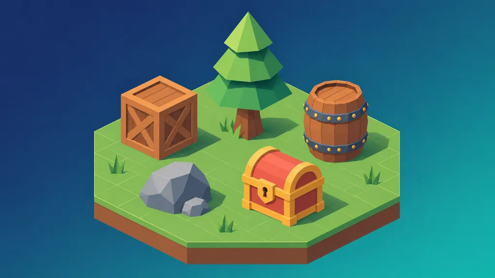

### [Kenney Game Assets](https://kenney.nl/assets)

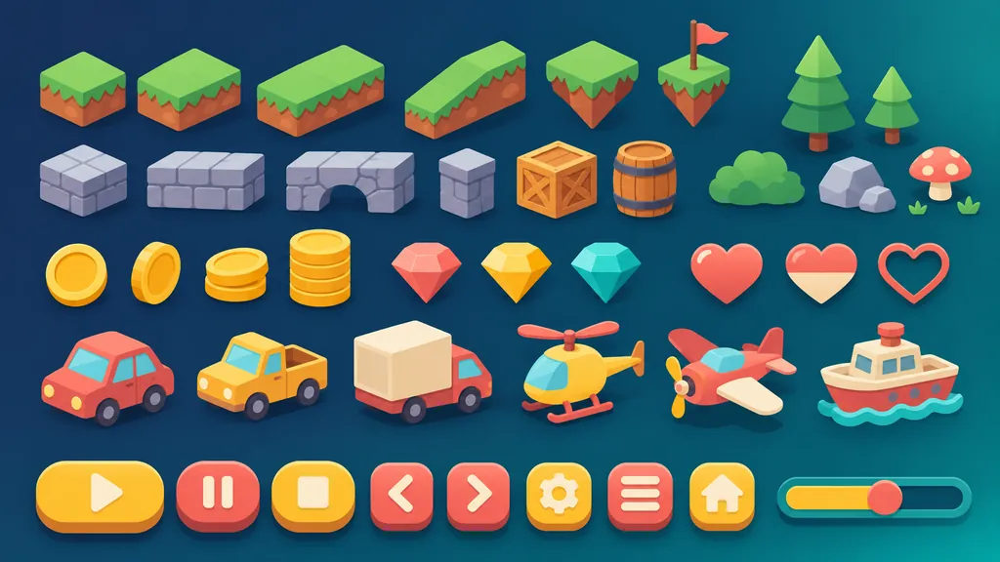

Thousands of consistent 2D sprites, UI, 3D models and sound packs; great for prototypes and game jams.

**License:** [CC0-1.0](https://kenney.nl/support)

*illustration*

### [Quaternius](https://quaternius.com/)

[View at source](https://quaternius.com/)

Low-poly 3D packs (characters, nature, buildings, weapons) in FBX/OBJ/glTF; free packs are CC0.

**License:** [CC0-1.0](https://quaternius.com/faq.html)

### [OpenGameArt.org](https://opengameart.org/)

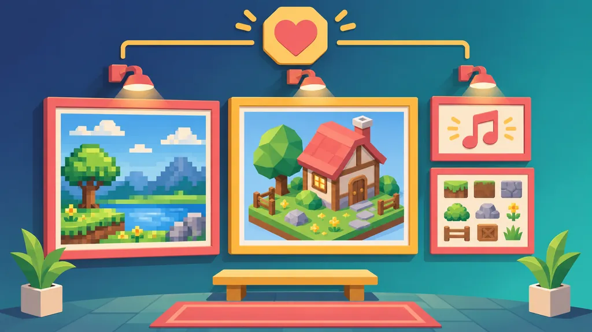

Community library of 2D, 3D, music and SFX; each asset page states its license, so check before use.

**License:** [Per asset (CC0 / CC-BY / CC-BY-SA / GPL / OGA-BY)](https://opengameart.org/content/faq)

*illustration*

### [KhronosGroup/glTF-Sample-Assets](https://github.com/KhronosGroup/glTF-Sample-Assets)

[View at source](https://github.com/KhronosGroup/glTF-Sample-Assets)

Reference glTF models for testing loaders, PBR materials and engine import pipelines.

**License:** [Per model (mostly CC0 / CC-BY-4.0; a few under custom terms, see REUSE.toml)](https://github.com/KhronosGroup/glTF-Sample-Assets/tree/main/LICENSES)

### [Polyfork](https://polyfork.dev/assets)

[View at source](https://polyfork.dev/assets)

3,000+ free low-poly 3D models as GLB plus a three.js ES module; credit Polyfork under CC BY, or use the no-credit licence without redistributing files. Paid tiers add HD editions.

**License:** [Free low-poly meshes: CC-BY-4.0 or Polyfork licence (your choice); ES modules and HD editions: Polyfork licence only](https://polyfork.dev/licensing)

### [The Base Mesh](https://www.thebasemesh.com/)

[View at source](https://www.thebasemesh.com/)

1,250+ real-world-scale base meshes for greyboxing, sculpting and prototyping.

**License:** [CC0-1.0](https://www.thebasemesh.com/)

listed in [madjin/awesome-cc0](https://github.com/madjin/awesome-cc0)

### [LiberatedPixelCup/Universal-LPC-Spritesheet-Character-Generator](https://github.com/LiberatedPixelCup/Universal-LPC-Spritesheet-Character-Generator)

[View at source](https://github.com/LiberatedPixelCup/Universal-LPC-Spritesheet-Character-Generator)

Browser generator for layered RPG character spritesheets with walk, slash and cast animations; exports a credits file.

**License:** [GPL-3.0 (code); art per asset (CC0 / CC-BY / CC-BY-SA / OGA-BY / GPL)](https://github.com/LiberatedPixelCup/Universal-LPC-Spritesheet-Character-Generator#licensing-and-attribution-credits)

listed in [Calinou/awesome-gamedev](https://github.com/Calinou/awesome-gamedev)

### [makehumancommunity/makehuman](https://github.com/makehumancommunity/makehuman)

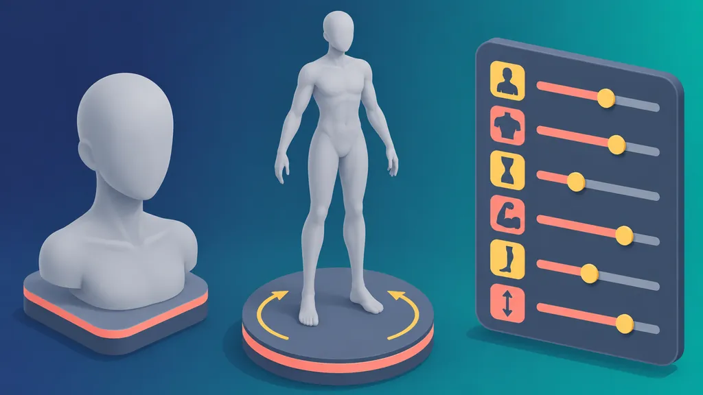

Parametric 3D human character creator; exported characters and bundled assets are CC0.

**License:** [AGPL-3.0 (code) / CC0-1.0 (bundled assets)](https://github.com/makehumancommunity/makehuman)

*illustration*

### [vrm-c/UniVRM](https://github.com/vrm-c/UniVRM)

[View at source](https://vrm.dev/en)

Unity importer/exporter for VRM humanoid avatars (glTF-based), with spring bones and expressions.

**License:** [MIT](https://github.com/vrm-c/UniVRM)

### [PolygonalMind/initiative-opensource-release](https://github.com/PolygonalMind/initiative-opensource-release)

[View at source](https://github.com/PolygonalMind/initiative-opensource-release)

CC0 releases from Polygonal Mind, including the 100 Avatars character packs and 3D environments.

**License:** [CC0-1.0](https://github.com/PolygonalMind/initiative-opensource-release)

### [sparklinlabs/superpowers-asset-packs](https://github.com/sparklinlabs/superpowers-asset-packs)

[View at source](https://github.com/sparklinlabs/superpowers-asset-packs)

CC0 asset packs from the Superpowers engine: 2D and 3D packs with characters, vehicles, backgrounds, shooter and platformer sets.

**License:** [CC0-1.0](https://github.com/sparklinlabs/superpowers-asset-packs)

### [umasteeringgroup/UMA](https://github.com/umasteeringgroup/UMA)

[View at source](https://github.com/umasteeringgroup/UMA)

Unity Multipurpose Avatar: customizable characters with swappable wardrobe, DNA-driven body shapes and texture atlasing.

**License:** [MIT](https://github.com/umasteeringgroup/UMA)

### [dicebear/dicebear](https://github.com/dicebear/dicebear)

[View at source](https://www.dicebear.com)

Avatar library that generates SVG profile pictures from a seed in many styles; check each style's license.

**License:** [MIT (code; avatar styles have their own licenses)](https://github.com/dicebear/dicebear)

### [Kenney Modular Characters](https://kenney.nl/assets/modular-characters)

[View at source](https://kenney.nl/assets/modular-characters)

Modular 2D character parts you can mix into many top-down or side-view characters.

**License:** [CC0-1.0](https://kenney.nl/assets/modular-characters)

### [Kenney Roguelike Characters](https://kenney.nl/assets/roguelike-characters)

[View at source](https://kenney.nl/assets/roguelike-characters)

16x16 pixel roguelike character sprites with gear and outfits.

**License:** [CC0-1.0](https://kenney.nl/assets/roguelike-characters)

### [Kenney Platformer Characters](https://kenney.nl/assets/platformer-characters)

[View at source](https://kenney.nl/assets/platformer-characters)

Side-view platformer characters with walk, jump and other poses.

**License:** [CC0-1.0](https://kenney.nl/assets/platformer-characters)

### [Kenney Toon Characters](https://kenney.nl/assets/toon-characters)

[View at source](https://kenney.nl/assets/toon-characters)

Cartoon 2D characters in multiple poses for casual games.

**License:** [CC0-1.0](https://kenney.nl/assets/toon-characters)

### [Quaternius Universal Base Characters](https://quaternius.com/packs/universalbasecharacters.html)

Rigged low-poly base characters made to work with Quaternius' universal animation library.

**License:** [CC0-1.0](https://quaternius.com/packs/universalbasecharacters.html)

image: project [Quaternius Universal Base Characters](https://quaternius.com/packs/universalbasecharacters.html)

### [Quaternius Modular Character Outfits - Fantasy](https://quaternius.com/packs/modularcharacteroutfitsfantasy.html)

[View at source](https://quaternius.com/packs/modularcharacteroutfitsfantasy.html)

Modular fantasy outfits (armor, robes, hats) for Quaternius base characters.

**License:** [CC0-1.0](https://quaternius.com/packs/modularcharacteroutfitsfantasy.html)

### [Liberated Pixel Cup (LPC) Base Assets](https://opengameart.org/content/liberated-pixel-cup-lpc-base-assets-sprites-map-tiles)

[View at source](https://opengameart.org/content/liberated-pixel-cup-lpc-base-assets-sprites-map-tiles)

Liberated Pixel Cup base sprites and map tiles, the root of the large LPC character-art ecosystem.

**License:** [CC-BY-SA-3.0 / GPL-3.0](https://opengameart.org/content/liberated-pixel-cup-lpc-base-assets-sprites-map-tiles)

### [Kenney Pixel Platformer](https://kenney.nl/assets/pixel-platformer)

18x18 pixel platformer tiles, characters and items.

**License:** [CC0-1.0](https://kenney.nl/assets/pixel-platformer)

image: project [Kenney Pixel Platformer](https://kenney.nl/assets/pixel-platformer)

### [Kenney 1-Bit Pack](https://kenney.nl/assets/1-bit-pack)

[View at source](https://kenney.nl/assets/1-bit-pack)

Over 1,000 one-bit 16x16 tiles for dungeons, towns, sci-fi and more.

**License:** [CC0-1.0](https://kenney.nl/assets/1-bit-pack)

### [Kenney Tiny Dungeon](https://kenney.nl/assets/tiny-dungeon)

[View at source](https://kenney.nl/assets/tiny-dungeon)

Tiny 16x16 dungeon tiles, heroes and monsters.

**License:** [CC0-1.0](https://kenney.nl/assets/tiny-dungeon)

### [Kenney Tiny Town](https://kenney.nl/assets/tiny-town)

[View at source](https://kenney.nl/assets/tiny-town)

Tiny 16x16 town tiles with houses, fences and nature.

**License:** [CC0-1.0](https://kenney.nl/assets/tiny-town)

### [16x16 DungeonTileset II](https://0x72.itch.io/dungeontileset-ii)

[View at source](https://0x72.itch.io/dungeontileset-ii)

16x16 dungeon tileset with animated characters, monsters and weapons.

**License:** [CC0-1.0 (assets) / MIT (code)](https://0x72.itch.io/dungeontileset-ii)

### [16x16 Fantasy tileset](https://opengameart.org/content/16x16-fantasy-tileset)

[View at source](https://opengameart.org/content/16x16-fantasy-tileset)

Mini characters and fantasy items for Game Boy/Famicom-style roguelikes and RPGs.

**License:** [CC-BY-SA-3.0](https://opengameart.org/content/16x16-fantasy-tileset)

### [A Blocky Dungeon](https://opengameart.org/content/a-blocky-dungeon)

[View at source](https://opengameart.org/content/a-blocky-dungeon)

Blocky 16x16 dungeon tiles with doors, switches and animated props (no characters).

**License:** [CC0-1.0](https://opengameart.org/content/a-blocky-dungeon)

## UI, Icons & HUD

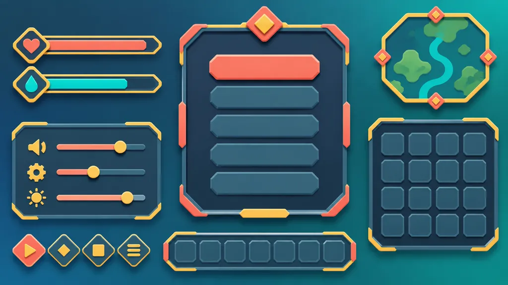

### [Game-icons.net](https://game-icons.net/)

[View at source](https://game-icons.net/)

4,000+ free SVG/PNG game icons (skills, items, status effects); credit each icon's author.

**License:** [CC-BY-3.0](https://game-icons.net/about.html)

listed in [Calinou/awesome-gamedev](https://github.com/Calinou/awesome-gamedev)

### [Those Awesome Guys: Controller & Keyboard Prompts](https://thoseawesomeguys.com/prompts/)

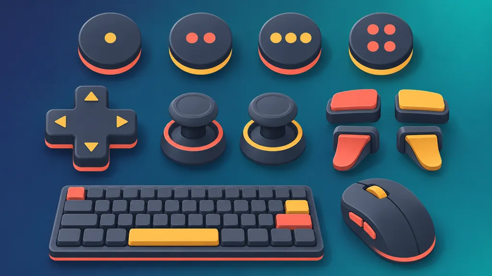

Button prompt icons for keyboard, mouse and common controllers, for tutorials and input hints.

**License:** [CC0-1.0](https://thoseawesomeguys.com/prompts/)

*illustration* listed in [Calinou/awesome-gamedev](https://github.com/Calinou/awesome-gamedev)

### [ocornut/imgui](https://github.com/ocornut/imgui)

[View at source](https://github.com/ocornut/imgui)

Immediate-mode GUI library (Dear ImGui) for debug menus, in-game tools and editors.

**License:** [MIT](https://github.com/ocornut/imgui)

### [Kenney UI Pack](https://kenney.nl/assets/ui-pack)

430 UI elements (buttons, sliders, panels) in several colors for menus and HUDs.

**License:** [CC0-1.0](https://kenney.nl/assets/ui-pack)

image: project [Kenney UI Pack](https://kenney.nl/assets/ui-pack)

### [mikke89/RmlUi](https://github.com/mikke89/RmlUi)

[View at source](https://github.com/mikke89/RmlUi)

C++ game UI library that builds interfaces from HTML/CSS-like documents, with data binding and animation.

**License:** [MIT](https://github.com/mikke89/RmlUi)

### [Immediate-Mode-UI/Nuklear](https://github.com/Immediate-Mode-UI/Nuklear)

[View at source](https://github.com/Immediate-Mode-UI/Nuklear)

Single-header ANSI C immediate-mode GUI for tools and in-game menus.

**License:** [MIT or Unlicense](https://github.com/Immediate-Mode-UI/Nuklear)

### [emilk/egui](https://github.com/emilk/egui)

[View at source](https://github.com/emilk/egui)

Easy immediate-mode GUI in Rust that runs natively and on the web; common in Rust game tools.

**License:** [MIT OR Apache-2.0](https://github.com/emilk/egui)

### [nicbarker/clay](https://github.com/nicbarker/clay)

[View at source](https://github.com/nicbarker/clay)

High-performance UI layout library in C with flexbox-like layout and renderer-agnostic output.

**License:** [Zlib](https://github.com/nicbarker/clay)

### [memononen/nanovg](https://github.com/memononen/nanovg)

[View at source](https://github.com/memononen/nanovg)

Antialiased 2D vector drawing on OpenGL for UI and visualizations.

**License:** [Zlib](https://github.com/memononen/nanovg)

### [CedricGuillemet/ImGuizmo](https://github.com/CedricGuillemet/ImGuizmo)

[View at source](https://github.com/CedricGuillemet/ImGuizmo)

Immediate-mode 3D gizmos (move, rotate, scale) and other editor controls for Dear ImGui.

**License:** [MIT](https://github.com/CedricGuillemet/ImGuizmo)

listed in [Calinou/awesome-gamedev](https://github.com/Calinou/awesome-gamedev)

### [epezent/implot](https://github.com/epezent/implot)

[View at source](https://github.com/epezent/implot)

Immediate-mode plotting for Dear ImGui; good for profilers and debug graphs.

**License:** [MIT](https://github.com/epezent/implot)

### [ebitenui/ebitenui](https://github.com/ebitenui/ebitenui)

[View at source](https://github.com/ebitenui/ebitenui)

UI engine and widget library for Ebitengine games in Go.

**License:** [MIT](https://github.com/ebitenui/ebitenui)

### [facebook/yoga](https://github.com/facebook/yoga)

[View at source](https://yogalayout.dev/)

Embeddable flexbox layout engine; can drive game UI layout in C++, C# or JavaScript.

**License:** [MIT](https://github.com/facebook/yoga)

### [wjakob/nanogui](https://github.com/wjakob/nanogui)

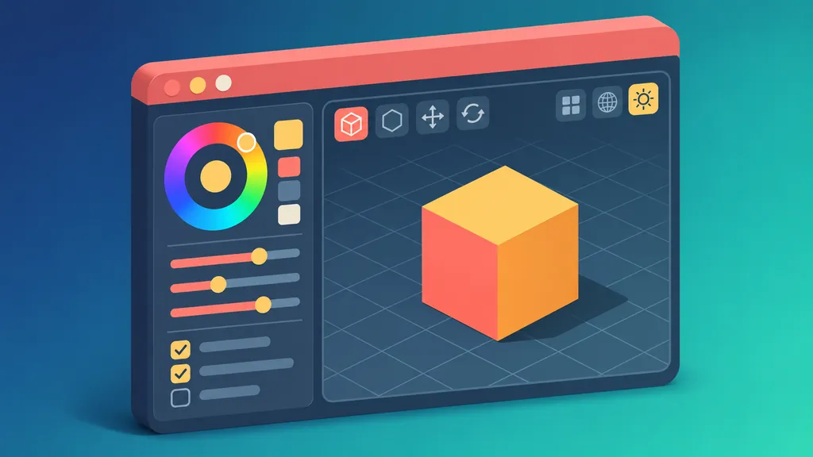

Minimalistic C++/Python GUI library for OpenGL, useful for quick tool panels.

**License:** [BSD-3-Clause](https://github.com/wjakob/nanogui)

*illustration*

### [vladbat00/bevy_egui](https://github.com/vladbat00/bevy_egui)

[View at source](https://github.com/vladbat00/bevy_egui)

Integrates egui into the Bevy engine for debug panels and in-game editors.

**License:** [MIT](https://github.com/vladbat00/bevy_egui)

### [Kenney Crosshair Pack](https://kenney.nl/assets/crosshair-pack)

[View at source](https://kenney.nl/assets/crosshair-pack)

Set of crosshair and reticle sprites for shooters and aiming UI.

**License:** [CC0-1.0](https://kenney.nl/assets/crosshair-pack)

### [Kenney Cursor Pack](https://kenney.nl/assets/cursor-pack)

[View at source](https://kenney.nl/assets/cursor-pack)

Mouse cursors and pointer icons for game menus and strategy games.

**License:** [CC0-1.0](https://kenney.nl/assets/cursor-pack)

### [Kenney UI Pack (RPG Expansion)](https://kenney.nl/assets/ui-pack-rpg-expansion)

[View at source](https://kenney.nl/assets/ui-pack-rpg-expansion)

RPG-style UI elements: panels, bars, buttons and frames.

**License:** [CC0-1.0](https://kenney.nl/assets/ui-pack-rpg-expansion)

### [RPG GUI construction kit v1.0](https://opengameart.org/content/rpg-gui-construction-kit-v10)

[View at source](https://opengameart.org/content/rpg-gui-construction-kit-v10)

RPG GUI construction kit with frames, bars and buttons to assemble fantasy menus.

**License:** [CC-BY-3.0](https://opengameart.org/content/rpg-gui-construction-kit-v10)

### [Sci-fi User Interface](https://opengameart.org/content/sci-fi-user-interface)

[View at source](https://opengameart.org/content/sci-fi-user-interface)

Sci-fi user interface elements for futuristic HUDs and menus.

**License:** [CC0-1.0](https://opengameart.org/content/sci-fi-user-interface)

## Textures & Materials

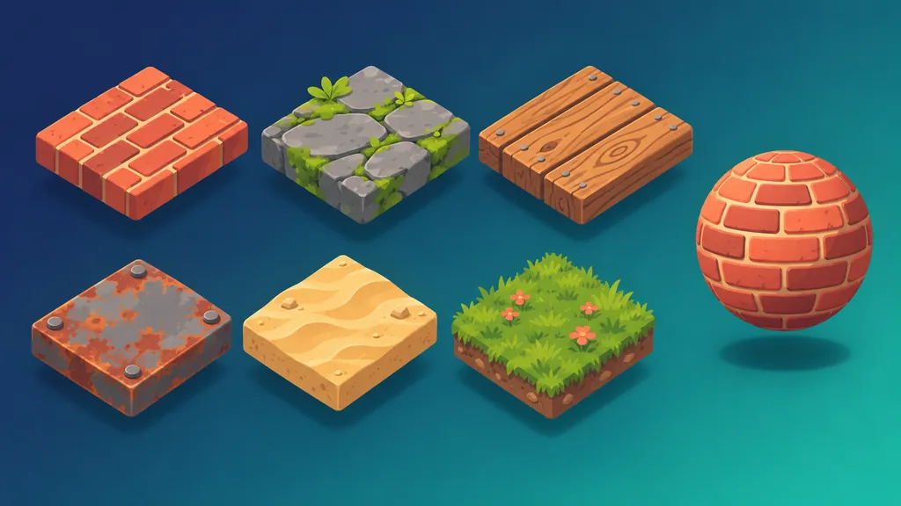

### [Poly Haven](https://polyhaven.com/)

[View at source](https://polyhaven.com/)

High-quality PBR textures, HDRIs and photoscanned models; ideal for realistic scenes and lighting.

**License:** [CC0-1.0](https://polyhaven.com/license)

### [ambientCG](https://ambientcg.com/)

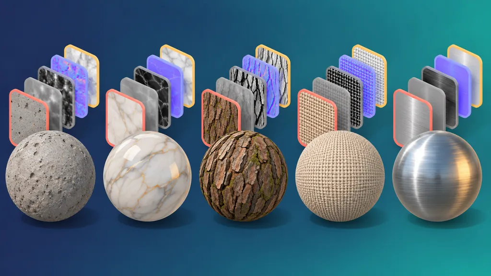

Large CC0 library of PBR materials, HDRIs and models with multiple resolutions.

**License:** [CC0-1.0](https://docs.ambientcg.com/license/)

*illustration*

### [kmkolasinski/AwesomeBump](https://github.com/kmkolasinski/AwesomeBump)

[View at source](https://github.com/kmkolasinski/AwesomeBump)

Generates normal, height, specular, AO, roughness and metallic maps from a single image (last updated 2023).

**License:** [GPL-3.0](https://github.com/kmkolasinski/AwesomeBump)

listed in [Calinou/awesome-gamedev](https://github.com/Calinou/awesome-gamedev) listed in [madjin/awesome-cc0](https://github.com/madjin/awesome-cc0)

### [armory3d/armorpaint](https://github.com/armory3d/armorpaint)

[View at source](https://github.com/armory3d/armorpaint)

3D painting tool for PBR texturing of models (source; prebuilt binaries are sold separately).

**License:** [Zlib](https://github.com/armory3d/armorpaint)

### [azagaya/laigter](https://github.com/azagaya/laigter)

[View at source](https://github.com/azagaya/laigter)

Generates normal, specular and occlusion maps for 2D sprites to get dynamic lighting.

**License:** [GPL-3.0](https://github.com/azagaya/laigter)

## Sound Effects & Audio

### [Freesound](https://freesound.org/)

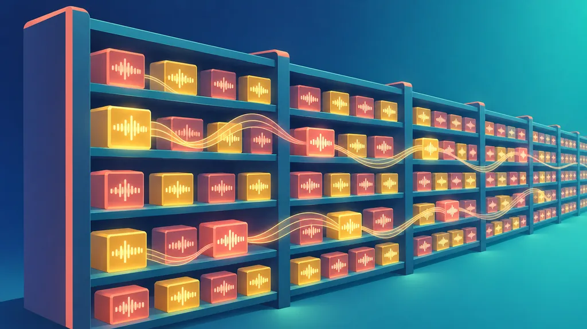

Huge community sound library; filter by license (CC0 or CC-BY for commercial games) and credit when required.

**License:** [Per sound (CC0 / CC-BY-4.0 / CC-BY-NC-4.0)](https://freesound.org/help/faq/)

*illustration*

### [Sonniss #GameAudioGDC Bundles](https://sonniss.com/gameaudiogdc)

[View at source](https://sonniss.com/gameaudiogdc)

Yearly free bundles of professional SFX, royalty-free for commercial games.

**License:** [Royalty-free (Sonniss license: commercial use, no attribution required)](https://sonniss.com/gameaudiogdc)

### [chr15m/jsfxr](https://github.com/chr15m/jsfxr)

[View at source](https://github.com/chr15m/jsfxr)

Browser-based retro sound effect generator (sfxr port) for jumps, coins, hits and lasers.

**License:** [Unlicense](https://github.com/chr15m/jsfxr)

### [raysan5/rfxgen](https://github.com/raysan5/rfxgen)

[View at source](https://github.com/raysan5/rfxgen)

Small sfxr-style sound effect generator from the raylib author; desktop and web.

**License:** [Zlib](https://github.com/raysan5/rfxgen)

listed in [Calinou/awesome-gamedev](https://github.com/Calinou/awesome-gamedev)

### [YuriSizov/boscaceoil-blue](https://github.com/YuriSizov/boscaceoil-blue)

[View at source](https://github.com/YuriSizov/boscaceoil-blue)

Beginner-friendly step-sequencer music maker, a modern port of Terry Cavanagh's Bosca Ceoil; good for game loops and jingles.

**License:** [MIT](https://github.com/YuriSizov/boscaceoil-blue/blob/main/LICENSE)

listed in [Calinou/awesome-gamedev](https://github.com/Calinou/awesome-gamedev)

### [mackron/miniaudio](https://github.com/mackron/miniaudio)

[View at source](https://github.com/mackron/miniaudio)

Single-file C audio playback and capture library with mixing and effects; easy to embed in engines.

**License:** [Unlicense or MIT-0 (your choice)](https://github.com/mackron/miniaudio)

### [jarikomppa/soloud](https://github.com/jarikomppa/soloud)

[View at source](https://github.com/jarikomppa/soloud)

Easy, portable C++ audio engine for games with 3D sound, filters and speech synthesis.

**License:** [Zlib](https://github.com/jarikomppa/soloud)

### [Tonejs/Tone.js](https://github.com/Tonejs/Tone.js)

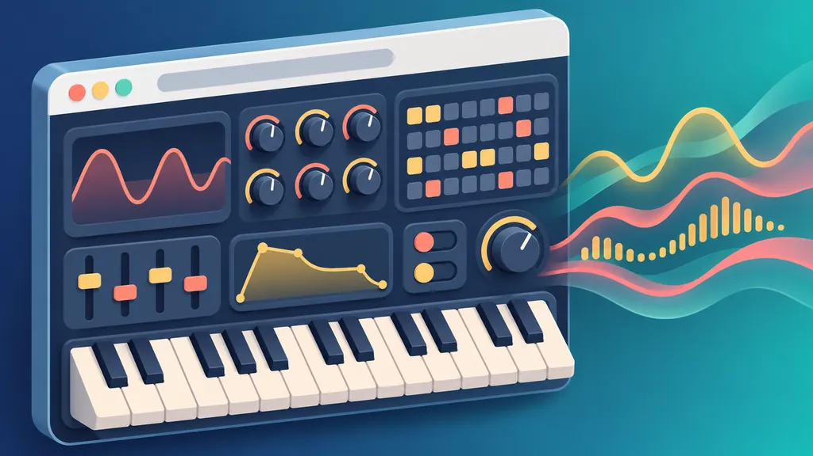

Web Audio framework for interactive music: synths, effects and scheduling in the browser.

**License:** [MIT](https://github.com/Tonejs/Tone.js)

*illustration*

### [goldfire/howler.js](https://github.com/goldfire/howler.js)

[View at source](https://github.com/goldfire/howler.js)

JavaScript audio library for web games: sprites, spatial audio and cross-browser playback.

**License:** [MIT](https://github.com/goldfire/howler.js)

### [surge-synthesizer/surge](https://github.com/surge-synthesizer/surge)

[View at source](https://github.com/surge-synthesizer/surge)

Surge XT, a powerful open-source synthesizer for designing game music and sound effects.

**License:** [GPL-3.0](https://github.com/surge-synthesizer/surge)

### [increpare/bfxr](https://github.com/increpare/bfxr)

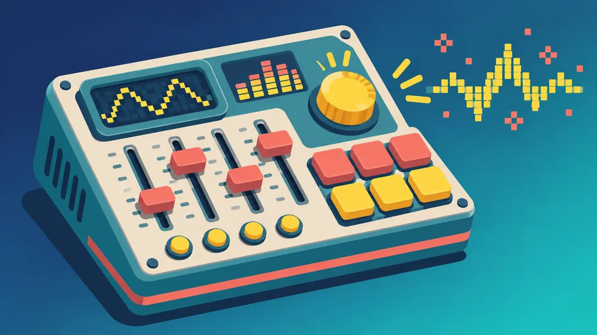

Retro sound effect generator (extended sfxr) for jumps, pickups and explosions.

**License:** [Apache-2.0 (stated in README)](https://github.com/increpare/bfxr#readme)

*illustration*

### [Pixabay Sound Effects](https://pixabay.com/sound-effects/)

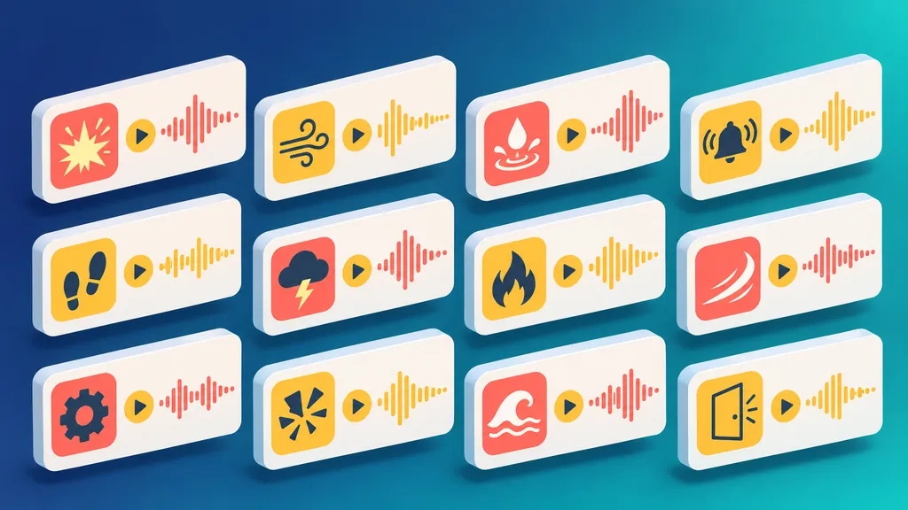

Large library of royalty-free sound effects and music under the Pixabay Content License.

**License:** [Pixabay Content License (free, no attribution; no standalone resale)](https://pixabay.com/service/license-summary/)

*illustration* ⚠ site returns 403 to automated checks; license verified manually

### [ValveSoftware/steam-audio](https://github.com/ValveSoftware/steam-audio)

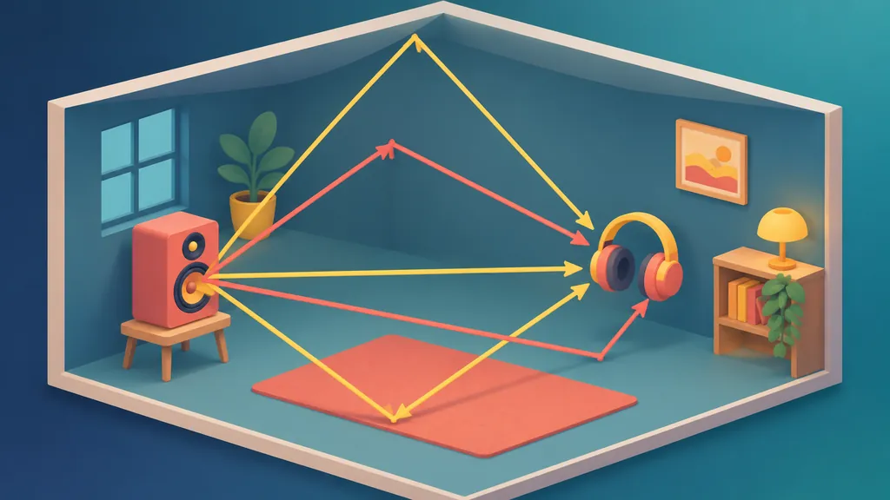

Spatial audio SDK with HRTF, occlusion and physics-based reverb; plugins for Unity, Unreal and FMOD.

**License:** [Apache-2.0](https://github.com/ValveSoftware/steam-audio)

*illustration*

### [kcat/openal-soft](https://github.com/kcat/openal-soft)

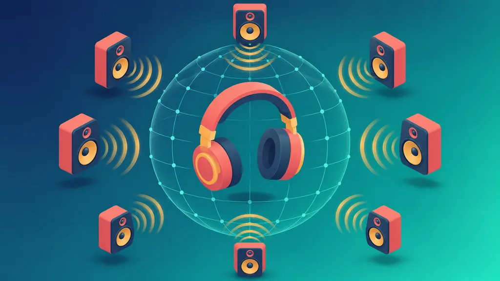

Software implementation of the OpenAL 3D audio API, with HRTF and surround output.

**License:** [LGPL-2.0-or-later](https://github.com/kcat/openal-soft)

*illustration*

### [tesselode/kira](https://github.com/tesselode/kira)

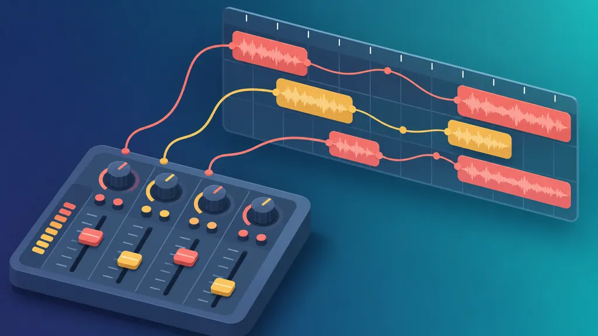

Rust game audio library with tweenable parameters, mixer tracks, clocks and effects.

**License:** [MIT OR Apache-2.0](https://github.com/tesselode/kira)

*illustration*

### [LabSound/LabSound](https://github.com/LabSound/LabSound)

[View at source](https://github.com/LabSound/LabSound)

Graph-based C++ audio engine derived from WebKit's WebAudio, for games and interactive apps.

**License:** [BSD-2-Clause / BSD-3-Clause](https://github.com/LabSound/LabSound)

### [tildearrow/furnace](https://github.com/tildearrow/furnace)

[View at source](https://github.com/tildearrow/furnace)

Multi-system chiptune tracker that emulates dozens of classic sound chips for retro music.

**License:** [GPL-2.0-or-later](https://github.com/tildearrow/furnace)

### [milkytracker/MilkyTracker](https://github.com/milkytracker/MilkyTracker)

[View at source](https://github.com/milkytracker/MilkyTracker)

FastTracker II-compatible music tracker for MOD/XM chiptune and game music.

**License:** [GPL-3.0 (MilkyPlay library: BSD-3-Clause)](https://github.com/milkytracker/MilkyTracker)

## Fonts

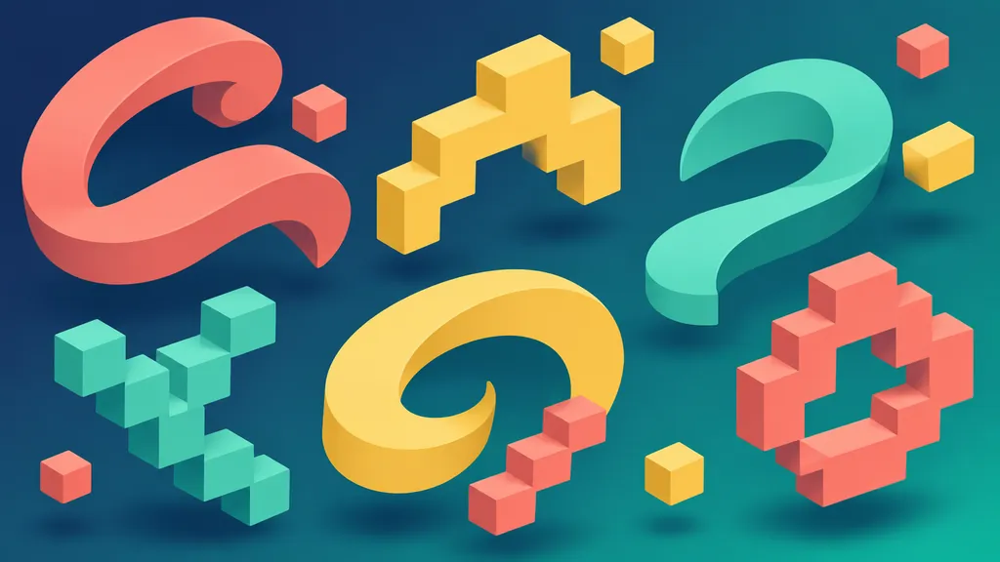

### [google/fonts](https://github.com/google/fonts)

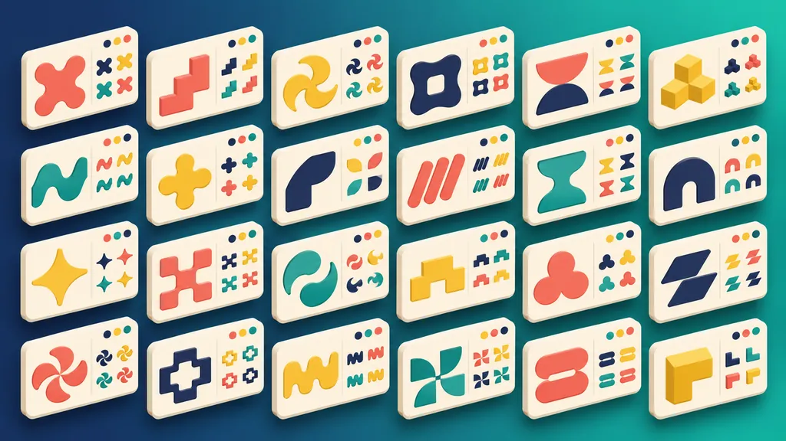

All Google Fonts families as source files; each folder name is its license. Many support CJK.

**License:** [Per family (OFL-1.1 / Apache-2.0 / UFL)](https://github.com/google/fonts#license)

*illustration*

### [rektdeckard/departure-mono](https://github.com/rektdeckard/departure-mono)

[View at source](https://github.com/rektdeckard/departure-mono)

Monospaced pixel font with a retro-futuristic look for HUDs and terminals.

**License:** [OFL-1.1 (font) / MIT (site)](https://github.com/rektdeckard/departure-mono)

### [TakWolf/fusion-pixel-font](https://github.com/TakWolf/fusion-pixel-font)

[View at source](https://github.com/TakWolf/fusion-pixel-font)

Open pixel font covering Chinese, Japanese, Korean and Latin, in 8/10/12 px sizes.

**License:** [OFL-1.1 (font) / MIT (build code)](https://github.com/TakWolf/fusion-pixel-font)

### [TakWolf/ark-pixel-font](https://github.com/TakWolf/ark-pixel-font)

[View at source](https://github.com/TakWolf/ark-pixel-font)

Open pixel font for CJK and Latin, designed for pixel-art games.

**License:** [OFL-1.1 (font) / MIT (build code)](https://github.com/TakWolf/ark-pixel-font)

### [Kenney Fonts](https://kenney.nl/assets/kenney-fonts)

[View at source](https://kenney.nl/assets/kenney-fonts)

11 playful game fonts from Kenney, free for any project.

**License:** [CC0-1.0](https://kenney.nl/assets/kenney-fonts)

### [IdreesInc/Monocraft](https://github.com/IdreesInc/Monocraft)

[View at source](https://github.com/IdreesInc/Monocraft)

Blocky monospaced font inspired by the Minecraft typeface, with programming ligatures.

**License:** [OFL-1.1](https://github.com/IdreesInc/Monocraft)

### [the-moonwitch/Cozette](https://github.com/the-moonwitch/Cozette)

[View at source](https://github.com/the-moonwitch/Cozette)

Small bitmap font with wide glyph coverage; works well for retro UI and terminals.

**License:** [MIT](https://github.com/the-moonwitch/Cozette)

### [fcambus/spleen](https://github.com/fcambus/spleen)

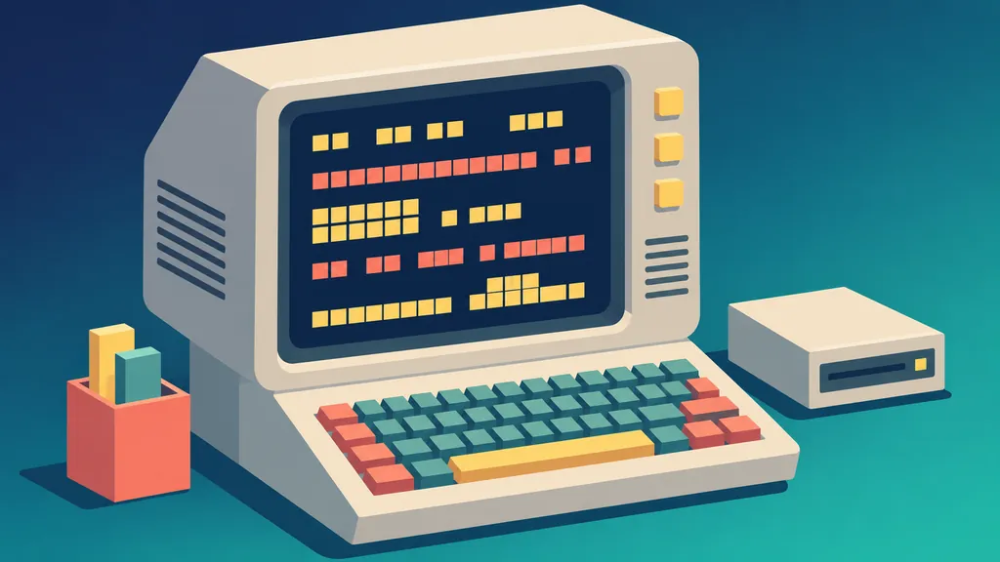

Monospaced bitmap fonts in sizes from 5x8 to 32x64 for crisp pixel UI.

**License:** [BSD-2-Clause](https://github.com/fcambus/spleen)

*illustration*

### [sgigou/NF-Pixels](https://github.com/sgigou/NF-Pixels)

[View at source](https://github.com/sgigou/NF-Pixels)

Free pixel font with regular and bold styles for retro game text.

**License:** [OFL-1.1](https://github.com/sgigou/NF-Pixels)

### [scott0107000/BoutiqueBitmap7x7](https://github.com/scott0107000/BoutiqueBitmap7x7)

[View at source](https://github.com/scott0107000/BoutiqueBitmap7x7)

Open-source 7x7 bitmap font covering Chinese, Japanese and Latin characters.

**License:** [OFL-1.1](https://github.com/scott0107000/BoutiqueBitmap7x7)

### [monogram](https://datagoblin.itch.io/monogram)

[View at source](https://datagoblin.itch.io/monogram)

monogram: free monospace pixel font with wide character coverage.

**License:** [CC0-1.0](https://datagoblin.itch.io/monogram)

### [m5x7](https://managore.itch.io/m5x7)

[View at source](https://managore.itch.io/m5x7)

m5x7: tiny, readable pixel font by Daniel Linssen.

**License:** [CC0-1.0](https://managore.itch.io/m5x7)

### [Pixeloid](https://ggbot.itch.io/pixeloid-font)

[View at source](https://ggbot.itch.io/pixeloid-font)

Pixeloid: pixel font family with sans, mono and bold styles.

**License:** [OFL-1.1](https://ggbot.itch.io/pixeloid-font)

### [The League of Moveable Type](https://www.theleagueofmoveabletype.com/)

[View at source](https://www.theleagueofmoveabletype.com/)

Foundry of open-source display fonts, all under the SIL Open Font License.

**License:** [OFL-1.1](https://www.theleagueofmoveabletype.com/)

## VFX, Particles & Shaders

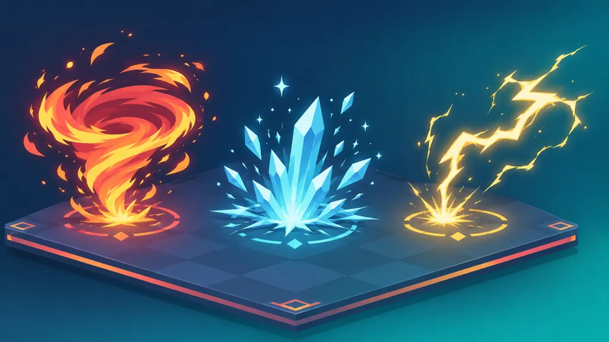

### [Alchemist0823/three.quarks](https://github.com/Alchemist0823/three.quarks)

[View at source](https://github.com/Alchemist0823/three.quarks)

General-purpose particle system / VFX engine for three.js, with a visual editor.

**License:** [MIT](https://github.com/Alchemist0823/three.quarks)

### [creativelifeform/three-nebula](https://github.com/creativelifeform/three-nebula)

[View at source](https://three-nebula.org/)

WebGL particle engine for three.js; JSON-defined emitters for fire, smoke and magic effects.

**License:** [MIT](https://github.com/creativelifeform/three-nebula)

### [effekseer/Effekseer](https://github.com/effekseer/Effekseer)

[View at source](https://github.com/effekseer/Effekseer)

Particle effect editor and runtime with plugins for Unity, Unreal, Godot and web.

**License:** [MIT](https://github.com/effekseer/Effekseer)

### [Kenney Particle Pack](https://kenney.nl/assets/particle-pack)

[View at source](https://kenney.nl/assets/particle-pack)

80 particle sprites (smoke, fire, sparks, magic) to drop into any particle system.

**License:** [CC0-1.0](https://kenney.nl/assets/particle-pack)

### [JangaFX Free VDB Animations](https://jangafx.com/software/embergen/download/free-vdb-animations/)

[View at source](https://jangafx.com/)

Free volumetric fire, smoke and explosion simulations (OpenVDB) for Blender, Houdini and offline renders.

**License:** [CC0-1.0](https://jangafx.com/software/embergen/download/free-vdb-animations/)

listed in [madjin/awesome-cc0](https://github.com/madjin/awesome-cc0)

### [pmndrs/postprocessing](https://github.com/pmndrs/postprocessing)

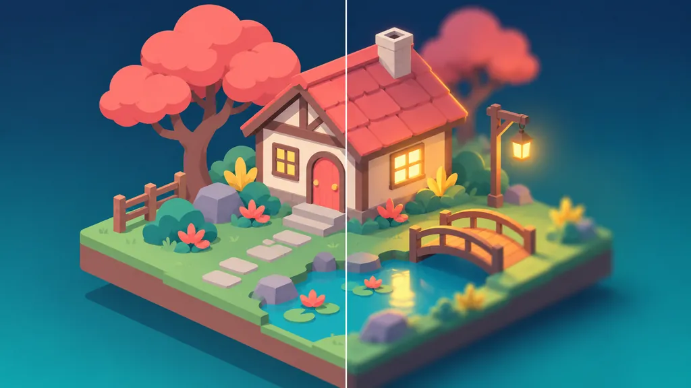

Post-processing effects library for three.js: bloom, depth of field, SMAA, tone mapping and more.

**License:** [Zlib](https://github.com/pmndrs/postprocessing)

*illustration*

### [gdquest-demos/godot-shaders](https://github.com/gdquest-demos/godot-shaders)

[View at source](https://github.com/gdquest-demos/godot-shaders)

Open-source Godot shader demos (dissolve, outline, water, toon and more) with readable code.

**License:** [MIT (code) / CC-BY-NC-SA-4.0 (art)](https://github.com/gdquest-demos/godot-shaders)

### [gdquest-demos/godot-visual-effects](https://github.com/gdquest-demos/godot-visual-effects)

[View at source](https://github.com/gdquest-demos/godot-visual-effects)

Godot visual-effects demos: particles, explosions, impacts and magic spells to learn from.

**License:** [MIT (code) / CC-BY-NC-SA-4.0 (art)](https://github.com/gdquest-demos/godot-visual-effects)

### [Godot Shaders](https://godotshaders.com/)

[View at source](https://godotshaders.com/)

Community library of Godot shaders; each post states its license, which covers the code only.

**License:** [Per shader (CC0 / MIT / GPL-3.0); images not covered](https://godotshaders.com/license/)

### [CyberAgentGameEntertainment/NovaShader](https://github.com/CyberAgentGameEntertainment/NovaShader)

[View at source](https://github.com/CyberAgentGameEntertainment/NovaShader)

Multi-purpose particle shader for Unity URP with distortion, dissolve, flow maps and more.

**License:** [MIT](https://github.com/CyberAgentGameEntertainment/NovaShader)

### [pixijs-userland/particle-emitter](https://github.com/pixijs-userland/particle-emitter)

Particle system for PixiJS with a visual editor for 2D effects like fire, smoke and sparks.

**License:** [MIT](https://github.com/pixijs-userland/particle-emitter)

*illustration*

### [djeedai/bevy_hanabi](https://github.com/djeedai/bevy_hanabi)

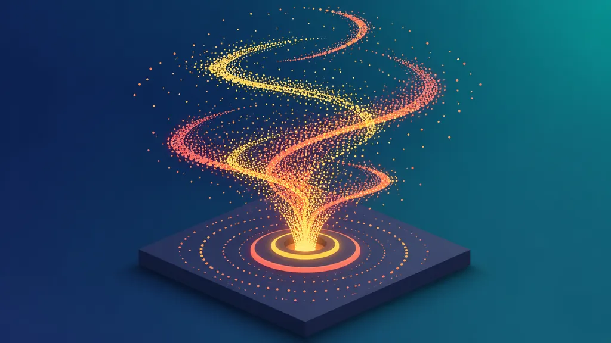

GPU particle system plugin for Bevy that handles large numbers of particles.

**License:** [MIT OR Apache-2.0](https://github.com/djeedai/bevy_hanabi)

*illustration*

### [haowg/GODOT-VFX-LIBRARY](https://github.com/haowg/GODOT-VFX-LIBRARY)

[View at source](https://github.com/haowg/GODOT-VFX-LIBRARY)

Collection of particle effects and shaders for Godot 4 action games: hits, slashes, explosions, auras.

**License:** [MIT](https://github.com/haowg/GODOT-VFX-LIBRARY)

### [Chrisknyfe/boujie_water_shader](https://github.com/Chrisknyfe/boujie_water_shader)

[View at source](https://github.com/Chrisknyfe/boujie_water_shader)

Stylized Godot 4 water shader with waves, foam and refraction.

**License:** [MIT](https://github.com/Chrisknyfe/boujie_water_shader)

### [Arnklit/Waterways](https://github.com/Arnklit/Waterways)

[View at source](https://github.com/Arnklit/Waterways)

Godot add-on that builds river meshes from Bezier curves and bakes flow and foam maps.

**License:** [MIT](https://github.com/Arnklit/Waterways)

### [gdquest-demos/godot-4-stylized-sky](https://github.com/gdquest-demos/godot-4-stylized-sky)

[View at source](https://github.com/gdquest-demos/godot-4-stylized-sky)

Open-source stylized sky shader for Godot 4 with sun, moon, clouds and stars.

**License:** [MIT (code) / CC-BY-NC-SA-4.0 (art)](https://github.com/gdquest-demos/godot-4-stylized-sky)

### [stegu/webgl-noise](https://github.com/stegu/webgl-noise)

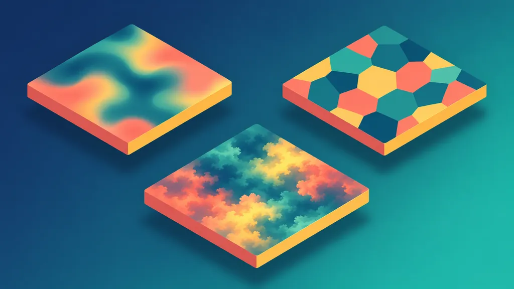

GLSL simplex, Perlin and cellular noise functions for procedural shaders.

**License:** [MIT](https://github.com/stegu/webgl-noise)

*illustration*

### [wwwtyro/glsl-atmosphere](https://github.com/wwwtyro/glsl-atmosphere)

[View at source](https://github.com/wwwtyro/glsl-atmosphere)

GLSL sky renderer with Rayleigh and Mie scattering for realistic skies.

**License:** [Unlicense](https://github.com/wwwtyro/glsl-atmosphere)

### [Cyanilux/URP_ShaderGraphCustomLighting](https://github.com/Cyanilux/URP_ShaderGraphCustomLighting)

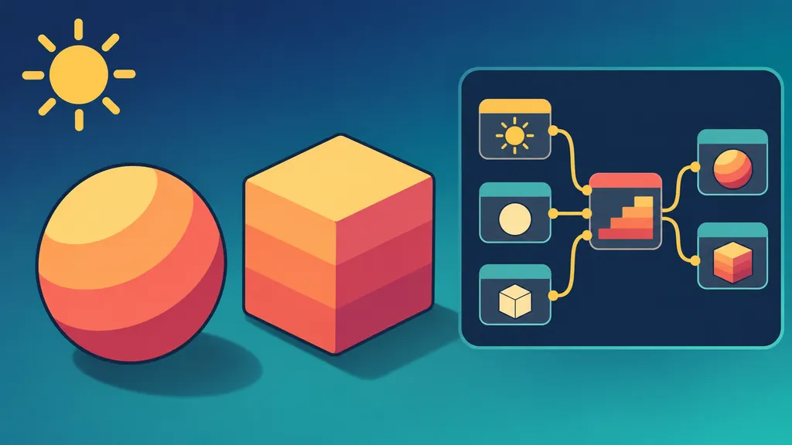

Custom lighting sub-graphs for Unity URP Shader Graph, handy for toon and stylized shading.

**License:** [MIT](https://github.com/Cyanilux/URP_ShaderGraphCustomLighting)

*illustration*

## Ability, Casting & Combat Demos

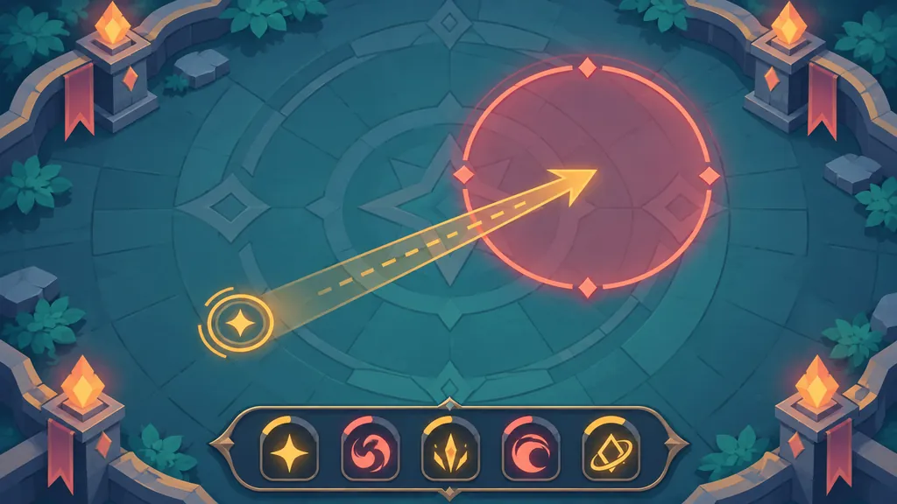

### [achrefelouafi/LinearAbiltyCastingThreeJS](https://github.com/achrefelouafi/LinearAbiltyCastingThreeJS)

[View at source](https://github.com/achrefelouafi/LinearAbiltyCastingThreeJS)

three.js demo of line-cast and far-cast abilities (aim arrow, target circle, beam, lance, meteor) with HUD.

**License:** [MIT](https://github.com/achrefelouafi/LinearAbiltyCastingThreeJS)

### [jammyfu/open-game-skills](https://github.com/jammyfu/open-game-skills)

[View at source](https://github.com/jammyfu/open-game-skills)

Agent skills for building games with coding agents: game feel, combat, camera and engine adapters, with runnable examples.

**License:** [MIT](https://github.com/jammyfu/open-game-skills)

### [tranek/GASDocumentation](https://github.com/tranek/GASDocumentation)

[View at source](https://github.com/tranek/GASDocumentation)

Unofficial in-depth guide to Unreal Engine 5's Gameplay Ability System with a multiplayer sample project (UE 5.3).

**License:** [MIT](https://github.com/tranek/GASDocumentation)

### [No78Vino/gameplay-ability-system-for-unity](https://github.com/No78Vino/gameplay-ability-system-for-unity)

[View at source](https://github.com/No78Vino/gameplay-ability-system-for-unity)

Unity implementation of Unreal's Gameplay Ability System (tags, attributes, effects, abilities); partial and still in progress. Docs in Chinese.

**License:** [MIT](https://github.com/No78Vino/gameplay-ability-system-for-unity)

### [tranek/GASShooter](https://github.com/tranek/GASShooter)

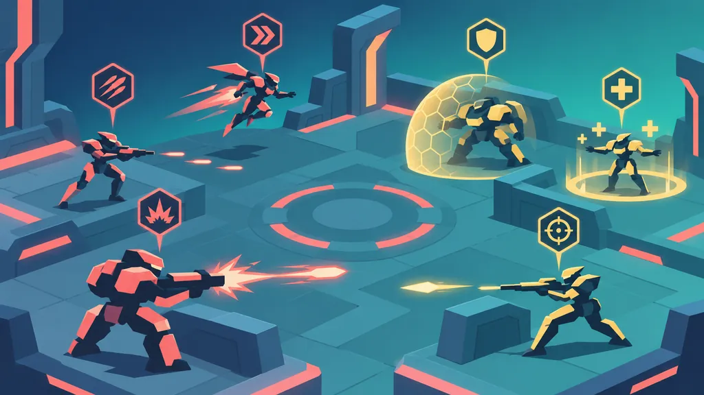

Advanced Unreal GAS sample: multiplayer FPS/TPS with weapons, abilities and prediction.

**License:** [MIT](https://github.com/tranek/GASShooter)

*illustration*

### [Narxim/Narxim-GAS-Example](https://github.com/Narxim/Narxim-GAS-Example)

[View at source](https://github.com/Narxim/Narxim-GAS-Example)

Clean Unreal Gameplay Ability System template project with attributes and abilities set up.

**License:** [MIT](https://github.com/Narxim/Narxim-GAS-Example)

### [OctoD/godot-gameplay-abilities](https://github.com/OctoD/godot-gameplay-abilities)

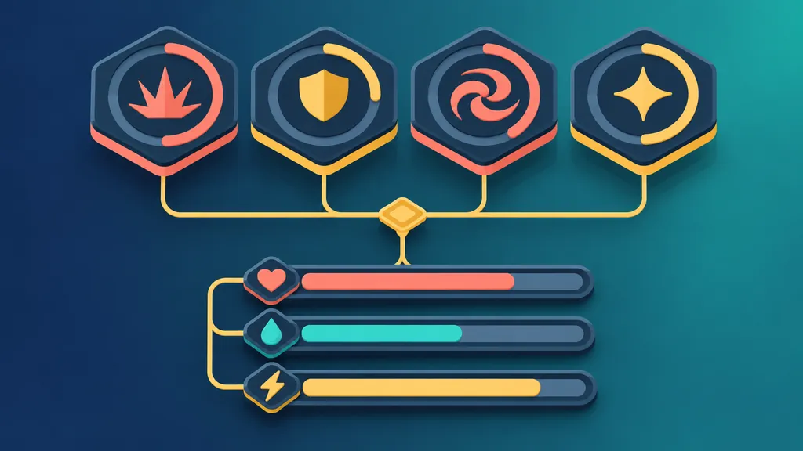

Gameplay ability system for Godot: abilities, attributes, effects and cooldowns.

**License:** [MIT](https://github.com/OctoD/godot-gameplay-abilities)

*illustration*

### [Leafwing-Studios/leafwing_abilities](https://github.com/Leafwing-Studios/leafwing_abilities)

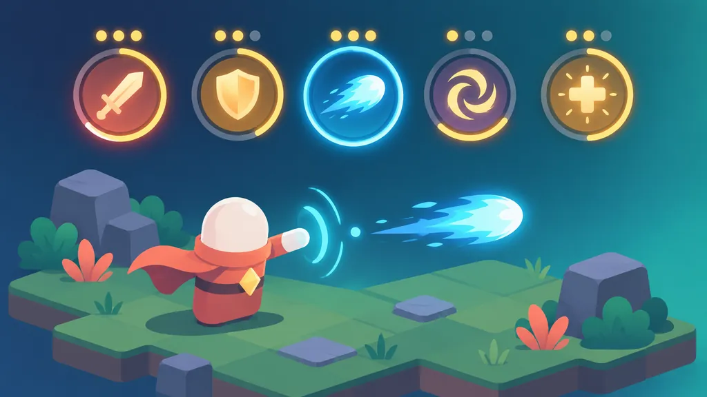

Ability management for Bevy: cooldowns, charges and resource pools tied to input actions.

**License:** [MIT OR Apache-2.0](https://github.com/Leafwing-Studios/leafwing_abilities)

*illustration*

### [Pyxus/fray](https://github.com/Pyxus/fray)

[View at source](https://github.com/Pyxus/fray)

Godot combat framework with hierarchical state machines, input buffering and hitbox management.

**License:** [MIT](https://github.com/Pyxus/fray)

### [panthavma/castagne](https://github.com/panthavma/castagne)

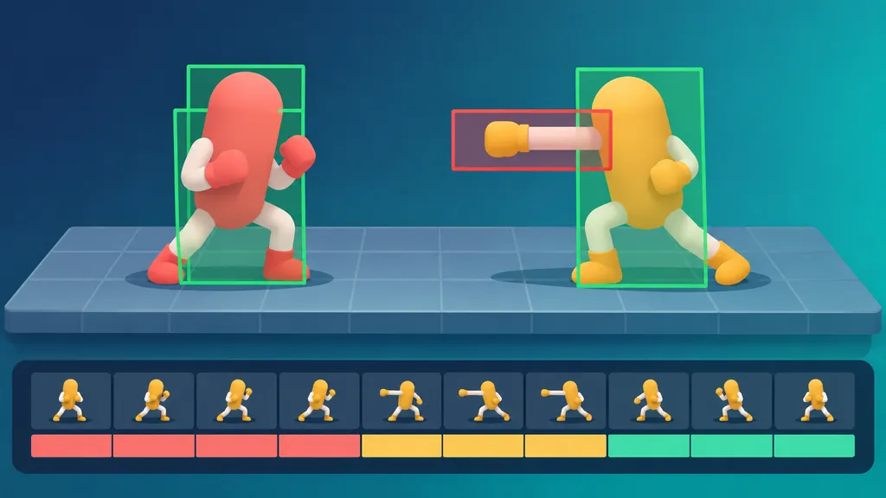

Fighting game engine and toolkit for Godot with its own character scripting and frame-data tools.

**License:** [MPL-2.0](https://github.com/panthavma/castagne)

*illustration*

### [gdquest-demos/godot-2d-jrpg-combat](https://github.com/gdquest-demos/godot-2d-jrpg-combat)

[View at source](https://github.com/gdquest-demos/godot-2d-jrpg-combat)

2D JRPG active-time-battle demo for Godot, showing turn order, skills and UI.

**License:** [MIT (code) / CC-BY-4.0 (art)](https://github.com/gdquest-demos/godot-2d-jrpg-combat)

### [gdquest-demos/godot-open-rpg](https://github.com/gdquest-demos/godot-open-rpg)

[View at source](https://github.com/gdquest-demos/godot-open-rpg)

Open-source Godot RPG demo for learning turn-based combat, inventory and dialogue.

**License:** [MIT](https://github.com/gdquest-demos/godot-open-rpg)

### [PhysaliaStudio/Flexi](https://github.com/PhysaliaStudio/Flexi)

[View at source](https://github.com/PhysaliaStudio/Flexi)

Unity gameplay ability framework with a node-graph editor for skills and effects.

**License:** [MIT](https://github.com/PhysaliaStudio/Flexi)

### [Relintai/entity_spell_system](https://github.com/Relintai/entity_spell_system)

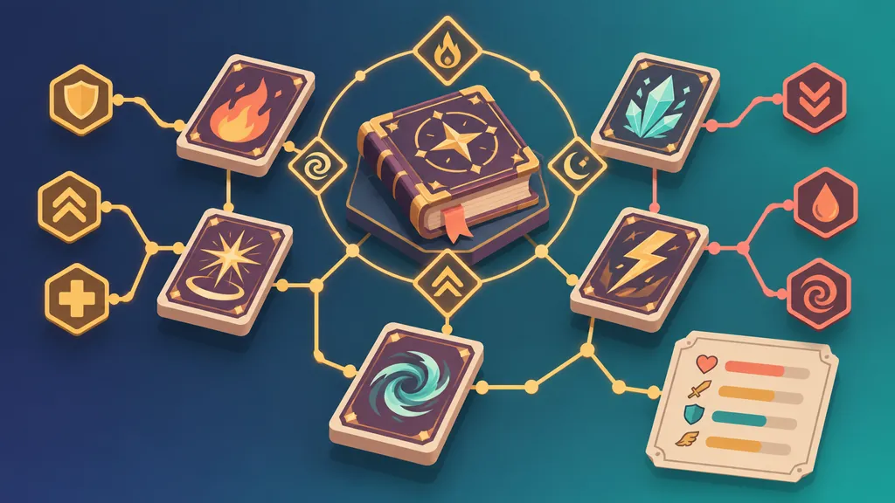

C++ Godot module for entities, spells, auras and stats in complex (optionally multiplayer) RPGs.

**License:** [MIT](https://github.com/Relintai/entity_spell_system)

*illustration* listed in [Calinou/awesome-godot](https://github.com/Calinou/awesome-godot)

### [homemech/unity-pattern-combo](https://github.com/homemech/unity-pattern-combo)

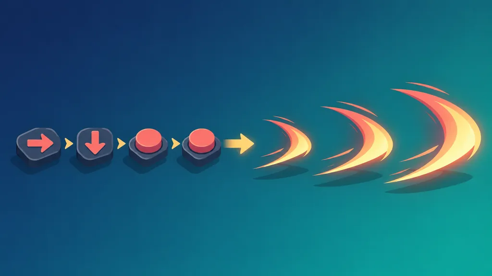

Unity example of an action/fighting-game combo system built with the command pattern.

**License:** [MIT](https://github.com/homemech/unity-pattern-combo)

*illustration*

## Animation & Motion Capture

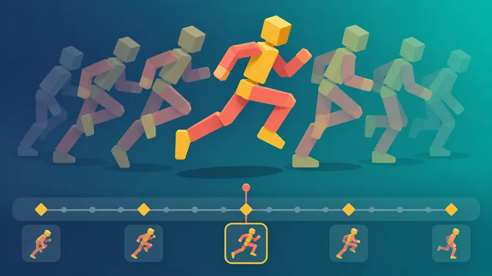

### [Quaternius Universal Animation Library](https://quaternius.com/packs/universalanimationlibrary.html)

[View at source](https://quaternius.com/packs/universalanimationlibrary.html)

120+ humanoid animations (locomotion, combat, emotes) on a universal rig, ready to retarget in Unity, Unreal and Godot.

**License:** [CC0-1.0](https://quaternius.com/packs/universalanimationlibrary.html)

### [Kenney Animated Characters](https://kenney.nl/assets/animated-characters-1)

[View at source](https://kenney.nl/assets/animated-characters-1)

Rigged, animated low-poly characters for quick 3D prototypes.

**License:** [CC0-1.0](https://kenney.nl/assets/animated-characters-1)

### [synfig/synfig](https://github.com/synfig/synfig)

[View at source](https://www.synfig.org/)

2D vector and bone animation software for cutscenes and character animation.

**License:** [GPL-3.0](https://github.com/synfig/synfig)

listed in [Calinou/awesome-gamedev](https://github.com/Calinou/awesome-gamedev)

### [piskelapp/piskel](https://github.com/piskelapp/piskel)

[View at source](https://www.piskelapp.com/)

Web-based sprite editor for frame-by-frame pixel animation, exports GIF and spritesheets.

**License:** [Apache-2.0](https://github.com/piskelapp/piskel)

listed in [Calinou/awesome-gamedev](https://github.com/Calinou/awesome-gamedev)

### [BandaiNamcoResearchInc/Bandai-Namco-Research-Motiondataset](https://github.com/BandaiNamcoResearchInc/Bandai-Namco-Research-Motiondataset)

[View at source](https://github.com/BandaiNamcoResearchInc/Bandai-Namco-Research-Motiondataset)

Motion-capture datasets with many styles of walking, fighting and gestures; non-commercial use only.

**License:** [CC-BY-NC-4.0 (datasets) / MIT (scripts)](https://github.com/BandaiNamcoResearchInc/Bandai-Namco-Research-Motiondataset#license)

### [DragonBones/DragonBonesJS](https://github.com/DragonBones/DragonBonesJS)

[View at source](https://github.com/DragonBones/DragonBonesJS)

JavaScript runtimes for DragonBones 2D skeletal animation (Pixi, Phaser, Egret and more).

**License:** [MIT](https://github.com/DragonBones/DragonBonesJS)

### [guillaumeblanc/ozz-animation](https://github.com/guillaumeblanc/ozz-animation)

[View at source](https://github.com/guillaumeblanc/ozz-animation)

C++ skeletal animation library and toolset: sampling, blending, IK and an FBX/glTF import pipeline.

**License:** [MIT](https://github.com/guillaumeblanc/ozz-animation)

### [nfrechette/acl](https://github.com/nfrechette/acl)

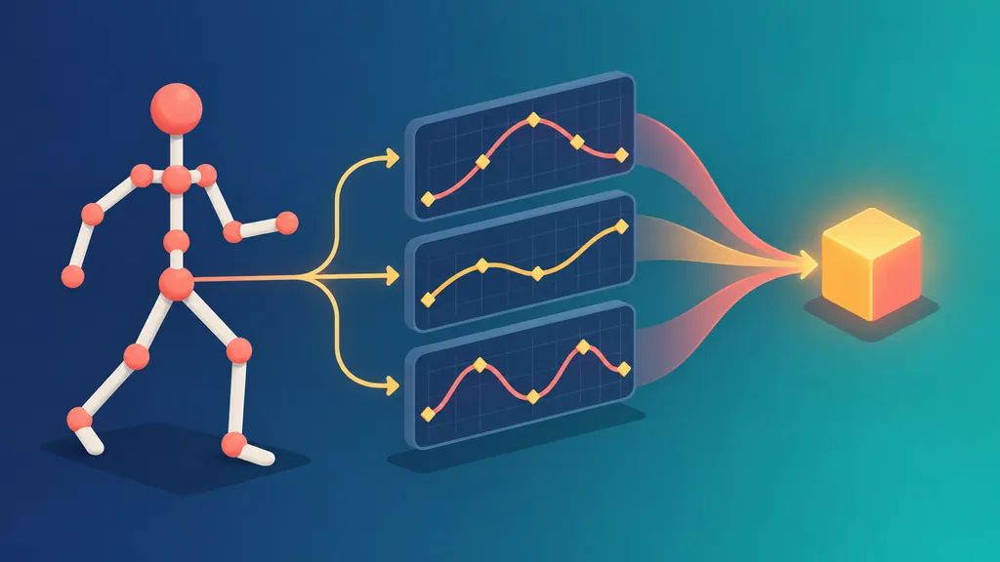

Animation Compression Library: fast, high-accuracy compression and decompression of skeletal animation clips.

**License:** [MIT](https://github.com/nfrechette/acl)

*illustration*

### [Rokoko/rokoko-studio-live-blender](https://github.com/Rokoko/rokoko-studio-live-blender)

[View at source](https://github.com/Rokoko/rokoko-studio-live-blender)

Blender add-on that streams live mocap from Rokoko Studio and retargets it onto your rigs.

**License:** [LGPL-3.0](https://github.com/Rokoko/rokoko-studio-live-blender)

### [enziop/mixamo_converter](https://github.com/enziop/mixamo_converter)

Blender add-on that converts Mixamo animations to root motion for Unreal-style pipelines.

**License:** [GPL-3.0](https://github.com/enziop/mixamo_converter)

*illustration*

### [freemocap/freemocap](https://github.com/freemocap/freemocap)

[View at source](https://github.com/freemocap/freemocap)

Markerless motion capture from ordinary webcams, with export to Blender and other formats.

**License:** [AGPL-3.0](https://github.com/freemocap/freemocap)

### [emilianavt/OpenSeeFace](https://github.com/emilianavt/OpenSeeFace)

[View at source](https://github.com/emilianavt/OpenSeeFace)

Real-time face and facial-landmark tracking on the CPU, with Unity integration for avatar puppeteering.

**License:** [BSD-2-Clause](https://github.com/emilianavt/OpenSeeFace)

### [google-ai-edge/mediapipe](https://github.com/google-ai-edge/mediapipe)

[View at source](https://github.com/google-ai-edge/mediapipe)

Cross-platform ML solutions for pose, hand and face tracking that can drive characters or prototype mocap.

**License:** [Apache-2.0](https://github.com/google-ai-edge/mediapipe)

### [ubisoft/ubisoft-laforge-animation-dataset](https://github.com/ubisoft/ubisoft-laforge-animation-dataset)

[View at source](https://github.com/ubisoft/ubisoft-laforge-animation-dataset)

Ubisoft La Forge LAFAN1 motion-capture dataset (BVH) for animation research; non-commercial, no derivatives.

**License:** [CC-BY-NC-ND-4.0](https://github.com/ubisoft/ubisoft-laforge-animation-dataset)

### [Inochi2D/inochi2d](https://github.com/Inochi2D/inochi2d)

[View at source](https://github.com/Inochi2D/inochi2d)

Open 2D puppet animation SDK for realtime rigged characters (VTuber-style), with its own editor.

**License:** [BSD-2-Clause](https://github.com/Inochi2D/inochi2d)

### [Samsung/rlottie](https://github.com/Samsung/rlottie)

[View at source](https://github.com/Samsung/rlottie)

Standalone C++ library that plays Lottie vector animations; useful for UI motion in games.

**License:** [MIT (some bundled parts under other licenses)](https://github.com/Samsung/rlottie)

### [rive-app/rive-runtime](https://github.com/rive-app/rive-runtime)

[View at source](https://github.com/rive-app/rive-runtime)

Low-level C++ runtime and renderer for Rive interactive animations and state machines.

**License:** [MIT](https://github.com/rive-app/rive-runtime)

### [mobius3/tweeny](https://github.com/mobius3/tweeny)

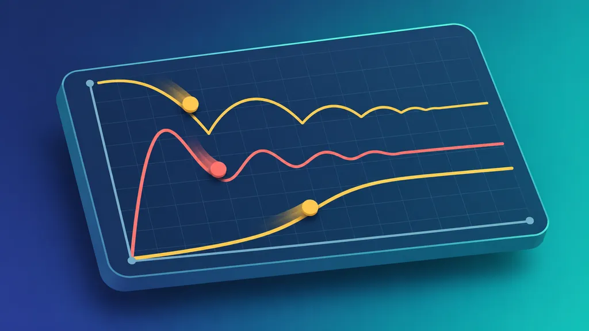

Modern header-only C++ tweening library with easing functions and multi-point tweens.

**License:** [MIT](https://github.com/mobius3/tweeny)

*illustration*

### [Wasserwecken/bvhio](https://github.com/Wasserwecken/bvhio)

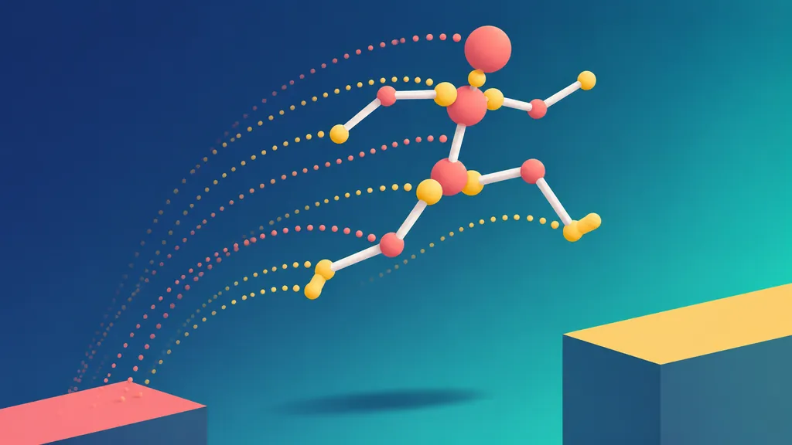

Python library to read, write, edit and create BVH motion files with hierarchical transforms.

**License:** [MIT](https://github.com/Wasserwecken/bvhio)

*illustration*

### [eth-ait/aitviewer](https://github.com/eth-ait/aitviewer)

[View at source](https://github.com/eth-ait/aitviewer)

Python viewer to visualize and interact with sequences of 3D data such as SMPL bodies and mocap.

**License:** [MIT](https://github.com/eth-ait/aitviewer)

### [xbpeng/DeepMimic](https://github.com/xbpeng/DeepMimic)

[View at source](https://github.com/xbpeng/DeepMimic)

Research code for physics-based characters that learn skills by imitating mocap clips with deep RL.

**License:** [MIT](https://github.com/xbpeng/DeepMimic)

### [orangeduck/Motion-Matching](https://github.com/orangeduck/Motion-Matching)

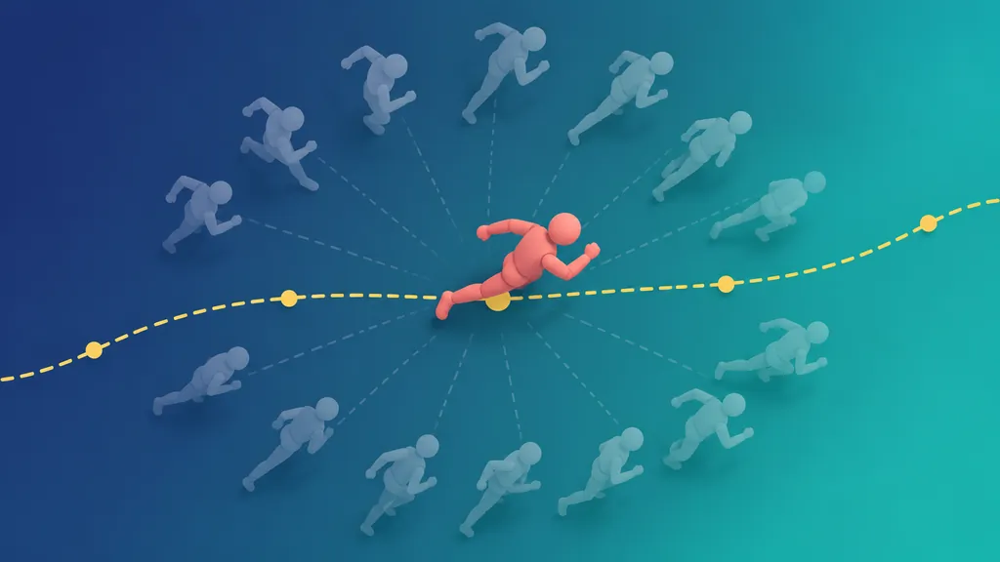

Example implementation of motion matching and learned motion matching for responsive character locomotion.

**License:** [MIT](https://github.com/orangeduck/Motion-Matching)

*illustration*

### [KayKit Character Animations (legacy)](https://kaylousberg.itch.io/kaykit-animations)

[View at source](https://kaylousberg.itch.io/kaykit-animations)

Legacy animation set for older KayKit low-poly characters: idle, walk, run, jump, climb, attacks and more; no longer updated.

**License:** [CC0-1.0](https://kaylousberg.itch.io/kaykit-animations)

### [Blender Studio — Rain rig](https://studio.blender.org/characters/rain/v3/)

[View at source](https://studio.blender.org/characters/rain/v3/)

Rain: free character rig from Blender Studio for learning and practicing animation.

**License:** [CC-BY (credit required)](https://studio.blender.org/characters/rain/v3/)

### [Blender Studio — Snow rig](https://studio.blender.org/characters/snow/v4/)

[View at source](https://studio.blender.org/characters/snow/v4/)

Snow: free character rig from Blender Studio for learning and practicing animation.

**License:** [CC-BY (credit required)](https://studio.blender.org/characters/snow/v4/)

### [Blender Studio — Vincent rig](https://studio.blender.org/characters/vincent/v2/)

[View at source](https://studio.blender.org/characters/vincent/v2/)

Vincent: cartoon character rig from Blender Studio for animation practice.

**License:** [CC-BY (credit required)](https://studio.blender.org/characters/vincent/v2/)

## Physics

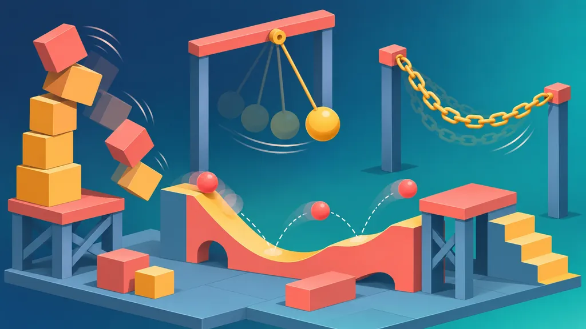

### [erincatto/box2d](https://github.com/erincatto/box2d)

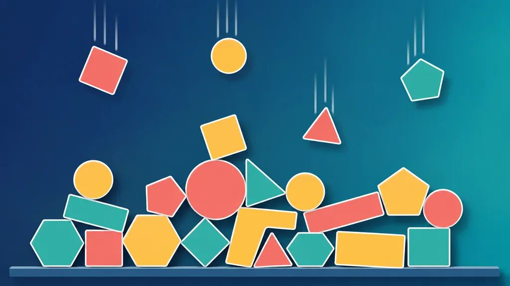

Widely used 2D rigid-body physics engine in C.

**License:** [MIT](https://github.com/erincatto/box2d)

*illustration*

### [jrouwe/JoltPhysics](https://github.com/jrouwe/JoltPhysics)

[View at source](https://github.com/jrouwe/JoltPhysics)

Fast multi-threaded 3D rigid-body physics engine for games and VR.

**License:** [MIT](https://github.com/jrouwe/JoltPhysics)

### [bulletphysics/bullet3](https://github.com/bulletphysics/bullet3)

[View at source](https://github.com/bulletphysics/bullet3)

Mature 3D physics SDK for collision detection, rigid and soft bodies.

**License:** [Zlib (except Extras and third-party libs)](https://github.com/bulletphysics/bullet3)

### [dimforge/rapier](https://github.com/dimforge/rapier)

[View at source](https://github.com/dimforge/rapier)

2D and 3D physics engine in Rust, also available for JavaScript via WASM.

**License:** [Apache-2.0](https://github.com/dimforge/rapier)

### [pmndrs/cannon-es](https://github.com/pmndrs/cannon-es)

[View at source](https://github.com/pmndrs/cannon-es)

Lightweight 3D physics engine for the web, often paired with three.js.

**License:** [MIT](https://github.com/pmndrs/cannon-es)

### [liabru/matter-js](https://github.com/liabru/matter-js)

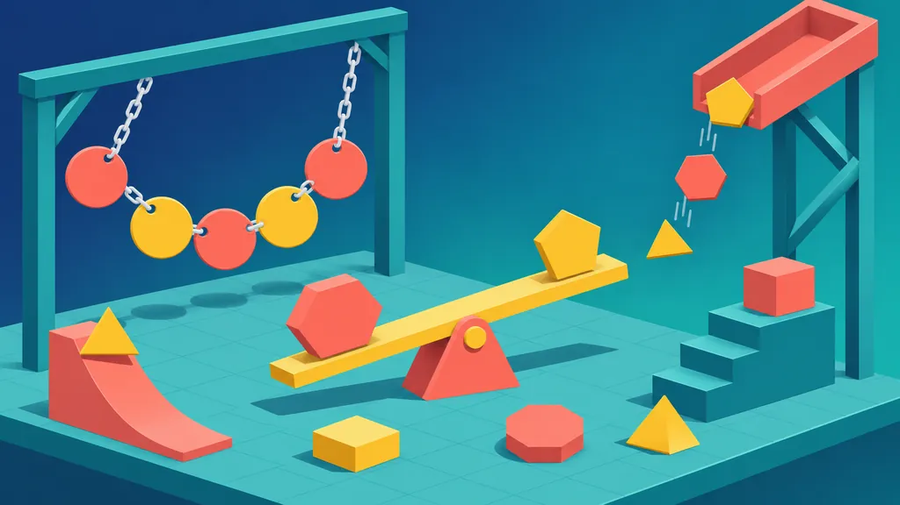

2D rigid-body physics engine for the web with a simple API.

**License:** [MIT](https://github.com/liabru/matter-js)

*illustration*

### [NVIDIA-Omniverse/PhysX](https://github.com/NVIDIA-Omniverse/PhysX)

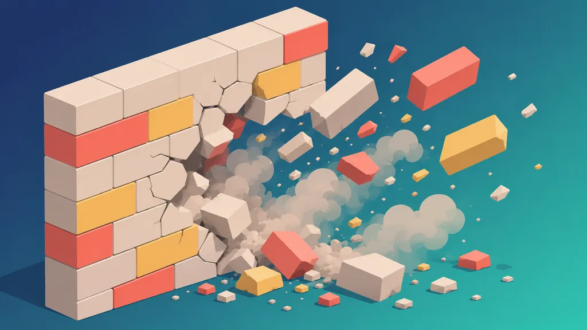

NVIDIA PhysX SDK, the 3D physics engine behind many commercial engines.

**License:** [BSD-3-Clause](https://github.com/NVIDIA-Omniverse/PhysX)

*illustration*

### [slembcke/Chipmunk2D](https://github.com/slembcke/Chipmunk2D)

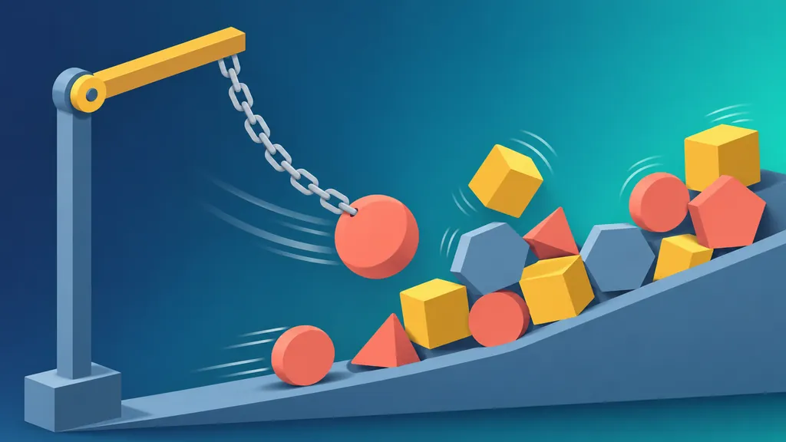

Fast, lightweight 2D rigid-body physics library in C.

**License:** [MIT](https://github.com/slembcke/Chipmunk2D)

*illustration* listed in [ellisonleao/magictools](https://github.com/ellisonleao/magictools)

### [piqnt/planck.js](https://github.com/piqnt/planck.js)

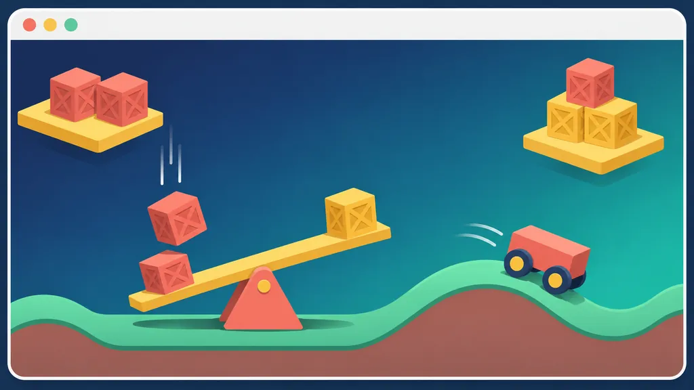

JavaScript/TypeScript rewrite of Box2D for 2D physics in browser games.

**License:** [MIT](https://github.com/piqnt/planck.js)

*illustration*

### [bepu/bepuphysics2](https://github.com/bepu/bepuphysics2)

[View at source](https://github.com/bepu/bepuphysics2)

Pure C# real-time 3D physics library built for speed.

**License:** [Apache-2.0](https://github.com/bepu/bepuphysics2)

### [DanielChappuis/reactphysics3d](https://github.com/DanielChappuis/reactphysics3d)

[View at source](https://github.com/DanielChappuis/reactphysics3d)

C++ 3D physics engine for games: rigid bodies, joints and collision detection.

**License:** [Zlib](https://github.com/DanielChappuis/reactphysics3d)

### [InteractiveComputerGraphics/PositionBasedDynamics](https://github.com/InteractiveComputerGraphics/PositionBasedDynamics)

[View at source](https://github.com/InteractiveComputerGraphics/PositionBasedDynamics)

C++ library for position-based simulation of rigid bodies, cloth, soft bodies and fluids.

**License:** [MIT](https://github.com/InteractiveComputerGraphics/PositionBasedDynamics)

### [notgiven688/jitterphysics2](https://github.com/notgiven688/jitterphysics2)

[View at source](https://github.com/notgiven688/jitterphysics2)

Fast, dependency-free 3D physics engine in C#.

**License:** [MIT](https://github.com/notgiven688/jitterphysics2)

### [dyn4j/dyn4j](https://github.com/dyn4j/dyn4j)

[View at source](https://github.com/dyn4j/dyn4j)

Java 2D collision detection and physics engine.

**License:** [BSD-3-Clause](https://github.com/dyn4j/dyn4j)

### [schteppe/p2.js](https://github.com/schteppe/p2.js)

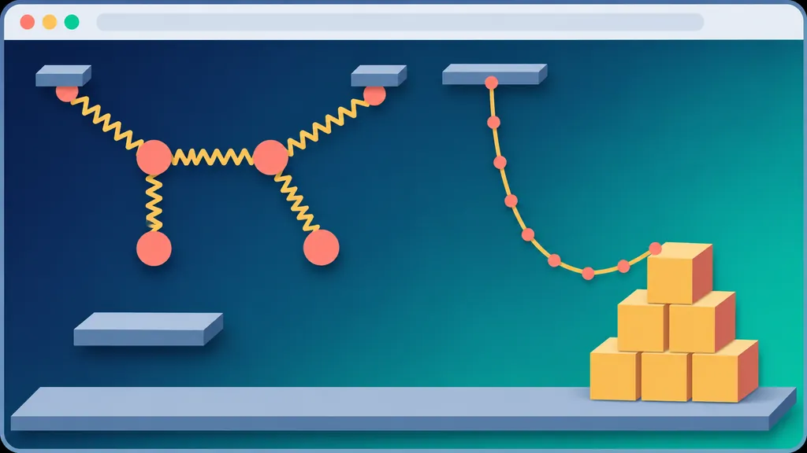

JavaScript 2D physics library with springs, constraints and a demo playground.

**License:** [MIT](https://github.com/schteppe/p2.js)

*illustration*

### [saharan/OimoPhysics](https://github.com/saharan/OimoPhysics)

[View at source](https://github.com/saharan/OimoPhysics)

Lightweight cross-platform 3D physics engine written in Haxe, with a JavaScript build.

**License:** [MIT](https://github.com/saharan/OimoPhysics)

### [InteractiveComputerGraphics/SPlisHSPlasH](https://github.com/InteractiveComputerGraphics/SPlisHSPlasH)

[View at source](https://github.com/InteractiveComputerGraphics/SPlisHSPlasH)

Open-source SPH fluid simulation library, good for baking water and liquid effects.

**License:** [MIT](https://github.com/InteractiveComputerGraphics/SPlisHSPlasH)

### [lo-th/phy](https://github.com/lo-th/phy)

[View at source](https://github.com/lo-th/phy)

Physics layer for three.js that wraps several engines (Oimo, Ammo, Rapier, Jolt, Havok, PhysX) behind one API.

**License:** [MIT](https://github.com/lo-th/phy)

### [anuraghazra/Verly.js](https://github.com/anuraghazra/Verly.js)

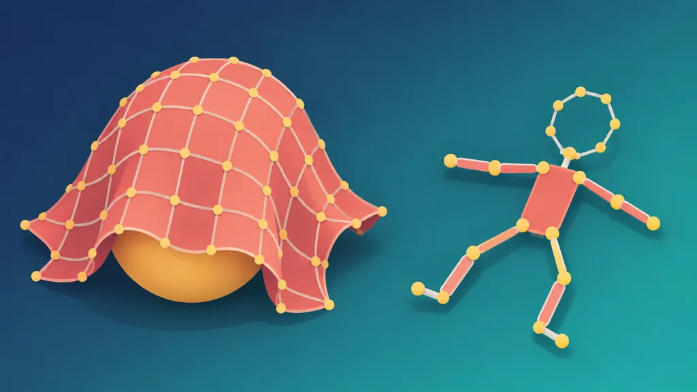

Easy-to-integrate Verlet physics for ropes, cloth and ragdolls in JavaScript.

**License:** [MIT](https://github.com/anuraghazra/Verly.js)

*illustration*

### [projectchrono/chrono](https://github.com/projectchrono/chrono)

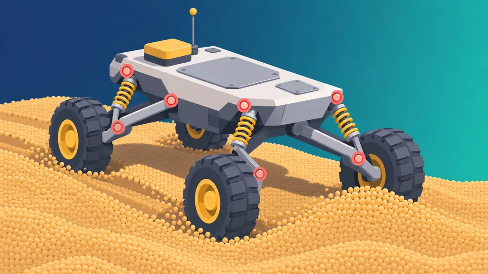

C++ multiphysics and multibody dynamics library for vehicles, granular terrain and robotics.

**License:** [BSD-3-Clause](https://github.com/projectchrono/chrono)

*illustration*

### [google-deepmind/mujoco](https://github.com/google-deepmind/mujoco)

[View at source](https://github.com/google-deepmind/mujoco)

General-purpose physics simulator for articulated bodies with contact, widely used for robotics and character control.

**License:** [Apache-2.0](https://github.com/google-deepmind/mujoco)

## Game AI & Pathfinding

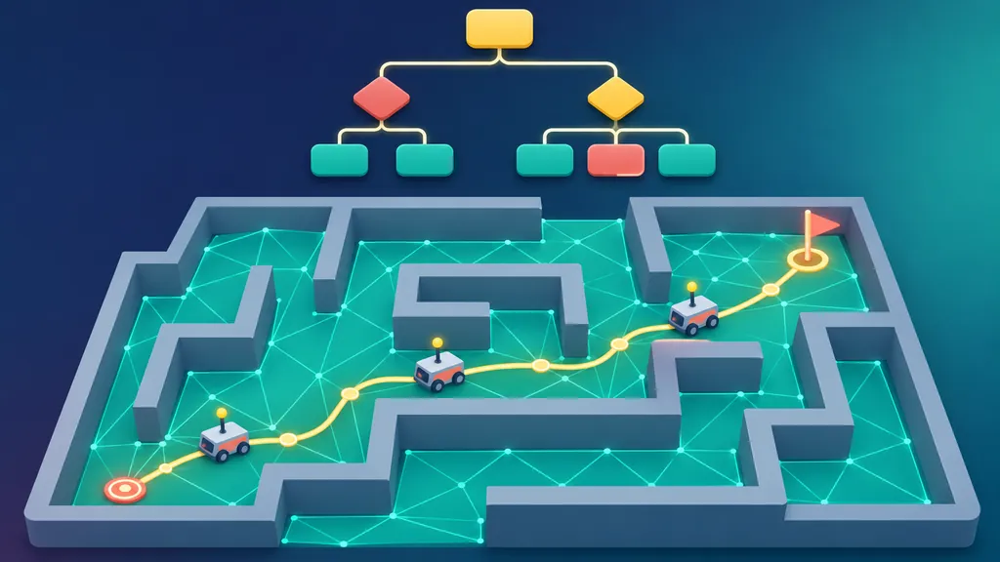

### [recastnavigation/recastnavigation](https://github.com/recastnavigation/recastnavigation)

[View at source](https://github.com/recastnavigation/recastnavigation)

Navmesh generation (Recast) and pathfinding / crowd simulation (Detour) for 3D games.

**License:** [Zlib](https://github.com/recastnavigation/recastnavigation)

### [qiao/PathFinding.js](https://github.com/qiao/PathFinding.js)

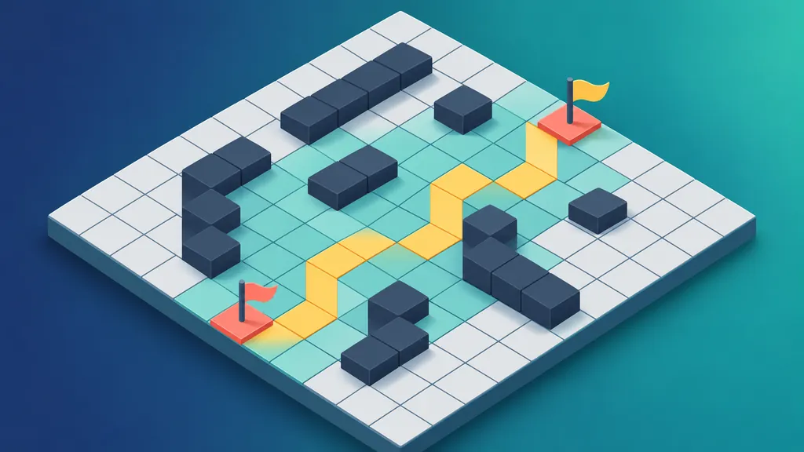

Grid pathfinding library for JavaScript (A*, Dijkstra, JPS) with an online visualizer.

**License:** [MIT (stated in README)](https://github.com/qiao/PathFinding.js#license)

*illustration*

### [BehaviorTree/BehaviorTree.CPP](https://github.com/BehaviorTree/BehaviorTree.CPP)

[View at source](https://github.com/BehaviorTree/BehaviorTree.CPP)

C++ behavior tree library with XML trees and the Groot visual editor.

**License:** [MIT](https://github.com/BehaviorTree/BehaviorTree.CPP)

### [Mugen87/yuka](https://github.com/Mugen87/yuka)

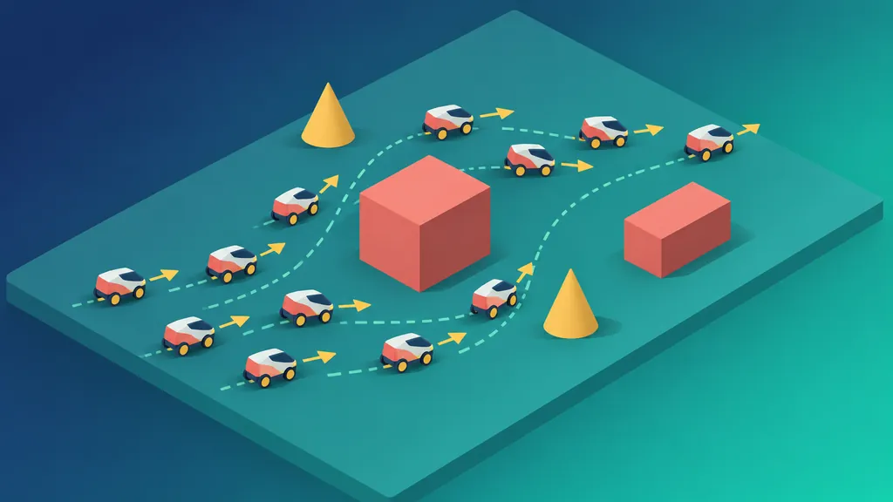

JavaScript game AI library: steering, state machines, goals, navmesh and perception.

**License:** [MIT](https://github.com/Mugen87/yuka)

*illustration*

### [limbonaut/limboai](https://github.com/limbonaut/limboai)

[View at source](https://github.com/limbonaut/limboai)

Behavior trees and state machines for Godot 4 with a visual editor and debugger.

**License:** [MIT](https://github.com/limbonaut/limboai)

### [bitbrain/beehave](https://github.com/bitbrain/beehave)

[View at source](https://github.com/bitbrain/beehave)

Behavior tree addon for Godot with a debug view for NPC logic.

**License:** [MIT](https://github.com/bitbrain/beehave)

### [donmccurdy/three-pathfinding](https://github.com/donmccurdy/three-pathfinding)

[View at source](https://github.com/donmccurdy/three-pathfinding)

Navmesh pathfinding for three.js scenes.

**License:** [MIT](https://github.com/donmccurdy/three-pathfinding)

### [Unity-Technologies/ml-agents](https://github.com/Unity-Technologies/ml-agents)

[View at source](https://unity.com/products/machine-learning-agents)

Toolkit that uses Unity games and simulations as environments to train agents with reinforcement and imitation learning.

**License:** [Apache-2.0](https://github.com/Unity-Technologies/ml-agents)

### [MineDojo/Voyager](https://github.com/MineDojo/Voyager)

[View at source](https://github.com/MineDojo/Voyager)

Research agent that uses an LLM to explore, write skills and keep learning in an open-world sandbox game.

**License:** [MIT](https://github.com/MineDojo/Voyager)

### [libgdx/gdx-ai](https://github.com/libgdx/gdx-ai)

[View at source](https://github.com/libgdx/gdx-ai)

Game AI framework for libGDX: steering behaviors, state machines, behavior trees, pathfinding and messaging.

**License:** [Apache-2.0](https://github.com/libgdx/gdx-ai)

### [Yonaba/Jumper](https://github.com/Yonaba/Jumper)

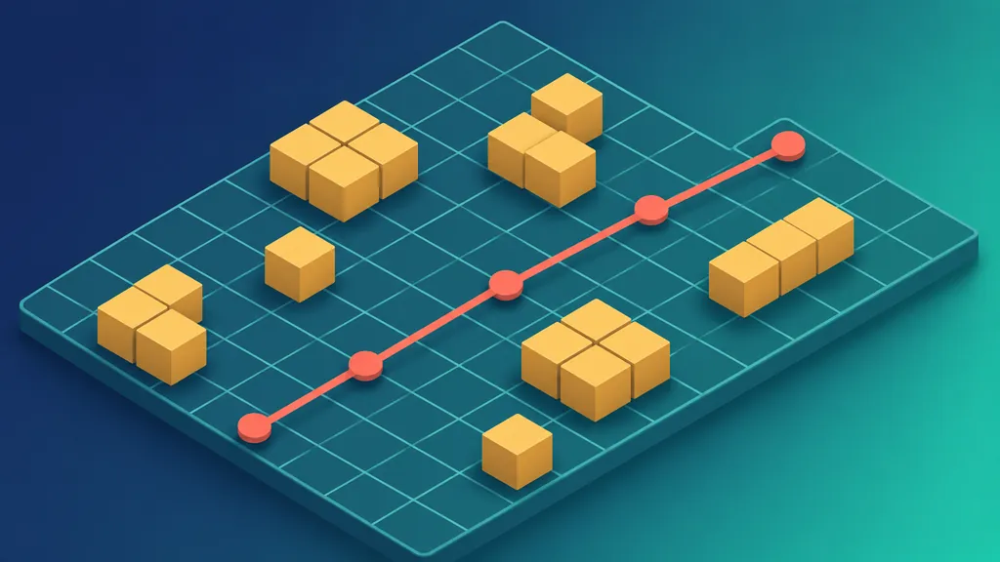

Fast grid pathfinding library for Lua (LÖVE etc.) with A*, Jump Point Search and other finders.

**License:** [MIT](https://github.com/Yonaba/Jumper)

*illustration*

### [igiagkiozis/CrystalAI](https://github.com/igiagkiozis/CrystalAI)

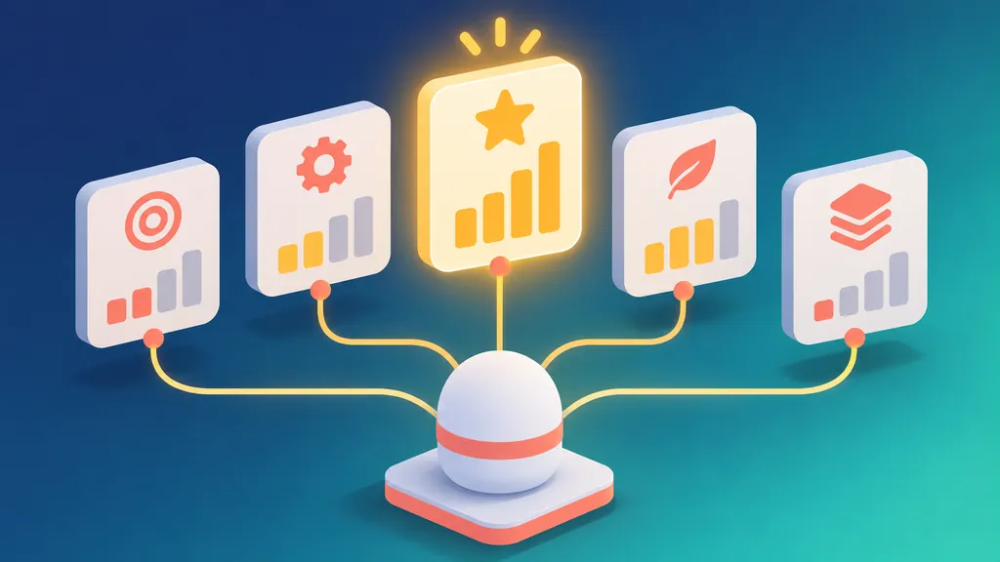

Utility-based AI framework in C# that scores options to pick agent actions.

**License:** [MIT](https://github.com/igiagkiozis/CrystalAI)

*illustration*

### [Sollimann/bonsai](https://github.com/Sollimann/bonsai)

[View at source](https://github.com/Sollimann/bonsai)

Behavior tree library for Rust with a visualizer, usable in games and robotics.

**License:** [MIT](https://github.com/Sollimann/bonsai)

## Procedural Generation

### [mxgmn/WaveFunctionCollapse](https://github.com/mxgmn/WaveFunctionCollapse)

[View at source](https://github.com/mxgmn/WaveFunctionCollapse)

The original Wave Function Collapse algorithm for generating tile maps and textures from examples.

**License:** [MIT](https://github.com/mxgmn/WaveFunctionCollapse)

### [BorisTheBrave/DeBroglie](https://github.com/BorisTheBrave/DeBroglie)

C# constraint-based procedural generation library (WFC and more) with many tile constraints.

**License:** [MIT](https://github.com/BorisTheBrave/DeBroglie)

*illustration*

### [Auburn/FastNoiseLite](https://github.com/Auburn/FastNoiseLite)

[View at source](https://github.com/Auburn/FastNoiseLite)

Portable noise library (Perlin, Simplex, Cellular) in many languages for terrain and textures.

**License:** [MIT](https://github.com/Auburn/FastNoiseLite)

### [AlexeyBond/godot-constraint-solving](https://github.com/AlexeyBond/godot-constraint-solving)

[View at source](https://github.com/AlexeyBond/godot-constraint-solving)

Wave Function Collapse addon for Godot 4 tile maps and grid maps.

**License:** [MIT](https://github.com/AlexeyBond/godot-constraint-solving)

### [a1studmuffin/SpaceshipGenerator](https://github.com/a1studmuffin/SpaceshipGenerator)

[View at source](https://github.com/a1studmuffin/SpaceshipGenerator)

Blender script that generates textured 3D spaceships from a random seed (older, last updated 2024).

**License:** [MIT](https://github.com/a1studmuffin/SpaceshipGenerator)

### [Auburn/FastNoise2](https://github.com/Auburn/FastNoise2)

[View at source](https://github.com/Auburn/FastNoise2)

SIMD noise generation library with a node-graph editor for building complex noise.

**License:** [MIT](https://github.com/Auburn/FastNoise2)

### [marian42/wavefunctioncollapse](https://github.com/marian42/wavefunctioncollapse)

[View at source](https://github.com/marian42/wavefunctioncollapse)

Unity project that generates an infinite walkable city with wave function collapse.

**License:** [MIT](https://github.com/marian42/wavefunctioncollapse)

### [mxgmn/MarkovJunior](https://github.com/mxgmn/MarkovJunior)

[View at source](https://github.com/mxgmn/MarkovJunior)

Probabilistic rewrite-rule language for generating levels, mazes and 3D structures, with 150+ examples.

**License:** [MIT](https://github.com/mxgmn/MarkovJunior)

### [OndrejNepozitek/Edgar-DotNet](https://github.com/OndrejNepozitek/Edgar-DotNet)

[View at source](https://github.com/OndrejNepozitek/Edgar-DotNet)

Graph-based procedural layout generator for dungeons with hand-made room templates.

**License:** [MIT](https://github.com/OndrejNepozitek/Edgar-DotNet)

### [ondras/rot.js](https://github.com/ondras/rot.js)

[View at source](https://github.com/ondras/rot.js)

Roguelike toolkit in JavaScript: map generators, FOV, pathfinding and a terminal display.

**License:** [BSD-3-Clause](https://github.com/ondras/rot.js)

### [libtcod/libtcod](https://github.com/libtcod/libtcod)

C/C++ toolkit for roguelikes: field of view, pathfinding, map generation and a tile terminal.

**License:** [BSD-3-Clause](https://github.com/libtcod/libtcod)

*illustration*

### [Syomus/ProceduralToolkit](https://github.com/Syomus/ProceduralToolkit)

Procedural generation library for Unity with mesh builders, noise and example generators.

**License:** [MIT](https://github.com/Syomus/ProceduralToolkit)

*illustration*

### [Azgaar/Fantasy-Map-Generator](https://github.com/Azgaar/Fantasy-Map-Generator)

[View at source](https://github.com/Azgaar/Fantasy-Map-Generator)

Web app that generates detailed, editable fantasy world maps with states, rivers and cultures.

**License:** [MIT](https://github.com/Azgaar/Fantasy-Map-Generator)

### [Zylann/godot_voxel](https://github.com/Zylann/godot_voxel)

[View at source](https://github.com/Zylann/godot_voxel)

Voxel terrain module for Godot with blocky and smooth terrain, LOD and procedural generation.

**License:** [MIT](https://github.com/Zylann/godot_voxel)

### [Zylann/godot_heightmap_plugin](https://github.com/Zylann/godot_heightmap_plugin)

[View at source](https://github.com/Zylann/godot_heightmap_plugin)

Heightmap terrain plugin for Godot with sculpting, texture painting and a generator.

**License:** [MIT](https://github.com/Zylann/godot_heightmap_plugin)

### [Mindwerks/worldengine](https://github.com/Mindwerks/worldengine)

[View at source](https://github.com/Mindwerks/worldengine)

World generator that simulates plate tectonics, rain shadow and erosion.

**License:** [MIT](https://github.com/Mindwerks/worldengine)

### [redblobgames/mapgen4](https://github.com/redblobgames/mapgen4)

[View at source](https://www.redblobgames.com/maps/mapgen4/)

Interactive procedural wilderness map generator by Red Blob Games.

**License:** [Apache-2.0](https://github.com/redblobgames/mapgen4)

### [SebLague/Hydraulic-Erosion](https://github.com/SebLague/Hydraulic-Erosion)

[View at source](https://github.com/SebLague/Hydraulic-Erosion)

Unity example of hydraulic erosion simulation on procedural terrain.

**License:** [MIT](https://github.com/SebLague/Hydraulic-Erosion)

### [SebLague/Procedural-Landmass-Generation](https://github.com/SebLague/Procedural-Landmass-Generation)

Unity project for noise-based endless terrain with LOD, from a well-known tutorial series.

**License:** [MIT](https://github.com/SebLague/Procedural-Landmass-Generation)

*illustration*

### [vazgriz/DungeonGenerator](https://github.com/vazgriz/DungeonGenerator)

[View at source](https://github.com/vazgriz/DungeonGenerator)

Unity dungeon generator using Delaunay triangulation and A* corridors in 2D and 3D.

**License:** [MIT](https://github.com/vazgriz/DungeonGenerator)

### [math-fehr/fast-wfc](https://github.com/math-fehr/fast-wfc)

Performance-focused C++ implementation of wave function collapse.

**License:** [MIT](https://github.com/math-fehr/fast-wfc)

*illustration*

## Engines & Frameworks

### [godotengine/godot](https://github.com/godotengine/godot)

[View at source](https://github.com/godotengine/godot)

Free open-source 2D and 3D game engine with its own editor and GDScript/C#.

**License:** [MIT](https://github.com/godotengine/godot)

### [bevyengine/bevy](https://github.com/bevyengine/bevy)

Data-driven game engine in Rust built on an ECS.

**License:** [Apache-2.0 or MIT](https://github.com/bevyengine/bevy)

*illustration*

### [defold/defold](https://github.com/defold/defold)

[View at source](https://github.com/defold/defold)

Lightweight engine for 2D/3D games with Lua scripting and one-click multi-platform builds.

**License:** [Defold License 1.0 (Apache-2.0 based)](https://github.com/defold/defold)

### [raysan5/raylib](https://github.com/raysan5/raylib)

[View at source](https://github.com/raysan5/raylib)

Simple C library for learning and making games, with bindings for 60+ languages.

**License:** [Zlib](https://github.com/raysan5/raylib)

### [love2d/love](https://github.com/love2d/love)

LÖVE, a 2D game framework in Lua.

**License:** [Zlib](https://github.com/love2d/love)

*illustration*

### [phaserjs/phaser](https://github.com/phaserjs/phaser)

[View at source](https://github.com/phaserjs/phaser)

HTML5 2D game framework for desktop and mobile browsers.

**License:** [MIT](https://github.com/phaserjs/phaser)

### [mrdoob/three.js](https://github.com/mrdoob/three.js)

[View at source](https://threejs.org/)

JavaScript 3D library (WebGL/WebGPU) behind most 3D web games and demos.

**License:** [MIT](https://github.com/mrdoob/three.js)

### [BabylonJS/Babylon.js](https://github.com/BabylonJS/Babylon.js)

[View at source](https://github.com/BabylonJS/Babylon.js)

Full-featured web 3D game and rendering engine with a playground and editor.

**License:** [Apache-2.0](https://github.com/BabylonJS/Babylon.js)

### [o3de/o3de](https://github.com/o3de/o3de)

[View at source](https://o3de.org)

Open 3D Engine, a modular AAA-grade 3D engine from the Linux Foundation.

**License:** [Apache-2.0 or MIT](https://github.com/o3de/o3de)

### [stride3d/stride](https://github.com/stride3d/stride)

[View at source](https://github.com/stride3d/stride)

C# 3D game engine with an editor, formerly Xenko.

**License:** [MIT](https://github.com/stride3d/stride)

### [MonoGame/MonoGame](https://github.com/MonoGame/MonoGame)

[View at source](https://github.com/MonoGame/MonoGame)

C# framework for cross-platform 2D/3D games (XNA successor).

**License:** [Ms-PL](https://github.com/MonoGame/MonoGame)

### [libgdx/libgdx](https://github.com/libgdx/libgdx)

[View at source](https://github.com/libgdx/libgdx)

Java game framework for desktop, Android, iOS and web.

**License:** [Apache-2.0](https://github.com/libgdx/libgdx)

### [excaliburjs/Excalibur](https://github.com/excaliburjs/Excalibur)

[View at source](https://github.com/excaliburjs/Excalibur)

TypeScript 2D game engine for the web.

**License:** [BSD-2-Clause](https://github.com/excaliburjs/Excalibur)

### [pixijs/pixijs](https://github.com/pixijs/pixijs)

[View at source](https://github.com/pixijs/pixijs)

Fast 2D WebGL/WebGPU renderer for web games and interactive graphics.

**License:** [MIT](https://github.com/pixijs/pixijs)

### [playcanvas/engine](https://github.com/playcanvas/engine)

[View at source](https://github.com/playcanvas/engine)

WebGL/WebGPU 3D game engine (runtime) for the web.

**License:** [MIT](https://github.com/playcanvas/engine)

### [kaplayjs/kaplay](https://github.com/kaplayjs/kaplay)

[View at source](https://github.com/kaplayjs/kaplay)

Beginner-friendly JavaScript game library (successor of Kaboom.js).

**License:** [MIT](https://github.com/kaplayjs/kaplay)

### [hajimehoshi/ebiten](https://github.com/hajimehoshi/ebiten)

[View at source](https://github.com/hajimehoshi/ebiten)

Ebitengine, a simple 2D game engine for Go.

**License:** [Apache-2.0](https://github.com/hajimehoshi/ebiten)

### [FyroxEngine/Fyrox](https://github.com/FyroxEngine/Fyrox)

[View at source](https://github.com/FyroxEngine/Fyrox)

3D and 2D game engine in Rust with a scene editor.

**License:** [MIT](https://github.com/FyroxEngine/Fyrox)

### [HeapsIO/heaps](https://github.com/HeapsIO/heaps)

[View at source](https://github.com/HeapsIO/heaps)

Cross-platform 2D/3D game engine for Haxe.

**License:** [MIT](https://github.com/HeapsIO/heaps)

### [panda3d/panda3d](https://github.com/panda3d/panda3d)

[View at source](https://github.com/panda3d/panda3d)

Mature open-source 3D engine for Python and C++, originally developed by Disney and CMU.

**License:** [BSD-3-Clause](https://github.com/panda3d/panda3d)

### [jMonkeyEngine/jmonkeyengine](https://github.com/jMonkeyEngine/jmonkeyengine)

[View at source](https://github.com/jMonkeyEngine/jmonkeyengine)

Complete 3D game development suite written in Java.

**License:** [BSD-3-Clause](https://github.com/jMonkeyEngine/jmonkeyengine)

### [pygame-community/pygame-ce](https://github.com/pygame-community/pygame-ce)

Community edition of pygame, a Python library on SDL for 2D games and multimedia.

**License:** [LGPL-2.1-or-later](https://github.com/pygame-community/pygame-ce#license)

*illustration*

### [flame-engine/flame](https://github.com/flame-engine/flame)

2D game engine built on Flutter, for mobile, desktop and web games in Dart.

**License:** [MIT](https://github.com/flame-engine/flame)

*illustration*

### [kitao/pyxel](https://github.com/kitao/pyxel)

[View at source](https://github.com/kitao/pyxel)

Retro game engine for Python with a fixed palette, built-in sprite, tilemap and sound editors.

**License:** [MIT](https://github.com/kitao/pyxel)

listed in [ellisonleao/magictools](https://github.com/ellisonleao/magictools)

### [HaxeFlixel/flixel](https://github.com/HaxeFlixel/flixel)

[View at source](https://github.com/HaxeFlixel/flixel)

Cross-platform 2D game engine powered by Haxe and OpenFL.

**License:** [MIT](https://github.com/HaxeFlixel/flixel)

### [coronalabs/corona](https://github.com/coronalabs/corona)

[View at source](https://github.com/coronalabs/corona)

Solar2D (formerly Corona SDK): Lua-based 2D engine for mobile and desktop games.

**License:** [MIT](https://github.com/coronalabs/corona)

### [not-fl3/macroquad](https://github.com/not-fl3/macroquad)

Simple cross-platform Rust game library that runs on desktop, mobile and the web.

**License:** [MIT OR Apache-2.0](https://github.com/not-fl3/macroquad)

*illustration*

### [turanszkij/WickedEngine](https://github.com/turanszkij/WickedEngine)

[View at source](https://github.com/turanszkij/WickedEngine)

C++ 3D engine with modern graphics features and an editor.

**License:** [MIT](https://github.com/turanszkij/WickedEngine)

### [liballeg/allegro5](https://github.com/liballeg/allegro5)

Long-running cross-platform C library for 2D games and multimedia.

**License:** [Zlib](https://github.com/liballeg/allegro5)

*illustration*

## Tools & Pipelines

### [Blender](https://www.blender.org/)

[View at source](https://github.com/blender/blender)

Free 3D suite for modeling, rigging, animation and baking game assets; your output is yours.

**License:** [GPL-3.0-or-later (binaries)](https://www.blender.org/about/license/)

⚠ official site returns 403 to automated checks; license verified manually

### [RodZill4/material-maker](https://github.com/RodZill4/material-maker)

[View at source](https://github.com/RodZill4/material-maker)

Node-based procedural texture and material authoring tool built on Godot.

**License:** [MIT](https://github.com/RodZill4/material-maker)

### [Orama-Interactive/Pixelorama](https://github.com/Orama-Interactive/Pixelorama)

[View at source](https://github.com/Orama-Interactive/Pixelorama)

Pixel art editor for sprites, tiles and frame animation; runs on desktop and web.

**License:** [MIT](https://github.com/Orama-Interactive/Pixelorama)

### [mapeditor/tiled](https://github.com/mapeditor/tiled)

Flexible tile map / level editor; exports TMX/JSON used by most 2D engines.

**License:** [GPL-2.0 (editor) / BSD-2-Clause (libtiled)](https://github.com/mapeditor/tiled/blob/master/COPYING)

*illustration*

### [deepnight/ldtk](https://github.com/deepnight/ldtk)

[View at source](https://ldtk.io/)

Modern, lightweight 2D level editor with auto-layer tiling and typed entity fields.

**License:** [MIT](https://github.com/deepnight/ldtk)

### [audacity/audacity](https://github.com/audacity/audacity)

[View at source](https://www.audacityteam.org/)

Audio editor for trimming, layering and cleaning up game sound effects.

**License:** [GPL-3.0](https://github.com/audacity/audacity/blob/master/LICENSE.txt)

### [LMMS/lmms](https://github.com/LMMS/lmms)

Free music production software (sequencer, synths, sampler) for game soundtracks and stingers.

**License:** [GPL-2.0](https://github.com/LMMS/lmms)

*illustration*

### [godotengine/godot-demo-projects](https://github.com/godotengine/godot-demo-projects)

Official Godot demo and template projects (2D, 3D, physics, UI) to learn from or start with.

**License:** [MIT](https://github.com/godotengine/godot-demo-projects)

*illustration*

### [KDE/krita](https://github.com/KDE/krita)

[View at source](https://krita.org/en/)

Digital painting app for concept art, textures and hand-drawn animation.

**License:** [GPL-3.0](https://github.com/KDE/krita)

listed in [Calinou/awesome-gamedev](https://github.com/Calinou/awesome-gamedev)

### [LibreSprite/LibreSprite](https://github.com/LibreSprite/LibreSprite)

[View at source](https://github.com/LibreSprite/LibreSprite)

Free pixel-art and sprite animation editor (fork of the last GPL Aseprite).

**License:** [GPL-2.0](https://github.com/LibreSprite/LibreSprite)

### [odrick/free-tex-packer](https://github.com/odrick/free-tex-packer)

[View at source](https://github.com/odrick/free-tex-packer)

Free texture-atlas packer with exporters for Phaser, Pixi, Unity, Godot and more.

**License:** [MIT](https://github.com/odrick/free-tex-packer)

### [Ogmo-Editor-3/OgmoEditor3-CE](https://github.com/Ogmo-Editor-3/OgmoEditor3-CE)

[View at source](https://github.com/Ogmo-Editor-3/OgmoEditor3-CE)

Free, engine-agnostic 2D level editor with tiles, entities and decals (last updated 2024).

**License:** [MIT](https://github.com/Ogmo-Editor-3/OgmoEditor3-CE)

### [TrenchBroom/TrenchBroom](https://github.com/TrenchBroom/TrenchBroom)

[View at source](https://github.com/TrenchBroom/TrenchBroom)

Brush-based 3D level editor for Quake-style maps, usable with Godot via plugins.

**License:** [GPL-3.0](https://github.com/TrenchBroom/TrenchBroom)

### [JannisX11/blockbench](https://github.com/JannisX11/blockbench)

[View at source](https://github.com/JannisX11/blockbench)

Low-poly and voxel-style 3D model editor with texturing and animation.

**License:** [GPL-3.0](https://github.com/JannisX11/blockbench)

### [guillaumechereau/goxel](https://github.com/guillaumechereau/goxel)

[View at source](https://github.com/guillaumechereau/goxel)

Open-source voxel editor for 3D models and scenes.

**License:** [GPL-3.0](https://github.com/guillaumechereau/goxel)

### [donmccurdy/glTF-Transform](https://github.com/donmccurdy/glTF-Transform)

[View at source](https://github.com/donmccurdy/glTF-Transform)

CLI and SDK to optimize glTF/GLB: compression, texture resize, deduplication.

**License:** [MIT](https://github.com/donmccurdy/glTF-Transform)

### [zeux/meshoptimizer](https://github.com/zeux/meshoptimizer)

Mesh optimization library and gltfpack tool for smaller, faster 3D assets.

**License:** [MIT](https://github.com/zeux/meshoptimizer)

*illustration*

### [assimp/assimp](https://github.com/assimp/assimp)

[View at source](https://www.assimp.org)

Open Asset Import Library: loads 40+ 3D formats into one data structure.

**License:** [BSD-3-Clause (modified)](https://github.com/assimp/assimp)

### [inkle/ink](https://github.com/inkle/ink)

Scripting language and engine for branching interactive narrative, with Unity integration.

**License:** [MIT](https://github.com/inkle/ink)

*illustration*

### [YarnSpinnerTool/YarnSpinner](https://github.com/YarnSpinnerTool/YarnSpinner)

[View at source](https://github.com/YarnSpinnerTool/YarnSpinner)

Dialogue language and engine-agnostic runtime for writing branching game dialogue.

**License:** [MIT](https://github.com/YarnSpinnerTool/YarnSpinner)

### [UltimateDoomBuilder/UltimateDoomBuilder](https://github.com/UltimateDoomBuilder/UltimateDoomBuilder)

Map editor for Doom-engine games with 2D and 3D editing modes.

**License:** [GPL-3.0](https://github.com/UltimateDoomBuilder/UltimateDoomBuilder)

*illustration*

### [crashinvaders/gdx-texture-packer-gui](https://github.com/crashinvaders/gdx-texture-packer-gui)

[View at source](https://github.com/crashinvaders/gdx-texture-packer-gui)

GUI for packing and managing texture atlases (libGDX format).

**License:** [Apache-2.0](https://github.com/crashinvaders/gdx-texture-packer-gui)

### [CesiumGS/gltf-pipeline](https://github.com/CesiumGS/gltf-pipeline)

Command-line tools to optimize glTF assets: Draco compression, embedding and format conversion.

**License:** [Apache-2.0](https://github.com/CesiumGS/gltf-pipeline)

*illustration*

### [google/draco](https://github.com/google/draco)

Library to compress and decompress 3D meshes and point clouds for smaller downloads.

**License:** [Apache-2.0](https://github.com/google/draco)

*illustration*

### [microsoft/DirectXTex](https://github.com/microsoft/DirectXTex)

[View at source](https://github.com/microsoft/DirectXTex)

Texture processing library and texconv tool for DDS, mipmaps and block compression.

**License:** [MIT](https://github.com/microsoft/DirectXTex)

### [BinomialLLC/basis_universal](https://github.com/BinomialLLC/basis_universal)

[View at source](https://github.com/BinomialLLC/basis_universal)

GPU texture codec that transcodes one file to many GPU formats (BC, ASTC, ETC).

**License:** [Apache-2.0](https://github.com/BinomialLLC/basis_universal)

### [KhronosGroup/KTX-Software](https://github.com/KhronosGroup/KTX-Software)

Khronos KTX texture library and tools for creating and validating KTX2 files.

**License:** [Apache-2.0 (bundled parts under other open licenses)](https://github.com/KhronosGroup/KTX-Software)

*illustration*

### [ufbx/ufbx](https://github.com/ufbx/ufbx)

Single-source-file C FBX loader that handles meshes, skinning, animation and materials.

**License:** [MIT or Unlicense](https://github.com/ufbx/ufbx)

*illustration*

### [glslify/glslify](https://github.com/glslify/glslify)

Node.js-style module system for GLSL that lets you import shader functions from npm.

**License:** [MIT](https://github.com/glslify/glslify)

*illustration*

## AI Asset Generation & Agent Skills

### [microsoft/TRELLIS](https://github.com/microsoft/TRELLIS)

[View at source](https://github.com/microsoft/TRELLIS)

Image/text-to-3D model generation (meshes, radiance fields, Gaussians) from Microsoft.

**License:** [MIT](https://github.com/microsoft/TRELLIS)

### [VAST-AI-Research/TripoSR](https://github.com/VAST-AI-Research/TripoSR)

[View at source](https://github.com/VAST-AI-Research/TripoSR)

Fast single-image to 3D mesh reconstruction model.

**License:** [MIT](https://github.com/VAST-AI-Research/TripoSR)

### [TencentARC/InstantMesh](https://github.com/TencentARC/InstantMesh)

Single image to 3D mesh generation with multi-view diffusion.

**License:** [Apache-2.0](https://github.com/TencentARC/InstantMesh)

*illustration*

### [Comfy-Org/ComfyUI](https://github.com/Comfy-Org/ComfyUI)

[View at source](https://github.com/Comfy-Org/ComfyUI)

Node-based UI for diffusion models to generate textures, sprites and concept art.

**License:** [GPL-3.0](https://github.com/Comfy-Org/ComfyUI)

### [facebookresearch/audiocraft](https://github.com/facebookresearch/audiocraft)

Meta's audio generation library (MusicGen, AudioGen) for music and sound effects; weights are non-commercial.

**License:** [MIT (code); model weights CC-BY-NC-4.0](https://github.com/facebookresearch/audiocraft)

*illustration*

### [Tencent-Hunyuan/Hunyuan3D-2](https://github.com/Tencent-Hunyuan/Hunyuan3D-2)

[View at source](https://github.com/Tencent-Hunyuan/Hunyuan3D-2)

Text/image-to-3D generation with textured meshes; check the territory and usage limits in its license.

**License:** [Tencent Hunyuan 3D 2.0 Community License (not valid in EU, UK, South Korea)](https://github.com/Tencent-Hunyuan/Hunyuan3D-2)

### [gamedev-skills/awesome-gamedev-agent-skills](https://github.com/gamedev-skills/awesome-gamedev-agent-skills)

[View at source](https://github.com/gamedev-skills/awesome-gamedev-agent-skills)

Collection of game-dev skills and a router for AI coding agents.

**License:** [Apache-2.0](https://github.com/gamedev-skills/awesome-gamedev-agent-skills)

### [3DTopia/LGM](https://github.com/3DTopia/LGM)

Large multi-view Gaussian model that turns a text prompt or one image into a high-resolution 3D Gaussian asset in seconds.

**License:** [MIT](https://github.com/3DTopia/LGM)

*illustration*

### [dreamgaussian/dreamgaussian](https://github.com/dreamgaussian/dreamgaussian)

Generative Gaussian splatting that makes a textured 3D mesh from an image or text in minutes.

**License:** [MIT](https://github.com/dreamgaussian/dreamgaussian)

*illustration*

### [openai/shap-e](https://github.com/openai/shap-e)

[View at source](https://github.com/openai/shap-e)

Text- or image-conditioned 3D object generator that outputs meshes and implicit fields.

**License:** [MIT](https://github.com/openai/shap-e)

### [openai/point-e](https://github.com/openai/point-e)

[View at source](https://github.com/openai/point-e)

Point-cloud diffusion model for quick text-to-3D drafts, with point-cloud-to-mesh conversion.

**License:** [MIT](https://github.com/openai/point-e)

### [thu-ml/CRM](https://github.com/thu-ml/CRM)

[View at source](https://github.com/thu-ml/CRM)

Single image to textured 3D mesh in about ten seconds with a convolutional reconstruction model.

**License:** [MIT](https://github.com/thu-ml/CRM)

### [xxlong0/Wonder3D](https://github.com/xxlong0/Wonder3D)

[View at source](https://github.com/xxlong0/Wonder3D)

Single image to 3D via cross-domain diffusion that predicts multi-view normals and colors.

**License:** [MIT](https://github.com/xxlong0/Wonder3D)

### [AiuniAI/Unique3D](https://github.com/AiuniAI/Unique3D)

[View at source](https://github.com/AiuniAI/Unique3D)

High-quality single-image-to-mesh generation with detailed textures.

**License:** [MIT](https://github.com/AiuniAI/Unique3D)

### [carson-katri/dream-textures](https://github.com/carson-katri/dream-textures)

[View at source](https://github.com/carson-katri/dream-textures)

Blender add-on that runs Stable Diffusion inside Blender to make seamless textures and project them onto models.

**License:** [GPL-3.0](https://github.com/carson-katri/dream-textures)

listed in [simoninithomas/awesome-ai-tools-for-game-dev](https://github.com/simoninithomas/awesome-ai-tools-for-game-dev)

### [OpenTexture/Paint3D](https://github.com/OpenTexture/Paint3D)

[View at source](https://github.com/OpenTexture/Paint3D)

Generates lighting-free UV textures for untextured 3D meshes from text or image prompts.

**License:** [Apache-2.0](https://github.com/OpenTexture/Paint3D)

### [Stable-X/StableNormal](https://github.com/Stable-X/StableNormal)

Estimates sharp, stable normal maps from a single image; handy for turning photos or concept art into normal maps.

**License:** [Apache-2.0](https://github.com/Stable-X/StableNormal)

*illustration*

### [KohakuBlueleaf/PixelOE](https://github.com/KohakuBlueleaf/PixelOE)

[View at source](https://github.com/KohakuBlueleaf/PixelOE)

Turns high-res images into clean pixel art with contrast-aware outline expansion; no AI model required.

**License:** [Apache-2.0](https://github.com/KohakuBlueleaf/PixelOE)

### [aldegad/sprite-gen](https://github.com/aldegad/sprite-gen)

[View at source](https://github.com/aldegad/sprite-gen)

Agent skill and Python CLI that turns one base image into game sprite atlases or transparent animation loops.

**License:** [Apache-2.0](https://github.com/aldegad/sprite-gen)

### [Retro-Diffusion/pixel-art-fixer](https://github.com/Retro-Diffusion/pixel-art-fixer)

[View at source](https://github.com/Retro-Diffusion/pixel-art-fixer)

Converts fake, off-grid "pixel art" (e.g. from image generators) into true grid-aligned pixel art.

**License:** [MIT](https://github.com/Retro-Diffusion/pixel-art-fixer)

### [suno-ai/bark](https://github.com/suno-ai/bark)

[View at source](https://github.com/suno-ai/bark)

Text-prompted generative audio model for speech, non-verbal sounds and simple music.

**License:** [MIT](https://github.com/suno-ai/bark)

listed in [simoninithomas/awesome-ai-tools-for-game-dev](https://github.com/simoninithomas/awesome-ai-tools-for-game-dev)

### [Stability-AI/stable-audio-tools](https://github.com/Stability-AI/stable-audio-tools)

Training and inference code for conditional audio generation models, including Stable Audio Open.

**License:** [MIT](https://github.com/Stability-AI/stable-audio-tools)

*illustration*

### [open-mmlab/Amphion](https://github.com/open-mmlab/Amphion)

Toolkit for audio, music and speech generation (TTS, voice conversion, singing voice and more).

**License:** [MIT](https://github.com/open-mmlab/Amphion)

*illustration*

## Curated Lists & Design References

### [ellisonleao/magictools](https://github.com/ellisonleao/magictools)

[View at source](https://github.com/ellisonleao/magictools)

Long-running list of game development resources: engines, art, audio, tools.

**License:** [MIT](https://github.com/ellisonleao/magictools)

### [Calinou/awesome-gamedev](https://github.com/Calinou/awesome-gamedev)

List of free software and free culture resources for making games.

**License:** [CC-BY-SA-4.0](https://github.com/Calinou/awesome-gamedev)

*illustration*

### [madjin/awesome-cc0](https://github.com/madjin/awesome-cc0)

List of CC0 assets from across the web: models, textures, sound.

**License:** [CC0-1.0](https://github.com/madjin/awesome-cc0)

*illustration*

### [FronkonGames/Awesome-Gamedev](https://github.com/FronkonGames/Awesome-Gamedev)

[View at source](https://github.com/FronkonGames/Awesome-Gamedev)

Curated list of game development resources: tools, tutorials, libraries.

**License:** [MIT](https://github.com/FronkonGames/Awesome-Gamedev)

### [dawdle-deer/awesome-learn-gamedev](https://github.com/dawdle-deer/awesome-learn-gamedev)

[View at source](https://github.com/dawdle-deer/awesome-learn-gamedev)

Curated learning resources for game development.

**License:** [CC0-1.0](https://github.com/dawdle-deer/awesome-learn-gamedev)

### [Calinou/awesome-godot](https://github.com/Calinou/awesome-godot)

Curated list of Godot plugins, scripts, templates and projects.

**License:** [CC-BY-4.0](https://github.com/Calinou/awesome-godot)

*illustration*

### [munificent/game-programming-patterns](https://github.com/munificent/game-programming-patterns)

Source of the free online book Game Programming Patterns (design patterns for game code).

**License:** [MIT (code) / CC-BY-NC-ND-4.0 (book text)](https://github.com/munificent/game-programming-patterns)

*illustration*

### [love2d-community/awesome-love2d](https://github.com/love2d-community/awesome-love2d)

[View at source](https://github.com/love2d-community/awesome-love2d)

Curated list of LÖVE libraries, tools and resources.

**License:** [CC0-1.0](https://github.com/love2d-community/awesome-love2d)

### [rafaskb/awesome-libgdx](https://github.com/rafaskb/awesome-libgdx)

[View at source](https://github.com/rafaskb/awesome-libgdx)

Curated list of libGDX libraries, tools and tutorials.

**License:** [CC0-1.0](https://github.com/rafaskb/awesome-libgdx)

### [pico-8/awesome-PICO-8](https://github.com/pico-8/awesome-PICO-8)

[View at source](https://github.com/pico-8/awesome-PICO-8)

Curated list of PICO-8 resources, tools, carts and tutorials.

**License:** [CC0-1.0](https://github.com/pico-8/awesome-PICO-8)

### [bobeff/open-source-games](https://github.com/bobeff/open-source-games)

Large list of open-source games and remakes, handy for reading real game code.

**License:** [CC0-1.0](https://github.com/bobeff/open-source-games)

*illustration*

### [hzoo/awesome-gametalks](https://github.com/hzoo/awesome-gametalks)

Curated list of talks on game development, design and postmortems.

**License:** [MIT](https://github.com/hzoo/awesome-gametalks)

*illustration*

### [flame-engine/awesome-flame](https://github.com/flame-engine/awesome-flame)

[View at source](https://github.com/flame-engine/awesome-flame)

Curated list of Flame engine games, libraries, tools and tutorials.

**License:** [CC0-1.0](https://github.com/flame-engine/awesome-flame)

### [Siilwyn/awesome-pixel-art](https://github.com/Siilwyn/awesome-pixel-art)

[View at source](https://github.com/Siilwyn/awesome-pixel-art)

Curated list of pixel art tools, tutorials, palettes and communities.

**License:** [CC0-1.0](https://github.com/Siilwyn/awesome-pixel-art)

### [radek-sprta/awesome-game-remakes](https://github.com/radek-sprta/awesome-game-remakes)

List of actively maintained open-source game remakes and engine re-implementations.

**License:** [CC-BY-SA-4.0](https://github.com/radek-sprta/awesome-game-remakes)

*illustration*

### [Roobyx/awesome-game-design](https://github.com/Roobyx/awesome-game-design)

List of game design learning materials, examples and tools.

**License:** [CC-BY-4.0](https://github.com/Roobyx/awesome-game-design)

*illustration*

### [ncase/loopy](https://github.com/ncase/loopy)

[View at source](https://github.com/ncase/loopy)

Browser tool for drawing interactive systems and feedback loops; handy for sketching game economies.

**License:** [CC0-1.0](https://github.com/ncase/loopy)

## Credits

Some entries were found through these lists. We only took the pointers: every source was re-checked (license, reachability) and every description was rewritten for this list, nothing was copied wholesale. Entries found this way say *listed in* with a link to the list.

- [Calinou/awesome-gamedev](https://github.com/Calinou/awesome-gamedev) · CC-BY-SA-4.0
- [madjin/awesome-cc0](https://github.com/madjin/awesome-cc0) · CC0-1.0
- [ellisonleao/magictools](https://github.com/ellisonleao/magictools) · MIT
- [simoninithomas/awesome-ai-tools-for-game-dev](https://github.com/simoninithomas/awesome-ai-tools-for-game-dev) · CC0-1.0
- [Calinou/awesome-godot](https://github.com/Calinou/awesome-godot) · CC-BY-4.0

## Contributing

See [../CONTRIBUTING.md](../CONTRIBUTING.md). Edit `data/entries.json`, then run `python3 tools/render_readme.py` and `python3 tools/verify.py`.

## License

The list text is [CC0 1.0](../LICENSE). Linked assets and tools keep their own licenses. Preview images belong to their projects and are linked, not copied.
